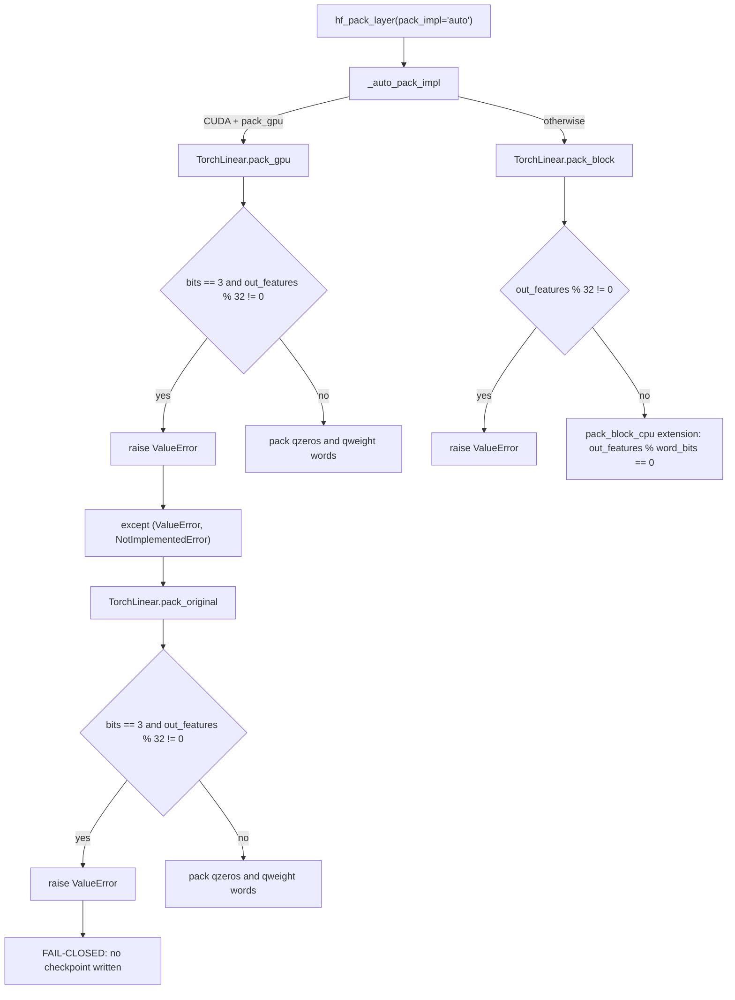

# 3-bit zero-point packing width contract

The 3-bit zero-point layout packs 32 code columns into three 32-bit words
(10-1-10-1-10). It cannot represent a partial trailing group, so
`out_features % 32 != 0` is not a supported width. `pack_gpu` used to drop the
tail columns silently, producing `qzeros` with fewer columns than the buffer the
module registered. `pack_original` walked the same tail and raised `IndexError`.
Both now fail closed with `ValueError`, matching `pack_block` and the CPU
extension, so `hf_pack_layer(pack_impl="auto")` cannot write a truncated
checkpoint.

This page describes the width contract. It was introduced with PR #3981
(issue #3978).

## New flow

The four packers now agree on the accepted width: `pack_gpu`, `pack_block`,
`pack_original`, and the `pack_block_cpu` extension all require
`out_features % 32 == 0` for 3-bit packing.

## Before / after

| Packer | Before | After |
| --- | --- | --- |
| `pack_gpu` | `groups = zeros_int.shape[1] // word_bits` dropped the tail (`__init__.py:1834-1841` on main); K=128, N=48 produced `(4, 3)` instead of `(4, 5)` | Raises `ValueError` before writing any zero words |
| `pack_original` | The 3-bit fallback loop indexed past `zeros.shape[1]` (`__init__.py:1989` on main), raising `IndexError` | Raises `ValueError` with the same divisibility contract |
| `pack_block` | Already raised `ValueError` for `out_features % 32 != 0` (`__init__.py:1502-1505` on main) | Unchanged |
| `pack_block_cpu` | Already required `out_features % word_bits == 0` (`pack_block_cpu.cpp:48-51` on main) | Unchanged |
| `hf_pack_layer(pack_impl="auto")` | GPU path returned a truncated `qzeros`; the later dequant failed with `shape '[k, 48]' is invalid` or a truncated checkpoint was written | GPU `ValueError` falls through to `pack_original`, which raises `ValueError`; no checkpoint is emitted |

## Failure contract

`pack_gpu` no longer converts an unsupported width into a silently smaller
tensor. The exception is a `ValueError`, which `hf_pack_layer` already handles
for the GPU-to-CPU fallback; when the CPU packer also rejects the width, the
error propagates to the caller instead of producing a checkpoint that cannot be
loaded.
