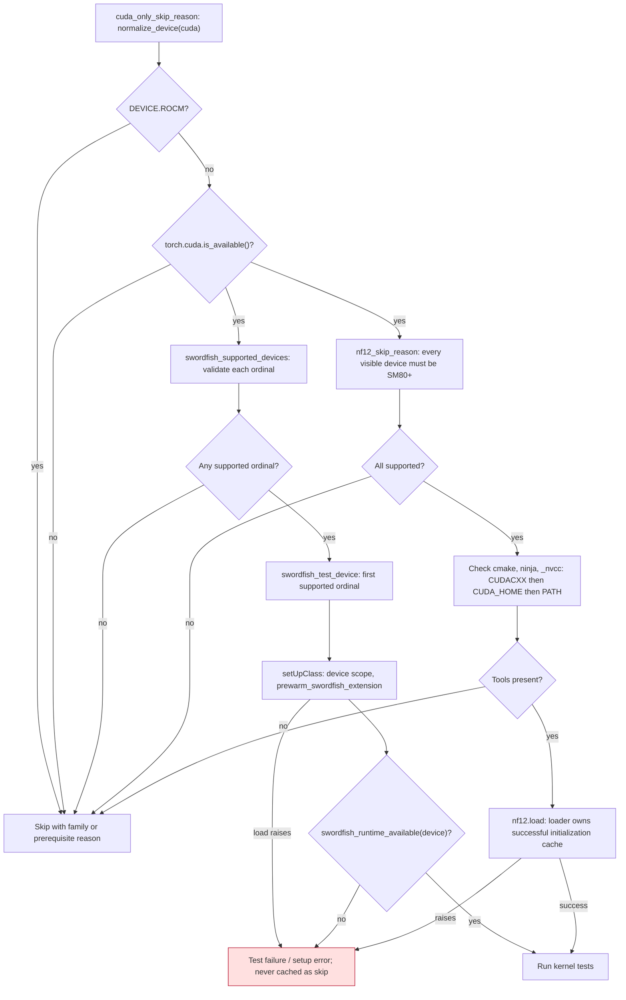
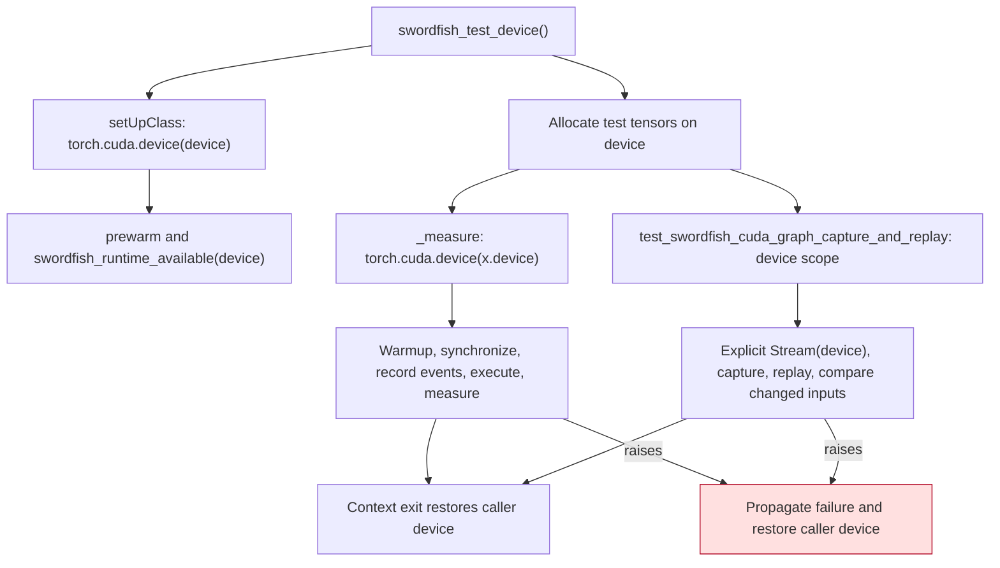

<!-- SPDX-FileCopyrightText: 2026 ModelCloud.ai -->
<!-- SPDX-License-Identifier: Apache-2.0 -->

# Accelerator test gates

GPT-QModel's CUDA-only kernel tests distinguish unsupported hardware and missing
build prerequisites from regressions in a supported runtime. The shared gates
live in `tests/accelerator_gates.py`. Family decisions use `normalize_device`;
HIP's `cuda` namespace must not be interpreted as NVIDIA compute capability.

## Gate and failure flow

A failed or ambiguous Swordfish device-validation probe is ineligible; the
explicit-device gate reports the exception, and a sweep excludes that ordinal.
NF12 treats an unreadable capability as ineligible. These eligibility checks
happen before loading. Once eligible, compiler, source, registration and runtime
load failures propagate. Missing NF12 build executables remain an explicit skip;
a present but incompatible toolchain produces a failure with its diagnostic.

## Keeping execution on the selected device

Selecting a tensor device does not move the thread's current device. CUDA events
and the default graph capture stream must belong to the device doing the work.
The graph test supplies an explicit `torch.cuda.Stream(device=device)` because
PyTorch can reuse a process-wide default capture stream from an earlier test on
another device. The separate cross-device Swordfish kernel test deliberately keeps a different
current device to verify that production execution follows its tensors.

## Before and after

The before pointers refer to commit `d68031262` in PR #3805.

| Before: evidence and behavior | After |
| --- | --- |
| `tests/accelerator_gates.py:161`: every NF12 load exception cached as a skip | `nf12_skip_reason` lets errors propagate; `nf12.load` owns successful caching |
| `tests/accelerator_gates.py:126`: compiler lookup ignored `CUDACXX` | `_nvcc` follows the JIT's compiler-override precedence |
| `tests/kernels/test_swordfish.py:233`, `test_swordfish_speed.py:101`, `test_swordfish_speed_deepseek_v4.py:136`: runtime checks used the current device, and setup errors became skips | All three `setUpClass` methods scope prewarm to the selected device, validate that explicit target, and propagate errors |
| `tests/kernels/test_swordfish_speed.py:106`, `test_swordfish_speed_deepseek_v4.py:111`: timing events used the current device | Both `_measure` functions scope warmup and timing to `x.device` |
| `tests/kernels/test_swordfish.py:449`: default graph stream could belong to another device | Warmup, capture and replay share the selected device scope and an explicit capture stream |

## Validation contract

`tests/test_accelerator_gates.py` covers family rejection before NVIDIA capability
queries, ordinal selection, missing tools, `CUDACXX` precedence and propagated
NF12 build failures. `tests/test_swordfish_test_devices.py` checks all three
setup consumers and runs timing and graph tests on a non-current CUDA device.
The graph test changes its inputs between replays; the timing tests check that
the measured operation sees its input device and that the caller is restored.

The harness tests use a small Torch operation instead of a Swordfish kernel.
They establish device-context behavior, not Swordfish numerical correctness.
No kernel math, inference dispatch, weight storage or threaded call site changes.

Measured on 2026-11-13 with the GIL disabled:

| Check | Result |
| --- | --- |
| New regression cases applied to `d68031262` | 12 failed |
| Full targeted suite, CUDA | 92 passed, 14 skipped |
| Full targeted suite, ROCm | 22 passed, 84 skipped |
| Ruff on the seven targeted Python files | Passed |

The full set comprises `test_accelerator_gates.py`,
`test_swordfish_test_devices.py`, the three Swordfish suites and
`test_gptqmodel_nf12_api.py`. Native Swordfish execution was architecture-skipped
and remains unvalidated in this run. NF12 native CUDA tests executed; ROCm skips
are intentional for these CUDA-only suites.

Introduced with [PR #3805](https://github.com/ModelCloud/GPTQModel/pull/3805).
