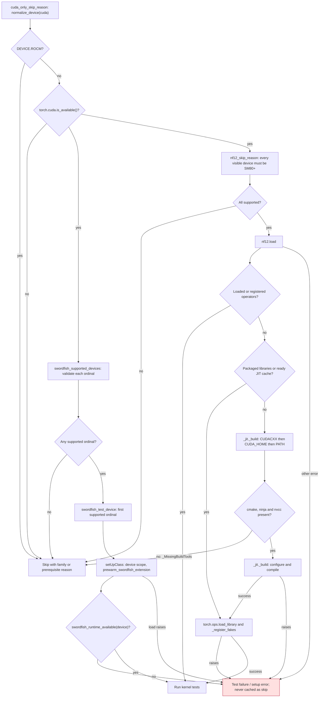
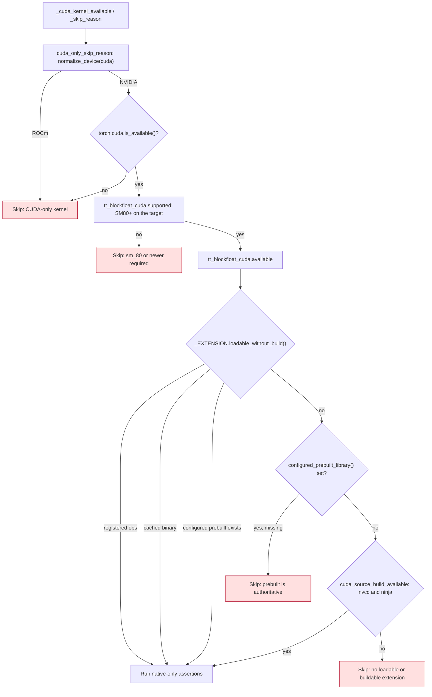
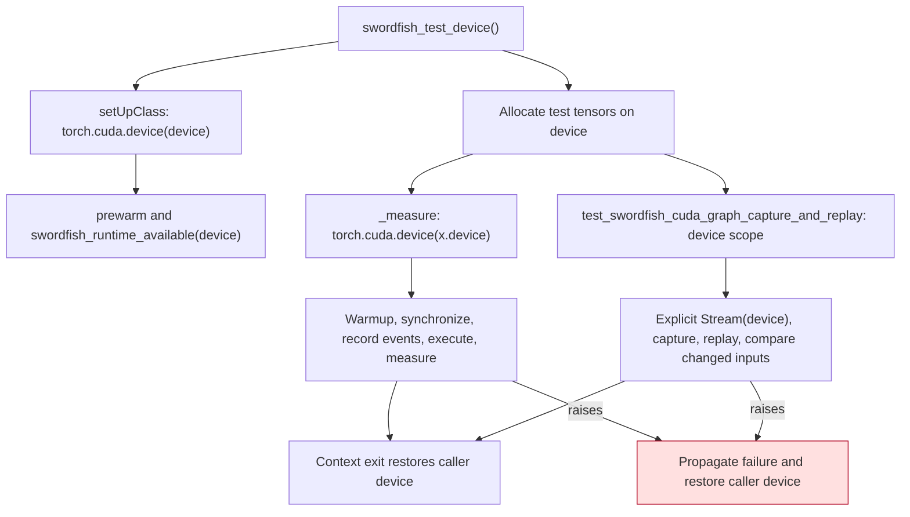

<!-- SPDX-FileCopyrightText: 2026 ModelCloud.ai -->
<!-- SPDX-License-Identifier: Apache-2.0 -->

# Accelerator test gates

GPT-QModel's CUDA-only kernel tests distinguish unsupported hardware and missing
build prerequisites from regressions in a supported runtime. The shared gates
live in `tests/accelerator_gates.py`. Family decisions use `normalize_device`;
HIP's `cuda` namespace must not be interpreted as NVIDIA compute capability.
The Tenstorrent block-float CUDA suite also gates on the native extension's own
capability probe, `gptqmodel.utils.tt_blockfloat_cuda.available`, because an
SM80+ device is not by itself evidence that the JIT extension can load.

## Gate and failure flow



A failed or ambiguous Swordfish device-validation probe is ineligible; the
explicit-device gate reports the exception, and a sweep excludes that ordinal.
NF12 treats an unreadable capability as ineligible. These eligibility checks
happen before loading. Once eligible, compiler, source, registration and runtime
load failures propagate. `nf12.load` first reuses loaded or registered operators,
packaged libraries, or a ready JIT cache. Compiler tools are required only on a
source-build cache miss. `_jit._build` reports missing executables through the
private `_MissingBuildTools` exception, which alone becomes a prerequisite skip.
A present but incompatible compiler, corrupt binary or failed registration
produces a failure with its diagnostic, even if build tools are absent.

## TT block-float native availability



`loadable_without_build` mirrors the pre-build stages of `TorchOpsJitExtension.load`:
registered `torch.ops`, a cached binary under `build_root()`, or an existing
configured prebuilt library. A configured prebuilt library is authoritative —
`load()` never falls back to a source build when one is set — so a missing file
means unavailable, not "build it instead". Only a cache miss consults
`cuda_source_build_available`, which reports whether `nvcc` and `ninja` exist for
torch's JIT. `available` never compiles; `prewarm`/`ready` still own the build.
The dense fallback precision tests in `test_tt_blockfloat_precision.py` are not
gated, so a toolkit-less host keeps validating the reference path.

## Keeping execution on the selected device



Selecting a tensor device does not move the thread's current device. CUDA events
and the default graph capture stream must belong to the device doing the work.
The graph test supplies an explicit `torch.cuda.Stream(device=device)` because
PyTorch can reuse a process-wide default capture stream from an earlier test on
another device. The separate cross-device Swordfish kernel test deliberately keeps a different
current device to verify that production execution follows its tensors.

## Before and after

The before pointers refer to commit `d68031262` in PR #3805 unless marked
`715a36e36`.

| Before: evidence and behavior | After |
| --- | --- |
| `tests/accelerator_gates.py:161`: every NF12 load exception cached as a skip | `nf12_skip_reason` lets errors propagate; `nf12.load` owns successful caching |
| `tests/accelerator_gates.py:126`: compiler lookup ignored `CUDACXX` | The source builder owns compiler lookup and honors its compiler-override precedence |
| `715a36e36`, `tests/accelerator_gates.py:151`: unconditional build-tool checks skipped usable runtimes and hid binary-load failures | `nf12.load` reuses available runtimes; only `_jit._build` raising `_MissingBuildTools` yields a tool-related skip, without duplicating compiler lookup |
| `tests/kernels/test_swordfish.py:233`, `test_swordfish_speed.py:101`, `test_swordfish_speed_deepseek_v4.py:136`: runtime checks used the current device, and setup errors became skips | All three `setUpClass` methods scope prewarm to the selected device, validate that explicit target, and propagate errors |
| `tests/kernels/test_swordfish_speed.py:106`, `test_swordfish_speed_deepseek_v4.py:111`: timing events used the current device | Both `_measure` functions scope warmup and timing to `x.device` |
| `tests/kernels/test_swordfish.py:449`: default graph stream could belong to another device | Warmup, capture and replay share the selected device scope and an explicit capture stream |
| `tests/test_tt_blockfloat_precision.py:70` and `tests/test_tt_blockfloat_cuda.py:32`: native tests admitted on `bf_cuda.supported()` alone, which only reads the SM architecture | `tt_blockfloat_cuda.available()` admits the native assertions only for registered ops, a cached/configured prebuilt binary, or a present `nvcc`/`ninja` toolchain |

## Validation contract

`tests/test_accelerator_gates.py` covers family rejection before NVIDIA capability
queries, ordinal selection, missing tools, the source builder's `CUDACXX`
precedence and propagated NF12 build failures. It also covers loaded and
registered operators, packaged libraries and ready JIT caches with no compiler
lookup, plus binary-load failures with missing tools. A native regression in
`tests/test_gptqmodel_nf12_api.py` runs NF12 linear after tool lookup is disabled.
`tests/test_swordfish_test_devices.py` checks all three
setup consumers and runs timing and graph tests on a non-current CUDA device.
The graph test changes its inputs between replays; the timing tests check that
the measured operation sees its input device and that the caller is restored.
`tests/test_tt_blockfloat_cuda_availability.py` covers a supported SM with no
loadable or buildable extension, a cached/registered extension without tools, a
missing configured prebuilt, and the `nvcc`/`ninja` probe. It also runs both
test-module gates and the dense fallback precision assertions under a simulated
toolkit-less host.

The harness tests use a small Torch operation instead of a Swordfish kernel.
They establish device-context behavior, not Swordfish numerical correctness.
The source builder adds a private exception type for its existing missing-tools
error. Kernel math, inference dispatch, weight storage and threaded call sites
are unchanged.

Measured on 2026-11-13 with the GIL disabled:

| Check | Result |
| --- | --- |
| New regression cases applied to `d68031262` | 12 failed |
| NF12 runtime regressions applied to `715a36e36` | 7 failed |
| TT block-float availability regressions applied to `757b7c2f` | 10 failed |
| Full targeted suite, CUDA | 100 passed, 14 skipped |
| Full targeted suite, ROCm | 29 passed, 85 skipped |
| Ruff on the eight targeted Python files | Passed |

The full set comprises `test_accelerator_gates.py`,
`test_swordfish_test_devices.py`, the three Swordfish suites and
`test_gptqmodel_nf12_api.py`. Native Swordfish execution was architecture-skipped
and remains unvalidated in this run. NF12 native CUDA tests executed; ROCm skips
are intentional for these CUDA-only suites.

Validation command, run separately with each runtime:

```bash
PYTHON_GIL=0 python -m pytest -q tests/test_accelerator_gates.py \
  tests/test_swordfish_test_devices.py tests/kernels/test_swordfish.py \
  tests/kernels/test_swordfish_speed.py tests/kernels/test_swordfish_speed_deepseek_v4.py \
  tests/test_gptqmodel_nf12_api.py
```

Introduced with [PR #3805](https://github.com/ModelCloud/GPTQModel/pull/3805).
