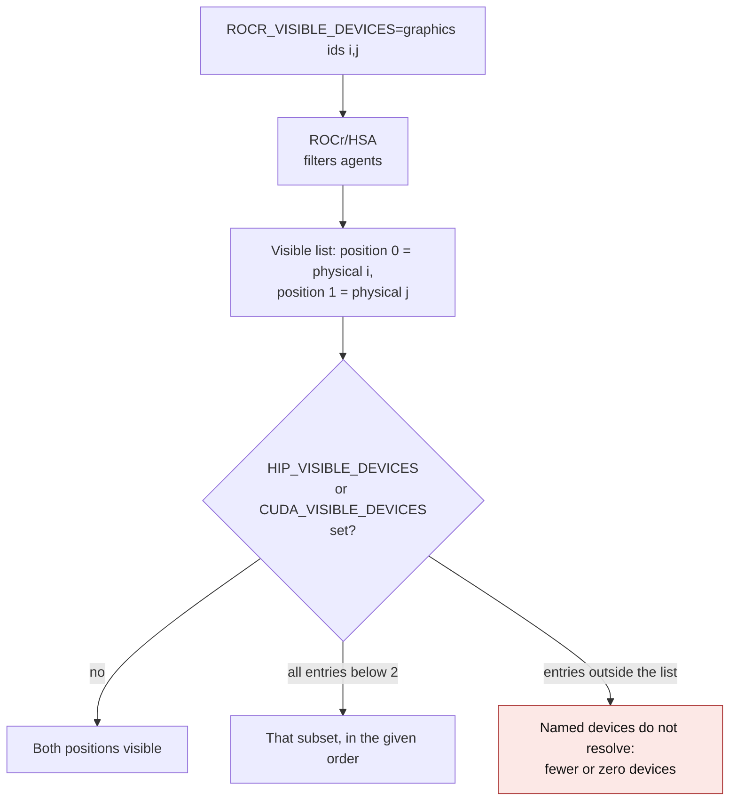
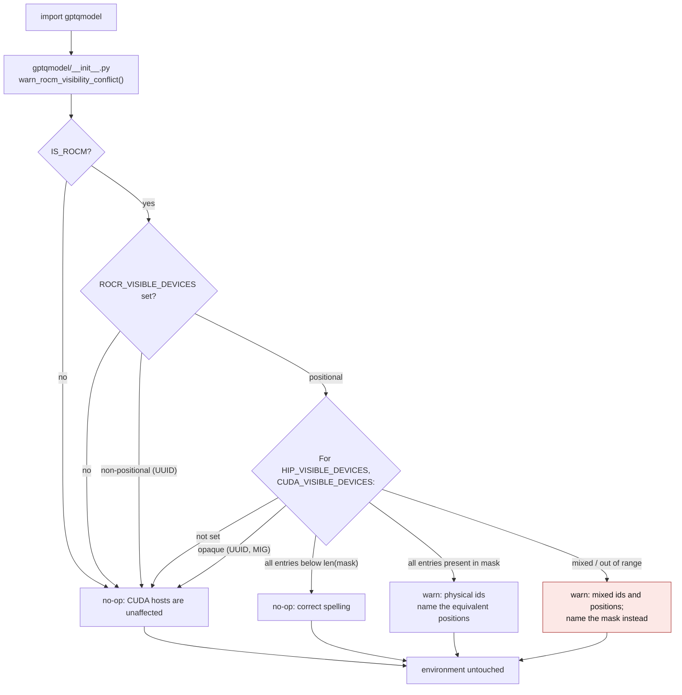

<!-- SPDX-FileCopyrightText: 2026 ModelCloud.ai
SPDX-License-Identifier: Apache-2.0 -->

# Accelerator visibility environment

GPT-QModel reads the caller's device isolation variables and never edits them.
This page states what the variables mean, what the package does with them, and
why importing must not normalize them. Reference implementation:
`check_rocm_visibility()` and `warn_rocm_visibility_conflict()` in
`gptqmodel/utils/rocm.py`, called once from `gptqmodel/__init__.py`.

Throughout this page the mask is written symbolically: `ROCR_VISIBLE_DEVICES`
holds physical device ids `i,j`, and HIP exposes them as positions `0` and `1`.
Any concrete numbers are examples, not part of the contract.

## Why the variables interact

On a ROCm host, `ROCR_VISIBLE_DEVICES` is the ROCr/HSA **hardware mask**. HIP
enumerates agents through that mask first, and only then resolves
`HIP_VISIBLE_DEVICES` / `CUDA_VISIBLE_DEVICES` as **positions** in the filtered
list. Torch's own `cuda` namespace is the HIP runtime, so `cuda:0` means
position 0 of the filtered list, never physical GPU 0.



| Environment (symbolic) | Visible devices | Note |
| --- | --- | --- |
| `ROCR_VISIBLE_DEVICES=i,j` | 2 | filtered list |
| `ROCR_VISIBLE_DEVICES=i,j`, `CUDA_VISIBLE_DEVICES=0,1` | 2 | documented spelling |
| `ROCR_VISIBLE_DEVICES=i,j`, `CUDA_VISIBLE_DEVICES=i,j` | 0 | `i`/`j` are read as positions |
| `ROCR_VISIBLE_DEVICES=i,j`, `CUDA_VISIBLE_DEVICES=0,i` | 1 | `i` does not resolve, `0` does |
| `ROCR_VISIBLE_DEVICES=i,j`, `HIP_VISIBLE_DEVICES=1` | 1 | second masked device |
| `ROCR_VISIBLE_DEVICES` removed, `CUDA_VISIBLE_DEVICES=i,j` | 2 | now physical ids |

The last row is the whole problem: with the mask gone, the same
`CUDA_VISIBLE_DEVICES` value names different physical devices.

## The removed mechanism

`gptqmodel/models/auto.py` used to do this during import:

```python
if 'CUDA_VISIBLE_DEVICES' in os.environ and 'ROCR_VISIBLE_DEVICES' in os.environ:
    del os.environ['ROCR_VISIBLE_DEVICES']
```

| Mechanism | Before | After |
| --- | --- | --- |
| Hardware mask (`auto.py:37-39`) | deleted whenever `CUDA_VISIBLE_DEVICES` was set | never modified |
| Process device set | widened past the caller's mask, or already fixed if HIP had initialized | unchanged |
| Child processes | inherited the widened environment | inherit the caller's mask |
| Unresolvable selection | silently reinterpreted as physical ids | reported, never rewritten |

The deletion is not a no-op even when the current process has already
initialized HIP: `os.environ` is the template every child process inherits, so
the child runs without the caller's hardware mask. It also fired for UUID/MIG
form masks and on non-ROCm hosts, where the variable is meaningful to nobody.

## What the package does now



Every branch is read-only. Reporting instead of rewriting is the contract:
neither variable belongs to the library, and choosing a winner would change
which physical GPUs run.

The check does not need to run before device enumeration, because it only reads
the environment. It is called next to `warn_unsupported_rocm()` so both ROCm
diagnostics share one import-time entry point.

### Failure and ambiguity contract

| Situation | Behavior |
| --- | --- |
| Not ROCm | No-op. NVIDIA hosts never see this path. |
| `ROCR_VISIBLE_DEVICES` unset | No-op. |
| Mask is not a positional list (UUID) | No-op; nothing positional to resolve against. |
| Relative selection inside the mask | No-op; this is the documented spelling. |
| Physical ids that are all in the mask | Warns with the equivalent positions. |
| Mixed or out-of-range selection | Warns as mixed; nothing is rewritten. |
| `HIP_VISIBLE_DEVICES` and `CUDA_VISIBLE_DEVICES` disagree | Not diagnosed here: HIP aborts inside its own agent enumeration, before this check can run. |

## Correct spellings

Reference the mask and use positions inside it:

```bash
ROCR_VISIBLE_DEVICES=i,j CUDA_VISIBLE_DEVICES=0,1 python quantize.py
```

Or name only the mask, and let every visible device through:

```bash
ROCR_VISIBLE_DEVICES=i,j python quantize.py
```

Do not pass physical ids to `CUDA_VISIBLE_DEVICES` while the mask is set. If a
selection must name physical devices, express it in the mask and use positions
in `CUDA_VISIBLE_DEVICES`.

## Tests

`tests/test_accelerator_visibility.py` pins each row above with synthetic
values, asserts the check never mutates `os.environ`, and runs subprocess
imports to confirm both that the environment survives `import gptqmodel` and
that a child process inherits the caller's mask. The reported regression (a
two-entry mask with `CUDA_VISIBLE_DEVICES=0,1` losing the mask) is covered end
to end. The tests never open a device.
