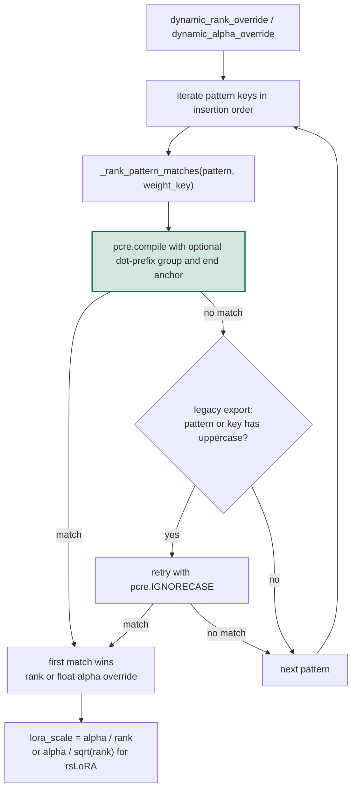

# LoRA adapter pattern matching

`adapter_config.json` can override the base rank and alpha per module through
`rank_pattern` and `alpha_pattern`. PEFT resolves both with one rule
(`peft.utils.other.get_pattern_key` in PEFT 0.21.2):

```text
re.match(r"(.*\.)?(<pattern>)$", module_name)
```

The optional group must end at a dot, so a bare suffix such as `q_proj` only
selects a module whose final segment is `q_proj`. GPT-QModel previously used
`endswith` without a dot boundary plus an unanchored `re.search`, which
selected extra modules and changed their LoRA scale by 8x.

## Matching flow



The case-insensitive retry is only for legacy GPT-QModel exports that
lowercased module names. It never rewrites the pattern, so regex escapes such
as `\S`, `\D`, and `\W` keep their meaning.

## Before and after

| Mechanism | Before (origin/main) | After |
| --- | --- | --- |
| Suffix match | `weight_key == pattern or weight_key.endswith(pattern)`, `gptqmodel/adapter/adapter.py:42` | `re.match(r"(.*\.)?(pattern)$", name)`, `gptqmodel/adapter/adapter.py:27` |
| Regex fallback | unanchored `pcre.compile(pattern).search(name)`, `gptqmodel/adapter/adapter.py:44` | anchored `.match(name)` with the same rule |
| First-match order | insertion order | unchanged, insertion order |
| Legacy case folding | lowercased pattern and name before literal checks | `pcre.IGNORECASE` on the unchanged pattern |
| Float alpha | `assert isinstance(override, int)` raised in `post_init`, `gptqmodel/adapter/adapter.py:392` | `numbers.Real` check and `float(override)`, `gptqmodel/adapter/adapter.py:380` |

### Measured effect

Base rank 8, base alpha 8, pattern alpha 64. "Before" is the origin/main
matcher; "PEFT" is `peft.utils.other.get_pattern_key` from PEFT 0.21.2 on the
same adapter configs. Scales are `alpha / rank`.

| Pattern | Module | Before | PEFT | After |
| --- | --- | --- | --- | --- |
| `1.self_attn.q_proj` | `model.layers.1.self_attn.q_proj` | 8.0 | 8.0 | 8.0 |
| `1.self_attn.q_proj` | `model.layers.10.self_attn.q_proj` | 1.0 | 1.0 | 1.0 |
| `1.self_attn.q_proj` | `model.layers.11.self_attn.q_proj` | 8.0 | 1.0 | 1.0 |
| `model.layers.1` | `model.layers.1.self_attn.q_proj` | 8.0 | 1.0 | 1.0 |
| `model.layers.1` | `model.layers.10.self_attn.q_proj` | 8.0 | 1.0 | 1.0 |
| `model.layers.1` | `model.layers.11.self_attn.q_proj` | 8.0 | 1.0 | 1.0 |
| `up_proj` | `model.layers.0.mlp.gate_up_proj` | 8.0 | 1.0 | 1.0 |
| `up_proj` | `model.layers.0.mlp.up_proj` | 8.0 | 8.0 | 8.0 |
| `up_proj` | `model.layers.0.mlp.down_proj` | 1.0 | 1.0 | 1.0 |

After the fix every per-module scale matches PEFT exactly (delta 0.0). A
`"alpha_pattern": {"module": 4.0}` config loads with scale 0.5, matching PEFT;
the origin/main `assert isinstance(override, int)` raised `AssertionError`.

## Contracts

- Pattern keys are PEFT patterns, not globs. The optional `(.*\.)?` prefix
  provides the dot boundary; there is no separate suffix shortcut.
- First match in config order wins, for rank and alpha independently.
- `rank_pattern` values remain positive integers; `alpha_pattern` values are
  positive real numbers and are converted with `float()`.
- The case-insensitive retry is a legacy-export compatibility path, not a
  second matching rule.

The regression coverage is in `tests/test_adapter_config.py` and
`tests/test_adapter_scaling.py`:
`test_alpha_pattern_matches_peft_dot_boundary` and
`test_float_alpha_pattern_loads_with_peft_scale`.
