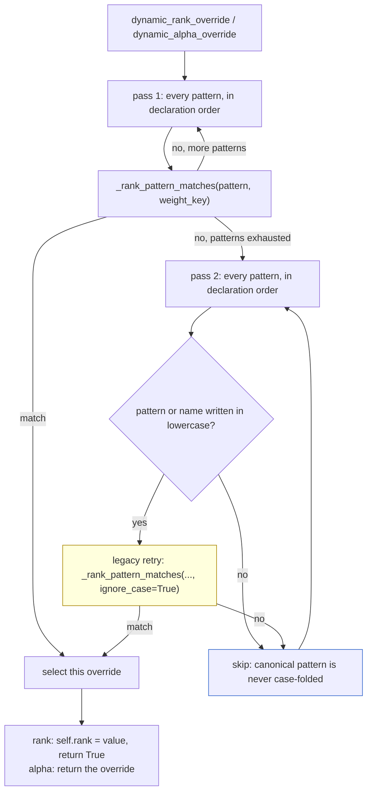
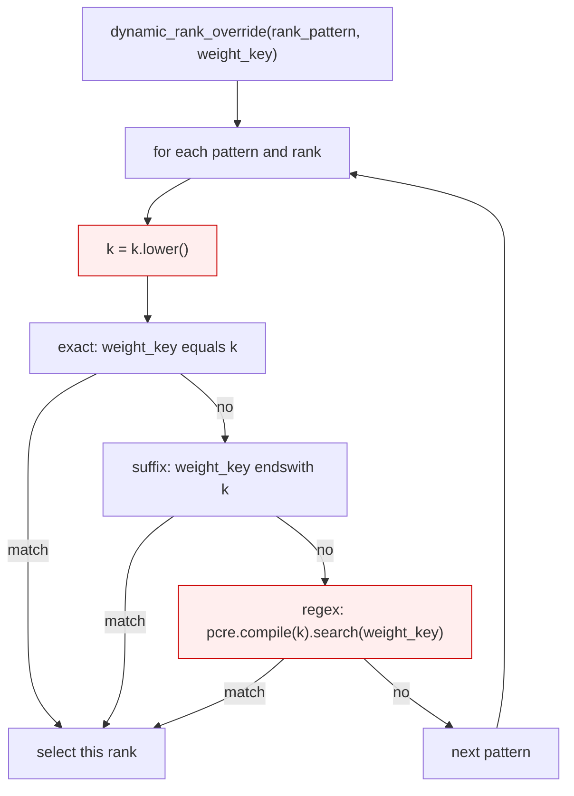
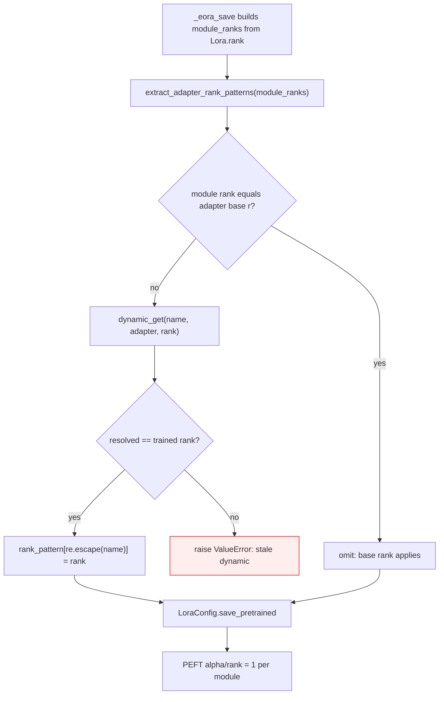

<!-- SPDX-FileCopyrightText: 2026 ModelCloud.ai -->
<!-- SPDX-License-Identifier: Apache-2.0 -->

# Adapter rank-pattern matching

A PEFT adapter can declare a per-module rank through `LoraConfig.rank_pattern`.
GPT-QModel applies that override when it binds an adapter to a quantized module,
so the pattern has to select the same module that PEFT would. Module names are
canonical and case-sensitive (MPT's `Wqkv`, Baichuan's `W_pack`), and the pattern
is a small pattern language, not just a name: it may be a full module name, a
suffix, or a regular expression.

The matcher therefore compares the pattern exactly as written. It never folds
the pattern text, because folding changes more than letter case.

## New flow



Both passes walk the patterns in declaration order, so the result is PEFT's
first-match rule for canonical payloads. The case-insensitive retry is a
separate pass rather than a per-pattern fallback: trying it inside pass 1 let
an earlier lowercase rule capture a later rule's canonical mixed-case module
(`alpha_pattern={"proj": 8, "Proj": 2}` applied 8 to `block.Proj`, where PEFT
applies 2 — #5422). The yellow node is still the only case-folding step, it
still only runs when one of the two strings is written in lowercase, and it
still passes the pattern text to the engine unchanged, so `\S`, `\D`, and
`\W` keep their meaning.

`_rank_pattern_matches` (`gptqmodel/adapter/adapter.py:28`) owns the match
test, `_pattern_override_candidates` owns the two-pass order, and
`dynamic_rank_override` / `dynamic_alpha_override` consume the resulting
candidate list.

## Previous flow



| Mechanism at `origin/main` (`8ecc2952`) | Location | Consequence |
| --- | --- | --- |
| `k = k.lower()` before any check | `gptqmodel/adapter/adapter.py:306` | A canonical `Wqkv` pattern became `wqkv` and stopped matching `transformer.blocks.0.attn.Wqkv` |
| Lowercased regex source | `gptqmodel/adapter/adapter.py:312` | `\S` became `\s`, `\D` became `\d`, `\W` became `\w`: the opposite character class |
| No case-insensitive fallback | `gptqmodel/adapter/adapter.py:308-315` | Legacy lowercase exports matched only by accident, because their names were already lowercase |

The lowercase step was introduced before #3874 preserved canonical module
names. While names were lowercased it was harmless; after #3874 it silently
missed exactly the mixed-case modules the export path had just fixed.

## EoRA rank-pattern export

`dynamic` picks the **first** matching rule for a module, while PEFT applies
every `rank_pattern` key independently with `(.*\.)?(key)$`. Exporting the
`dynamic` rules verbatim therefore does not describe the ranks that were
trained.



Each exported key is the escaped full module name. `re.escape` is enough
because PEFT's optional `(.*\.)?` prefix anchors the match at a dot boundary;
adding `^` would disable that prefix, and the adapter weights are keyed as
`base_model.model.<name>`.

| Situation | Before | After |
| --- | --- | --- |
| Earlier rule without an adapter rank shadows a later one | verbatim rule exported, PEFT selects the wrong rank | rank comes from the trained `Lora.rank` |
| Prefix rule `model\.layers\.1\.` | key exported, PEFT matches nothing | exact per-module key |
| Two rules that both match one module | both keys exported, PEFT takes the first | one key per module |
| Module trained at the base rank | no entry (unchanged) | no entry |
| Trained rank differs from `dynamic_get` | silently wrong export | `ValueError` |
| `dynamic` has no adapter rank rule | `{}` | `{}` (unchanged) |

Rank-pattern resolution lives in
`gptqmodel/quantization/config.py::extract_adapter_rank_patterns`;
`_exact_rank_pattern` (`:3276`) owns the key encoding;
`_eora_save` (`gptqmodel/models/writer.py:1946`) supplies the trained ranks.

## Failure and ambiguity contract

| Situation | Before | After |
| --- | --- | --- |
| `Wqkv` pattern, `...attn.Wqkv` name | no match, rank stays base | match |
| `\S+\.q_proj$` pattern, lowercase name | no match (`\s` needs whitespace) | match |
| `\D+\.q_proj$` pattern, name containing digits | no match (`\d` needs a digit) | match |
| `\W+q_proj$` pattern | no match (`\w` needs word chars) | match |
| `\d+\.q_proj$` pattern, name with no digit before `.q_proj` | no match | no match (unchanged) |
| `q_proj` / `q_proj$` / full name, lowercase name | match | match (unchanged) |
| `v_proj$` pattern, `q_proj` name | no match | no match (unchanged) |
| `Wqkv` pattern, legacy `...attn.wqkv` name | no match | match via the legacy retry |
| `wqkv` pattern, canonical `...attn.Wqkv` name | no match | match via the legacy retry |
| Invalid regex pattern | `pcre.compile` raises | `pcre.compile` raises (unchanged) |
| Trained rank shadowed by an earlier rule (#4199) | wrong PEFT rank, shape mismatch on load | exported rank equals the trained rank |
| Trained rank selected by a prefix rule (#4199) | key never matches, PEFT uses base rank | exact per-module key matches |

The legacy retry is fail-open by design: it can only turn a non-match into a
match, and it never changes the rank a canonical match already selected. A
genuinely non-matching escape still does not match, because only the engine's
case flag changes.

## Validation

| Test | Invariant |
| --- | --- |
| `tests/test_adapter_config.py::test_rank_pattern_matches_canonical_mixed_case_module_name` | `Wqkv`, `Wqkv$`, and the full name select a mixed-case module; `W_pack` too |
| `::test_rank_pattern_preserves_regex_escapes` | `\S`, `\D`, `\W` match as written; `\d` still does not |
| `::test_rank_pattern_legacy_lowercase_module_name` | Legacy lowercase names match in both directions |
| `::test_rank_pattern_mixed_case_regex_fallback_keeps_escapes` | The fallback keeps `\S` non-whitespace and `\s` still requires whitespace |
| `::test_rank_pattern_matches_short_suffix_and_regex` | #3873 behavior unchanged |
| `::test_rank_pattern_does_not_match_other_suffixes` | No false positives introduced |
| `tests/test_adapter_config.py::test_rank_pattern_export_uses_trained_rank_not_rule_text` | A shadowed rank is exported from the trained rank, not the rule text |
| `::test_rank_pattern_export_is_exact_for_prefix_rules` | Prefix rules become exact per-module keys that cannot spill into layer 11 |
| `::test_rank_pattern_export_requires_trained_ranks` | Missing trained ranks fail closed; unrelated `dynamic` rules export nothing |
| `::test_rank_pattern_export_rejects_stale_resolution` | A trained rank that `dynamic` no longer resolves is rejected |
| `tests/test_adapter_scaling.py::test_eora_export_rank_pattern_reproduces_first_match_dynamic` | Exported `rank_pattern`/`alpha_pattern` reproduce every trained rank, including the PEFT reload |

Measured on this host (torch 2.16.0.dev20261102+cu130, Python 3.14.10t):

| Command | Result |
| --- | --- |
| `pytest tests/test_adapter_config.py -q` | 12 passed |
| same file, matcher changes reverted | 4 failed, 8 deselected (the four new tests) |
| `pytest tests/test_adapter_case_sensitive.py tests/test_eora.py tests/test_adapter_remote_security.py -q` | 60 passed |
| `pytest tests/test_eora_weight_lifecycle.py tests/test_eora_merge.py -q` | 5 passed |
| `ruff check gptqmodel/adapter/adapter.py tests/test_adapter_config.py` | All checks passed |

Issue reproducer before and after:

```
before:  True False 8      (re.search matches, matcher does not)
         True False 8
after:   True True 16
         True True 16
```
