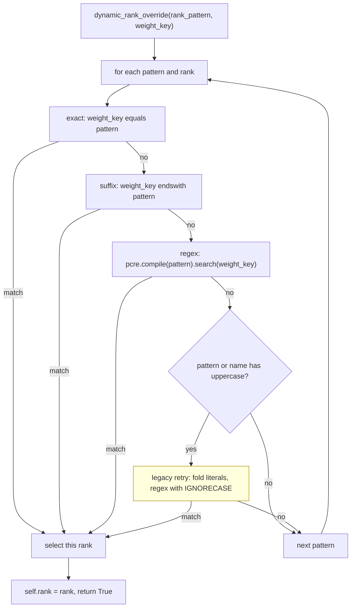
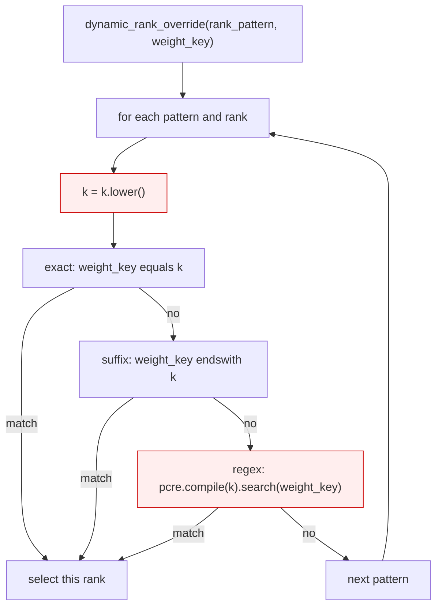

<!-- SPDX-FileCopyrightText: 2026 ModelCloud.ai -->
<!-- SPDX-License-Identifier: Apache-2.0 -->

# Adapter rank-pattern matching

A PEFT adapter can declare a per-module rank through `LoraConfig.rank_pattern`.
GPT-QModel applies that override when it binds an adapter to a quantized module,
so the pattern has to select the same module that PEFT would. Module names are
canonical and case-sensitive (MPT's `Wqkv`, Baichuan's `W_pack`), and the pattern
is a small pattern language, not just a name: it may be a full module name, a
suffix, or a regular expression.

The matcher therefore compares the pattern exactly as written. It never folds
the pattern text, because folding changes more than letter case.

## New flow



The yellow node is the only case-folding step, and it is a separate fallback:
it runs only after the exact spelling fails, and only when one of the two
strings actually contains an uppercase letter. It folds the two literal
comparisons and passes `pcre.IGNORECASE` to the regex engine; the pattern
string itself is handed to the engine unchanged, so `\S`, `\D`, and `\W` keep
their meaning.

`_rank_pattern_matches` (`gptqmodel/adapter/adapter.py:26`) owns the three
checks; `dynamic_rank_override` (`:325`) owns the ordering and the fallback.

## Previous flow



| Mechanism at `origin/main` (`8ecc2952`) | Location | Consequence |
| --- | --- | --- |
| `k = k.lower()` before any check | `gptqmodel/adapter/adapter.py:306` | A canonical `Wqkv` pattern became `wqkv` and stopped matching `transformer.blocks.0.attn.Wqkv` |
| Lowercased regex source | `gptqmodel/adapter/adapter.py:312` | `\S` became `\s`, `\D` became `\d`, `\W` became `\w`: the opposite character class |
| No case-insensitive fallback | `gptqmodel/adapter/adapter.py:308-315` | Legacy lowercase exports matched only by accident, because their names were already lowercase |

The lowercase step was introduced before #3874 preserved canonical module
names. While names were lowercased it was harmless; after #3874 it silently
missed exactly the mixed-case modules the export path had just fixed.

## Failure and ambiguity contract

| Situation | Before | After |
| --- | --- | --- |
| `Wqkv` pattern, `...attn.Wqkv` name | no match, rank stays base | match |
| `\S+\.q_proj$` pattern, lowercase name | no match (`\s` needs whitespace) | match |
| `\D+\.q_proj$` pattern, name containing digits | no match (`\d` needs a digit) | match |
| `\W+q_proj$` pattern | no match (`\w` needs word chars) | match |
| `\d+\.q_proj$` pattern, name with no digit before `.q_proj` | no match | no match (unchanged) |
| `q_proj` / `q_proj$` / full name, lowercase name | match | match (unchanged) |
| `v_proj$` pattern, `q_proj` name | no match | no match (unchanged) |
| `Wqkv` pattern, legacy `...attn.wqkv` name | no match | match via the legacy retry |
| `wqkv` pattern, canonical `...attn.Wqkv` name | no match | match via the legacy retry |
| Invalid regex pattern | `pcre.compile` raises | `pcre.compile` raises (unchanged) |

The legacy retry is fail-open by design: it can only turn a non-match into a
match, and it never changes the rank a canonical match already selected. A
genuinely non-matching escape still does not match, because only the engine's
case flag changes.

## Validation

| Test | Invariant |
| --- | --- |
| `tests/test_adapter_config.py::test_rank_pattern_matches_canonical_mixed_case_module_name` | `Wqkv`, `Wqkv$`, and the full name select a mixed-case module; `W_pack` too |
| `::test_rank_pattern_preserves_regex_escapes` | `\S`, `\D`, `\W` match as written; `\d` still does not |
| `::test_rank_pattern_legacy_lowercase_module_name` | Legacy lowercase names match in both directions |
| `::test_rank_pattern_mixed_case_regex_fallback_keeps_escapes` | The fallback keeps `\S` non-whitespace and `\s` still requires whitespace |
| `::test_rank_pattern_matches_short_suffix_and_regex` | #3873 behavior unchanged |
| `::test_rank_pattern_does_not_match_other_suffixes` | No false positives introduced |

Measured on this host (torch 2.16.0.dev20261102+cu130, Python 3.14.10t):

| Command | Result |
| --- | --- |
| `pytest tests/test_adapter_config.py -q` | 12 passed |
| same file, matcher changes reverted | 4 failed, 8 deselected (the four new tests) |
| `pytest tests/test_adapter_case_sensitive.py tests/test_eora.py tests/test_adapter_remote_security.py -q` | 60 passed |
| `pytest tests/test_eora_weight_lifecycle.py tests/test_eora_merge.py -q` | 5 passed |
| `ruff check gptqmodel/adapter/adapter.py tests/test_adapter_config.py` | All checks passed |

Issue reproducer before and after:

```
before:  True False 8      (re.search matches, matcher does not)
         True False 8
after:   True True 16
         True True 16
```
