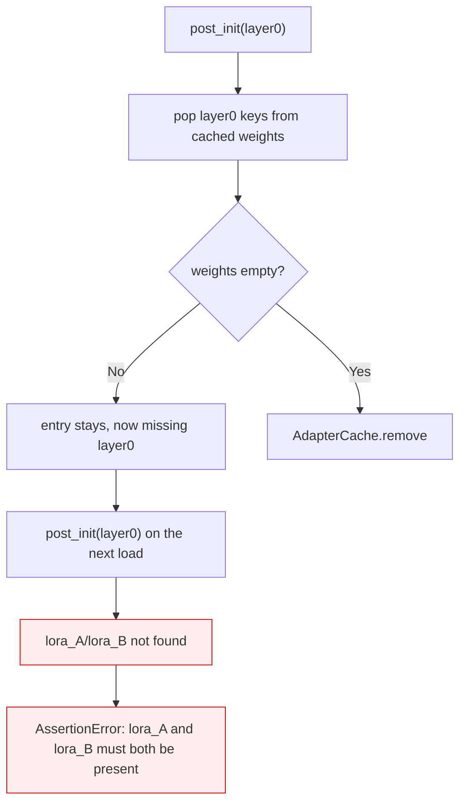

<!-- SPDX-FileCopyrightText: 2026 ModelCloud.ai -->
<!-- SPDX-License-Identifier: Apache-2.0 -->

# Adapter weight cache

LoRA adapter files are small but read from disk once per process. `AdapterCache`
(`gptqmodel/adapter/adapter.py`) keeps the parsed `LoraConfig` and the
safetensors tensors keyed by `(path, remote_revision, remote_sha256)`, so loading
several quantized layers of the same model does not re-read the adapter.

The cache is process-global, which makes *what a load is allowed to do to it* the
whole contract. One model load instantiates only the modules that exist in that
model, so a load legitimately consumes a subset of the adapter's target modules.
A cache entry therefore has to survive a partial load.

## Lifecycle

```mermaid
stateDiagram-v2
    [*] --> Absent
    Absent --> Cached: AdapterCache.add stores config, weights, empty consumed
    Cached --> Cached: post_init extracts A/B and records the keys in consumed
    Cached --> Cached: post_init for another module
    Cached --> Absent: consumed covers every cached weight
    Cached --> Absent: AdapterCache.reset
```

`post_init` reads the tensors it needs and records the key names in `consumed`.
It never deletes from the cached mapping. The entry is released when `consumed`
covers every cached weight — the same end state as before, reached without
destroying information another load may still need.

## Previous flow

| Mechanism | Previous behavior | New behavior |
| --- | --- | --- |
| `AdapterCache.add` | Stored `config` and `weights` | Also initialises a `consumed` set |
| `post_init` consumption | `lora_weights.pop(key)` for each consumed key | `AdapterCache.consume(cache_key, keys)` records the names |
| Release condition | `len(lora_weights) == 0` after popping | `consumed` covers every cached weight |
| Cached tensors after a partial load | Missing the consumed modules | Complete and unchanged |
| Second load of the same adapter | Failed when the first load used a subset | Finds every module |

## Failure and ambiguity contract

| Situation | Result |
| --- | --- |
| One load consumes every target module | Entry released, exactly as before |
| One load consumes a subset | Entry retained with all weights; the next load succeeds |
| Adapter has a module the model never instantiates | Entry stays cached (unchanged); it no longer breaks later loads |
| Interleaved loads of the same path | Each load finds the modules it asks for |
| `AdapterCache.reset()` | Still clears everything, including consumption state |
| Unknown module key | `log.warn` and the existing `AssertionError` (unchanged) |

Memory: the peak is unchanged because the whole adapter file is loaded up front
either way. The only difference is that the tensors are released when the entry
is dropped rather than incrementally as modules load.

## Validation

| Test | Invariant |
| --- | --- |
| `tests/test_adapter_cache_lifecycle.py::test_second_sequential_load_sees_the_modules_the_first_load_ignored` | The reported failure: two loads that each use only `layer0` |
| `::test_cached_source_weights_are_not_mutated_by_a_load` | The cached mapping still holds all four tensors after a load |
| `::test_a_later_load_can_consume_the_module_an_earlier_load_ignored` | `layer1` is still addressable after a load used `layer0` |
| `::test_interleaved_loads_keep_every_module_addressable` | Alternating modules across three adapters |
| `::test_fully_consumed_adapter_releases_the_cache_entry` | A full load still frees the entry |

Measured on CPU with torch 2.16.0.dev20261102+cu130:
`pytest tests/test_adapter_cache_lifecycle.py -q` reports 5 passed after the
change and 2 failed before it.
