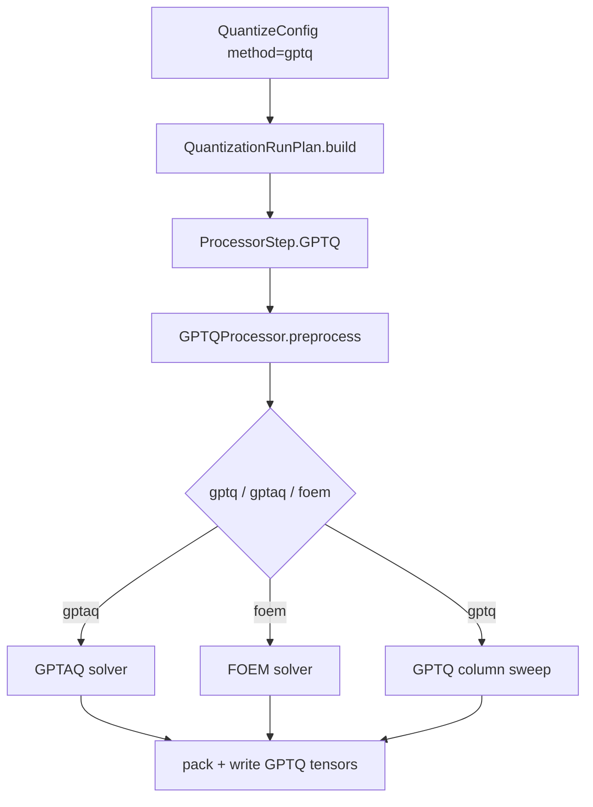
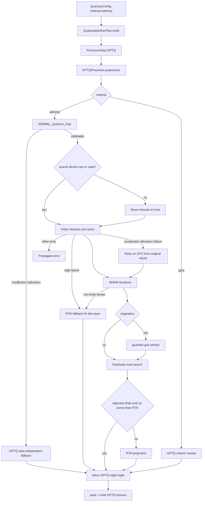
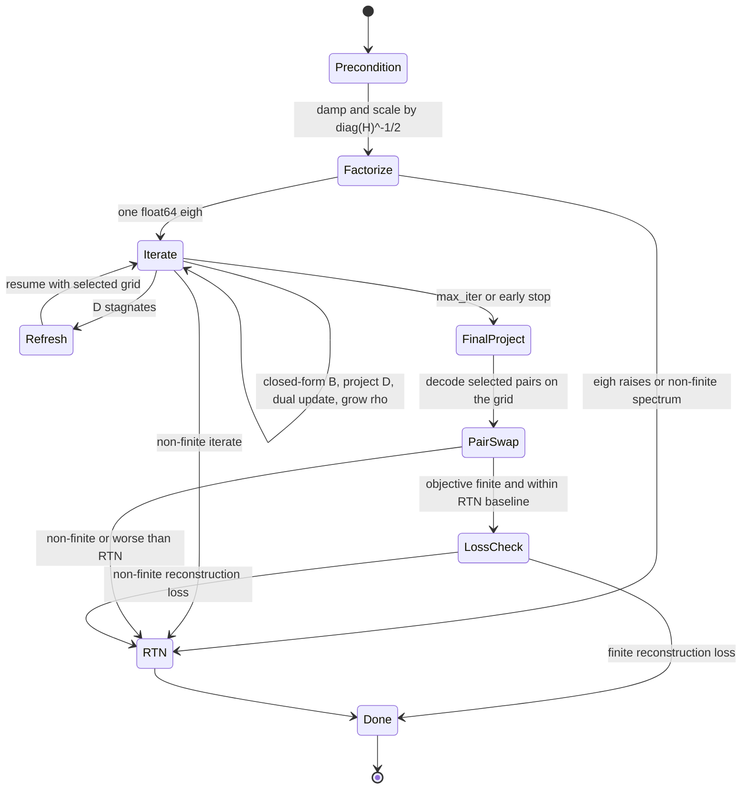

# ADMM-Q weight quantization

ADMM-Q is a calibrated, Hessian-based weight quantizer for post-training
quantization of large language models. It minimizes the same layer objective as
GPTQ and produces the same packed INT tensors, but replaces GPTQ's one-pass
column sweep with an ADMM split between a continuous Hessian-weighted update
and the discrete grid projection.

- Paper: [ADMM-Q: An Improved Hessian-based Weight Quantizer for Post-Training
  Quantization of Large Language Models](https://arxiv.org/abs/2605.11222) by
  Ryan Lucas, Mehdi Makni, Xiang Meng, Adam Deng, and Rahul Mazumder
  (COLM 2026).
- Reference implementation: [mazumder-lab/admm-q](https://github.com/mazumder-lab/admm-q).
- GPT-QModel implementation: `gptqmodel/quantization/admmq.py` (clean-room
  implementation from the paper's algorithm; no reference code is copied).

ADMM-Q is a drop-in replacement for the GPTQ weight solve. Rotation, smoothing,
fallback strategies, calibration capture and packing are shared with the GPTQ
family, so an ADMM-Q checkpoint is an ordinary GPTQ checkpoint.

## Objective

For one linear layer with weight `W` and calibration inputs `X`:

```
minimize  0.5 * tr((W - Wq) H (W - Wq)^T)
subject to Wq ∈ G, the per-group quantization grid
H = X^T X + damp_percent * mean(diag(X^T X)) * I
```

`H` is the layer Hessian up to a constant. The grid is fitted per group with the
same scale and zero-point search GPTQ uses, including the MSE shrink search
when it is enabled. The search is on by default for 2-3 bit models and off for
4-8 bit models; an explicit `mse` setting overrides that.

## Algorithm

`ADMMQ` subclasses `GPTQ` and overrides only the weight solve, so Hessian
capture, dead-column neutralization, tensor-parallel padding, dtype narrowing
and replay stay on the GPTQ contract. With `hessian.dedup_shared_inputs`
enabled, projections in the same subset share a capture when their inputs
are explicitly shared and their capture settings match. Each solver receives
its own Hessian for damping and activation ordering.

1. Damp `H` once and precondition it by its diagonal:
   `Sigma = diag(H)^(-1/2)`, `H' = Sigma H Sigma`, `W' = W Sigma^(-1)`.
2. Factorize `H'` once with a float64 symmetric eigendecomposition
   (`H' = Q Lambda Q^T`). The iteration runs in the weight dtype.
3. Fit one grid per quantization group on `W` and initialize `D` with the RTN
   projection.
4. Repeat for `max_iter` iterations:
   - Solve the continuous subproblem in closed form:
     `B' = (W' H' + rho D - V) Q (Lambda + rho I)^(-1) Q^T`.
   - Project the scaled target `B' + V / rho` onto the fitted grids.
   - Update the scaled dual: `V <- V + rho (B' - D)`.
   - Grow the penalty: `rho_t = rho * rho_update^(t // update_iter)`, capped at
     `1e6`.
   - Stop after `switch_iter` iterations once the relative change of `D` falls
     below `early_stop_tol`. Measure the change after any accepted grid refresh.
5. When `D` stagnates over `stagnation_window` iterations, refit the grids on
   the current continuous iterate and accept the refresh only when it lowers the
   projection objective by `refresh_accept_rel`. The dual absorbs the accepted
   change, and at most one refresh is attempted per layer.
6. Project the final iterate onto the fitted grid and run PairSwap. For each
   sampled pair, score the four sign combinations of a one-cell move. Apply
   the best improving pair using its updated integer codes and update the
   gradient with the resulting rank-2 correction.
7. Keep the RTN projection if the result is non-finite or has a higher
   reconstruction objective than the RTN initialization.
8. If the float64 eigendecomposition raises `LinAlgError`, returns a
   non-finite spectrum, produces a non-finite continuous iterate, or leaves a
   non-finite reconstruction loss, stop the layer solve and keep the GPTQ
   family's RTN quantization for that layer. The run continues; only a
   non-finite RTN fallback is an error.

With `pairswap_mode="auto"`, the condition number uses the full preconditioned
spectrum. A zero eigenvalue gives an infinite condition number and enables
PairSwap; a positive eigenvalue is used without a floor. This also covers
rank-deficient calibration when a small damping increment rounds away.

The solve factorizes the preconditioned Hessian with a float64
`torch.linalg.eigh`. CPU and CUDA/HIP provide that op; device families that do
not (MPS, XPU and NPU) run the solve on the host instead. The reconstruction
returns to the source module device for replay.

If activation ordering or the solve runs out of accelerator memory, retry the
layer on CPU once using the original Hessian diagonal and source weights.

The solve returns the GPTQ eight-tuple `(quantized, scale, zero, g_idx,
duration, avg_loss, damp, nsamples)`, so `GPTQProcessor` finalization, packing
and writing are unchanged.

## Flow

### Before this change



### With ADMM-Q



### Solver loop and failure exits



The failure exits keep one layer's numerical failure from aborting the model.
The RTN projection is the same per-group grid the solver already uses as its
initialization and as its "did not improve" result.

| Failure | Detection point | Result |
| --- | --- | --- |
| `eigh` raises `LinAlgError` | factorization | keep the RTN projection |
| Non-finite eigenvalues | factorization | keep the RTN projection |
| Non-finite continuous iterate (including corrupted eigenvectors) | first affected chunk | stop the iterations, keep the RTN projection |
| Non-finite reconstruction loss | after the solve | keep the RTN projection |
| The RTN projection is also non-finite | after the RTN fallback | raise; do not publish a corrupt checkpoint |

| Situation | Before (GPTQ family) | After (ADMM-Q) |
| --- | --- | --- |
| Method dispatch | `METHOD.GPTQ` only | `METHOD.ADMMQ` joins the run-plan and calibrated-method sets, and reuses `ProcessorStep.GPTQ` |
| Per-module solver | `GPTQ` / `GPTAQ` / `FOEM` | `ADMMQ` when the resolved method is `admmq` |
| Weight update | One forward column sweep, decisions final | Many ADMM iterations over the whole matrix, decisions revisable |
| Grid fitting | Per group, before the sweep | Per group, plus at most one guarded refit per layer |
| Local refinement | None | PairSwap over adjacent grid cells |
| Hessian factorization failure | GPTQ retries its damp grid, then uses RTN | ADMM-Q keeps the RTN projection for that layer |
| Non-finite ADMM iterate or reconstruction loss | Not applicable (GPTQ has no ADMM iterate) | ADMM-Q stops the solve and keeps the RTN projection for that layer |
| Failure exit | GPTQ RTN fallback for low sample counts | GPTQ RTN fallback for low sample counts, plus RTN when the ADMM objective is non-finite or worse |
| Solve device | CUDA/HIP solve, with a CPU retry only after an allocation failure | CPU and CUDA/HIP solve on the source device; MPS, XPU and NPU move the Hessian to the host first |
| Accelerator allocation failure in solve | GPTQ retries on CPU | ADMM-Q restarts the solve on CPU with the original inputs |
| Checkpoint | GPTQ packing | Identical GPTQ packing; `method` stays `admmq` and solver settings live in `meta` |

## Configuration

```python
from gptqmodel import ADMMQConfig, CalibrationConfig, GPTQModel

qcfg = ADMMQConfig(
    bits=4,
    group_size=128,
    sym=True,
    desc_act=False,
    max_iter=300,
    rho=0.1,
    rho_update=1.1,
    update_iter=3,
    switch_iter=30,
    early_stop_tol=1e-6,
    pairswap_mode="always",
    pairswap_rounds=5,
)
model = GPTQModel.load("Qwen/Qwen2.5-0.5B-Instruct", qcfg, device="cuda")
model.quantize(CalibrationConfig(dataset=calibration_texts, batch_size=1))
model.save("qwen-admmq-4bit")
```

| Field | Default | Meaning |
| --- | --- | --- |
| `bits` | `4` | 2–8 bits; 5/6/7 bits use the planar `FORMAT.GPTQ_P` layout. |
| `group_size` | `128` | Group width; `-1` fits one grid for the whole row. |
| `sym` | `True` | Symmetric grid when true, affine grid otherwise. |
| `desc_act` | `False` | Act-order permutation by Hessian diagonal before the solve. |
| `damp_percent` | `0.01` | Hessian damping, tighter than GPTQ's default. |
| `max_iter` | `300` | Maximum ADMM iterations. |
| `rho` | `0.1` | Initial penalty. |
| `rho_update` | `1.1` | Multiplicative penalty growth, greater than 1. |
| `update_iter` | `3` | Iterations between penalty updates. |
| `switch_iter` | `30` | Earliest iteration that may trigger the early exit. |
| `early_stop_tol` | `1e-6` | Relative `D` change that triggers the early exit. |
| `stagnation_window` | `4` | Iterations compared for stagnation. |
| `stagnation_tol` | `1e-3` | Relative flatness that triggers the grid refresh. |
| `refresh_on_stagnation` | `True` | Enables the single guarded grid refresh. |
| `refresh_accept_rel` | `0.0` | Required relative projection improvement to accept it. |
| `pairswap_mode` | `"always"` | `"always"`, `"auto"` (condition-number gate) or `"off"`. |
| `pairswap_rounds` | `5` | PairSwap rounds. |
| `pairswap_pairs` | `64` | Disjoint pairs scored per batch. |
| `pairswap_batch` | `64` | Batches per round. |
| `pairswap_seed` | `0` | Pair sampling seed. |
| `pairswap_condition_threshold` | `5e4` | Condition number above which `"auto"` runs PairSwap. |
| `mse` | `None` (bit-adaptive) | MSE shrink-grid clipping search. `None` enables `MSEConfig(norm=2.0)` at 2-3 bits and disables it at 4-8 bits. The 4-bit WikiText-2 rows below were measured with the search off. At 3 bits the search is a model-dependent trade-off: it lowers SmolLM2-135M but raises Qwen2.5-0.5B-Instruct (see the low-bit table below). Set `0` or `MSEConfig(norm=0)` to force it off, or `MSEConfig(norm=2.0)` to force it on. The automatic choice follows the run-level `bits`; a `dynamic` rule that changes `bits` should set `mse` explicitly. |

`ADMMQConfig` rejects `activation`, `gptaq`, and `foem` configs. It also
rejects enabled `mock_quantization`, `g2ptq`, `gsq`, `gsq_training`,
`static_groups`, and `act_group_aware`. ADMM-Q damps the Hessian once with
`damp_percent` and requires `damp_auto_increment=0`. The same restrictions
apply to per-module `dynamic` rules.

## Measured quality

WikiText-2 perplexity, 4-bit, `group_size=128`, symmetric, no activation
quantization. Calibration is 24 x 2048 tokens from the train split; evaluation
is 32768 tokens from the test split. Both solvers see identical calibration and
evaluation windows, and every quantized checkpoint is reloaded before scoring.

| Model | FP16 | RTN | GPTQ | ADMM-Q (60 iters) | ADMM-Q (default) |
| --- | ---: | ---: | ---: | ---: | ---: |
| Qwen2.5-0.5B-Instruct | 13.770 | 18.503 | 14.990 | 15.062 | **14.834** |
| SmolLM2-135M | 14.711 | 22.322 | 18.836 | 16.707 | **16.591** |

Against GPTQ, the default solver is 1.0% lower on Qwen2.5-0.5B-Instruct and
11.9% lower on SmolLM2-135M. The 60-iteration budget is not enough on the larger
model, where it lands 0.5% above GPTQ, but it already beats GPTQ by 11.3% on the
smaller one, so the default budget matters most for the wider model.

Quantization cost on the same runs: GPTQ takes 15 s and 0.59 GiB peak on
Qwen2.5-0.5B-Instruct, while ADMM-Q takes 81 s and 1.50 GiB. The extra time is
the ADMM iterations; the extra memory is the float64 factor.

### Low-bit MSE default

The 4-bit table above was measured with the MSE search off. At 3 bits the search
is not uniformly better. With the same 24 x 2048 calibration and 32768-token
evaluation:

| Model (3-bit) | MSE off | MSE `norm=2.0` | Change |
| --- | ---: | ---: | ---: |
| SmolLM2-135M | 29.140 | **24.887** | -14.6% |
| Qwen2.5-0.5B-Instruct | **20.826** | 22.460 | +7.8% |

The bit-adaptive default follows the paper and the SmolLM2-135M result. A model
that regresses can restore the previous behavior with `mse=0` or
`MSEConfig(norm=0)`.

Reproduce with:

```bash
python scripts/benchmark_admmq_ppl.py --model Qwen/Qwen2.5-0.5B-Instruct \
    --configs dense,rtn,gptq,admmq-60,admmq \
    --calibration-rows 24 --calibration-seq-len 2048 \
    --eval-rows 16 --eval-seq-len 2048

# 3-bit MSE comparison; repeat with `--mse-norm 0` for the off row and with
# `--model HuggingFaceTB/SmolLM2-135M` for the smaller model.
python scripts/benchmark_admmq_ppl.py --model Qwen/Qwen2.5-0.5B-Instruct \
    --bits 3 --configs admmq --mse-norm 2 \
    --calibration-rows 24 --calibration-seq-len 2048 \
    --eval-rows 16 --eval-seq-len 2048
```

## Checkpoint contract

An ADMM-Q save publishes:

- `quant_method: "gptq"` — the packing contract and the runtime integration.
- `method: "admmq"` — the GPT-QModel method, preserved so a reload restores
  `ADMMQConfig` and its solver settings.
- `format` — `gptq`, `gptq_v2`, `gptq_p`, `marlin` or `bitblas`.
- `meta` — every solver field above.

Kernel selection, packing, the writer and the loader resolve the export method
through `ADMMQConfig.export_quant_method()`, which returns `METHOD.GPTQ`. A
loaded ADMM-Q checkpoint therefore runs on any GPTQ kernel and remains loadable
by Transformers, vLLM and SGLang as a standard GPTQ artifact.

## Cost and limitations

- One float64 symmetric eigendecomposition per layer. On a 4096-wide layer it
  takes about 0.5 s on a current NVIDIA GPU and about 1.1 s on a current AMD
  GPU, with a peak of about 0.7 GiB; the peak and the runtime grow with the
  square and cube of the width respectively. Very wide layers (tens of
  thousands of input features) need the memory for the float64 factor.
- Each iteration is two dense matrix products per chunked row block. The default
  `max_iter=300` trades time for quality; lower it for large models or quick
  experiments.
- On MPS, XPU and NPU the float64 factorization and the solve run on the host,
  so quantization is much slower than on a qualified accelerator.
- PairSwap evaluates four sign combinations per sampled pair; `pairswap_mode`
  and the pair/batch budgets bound that work.
- ADMM-Q is a weight-only method. It does not quantize activations or the KV
  cache, and the quantization-protocol compiler accepts only `gptq`, `awq` and
  `gguf` weight targets.
- Definitions with their own projection quantizer (for example DeepSeek V4.1
  Flash) keep their existing GPTQ/EXL3 gate.

## Citation

If you use ADMM-Q, cite the original paper:

```bibtex
@inproceedings{lucas2026admmq,
  title     = {{ADMM-Q}: An Improved Hessian-based Weight Quantizer for Post-Training Quantization of Large Language Models},
  author    = {Lucas, Ryan and Makni, Mehdi and Meng, Xiang and Deng, Adam and Mazumder, Rahul},
  booktitle = {Conference on Language Modeling (COLM)},
  year      = {2026},
  eprint    = {2605.11222},
  archivePrefix = {arXiv}
}
```

Introduced in [PR #6063](https://github.com/ModelCloud/GPTQModel/pull/6063).
