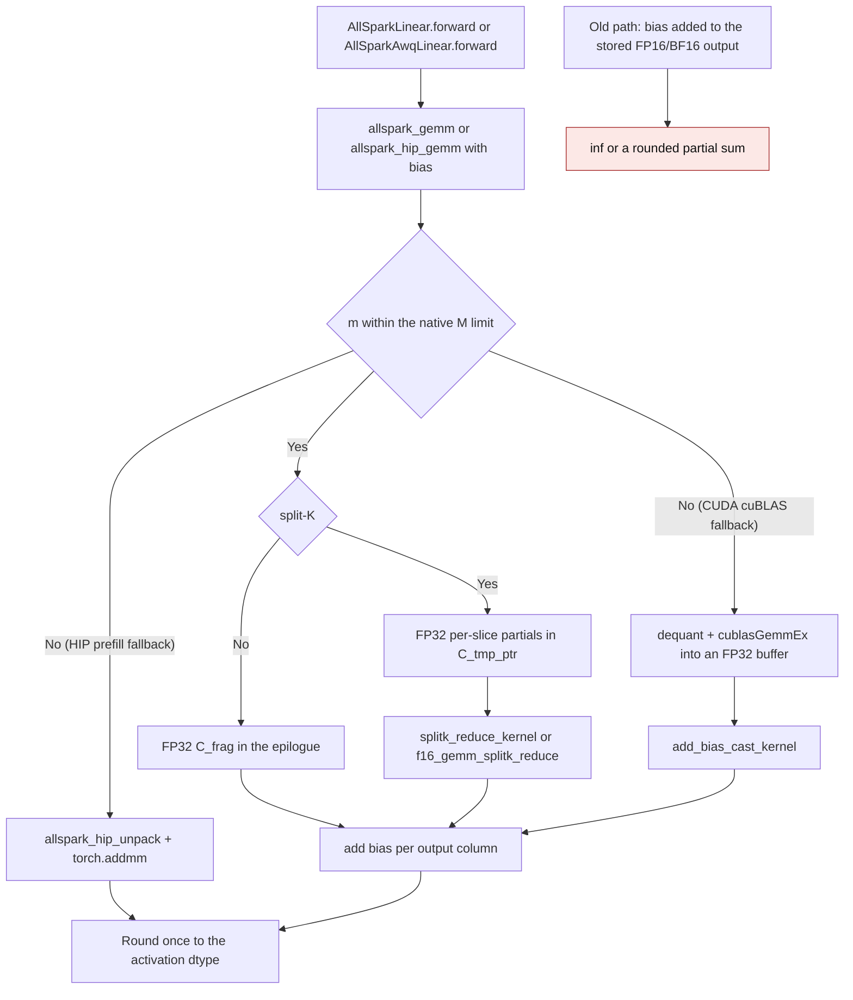

<!-- SPDX-FileCopyrightText: 2026 ModelCloud.ai
SPDX-License-Identifier: Apache-2.0 -->

# AllSpark W8A16 bias epilogue

`AllSparkLinear` and `AllSparkAwqLinear` run a W8A16 GEMM whose accumulators
are FP32 but whose output tensor is the activation dtype (FP16 or BF16).
Adding a checkpoint bias to that returned tensor rounds, and can overflow, the
partial sum first: with 4096 unit weights and 16-valued activations the product
is `65536`, which is already `inf` as FP16, so a finite `-32768` bias can no
longer restore `32768`.

The bias therefore joins the FP32 accumulator inside the kernel, and the result
is rounded once. This page describes the flow for both device paths.

## Flow

`bias` is optional and defaults to `None`, so every existing caller keeps its
signature. The kernel reads either an activation-dtype buffer or an FP32 buffer;
`bias32` selects the latter. The CUDA and HIP packed layouts are otherwise
unchanged, so no checkpoint or repack bytes change.

## Where the bias is applied

| Path | Mechanism before | Mechanism now |
| --- | --- | --- |
| HIP native (`M <= 16`) | `out = out + self.bias` on the returned FP16/BF16 tensor in `gptqmodel/nn_modules/qlinear/allspark.py` and `allspark_awq.py` | `C_bias_ptr` added to `c0[j]`/`c1[j]` in the FP32 epilogue of `gptqmodel_ext/allspark_hip/allspark_hip.cu` |
| HIP split-K reduce | `splitk_reduce_kernel` cast the FP32 sum straight to `OType` | the reduce kernel adds the bias to the FP32 sum before the cast |
| HIP prefill (`M > 16`) | unpack + `torch.matmul`, bias added by the module | unpack + `torch.addmm`, or an FP32 product for a wider stored bias |
| CUDA fused MMA | `stg` narrowed `C_frag` to `FType`, then the module added the bias | the bias is added to `C_frag` in `stg`, then narrowed once |
| CUDA non-fused split-K | `f16_gemm_splitk_reduce` narrowed the FP32 sum | the bias is added to the FP32 sum before the cast |
| CUDA cuBLAS fallback (`M > 1024`) | dequant + `cublasGemmEx` straight into the FP16/BF16 output | biased calls write an FP32 `cublasGemmEx` result and `add_bias_cast_kernel` adds the bias before the cast |

The split-K paths keep the per-slice partials unbiased and apply the bias
exactly once, in the reduction. `C32_ptr` (the diagnostic/test FP32 output)
also stays a plain accumulator so the numerics oracles remain comparable.

## Failure and ambiguity contract

| Situation | Before | Now |
| --- | --- | --- |
| FP32 bias `-32768`, FP16 product `65536` | `inf` | `32768` |
| Bias stored in FP32, activation FP16/BF16 | the module narrowed it first | the kernel adds it in FP32 |
| Bias is not one element per output channel | broadcast shape error | explicit rejection before launch |
| Bias on another device or an unsupported dtype | a deep device/dtype error | explicit rejection in the helper and both bindings |
| No bias | unchanged | unchanged (`bias=None`) |

## Numerics

The bias is never narrowed before the reduction, so the only rounding is the
single cast of the final FP32 sum: the independent FP64 oracle plus at most one
output-dtype ULP. Tests pin both the cancellation case above and ordinary
random biases on every execution path; see `tests/test_allspark_jit.py`,
`tests/test_allspark_hip.py`, `tests/test_allspark_linear.py`,
`tests/test_allspark_awq.py`, and `tests/test_allspark_awq_cuda.py`.
