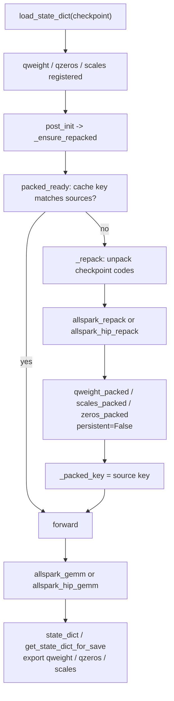
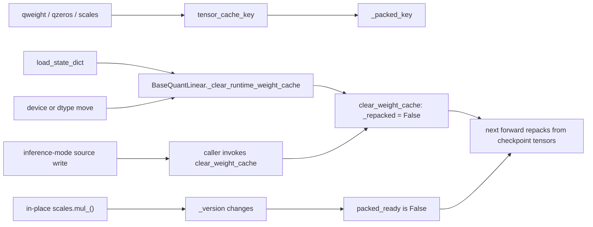
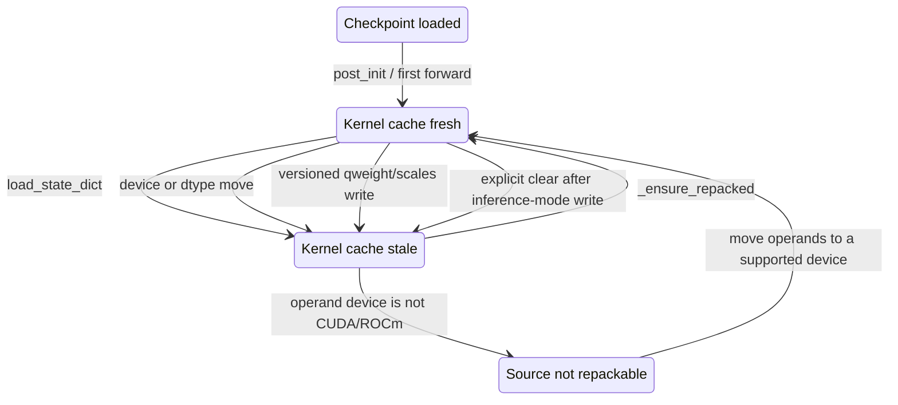

<!--
SPDX-FileCopyrightText: 2026 ModelCloud.ai
SPDX-License-Identifier: Apache-2.0
-->

# AllSpark checkpoint layout and derived kernel cache

AllSpark W8A16 stores two different weight layouts at once: the checkpoint
layout that the writer serializes, and the kernel layout the GEMM consumes.
They share no shape, so the module has to declare exactly one of them as the
checkpoint owner and treat the other as disposable derived state.

## Layouts

| Layout | Tensors | Registered | Serialized |
| --- | --- | --- | --- |
| GPTQ 8-bit checkpoint | `qweight` `(K/4, N)` int32, `scales` `(1, N)` | persistent parameter | yes |
| AWQ 8-bit checkpoint | `qweight` `(K, N/4)`, `qzeros` `(1, N/4)` int32, `scales` `(1, N)` | persistent parameter | yes |
| CUDA N32K16 kernel cache | `qweight_packed` `(N32, K)` uint8, `scales_packed` `(N32,)` | non-persistent buffer | no |
| ROCm WMMA cache | `qweight_packed` `(N128, K)` uint8, `scales_packed`/`zeros_packed` `(N128,)` | non-persistent buffer | no |

Both extension layouts are *derived*: they are reproducible from the checkpoint
tensors, and the shape differs between the CUDA and RDNA4 kernels.

## Current flow



The checkpoint tensors are never dropped. `set` of the exported names is
`qweight`, `qzeros`, `scales` and `bias` both before and after the first
forward.

## Cache invalidation



`forward` re-checks `packed_ready()` rather than trusting the `_repacked` flag
alone. Ordinary tensors expose a version counter, so in-place writes invalidate
the key. Inference-mode tensors do not expose a version counter: code that
mutates them inside `InferenceMode` must call `clear_weight_cache()` explicitly.

## Before / after

| Mechanism | Before | After |
| --- | --- | --- |
| Checkpoint tensors after `post_init` | `del self.qweight, self.scales`; GPTQ set them to `None` (`gptqmodel/nn_modules/qlinear/allspark.py` line 192 of `origin/main`) | kept registered; only the kernel cache is derived |
| AWQ checkpoint tensors | `del self.qweight, self.qzeros, self.scales` (`gptqmodel/nn_modules/qlinear/allspark_awq.py` line 233 of `origin/main`) | kept registered |
| `state_dict()` after a forward | `{bias}` only | `{qweight, qzeros, scales, bias}` |
| `get_state_dict_for_save()` after a forward | `{bias}` only | checkpoint layout |
| Strict reload of the original checkpoint | `size mismatch` / missing keys | succeeds and reproduces the baseline output |
| Kernel layout | unrecoverable, no source tensors | derived cache rebuilt on load/move/mutation |
| Fusion eligibility | `not module._repacked` gate in `shape_error` | `module.packed_ready()` plus a `prepare()` rebuild; only materialized CUDA/ROCm sources repack |

Reproduced on `origin/main` at `77ecd32d6`:

```
before state_dict: {'qweight': (64, 512), 'scales': (1, 512), 'bias': (512,)}
after  state_dict: {'bias': (512,)}
get_state_dict_for_save: {'bias': (512,)}
```

## Failure and ambiguity contract



| Situation | Result |
| --- | --- |
| Export after any number of forwards | checkpoint layout under checkpoint keys |
| `load_state_dict` of the module's own runtime dict | accepted; cache invalidated, repacked on next forward |
| `load_state_dict` of the original checkpoint | accepted; strict load has no missing/unexpected keys |
| In-place write to a versioned `scales`/`qweight` | detected by the cache key; repacked before the next launch |
| Inference-mode source write | caller must invoke `clear_weight_cache()`; repacked before the next launch |
| Fusion over sources whose cache was invalidated | `prepare()` repacks, then the group concatenates the native operands |
| Fusion over CPU/meta operands | declared ineligible; no repack inside a forward |

## See also

- [Kernel validation and cache lifecycle](kernel-validation-and-cache-lifecycle.md)
- [Fusion kernel inventory](fusion-kernel-inventory.md)
- Numerics follow the Torch-oracle contract for every changed path; the
  AllSpark oracles live in `tests/test_allspark_linear.py`,
  `tests/test_allspark_awq.py` and `tests/test_allspark_awq_cuda.py`.
