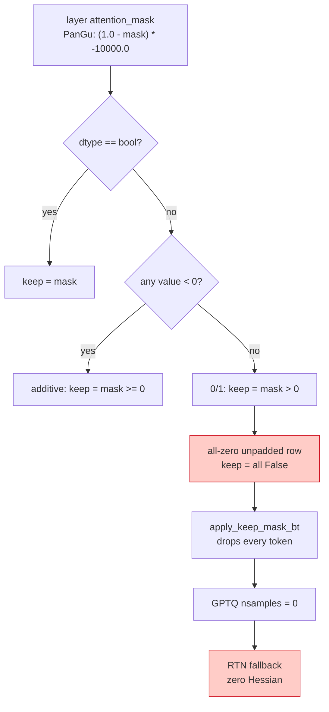
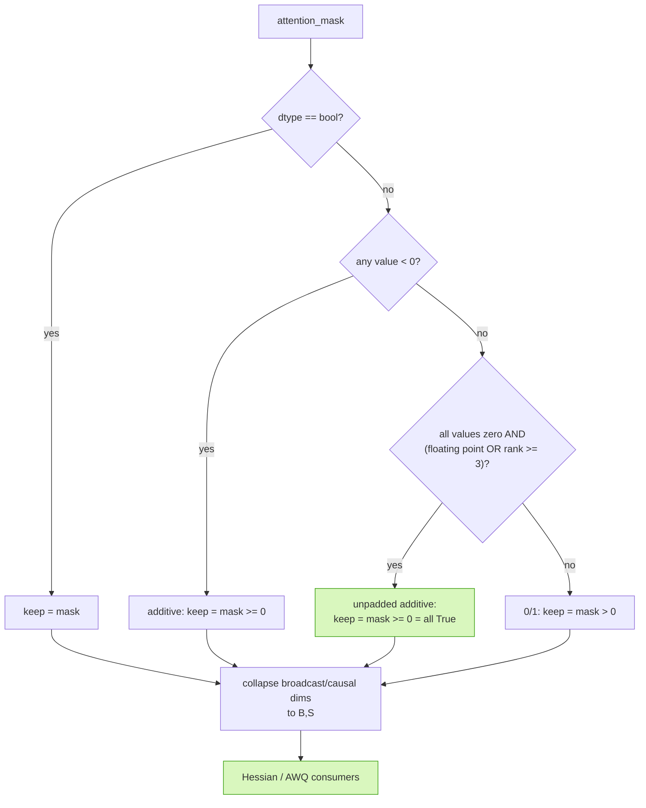

# Attention-mask keep classification

`normalize_seq_mask` (`gptqmodel/utils/attn_mask.py:11`) turns every attention
mask form a model hands a decoder block into one boolean `[B, S]` keep mask
(`True` = attended). It is the single classifier behind the calibration
Hessian, the user-supplied calibration mask and the AWQ token-row replay:

| Consumer | Call site |
| --- | --- |
| Cached layer-input mask -> GPTQ Hessian | `gptqmodel/looper/forward_executor.py:435` |
| Staged layer replay -> GPTQ Hessian | `gptqmodel/utils/looper_helpers.py:785` |
| User calibration `attention_mask` | `gptqmodel/utils/calibration.py:929` |
| AWQ token-row source structure | `gptqmodel/looper/awq_processor.py:1844` |
| AWQ packed replay kwargs | `gptqmodel/looper/awq_processor.py:2269` |
| Definition replay hooks | `gptqmodel/models/base.py:3644`, `:3775`, `gptqmodel/models/definitions/*.py` |

Introduced by the fix for issue #5134.

## Why the classifier matters

An additive/extended HF mask encodes **attend = 0** and **masked = large
negative bias**. A 0/1 mask encodes **attend = 1** and **masked = 0**. The two
forms overlap at zero, so the classifier has to use the mask's rank and dtype,
not just its values.

PanGu-alpha's remote block code passes
`(1.0 - attention_mask[:, None, None, :]) * -10000.0`
(`modeling_gptpangu.py:332-340`). For a row with no padding that tensor is all
zeros. The old classifier looked for a negative value; finding none, it used
the 0/1 rule (`m > 0`) and produced an all-`False` keep mask. Every module then
received zero Hessian samples and silently fell back to RTN.

## Before: value-only inference

| Input | Old rule | Old result |
| --- | --- | --- |
| `torch.ones(1, 5)` | no negative -> `> 0` | all keep (correct) |
| `(1.0 - ones(1,5)) * -10000.0` = all zeros | no negative -> `> 0` | **all drop (bug)** |
| `[0, -10000, 0]` additive | negative -> `>= 0` | correct |
| 2-D integer `[1, 0, 1]` | no negative -> `> 0` | correct |
| bool mask | unchanged | correct |

## After: zero is keep for floating-point and rank >= 3 masks

The rule is implemented once in `normalize_seq_mask`
(`gptqmodel/utils/attn_mask.py:30-46`) and the duplicate special case that used
to live in `calibration.py` was removed, so layer replay and user calibration
cannot drift apart again. The CUDA path builds the decision as a device tensor
and keeps the existing `torch.where` form, avoiding a host sync per mask.

## Failure and ambiguity contracts

| Input | Result | Why |
| --- | --- | --- |
| all-zero `[B, 1, 1, S]` float | all keep | unpadded extended/additive mask |
| partially padded additive (`0`, `-10000`) | only negatives drop | real masked keys |
| all-negative additive | all drop | every position is masked |
| 2-D integer 0/1 all-zero row | all drop | all-padding tokenizer row |
| 2-D float all-zero | all keep | additive convention; a float 2-D mask is not a 0/1 tokenizer mask |
| all-zero rank >= 3 integer | all keep | extended/causal convention; see ambiguity below |
| bool mask (keep or masked polarity) | unchanged | polarity is owned by the caller |
| 4-D causal `[B, 1, S, S]` | query axis collapsed with `any` | token kept when any query may attend |
| unsupported rank/shape | `ValueError` | caller must fix the mask |

The ambiguous case is an all-zero rank >= 3 **integer** grid: it can mean an
unpadded additive mask or a 0/1 causal mask whose every position is padding.
GPT-QModel follows the extended/additive convention (all keep), because an
all-masked calibration row has no signal and would only produce the RTN
fallback this change removes. `tests/test_attn_mask.py` pins that choice.

## Regression coverage

- `tests/test_attn_mask.py::test_normalize_seq_mask_all_zero_extended_mask_keeps_every_token`
- `tests/test_attn_mask.py::test_normalize_seq_mask_partially_padded_additive_mask_keeps_real_tokens`
- `tests/test_attn_mask.py::test_normalize_seq_mask_all_negative_mask_drops_every_token`
- `tests/test_attn_mask.py::test_normalize_seq_mask_2d_integer_all_zero_row_is_all_padding`
- `tests/test_attn_mask.py::test_normalize_seq_mask_all_zero_float_2d_is_fully_attended`
- `tests/test_attn_mask.py::test_normalize_seq_mask_all_zero_rank3_integer_is_fully_attended`
- `tests/test_pangu_alpha_replay.py::test_pangu_unpadded_calibration_reaches_every_gptq_module`
  asserts every module accumulated `128` samples (`4` rows x `32` tokens)
  instead of `0`.
