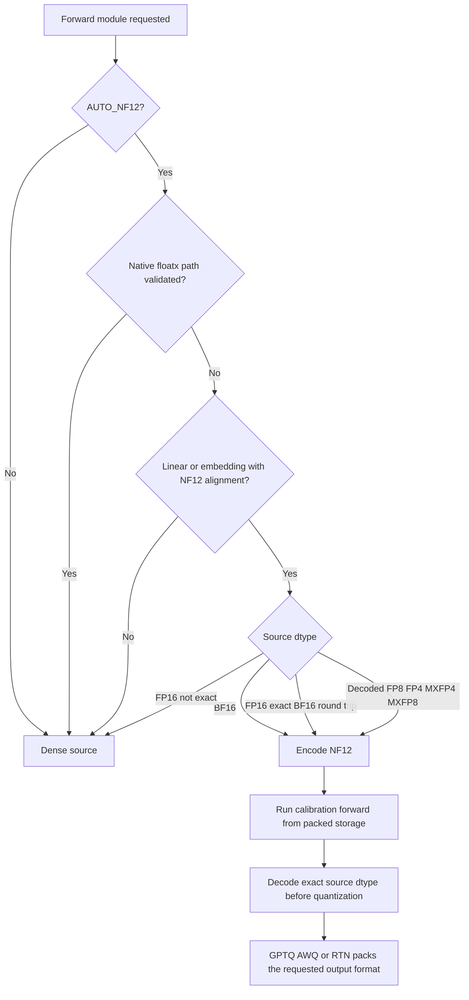
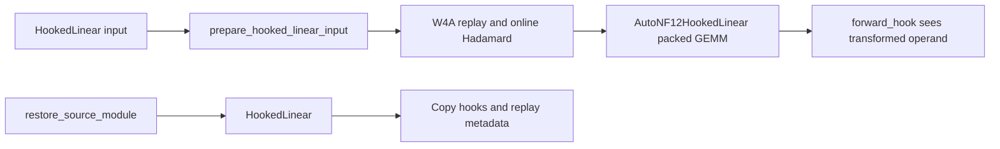

<!-- SPDX-FileCopyrightText: 2026 ModelCloud.ai -->
<!-- SPDX-License-Identifier: Apache-2.0 -->

# Automatic NF12 source storage

`BaseQuantizeConfig.auto_dtype_cast` controls how dense source matrices are
represented while calibration forwards run. The default, `AUTO_NF12`, stores a
supported BF16 matrix as NF12 and restores its exact BF16 values before the
quantizer consumes it.

```python
from gptqmodel import AutoDtypeCast, QuantizeConfig

config = QuantizeConfig(auto_dtype_cast=AutoDtypeCast.AUTO_NF12)
```

`AutoDtypeCast.OFF` keeps the existing dense source representation.

## Decision flow



FP16 does not have a subset relationship with BF16. An FP16 matrix is therefore
eligible only when every FP16 bit pattern survives FP16 to BF16 to FP16. Signed
zero is included in that comparison. A non-exact FP16 matrix stays dense.

Native FP8, FP4, MXFP4, and MXFP8 execution keeps its validated source path.
When that path is unavailable, the existing floatx decoder materializes a dense
BF16 view and `AUTO_NF12` stores that view in NF12 for calibration.

## Quantization handoff

The processor creates its quantization task before the source is packed. The
task retains shape and operation metadata, while its dense source storage is
released. Immediately before that task runs, the exact original dtype and bit
patterns are reconstructed from NF12 and rebound to the task.

This handoff prevents a packed calibration forward from changing the input
matrix seen by GPTQ, AWQ, or RTN. It also prevents the original dense weight
from remaining live beside the packed representation.

## Module coverage

NF12 supports aligned matrices with `N % 16 == 0` and `K % 64 == 0`.

- `nn.Linear`, including GPT-QModel's calibration `HookedLinear`.
- `nn.Embedding` when the embedding quantization lifecycle selects it.
- Norm vectors and biases remain dense because NF12's matrix format does not
  represent them.

The CUDA path supports native linear and embedding operators. The RDNA4 HIP
path supports native linear and embedding operators. Embedding modules persist
the row-major lookup layout documented in
[NF12 row-major embedding storage](nf12-row-major-embedding.md); matrix modules
keep the canonical 16-row super-atom layout. Unsupported devices or shapes stay
dense.

### Hook and replay contract

`HookedLinear` and `AutoNF12HookedLinear` share
`prepare_hooked_linear_input`. The helper applies the selected W4A replay and
online Hadamard transforms exactly once. The packed wrapper then calls
`NF12Linear._forward_impl(..., apply_rotation=False)` and gives its calibration
hook the transformed operand that the GEMM consumes.



Restoring a packed hooked source therefore preserves its class, registered
hooks, online-rotation settings, and W4A replay state. Subsequent quantization
replay executes the same forward behavior as the original source.

## Previous behavior

| Mechanism | Previous behavior | New behavior |
| --- | --- | --- |
| Dense BF16 source forward | Every quantizable matrix stayed dense. | Eligible matrices use NF12 during calibration. |
| Quantizer input | The dense module was already present. | Exact source dtype and bits are restored before `process()`. |
| Native floatx source | Native or decoded path selected by `AutoModuleDecoderConfig`. | Native execution remains; decoded BF16 is eligible for NF12. |
| FP16 source | Stayed dense. | Stays dense unless the BF16 round trip is bit exact. |

## Failure and ambiguity path

An unsupported device, unaligned shape, non-exact FP16 matrix, vector, or
unsupported module remains dense. Packing or decoding errors are not treated as
successful compression. Native floatx selection takes precedence over NF12
when its capability check succeeds.

## Measured validation

The real model was `unsloth/Llama-3.2-1B-Instruct` loaded as BF16. GPTQ
calibration cast 112 projection matrices in every run. Their dense source
occupied 1,856.0 MiB and their NF12 representation occupied 1,394.532 MiB.

| Device | Runtime | AUTO_NF12 peak | OFF peak | Peak change |
| --- | --- | ---: | ---: | ---: |
| RTX 4090, SM 8.9 | Torch 2.16.0.dev20261102+cu130 | 1,229.364 MiB | 1,567.786 MiB | -21.6% |
| RTX 5090, SM 12.0 | Torch 2.16.0.dev20261102+cu130 | 1,229.364 MiB | 1,460.828 MiB | -15.8% |
| R9700, gfx1201 | Torch 2.16.0.dev20261025+rocm10.1, HIP 7.16.26385 | 1,228.664 MiB | 1,204.624 MiB | +2.0% |

The R9700 keeps the 24.9% smaller packed weights, but its calibration workspace
dominates peak allocation. A 4090 GPTQ A/B save produced 482 state tensors on
both policies; all 482 were bit-identical, including packed weights and scales.

Full dense-model inference packed 113 linear matrices. Dense allocation was
2,360.311 MiB and packed allocation was 2,275.021 MiB. The next-token IDs
matched dense execution on all three devices:

| Device | Max logits difference | Mean absolute difference |
| --- | ---: | ---: |
| RTX 4090 | 0.218750 | 0.0234022 |
| RTX 5090 | 0.2734375 | 0.0255472 |
| R9700 | 0.187500 | 0.0176995 |

The source weights are restored exactly. The logits difference comes from the
NF12 kernel's floating-point reduction order; it is not a lossy weight decode.
