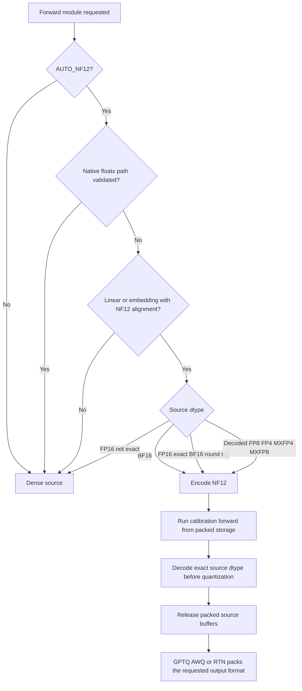
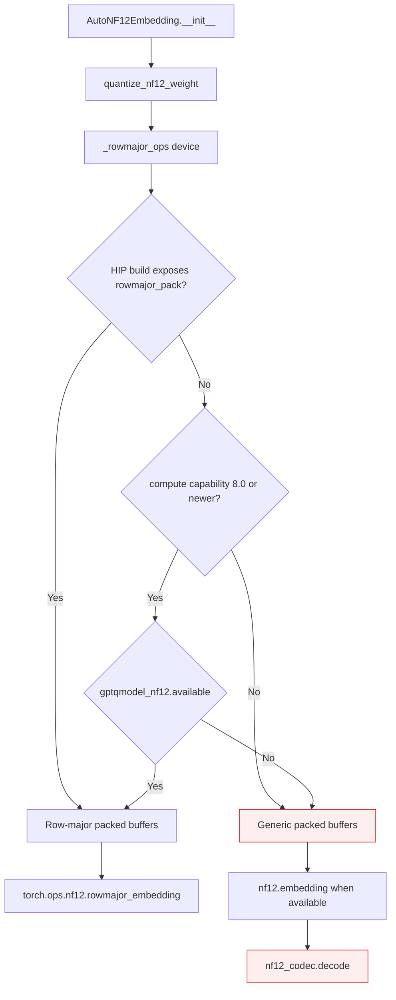
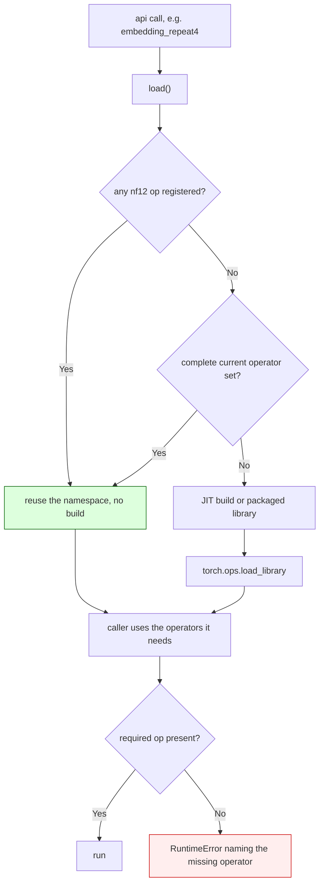
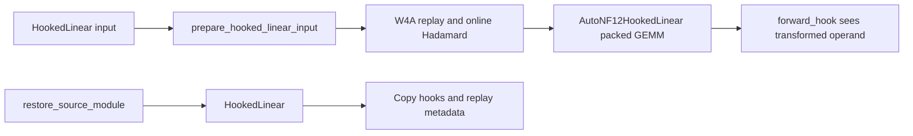
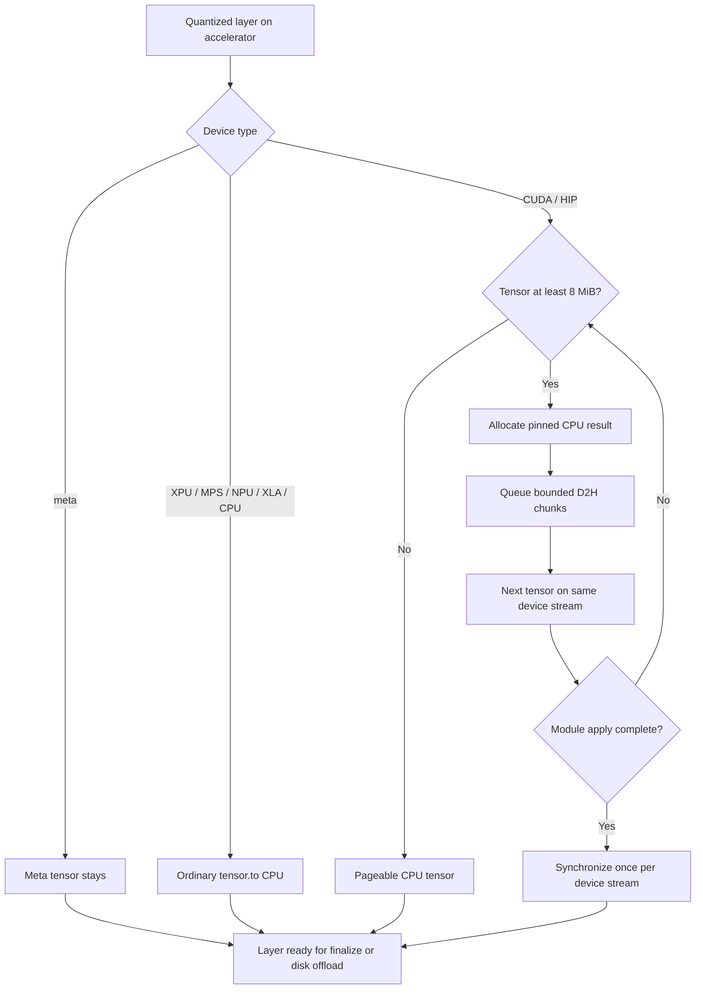
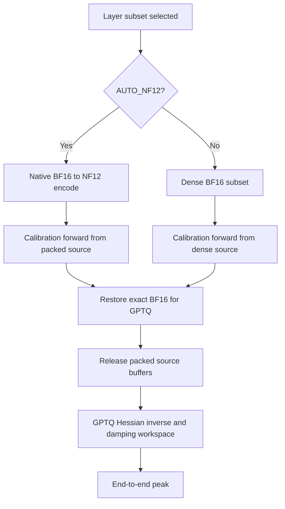
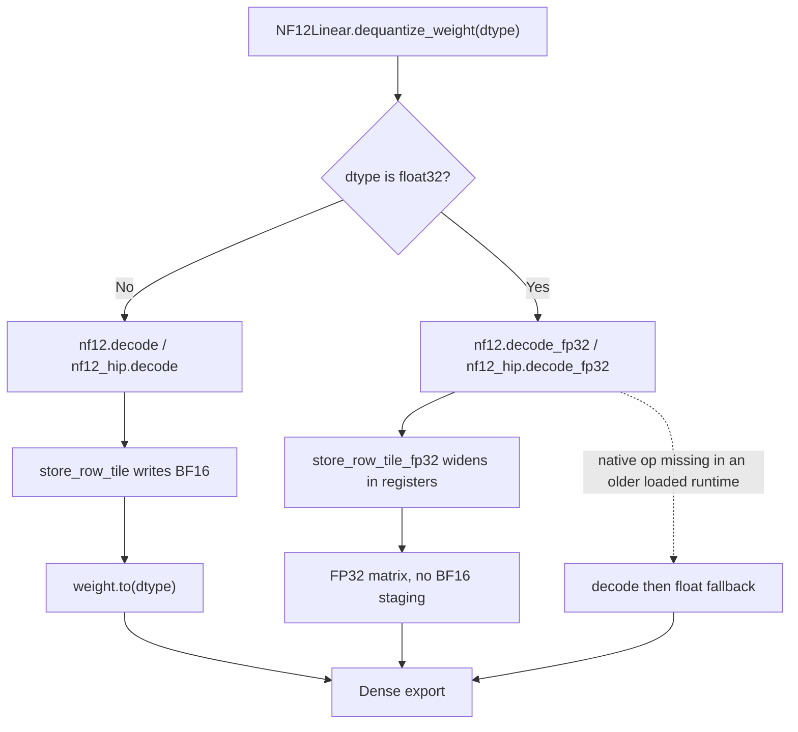
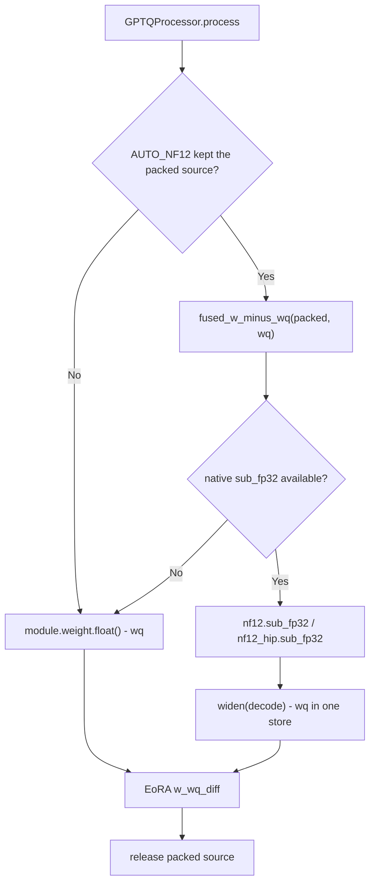

<!-- SPDX-FileCopyrightText: 2026 ModelCloud.ai -->
<!-- SPDX-License-Identifier: Apache-2.0 -->

# Automatic NF12 source storage

`BaseQuantizeConfig.auto_dtype_cast` controls how dense source matrices are
represented while calibration forwards run. The default, `AUTO_NF12`, stores a
supported BF16 matrix as NF12 and restores its exact BF16 values before the
quantizer consumes it.

```python
from gptqmodel import AutoDtypeCast, QuantizeConfig

config = QuantizeConfig(auto_dtype_cast=AutoDtypeCast.AUTO_NF12)
```

`AutoDtypeCast.OFF` keeps the existing dense source representation.

## Decision flow



FP16 does not have a subset relationship with BF16. An FP16 matrix is therefore
eligible only when every FP16 bit pattern survives FP16 to BF16 to FP16. Signed
zero is included in that comparison. A non-exact FP16 matrix stays dense.

Native FP8, FP4, MXFP4, and MXFP8 execution keeps its validated source path.
When that path is unavailable, the existing floatx decoder materializes a dense
BF16 view and `AUTO_NF12` stores that view in NF12 for calibration.

## Native availability

The row-major embedding layout is a native extension, so a supported compute
capability is not evidence that it can run. `gptqmodel_nf12.available()` answers
that question without starting a build, and `_rowmajor_ops` consults it before
choosing a layout.



`available()` is a capability probe, not a build. It is true when
`torch.ops.nf12` is already registered, when both native libraries ship with the
package, when a source build for the visible GPUs is already cached, or when the
JIT build tools (nvcc, CMake, Ninja) are present. Otherwise the generic packed
layout is selected and decoding uses the pure-Torch codec. Both branches keep
packed NF12 bytes resident; neither retains a dense weight cache.

The probe is a property of the host, not a configuration switch. There is no
`GPTQMODEL_*` override for it.

### Preloaded operator namespaces

An older standalone NF12 library, or GPTQModel's legacy runtime, can already own
`torch.ops.nf12` with only a subset of the current operators. Loading a second
library would fail registration, so the loader reuses whatever is registered.



`embedding_repeat4` therefore keeps its documented fallback: with a legacy
namespace that has `embedding` but not `embedding_repeat4`, it uses the
single-copy lookup and repeats the result in Torch. `require()` and `has_ops()`
let a caller name the operators it actually needs, and `available_ops()` answers
the same question without loading anything.

| Situation | Before | After |
| --- | --- | --- |
| Namespace has only `embedding`/`decode` | Rejected as incomplete, then a JIT build was attempted and raised `_MissingBuildTools` | Namespace reused; `embedding_repeat4` takes the single-copy fallback |
| Namespace has the full current set | Reused | Reused (unchanged) |
| Nothing registered, build tools present | Build | Build (unchanged) |
| Required operator genuinely missing | Generic build error | `RuntimeError` naming the operator |

## Quantization handoff

The processor creates its quantization task before the source is packed. The
task retains shape and operation metadata, while its dense source storage is
released. Immediately before that task runs, the exact original dtype and bit
patterns are reconstructed from NF12 and rebound to the task. The replacement
is installed first, then the now-unused packed buffers are released.

This handoff prevents a packed calibration forward from changing the input
matrix seen by GPTQ, AWQ, or RTN. It also prevents the original dense weight
from remaining live beside the packed representation.

## Module coverage

NF12 supports aligned matrices with `N % 16 == 0` and `K % 64 == 0`.

- `nn.Linear`, including GPT-QModel's calibration `HookedLinear`.
- `nn.Embedding` when the embedding quantization lifecycle selects it.
- Norm vectors and biases remain dense because NF12's matrix format does not
  represent them.

The CUDA path supports native linear and embedding operators. The RDNA4 HIP
path supports native linear and embedding operators. Embedding modules persist
the row-major lookup layout documented in
[NF12 row-major embedding storage](nf12-row-major-embedding.md); matrix modules
keep the canonical 16-row super-atom layout. Unsupported devices or shapes stay
dense.

### Hook and replay contract

`HookedLinear` and `AutoNF12HookedLinear` share
`prepare_hooked_linear_input`. The helper applies the selected W4A replay and
online Hadamard transforms exactly once. The packed wrapper then calls
`NF12Linear._forward_impl(..., apply_rotation=False)` and gives its calibration
hook the transformed operand that the GEMM consumes.



Restoring a packed hooked source therefore preserves its class, registered
hooks, online-rotation settings, and W4A replay state. Source, packed, and
restored modules share the same hook registries, so a PyTorch `RemovableHandle`
removes the hook from every replacement. Subsequent quantization replay
executes the same forward behavior as the original source.

## Previous behavior

| Mechanism | Previous behavior | New behavior |
| --- | --- | --- |
| Dense BF16 source forward | Every quantizable matrix stayed dense. | Eligible matrices use NF12 during calibration. |
| Quantizer input | The dense module was already present. | Exact source dtype and bits are restored before `process()`. |
| Native floatx source | Native or decoded path selected by `AutoModuleDecoderConfig`. | Native execution remains; decoded BF16 is eligible for NF12. |
| FP16 source | Stayed dense. | Stays dense unless the BF16 round trip is bit exact. |
| Row-major embedding layout | Assumed from compute capability; the first cast attempted a JIT build and could raise `_MissingBuildTools`. | Probed with `gptqmodel_nf12.available()`; an unavailable extension keeps the generic packed layout. |

## Failure and ambiguity path

An unsupported device, unaligned shape, non-exact FP16 matrix, vector, or
unsupported module remains dense. Packing or decoding errors are not treated as
successful compression. Native floatx selection takes precedence over NF12
when its capability check succeeds.

An eligible embedding never aborts quantization because the row-major extension
cannot be built. When `available()` is false, the generic packed layout is used
and `forward()` decodes through `nf12_codec`; a dense view exists only for the
duration of that forward. The previous failure was a `_MissingBuildTools`
exception raised from the first embedding cast on a CUDA host without a
toolkit or a prebuilt library.

## Measured validation

The real model was `unsloth/Llama-3.2-1B-Instruct` loaded as BF16. GPTQ
calibration cast 112 projection matrices in every run. Their dense source
occupied 1,856.0 MiB and their NF12 representation occupied 1,394.532 MiB.

| Device | Runtime | AUTO_NF12 peak | OFF peak | Peak change |
| --- | --- | ---: | ---: | ---: |
| RTX 4090, SM 8.9 | Torch 2.16.0.dev20261102+cu130 | 1,229.364 MiB | 1,567.786 MiB | -21.6% |
| RTX 5090, SM 12.0 | Torch 2.16.0.dev20261102+cu130 | 1,229.364 MiB | 1,460.828 MiB | -15.8% |
| R9700, gfx1201 | Torch 2.16.0.dev20261025+rocm10.1, HIP 7.16.26385 | 1,228.664 MiB | 1,204.624 MiB | +2.0% |

The R9700 keeps the 24.9% smaller packed weights, but its calibration workspace
dominates peak allocation. A 4090 GPTQ A/B save produced 482 state tensors on
both policies; all 482 were bit-identical, including packed weights and scales.

Layout selection on one RTX 4090 (SM 8.9) with the same 16x64 BF16 embedding:

| Host state | `available()` | Layout | Buffers | Max output error |
| --- | --- | --- | --- | ---: |
| Toolkit on `PATH`, `CUDA_HOME` unset | True | row-major | `nf12_row_packed`, `nf12_row_escapes`, `nf12_exp_base` | 0.0 |
| `PATH=/usr/bin:/bin`, `CUDA_HOME=/nonexistent` | False | generic packed | `nf12_packed`, `nf12_escapes`, `nf12_exp_base` | 0.0 |

Full dense-model inference packed 113 linear matrices. Dense allocation was
2,360.311 MiB and packed allocation was 2,275.021 MiB. The next-token IDs
matched dense execution on all three devices:

| Device | Max logits difference | Mean absolute difference |
| --- | ---: | ---: |
| RTX 4090 | 0.218750 | 0.0234022 |
| RTX 5090 | 0.2734375 | 0.0255472 |
| R9700 | 0.187500 | 0.0176995 |

The source weights are restored exactly. The logits difference comes from the
NF12 kernel's floating-point reduction order; it is not a lossy weight decode.

### Lossless storage and projection arithmetic

NF12 storage and decoding are bit exact for BF16. That property does not make
every NF12 matrix multiplication bitwise identical to a dense BF16 GEMM:
the kernels can associate the same FP32 partial sums in a different order.

On RTX 4090, all 113 aligned projection weights restored bit exactly across
1,235,746,816 elements. Representative projection comparisons were:

| Projection | Max absolute difference | Mean absolute difference | Bit exact |
| --- | ---: | ---: | --- |
| `model.layers.0.self_attn.q_proj` | 0.0009765625 | 1.7003549146465957e-07 | No |
| `model.layers.0.mlp.down_proj` | 0.03125 | 1.4519027899950743e-05 | No |
| `lm_head` | 0.0 | 0.0 | Yes |

The full model retained the same next-token IDs, with maximum logits difference
0.21875 and mean absolute difference 0.023402199131775. This is numerically
close execution of an exactly restored source, not bitwise-identical GEMM
arithmetic.

The Llama embedding table decoded bit exactly, and 512 sampled lookup rows
matched dense BF16 exactly. Its row-major packed representation occupied
394,365,297 bytes instead of 525,336,576 bytes, a 24.93% reduction.

### End-to-end quantization comparison

A separate RTX 4090 comparison used GPTQ 4-bit, group size 128, with
`AUTO_NF12` and `OFF`. Both policies used the same BF16 source model and
4,096 WikiText calibration tokens from 8 windows of 512 tokens. Model load and
checkpoint save were excluded from the quantization timer. Peak allocated
memory was reset immediately before quantization.

| Metric | `AUTO_NF12` | `OFF` |
| --- | ---: | ---: |
| Cast projection modules | 112 | 0 |
| Peak allocated memory | 1,458.342 MiB | 1,458.342 MiB |
| Warm median quantization time | 5.318339 s | 5.500630 s |

All six final checkpoints, three per policy, contained 482 state tensors, and
every corresponding tensor was bit identical. On a held-out 4,096-token
WikiText split, both quantized policies scored NLL
3.1000067591667175 and perplexity 22.198101321602206.

After warming the kernels, `AUTO_NF12` was 3.43% faster at the median. Relative
to the previous implementation, absolute warm quantization time fell 9.47% for
`AUTO_NF12` and 10.22% for `OFF`. The checkpoint and held-out score remained
exact. End-to-end peak allocation was equal because the GPTQ Hessian and
inverse/damping workspace, rather than resident source weights, determined the
peak.

The 10–15% target was not reached for the `AUTO_NF12`-versus-`OFF` ratio. Most
of the remaining calibration time is GPTQ processing and dense Hessian
workspace, while NF12 packing now costs about 0.12 seconds in total.

### SM89 calibration schedules

Quantization used 512-token calibration blocks, so the earlier M=1/4/8/16
decode tuning did not cover this path. A sweep of the existing SM89 large-M
kernel table found these bit-identical schedules:

| Projection `(N, K)` | Previous NF12 | Tuned NF12 | NF12 improvement | Dense BF16 |
| --- | ---: | ---: | ---: | ---: |
| `2048×2048` | 30.010 µs | 27.583 µs | 8.80% | 26.062 µs |
| `512×2048` | 16.988 µs | 15.183 µs | 11.88% | 11.307 µs |
| `2048×8192` | 91.065 µs | 86.317 µs | 5.50% | 93.956 µs |

The `8192×2048` gate/up projection and `128256×2048` vocabulary projection
already selected the fastest tested schedule and remain unchanged.

### Layer offload transfers

Nsight Systems attributed about 590 ms of the original 4K quantization run to
2.499 GiB of pageable D2H copies. `BaseQModel.post_quantize()` now uses
`move_module_to_cpu_pinned()`:



XPU, MPS, NPU, XLA and CPU take the ordinary CPU move, so layer offload still
happens off the CUDA/HIP path. Meta tensors stay in place because they have no
storage. Small CUDA/HIP tensors remain pageable to avoid pinning metadata and
scalar state.
Queued copies use the same current stream and are synchronized once at the
module boundary, before any CPU consumer can read them.

Checkpoint H2D remains on the existing path. Direct `safe_open(..., device="cuda")`
was slower for large Llama tensors in this environment, and adding a
CPU-to-pinned staging copy did not improve the mmap-backed safetensors path.
Native NF12 encoding now runs directly on accelerator-resident BF16 weights;
parallel CPU encoding was not added because all 112 native encodes total about
0.12 seconds and cannot provide the requested end-to-end gain.

### Memory and timing attribution

The source representation and the quantization workspace peak at different
times:



For the 4K calibration run, resident allocation after module preparation
peaked at 626.139 MiB with `AUTO_NF12` and 771.844 MiB with `OFF`, an 18.88%
reduction. The calibration-forward phase peak was 912.420 MiB and
920.391 MiB respectively because the cached 4K activation inputs dominated
that phase.

The full quantization peak was 1,458.342 MiB for both policies. Allocation
history attributed the peak to GPTQ's 512 MiB inverse factor, two 256 MiB
damping/inverse temporaries, 64 MiB permutation storage, and additional
quantization and activation buffers. With one 512-token block, where the
activation cache is small, the calibration-forward peak was 444.420 MiB with
`AUTO_NF12` and 681.783 MiB with `OFF`.

The packed representation therefore reduces calibration resident memory, but
cannot reduce the end-to-end peak while GPTQ's dense Hessian workspace remains
unchanged.

### Native encode path

The first warm implementation copied each GPU weight to CPU, copied it back to
the GPU for native encoding, then returned the result to CPU and copied the
packed buffers to the GPU again. It also allocated full zero NF12 buffers
before immediately overwriting them. Those round trips made 112 encodes take
about 1.8 seconds and made `AUTO_NF12` slower end to end.

The encoder now consumes the accelerator-resident BF16 source directly and
installs the native result on that device. Warm encoding took 0.118522 seconds
for all 112 modules, or 0.079967 seconds after excluding the first seven shape
specializations. Median warm encoding was 0.478 ms per module.

### Decode output width

GPTQ needs the source weight twice: as the restored BF16 module weight, and as
an FP32 operand for the Hessian solve, `w - wq` diagnostics and FP32 oracles.
The FP32 copy used to be produced by decoding BF16 and then widening the dense
matrix, which materializes and re-reads 2 B/element.

`NF12Linear.dequantize_weight` now selects the store width from the requested
dtype. `nf12::decode_fp32` and `nf12_hip::decode_fp32` decode each super-atom
once and widen it in registers, so a BF16 matrix never exists on the FP32 path:



The widening is an exponent-preserving bit shift, so the result is
bit-identical to decoding BF16 and casting. Signed zero, subnormals,
infinities and NaN payloads all match, which
`test_native_decode_fp32_is_bit_identical_to_decode_then_widen` and
`test_hip_decode_fp32_is_bit_identical_to_decode_then_widen` pin against
adversarial bit patterns.

| Mechanism | Before | After |
| --- | --- | --- |
| FP32 weight materialization | `nf12.decode` then `Tensor.float` | `nf12.decode_fp32` |
| ROCm equivalent | `nf12_hip.decode` then `Tensor.float` | `nf12_hip.decode_fp32` |
| Bytes moved per element | 1.5 read + 2 write + 2 read + 4 write = 9.5 | 1.5 read + 4 write = 5.5 |
| BF16 matrix on the FP32 path | required | never materialized |

Measured on an RTX 4090 with resident inputs, median of seven trials:

| Shape `(N, K)` | Decode then widen | `decode_fp32` | Speedup |
| --- | ---: | ---: | ---: |
| `2048×2048` | 15.23 µs | 12.45 µs | 1.22× |
| `512×2048` | 10.59 µs | 6.49 µs | 1.63× |
| `8192×2048` | 175.31 µs | 109.21 µs | 1.61× |
| `2048×8192` | 175.50 µs | 109.75 µs | 1.60× |

Across the 112 Llama 3.2 1B projections the FP32 conversion falls from
9.08 ms to 5.77 ms, a 1.57× improvement and 3.30 ms saved. On an R9700 the
same shapes measured 1.37× to 2.41×.

This does not remove the BF16 module weight from the GPTQ path. `GPTQ.clone_module`
reads the restored dense source, and that source is also what W4A replay and
the saved checkpoint require, so decoding FP32 from NF12 instead of widening
the resident BF16 copy would add a packed buffer beside both dense tensors
rather than remove one. The fused store therefore targets FP32-only consumers:
`dequantize_weight(dtype=torch.float32)`, FP32 oracles, and future FP32 paths.

Not in scope: the embedding row-major layout still restores through its BF16
lookup kernel and casts afterwards, so `AutoNF12Embedding.dequantize_weight`
has no FP32 widening store yet.

### Fused EoRA `w - wq` diff

EoRA consumes the FP32 difference between the source weight and GPTQ's
reconstructed weight. Before this change the diff was built as
`module.weight.data.float() - wq`, which materializes a second full FP32 source
matrix next to `wq` and the result. `nf12::sub_fp32` /
`nf12_hip.sub_fp32` decode each super-atom and subtract `wq` in the same
widening store, so the FP32 source is never written:



The packed source is stashed only when GPTQ and EoRA both run. The EoRA stage
does not re-pack the restored dense source: it forwards the quantized layer
already in the model tree, and the packed bytes are released immediately after
the diff is built.

| Mechanism | Dense diff | Fused diff |
| --- | --- | --- |
| Source read | 2 B/element | 1.5 B/element (packed) |
| FP32 source copy | 4 B/element | none |
| `wq` FP32 operand | 4 B/element | 4 B/element |
| Result write | 4 B/element | 4 B/element |
| Peak for the diff step | 12 B/element | 8 B/element |

Measured on an RTX 4090 with resident inputs, median of 30 trials:

| Shape `(N, K)` | Dense diff | Fused diff | Speedup | Peak saved |
| --- | ---: | ---: | ---: | ---: |
| `512×2048` | 15.97 µs | 18.24 µs | 0.88× | 4 MiB |
| `2048×2048` | 25.86 µs | 27.65 µs | 0.94× | 16 MiB |
| `8192×2048` | 325.58 µs | 184.22 µs | 1.77× | 64 MiB |
| `2048×8192` | 324.66 µs | 184.22 µs | 1.76× | 64 MiB |
| `128256×2048` | 5,027.84 µs | 2,712.77 µs | 1.85× | 1,002 MiB |

The benchmark dense side uses an already-FP32 `wq`. Production GPTQ returns a
BF16/FP16 reconstruction, so both paths add a `wq.to(float32)` copy and the
absolute peak is 12 vs 8 B/element; the 4 B/element saving is unchanged.

Across the 112 Llama 3.2 1B projections plus the vocabulary projection the diff
falls from 21.98 ms to 13.02 ms (1.69×), and 4,714 MiB of FP32 source traffic is
never materialized. Small matrices are slightly slower because the decode
store is compute-bound while the dense expression is a pure elementwise copy;
the large projections dominate the aggregate.

End-to-end GPTQ + EoRA on Llama 3.2 1B with the same calibration set produced
482/482 bit-identical model tensors and 224/224 bit-identical adapter tensors
between AUTO_NF12 and OFF. Both policies peaked at 4,042.4 MiB: the packed
source stays resident through GPTQ's Hessian/inverse workspace, but the fused
store removes the FP32 source copy, so the diff step no longer adds to the
workspace-dominated peak.
