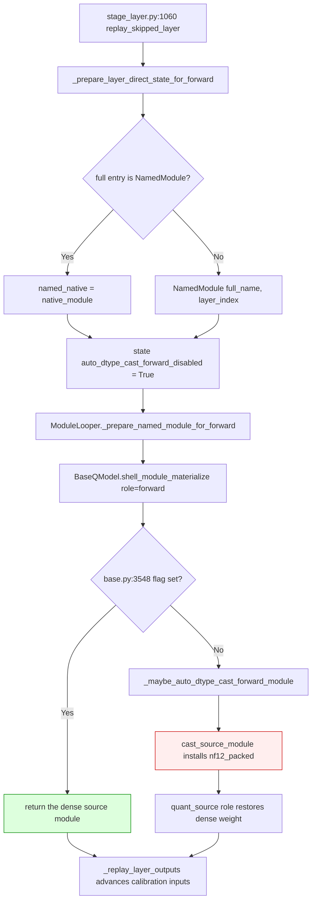
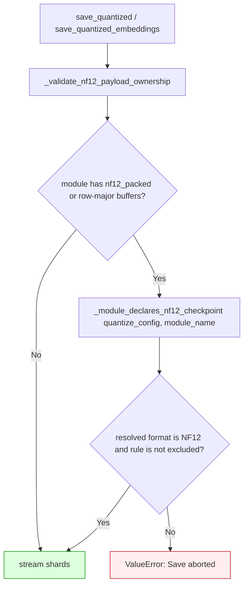

<!-- SPDX-FileCopyrightText: 2026 ModelCloud.ai -->
<!-- SPDX-License-Identifier: Apache-2.0 -->

# Excluded-layer replay and AUTO_NF12 source storage

`BaseQuantizeConfig.auto_dtype_cast` (default `AUTO_NF12`) replaces a dense
BF16 source matrix with lossless NF12 source storage for the length of one
calibration forward. The packing is deliberately temporary: the quantizer's
`quant_source` role restores the exact dense module before the matrix is
packed into the checkpoint format, and `save()` is only ever allowed to see
the restored module.

A `dynamic` `-:` rule can exclude **every** module of a decoder layer. When
that layer is not the last one, the looper still runs one forward through it so
the next layer receives correct activations (`replay_skipped_layer` in
`gptqmodel/looper/stage_layer.py:1060`). That replay is the one forward that
must not install AUTO_NF12 storage: an excluded layer never reaches the
`quant_source` role (`gptqmodel/models/base.py:4625`), so nothing would restore
the dense module afterwards.

## Replay flow

Before the fix the `forward` role always took the `K`/`L` branch for an
excluded layer, and no `N` step existed for it. The packed module stayed in the
model tree, so the writer serialized `nf12_packed`, `nf12_escapes`, and
`nf12_exp_base` in place of `weight` while `quantize_config.json` still
described the module as plain unquantized. The loader reported the NF12 keys as
unused and left the `nn.Linear` weight uninitialised, so the reloaded logits
were NaN in the issue report and arbitrary finite garbage in our rerun.

The fix is the single state flag at `gptqmodel/looper/stage_layer.py:1100`. It
is set only on the wrappers this replay creates, so the quantized-subset path
(which does restore the source through `quant_source`) keeps its existing
behaviour.

## Save contract

The writer no longer trusts the model tree to be clean. `save_quantized` and
`save_quantized_embeddings` call `_validate_nf12_payload_ownership`
(`gptqmodel/models/writer.py:728`), which walks the tree and fails closed when a
module carries `nf12_*` buffers but the config does not declare it as NF12.

`_module_declares_nf12_checkpoint` (`gptqmodel/models/writer.py:710`) resolves
the winning `dynamic` rule for the module and its effective format, so a mixed
config that genuinely asks for NF12 storage on a path still saves, while an
excluded path or a non-NF12 method never does. The error names the offending
modules and tells the caller to restore the dense source first.

## Measured behaviour

Tiny BF16 Llama (`hidden_size=128`, `intermediate_size=256`, 4 layers) on one
RTX 4090, `dynamic={"-:.*layers\\.1\\..*": {}}`, GPTQ 4-bit group 32:

| State | Saved layer-1 keys | Reloaded logits rel-err |
| --- | --- | --- |
| Before fix | `mlp.up_proj.nf12_packed`, `.nf12_escapes`, `.nf12_exp_base` | `nan` in the issue; `1.034` in our rerun (uninitialised-weight garbage) |
| Before fix, `auto_dtype_cast="off"` | `mlp.up_proj.weight` | `0.0384` |
| After fix | `mlp.up_proj.weight` | `0.0384` |
| After fix, AWQ 4-bit | `mlp.up_proj.weight` | `0.2215` |

With the save guard active and the replay fix reverted, `save()` raises
`ValueError: Save aborted: AUTO_NF12 source storage is still installed on
modules the quantize config does not declare as NF12` and lists all seven
layer-1 projections, so the corruption cannot reach a checkpoint again.

## Tests

`tests/test_auto_nf12_excluded_layers.py`:

| Test | Invariant |
| --- | --- |
| `test_fully_excluded_non_final_layer_saves_dense_weights` (layers 0, 1, 2, 1+2; GPTQ and AWQ) | An excluded non-final layer saves `*.weight`, never `nf12_*`, and reloads with finite logits |
| `test_other_exclusions_never_serialize_nf12_buffers` (last layer, single module, one sub-block, `auto_dtype_cast="off"`) | The cases the issue reports as unaffected stay unaffected |
| `test_save_guard_rejects_nf12_buffers_under_an_excluded_module` | The writer fails closed for an excluded path |
| `test_save_guard_rejects_nf12_buffers_for_a_non_nf12_config` | A non-NF12 config never serializes NF12 storage |
| `test_save_guard_allows_modules_the_config_declares_as_nf12` | A real `NF12Config` checkpoint still saves |
| `test_save_guard_ignores_modules_outside_the_requested_prefixes` | The module-replacement path only validates its own prefixes |

## Related

- [Automatic NF12 source storage](auto-nf12-dtype-cast.md) describes the cast
  and restore decision flow this page special-cases.
- Introduced by PR #4012 for issue #4007.
