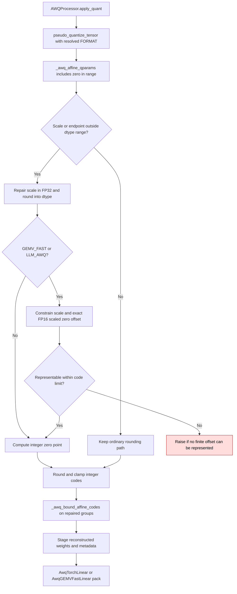

<!-- SPDX-FileCopyrightText: 2026 ModelCloud.ai
SPDX-License-Identifier: Apache-2.0 -->

# AWQ affine range and packed decode

AWQ staging must choose scales and zero points that remain finite after the
selected checkpoint layout packs and decodes them. This is especially relevant
for FP16 weights near ±65504. The boundary repair introduced in PR #3722 is
localized to groups whose affine scale or decoded endpoint exceeds the dtype
range; ordinary groups retain their existing rounding path.

| Before | After |
| --- | --- |
| `AWQProcessor.pseudo_quantize_tensor` repaired only nonfinite scale subtraction (`gptqmodel/looper/awq_processor.py:1990` at the PR's previous revision). | `_awq_affine_qparams` also checks the largest code's decoded range and the GEMV-fast scaled zero offset. |
| Staging clamped a nonfinite reconstructed weight, which could differ from the packed code's output. | `_awq_bound_affine_codes` chooses a finite code before reconstruction; the in-place clip path uses the same rule. |
| `AwqGEMVFastLinear.pack` could reject an infinite FP16 scaled zero offset. | `apply_quant` passes the resolved format to staging so GEMV-fast/LLM-AWQ metadata can fit the stored offset. |

For the GEMM layout, decoding is `(code - zero) * scale` in the stored scale
dtype. GEMV-fast and LLM-AWQ store `-scale * zero` in FP16 and their native
decode uses a half FMA. Boundary repair therefore chooses an exactly
representable offset, so a packed zero weight remains zero. Unit tests check
complete packed words and both decode formulas against a separate scalar
reference at extrema and half-step neighbors.
