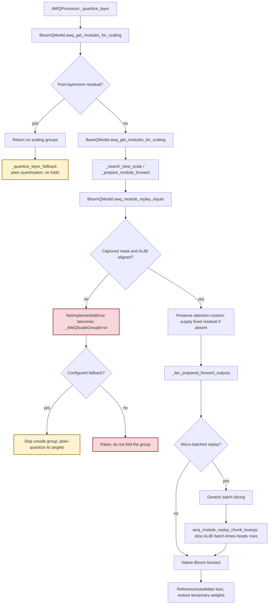

# Bloom AWQ replay context

Bloom attention requires a residual, ALiBi, and an attention mask; its MLP
requires a residual. A fixed additive residual cancels from reference-minus-
candidate reconstruction error, so `BloomQModel.awq_module_replay_inputs` may
use the captured activation as that residual. This does not permit folding a
norm across an uncompensated residual branch.

Attention context is authoritative capture data, not scaffolding to guess.
Replay preserves the supplied causal/padding mask and ALiBi. Missing or
batch/sequence-incompatible context raises `NotImplementedError` from the model
hook; `_prepare_module_forward` converts that explicit unsupported-replay signal
to `_AWQScaleGroupError`. `_quantize_layer` uses the configured fallback, or
raises with `fallback=None`. Unrelated exceptions are not swallowed.

| Before (proposed Bloom replay at `a6c1abfd3`) | Now |
| --- | --- |
| Missing masks become all zeros (`definitions/bloom.py:54-58`), permitting future-token attention. | Require captured, sequence-aligned masks; do not synthesize them. |
| ALiBi is synthesized from all-valid tokens and construction exceptions are swallowed (`definitions/bloom.py:59-74`). | Require captured ALiBi with the actual batch, head and sequence dimensions. |
| Generic slicing (`awq_processor.py:3623-3643`) leaves `[batch * heads, 1, sequence]` ALiBi unsliced. | The model-owned chunk hook slices full prepared ALiBi using the chunk's batch offset and length, including one-head attention. |
| The static tree permits norm folds when the norm output also supplies the residual (`definitions/bloom.py:16-27`). | The live block's `apply_residual_connection_post_layernorm` disables scaling groups; every supported linear still uses plain quantization. |

The no-group policy is the existing architecture-level plain-quantization path,
including when `fallback=None`; the fallback setting controls rejection of
groups that were constructed but lack safe replay context. No new tags or DSL
are introduced. Other definitions inherit an empty chunk-override mapping.
Chunk hooks receive original prepared kwargs, not already-sliced values;
returned keys override generic slicing. One-head attention therefore cannot
accidentally slice its metadata twice.

CPU regressions in `tests/test_bloom_awq_replay.py` compare native forwards
against replay, including FP32/FP16/BF16 causality, distinct per-sample padding,
one/four heads, partial final chunks, eager/chunked candidate search, and
missing-context fallback/error behavior. Neutral folds are checked against
full native logits; both residual modes complete CPU AWQ quantization from
tiny local safetensors fixtures. Tests in
`tests/module_tree/test_bloom_awq_relationships.py` verify that disabling scaling
does not hide any linear or norm weight owner.

Run both test files explicitly alongside the AWQ CPU unit suite. This change
does not modify CI workflows.

Introduced with [Bloom replay safety](https://github.com/ModelCloud/GPTQModel/pull/4145).
