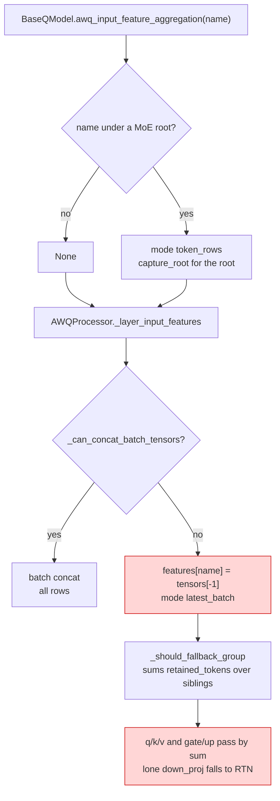
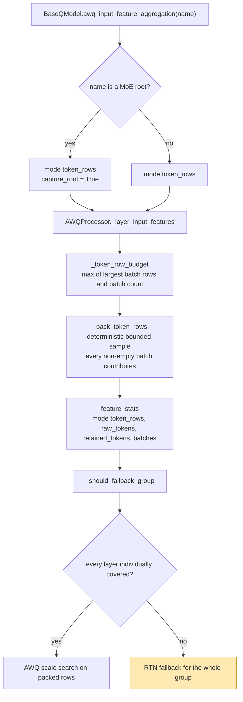

# AWQ calibration aggregation

AWQ scale search scores candidate scales against captured input activations.
With the default `batch_size=1` and a variable-length text corpus, captures have
different sequence lengths (`[1, 423, H]`, `[1, 36, H]`, ...), so they cannot be
concatenated on the batch axis. Calibration is sorted by length descending, so
the last capture is also the shortest one.

Before #4063 the model declared token-row packing only for MoE modules
(`BaseQModel.awq_input_feature_aggregation`). Every dense module took the
generic fallback and kept only the latest capture. On Qwen2.5-0.5B-Instruct
that was 32 of 55,091 calibration tokens, so AWQ measured no better than RTN
and could be worse on symmetric checkpoints.

## Old flow



The old mechanisms and their `main` locations (ad0525cca):

| Mechanism | Location | Effect |
| --- | --- | --- |
| MoE-only token-row policy | `gptqmodel/models/base.py:4785-4802` | Dense modules returned `None` |
| Latest-capture fallback | `gptqmodel/looper/awq_processor.py:1357` | Kept `tensors[-1]`, the shortest sample |
| Summed group coverage | `gptqmodel/looper/awq_processor.py:1546-1554` | q/k/v and gate/up could hide a starved sibling |

## New flow



`AWQProcessor._feature_aggregation_policy` still asks the model class, so a
model definition can change or narrow the policy. The default is now
`{"mode": "token_rows"}` for every module name; MoE roots additionally return
`capture_root: True`, which keeps the shared pre-router capture used by the
gate/up scaling group (`AWQProcessor.register_moe_root_capture_hook`).

## Token-row budget

`AWQProcessor._token_row_budget` derives the bound from the captures themselves:

```
retained = min(total_rows, max(largest_batch_rows, non_empty_batch_count))
```

For `batch_size=1` that is one longest-sample equivalent, so 512 rows for a
512-token maximum. It is independent of corpus size: a 128-document corpus and
a 4096-document corpus keep the same per-module replay tensor. The extra row per
batch guarantees every non-empty calibration batch contributes at least one row
when the budget is at least the batch count; below that, evenly spaced batches
contribute one row each. `_pack_token_rows` samples evenly inside each batch and
is deterministic for a fixed capture order.

Host memory for the packed tensor is `retained * hidden * dtype_bytes` per
module, and the raw per-batch captures are dropped by
`AWQProcessor._finalize_quantized_layer` after the layer is quantized. The bound
does not grow with the number of calibration documents.

## Fallback coverage contract

`AWQProcessor._should_fallback_group` now evaluates every member of the group:

| Capture mode | Coverage compared with the corpus total |
| --- | --- |
| `token_rows` | `raw_tokens` (all rows routed to the module) |
| `latest_batch` / `batch` | `retained_tokens` (rows the scale search actually sees) |
| no statistics | tensor rows (`numel / hidden`) |

A group shares one scale vector, so one starved member sends the whole group to
the RTN fallback. Sibling counts are never summed. For the default token-row
policy, `raw_tokens` is the full routed corpus, so a dense module no longer
falls below a percentage threshold merely because its capture was sampled down
to the memory bound.

## Failure and ambiguity paths

| Situation | Before | After |
| --- | --- | --- |
| Dense module, ragged captures | latest (shortest) capture | bounded rows from every capture |
| Dense module, equal-length captures | batch concat | bounded token rows from every capture |
| One starved member in a group | hidden by sibling sum | group falls back to RTN |
| Empty capture for a module | group falls back | group falls back |
| Token-row budget below batch count | n/a for dense | one row from evenly spaced batches |

## Extension points

- A model definition overrides `awq_input_feature_aggregation` to change the
  policy for a module name. Returning `None` restores the legacy latest-capture
  behaviour for that module, and the per-layer fallback check then applies.
- `capture_root: True` keeps the MoE shared-input capture; do not set it on a
  dense root.
- The policy is a declared property of the model class, not an environment
  variable. Runtime behaviour is selected through the config object or the
  call that owns it.

Introducing PR: #4063 item 1 (AWQ calibration aggregation). The MoE token-row
policy itself came from #3036.

## Measured effect

Wikitext-2 perplexity, 4-bit, `group_size=128`, `batch_size=1`, the first 128
C4 documents as calibration, 80 x 512-token evaluation chunks, and a
save-then-reload before evaluation. RTX 4090 (CUDA) measurements; the fp16
column uses the same harness.

| Model | fp16 | RTN | AWQ before | AWQ after |
| --- | --- | --- | --- | --- |
| Llama-3.2-1B-Instruct, asym | 19.13 | 24.03 | 24.15 | 21.23 |
| Qwen2.5-0.5B-Instruct, asym | 18.68 | 22.77 | 22.79 | 22.23 |
| Qwen2.5-0.5B-Instruct, sym | - | 24.84 | 26.21 | 24.92 |

Before the change AWQ was tied with or worse than RTN. After it, AWQ is
2.80 PPL better than RTN on Llama-3.2-1B and 0.54 better on Qwen2.5-0.5B
(asymmetric). The symmetric Qwen case improves by 1.29 PPL but remains 0.08
PPL above RTN at this bound; raising the row budget to 20,000 rows on the same
corpus measures 24.68 PPL, which shows the residual is the bounded replay
sample rather than a lost capture. The default bound is kept for 70B memory
safety.

Qwen2.5-0.5B retains 5,405 of 55,091 rows (one largest-document equivalent) and
Llama-3.2-1B retains 5,384 of 54,302. Peak allocated VRAM for the Qwen AWQ run
rose from 0.423 GB to 0.498 GB.
