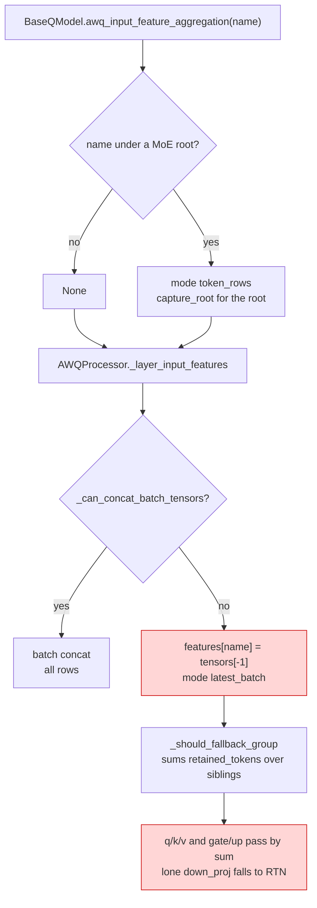
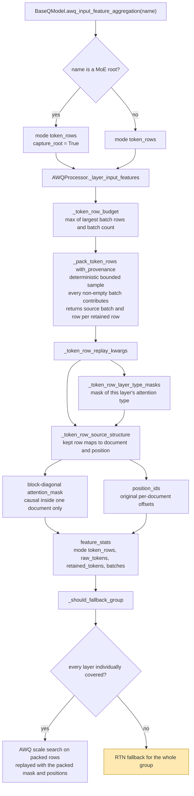
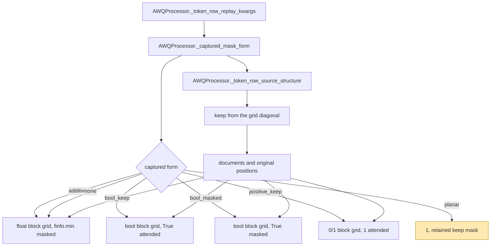
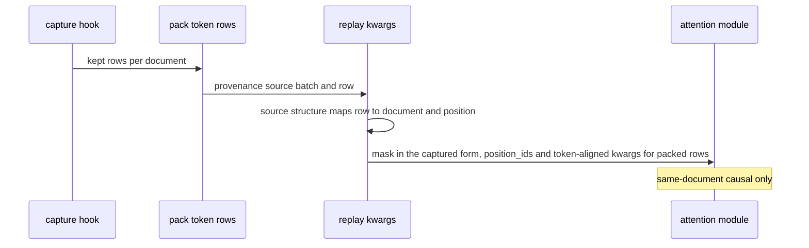

# AWQ calibration aggregation

AWQ scale search scores candidate scales against captured input activations.
With the default `batch_size=1` and a variable-length text corpus, captures have
different sequence lengths (`[1, 423, H]`, `[1, 36, H]`, ...), so they cannot be
concatenated on the batch axis. Calibration is sorted by length descending, so
the last capture is also the shortest one.

Before #4063 the model declared token-row packing only for MoE modules
(`BaseQModel.awq_input_feature_aggregation`). Every dense module took the
generic fallback and kept only the latest capture. On Qwen2.5-0.5B-Instruct
that was 32 of 55,091 calibration tokens, so AWQ measured no better than RTN
and could be worse on symmetric checkpoints.

## Old flow



The old mechanisms and their `main` locations (ad0525cca):

| Mechanism | Location | Effect |
| --- | --- | --- |
| MoE-only token-row policy | `gptqmodel/models/base.py:4785-4802` | Dense modules returned `None` |
| Latest-capture fallback | `gptqmodel/looper/awq_processor.py:1357` | Kept `tensors[-1]`, the shortest sample |
| Summed group coverage | `gptqmodel/looper/awq_processor.py:1546-1554` | q/k/v and gate/up could hide a starved sibling |

## New flow



`AWQProcessor._feature_aggregation_policy` still asks the model class, so a
model definition can change or narrow the policy. The default is now
`{"mode": "token_rows"}` for every module name; MoE roots additionally return
`capture_root: True`, which keeps the shared pre-router capture used by the
gate/up scaling group (`AWQProcessor.register_moe_root_capture_hook`).

## Token-row budget

`AWQProcessor._token_row_budget` derives the bound from the captures themselves:

```
retained = min(total_rows, max(largest_batch_rows, non_empty_batch_count))
```

For `batch_size=1` that is one longest-sample equivalent, so 512 rows for a
512-token maximum. It is independent of corpus size: a 128-document corpus and
a 4096-document corpus keep the same per-module replay tensor. The extra row per
batch guarantees every non-empty calibration batch contributes at least one row
when the budget is at least the batch count; below that, evenly spaced batches
contribute one row each. `_pack_token_rows` samples evenly inside each batch and
is deterministic for a fixed capture order.

Host memory for the packed tensor is `retained * hidden * dtype_bytes` per
module, and the raw per-batch captures are dropped by
`AWQProcessor._finalize_quantized_layer` after the layer is quantized. The bound
does not grow with the number of calibration documents.

### Why the default budget was not raised (#4176 item 1)

Even spacing takes row 0 and the last row of every document, so BOS is
over-represented in the packed sample (12.5% of retained rows against 0.28% of
the corpus on 128 C4 documents). The issue proposed raising the default budget
to >=8k rows, or computing `x_mean` over every row and subsampling only the
replay loss. Both were implemented and measured; **both regress wikitext-2 PPL
on Llama-3.2-1B-Instruct**, so neither is shipped as the default:

| Run (W4 g128 asym GEMM, 128 C4 docs) | PPL |
| --- | --- |
| FP16 | 12.6343 |
| RTN | 15.8825 |
| HEAD default (1024-row budget) | 13.8790 |
| HEAD + budget 8192 | 13.9253 |
| HEAD + full-corpus `x_mean` | 13.9321 |
| HEAD + full-corpus `x_mean` + budget 8192 | 13.9076 |
| HEAD + full-corpus `x_mean` + bin-centre sampling | 14.0543 |

The repeats are deterministic (13.87899 vs 13.87911 and 13.93213 vs 13.93213),
so the deltas are not run-to-run noise. The corpus mean changes the scale grid
away from the distribution the reconstruction loss is scored on, and the
larger replay tensor costs more without recovering PPL. The default budget and
the packed-sample `x_mean` are therefore retained. The sampling bias remains a
known property of the bounded sample; a future change must move both the grid
and the loss sample together, and must beat the default on this table.
`CalibrationConfig(exclude_attention_sinks=True)` removes the BOS rows
from the captures before sampling, so the grid and the loss sample move
together; see [calibration attention-sink
exclusion](calibration-attention-sinks.md) for its measured effect.

The replay mask adds `retained * retained` boolean entries plus one additive
copy in the activation dtype (8 MiB for 2048 retained rows in fp16). It is
built once per unique capture list per layer, shared by sibling projections,
and released with the layer state.

## Replay mask and positions

`AWQProcessor._pack_token_rows(..., with_provenance=True)` also reports, for
every retained row, the capture batch it came from and its row inside that
batch. `AWQProcessor._token_row_replay_kwargs` turns that provenance into the
`attention_mask` and `position_ids` the packed `[1, retained, hidden]` replay
needs:

- `AWQProcessor._token_row_source_structure` maps each kept row back to its
  `[document, position]` cell using the cached mask's keep pattern. A `[B, S, S]`
  mask supplies the model's own per-query relation (causal, padding, sliding
  window); a `[B, S]` mask supplies the kept set and the replay adds causal
  order among kept rows.
- The kept set of a `[B, S, S]` grid comes from the **diagonal**, not from
  `any(dim=-1)`. A real token always attends to itself, while a padding query
  row of a real Hugging Face mask still sees the real keys (only padding
  *keys* are masked). `any(dim=-1)` therefore counted padding rows as real
  tokens, the `!= row_count` check failed, and every real padded `batch_size>1`
  capture fell back to one causal sequence.
- The packed mask is block-diagonal: a retained row may only attend to retained
  rows of the same document at or before its own position. Document A can no
  longer attend to document B through the concatenated sequence, which was the
  semantic defect behind #4095.
- `position_ids` keep each row's original offset (taken from the cached
  `position_ids` when available), so rotary embeddings are evaluated at the
  real positions instead of a synthetic `0..retained-1` range. Attention
  modules that take `position_embeddings` but not `position_ids` (HF Llama,
  Qwen3, Gemma) would lose that tensor in `AWQProcessor._sanitize_kwargs`, so
  `_token_row_replay_kwargs` also returns it under the private
  `_awq_rotary_position_ids` key. `_prepare_module_forward` pops that key and
  rebuilds rotary from it before falling back to `torch.arange`.
- The replay mask follows the **layer's own attention type**, not layer 0's.
  `transformers` 5 builds one mask per declared `config.layer_types` entry, and
  the capture stage stores every type under
  `_gptqmodel_layer_type_replay_kwargs`. `AWQProcessor._token_row_layer_type_masks`
  resolves the type of the layer being quantized with
  `BaseQModel._resolve_layer_replay_type` and passes that type's mask to
  `_token_row_replay_kwargs` as an override. Without it a full-attention layer
  of a mixed model (gemma-3, OLMo 3) was replayed with the sliding window.
- A **recurrent/convolution mixer never receives the additive attention grid**
  (#4671). `transformers` 5 builds the `linear_attention` / `conv` mask with
  `create_recurrent_attention_mask`, which returns `None` for an unpadded batch
  and a planar `[batch, seq]` keep mask otherwise; the mixer applies it as
  `hidden * attention_mask[:, :, None]`. The replay used to read that `None` as
  "the module relied on its internal causal path" and fall back to the
  `[1, 1, T, T]` grid, which raised on the first scale-search replay for every
  Mamba/conv hybrid (Granite-4.0-H, LFM2, Nemotron-H, OLMo-Hybrid). The replay
  now resolves the layer type, detects the recurrent builders through
  `_is_recurrent_attention_layer_type`, and emits a planar `[1, retained]` keep
  mask instead. `_pack_token_rows` emits rows in source order, so each document
  stays contiguous and the recurrent state only crosses a document boundary --
  the same limitation the padded `batch_size>1` path already has.
- Sibling projections (`q/k/v`, `gate/up`) share one captured input list, so
  the quadratic mask is built once per unique capture list per layer.
- **Token-aligned kwargs travel with the same provenance** (#4880).
  `AWQProcessor._pack_token_aligned_kwargs` selects `input_ids` (every entry of
  `_AWQ_TOKEN_ALIGNED_KWARGS`) with the retained rows' provenance and returns it
  as `[1, retained]`. DeepSeek-V4 `hash_moe` layers route with
  `gate.tid2eid[input_ids.reshape(-1)]`, so forwarding the current calibration
  batch's ids instead handed the router a different number of index rows than
  the replayed hidden states and raised `IndexError` in the first decoder layer.
  If a token-aligned kwarg still does not describe the replayed rows,
  `_prepare_module_forward` raises `_AWQScaleGroupError`, so the configured
  plain-quantization fallback applies instead of aborting `quantize()`.
- A forward declared with a `**kwargs` catch-all takes its real inputs from
  that dict: Hymba's `HymbaBlock` reads `attention_mask`, `position_ids`,
  `kv_last_layer` and `use_swa` out of it. `AWQProcessor._sanitize_kwargs`
  therefore passes the captured kwargs through unchanged, and
  `_prepare_module_forward` treats `position_ids` as accepted so a 2-D
  activation is promoted to `[1, seq, hidden]` the way the block's
  `pack(...)` requires (#4891). A name-based filter handed the block an empty
  dict and the replay raised `KeyError: 'attention_mask'`.

### Bloom ALiBi

`BloomQModel.awq_module_replay_inputs` requires a captured `alibi` of shape
`(batch * heads, 1, seq)`. `build_alibi_tensor` is
`slope * position` per key, so a packed replay needs the retained rows' real
positions, not the captured sample's `0..N-1` range. A shape-compatible
captured alibi is therefore stale: the old shape check accepted it and the
replay scored Bloom attention with the wrong relative bias, while a
variable-length batch missed the shape check and fell back.

The definition now rebuilds ALiBi from `_awq_rotary_position_ids` (or
`position_ids`) whenever they describe the replay sequence:
`BloomQModel._awq_rebuild_alibi` multiplies the model's own slopes
(`_get_alibi_slopes`) by the retained positions in float32 and casts to the
activation dtype, which reproduces `build_alibi_tensor` bit-for-bit for
contiguous positions. When no positions are available and the captured alibi
does not match the replay shape, the replay raises with the expected and actual
shapes instead of accepting a stale tensor.

### Mask form and polarity

`AWQProcessor._captured_mask_form` classifies the captured grid, and the replay
rebuilds it in the same form. This is not cosmetic: the form decides how the
attention implementation consumes the tensor.

| Form | Captured example | Replay | Why |
| --- | --- | --- | --- |
| `additive` | `[B, 1, S, S]` float with `finfo.min` | float block grid, `min` for masked cells | Hugging Face eager attention sums the mask into the logits |
| `bool_keep` | `[B, 1, S, S]` bool, `True` = attended (SDPA) | bool block grid, `True` = attended | SDPA takes a keep mask |
| `bool_masked` | `[B, 1, S, S]` bool, `True` = masked (TeleChat2 `triu(1)`) | bool block grid, `True` = masked | the consumer calls `masked_fill`, which rejects a float mask |
| `positive_keep` | `[B, 1, S, S]` integer 0/1, `1` = attended (LLaDA2 `tril * padding`) | integer block grid, `1` = attended | the consumer multiplies or masks with the 0/1 grid |
| planar | `[B, S]` keep mask | `[1, retained]` keep mask | FlashAttention takes a rank-2 keep mask; cross-document separation is not expressible |

A bool mask's polarity is read from its diagonal: `True` on the diagonal means
the keep convention, an all-`False` diagonal means `masked_fill`. An additive
**float** mask is normalized as `m >= 0` unconditionally: it is summed into the
logits, so `0` is attended and only negatives suppress a key. An all-zero float
grid (an unpadded `batch_size>1` batch) therefore keeps every diagonal entry. A
square **integer** grid is not additive: it is a multiplicative 0/1 keep mask
(LLaDA2 expands the tokenizer mask with `tril * padding`) and is normalized as
`m > 0`, so `0` means masked. A planar `[B, S]` numeric mask is a keep
indicator, not an additive grid, and keeps the Hugging Face `1`/`0` convention.
When the capture stored no mask at all (`batch_size=1` on a model that builds
its own causal mask), the additive block-diagonal fallback is used; it is the
explicit form of the causal path the module already took.





## Fallback coverage contract

`AWQProcessor._should_fallback_group` now evaluates every member of the group:

| Capture mode | Coverage compared with the corpus total |
| --- | --- |
| `token_rows` | `raw_tokens` (all rows routed to the module) |
| `latest_batch` / `batch` | `retained_tokens` (rows the scale search actually sees) |
| no statistics | tensor rows (`numel / hidden`) |

A group shares one scale vector, so one starved member sends the whole group to
the RTN fallback. Sibling counts are never summed. For the default token-row
policy, `raw_tokens` is the full routed corpus, so a dense module no longer
falls below a percentage threshold merely because its capture was sampled down
to the memory bound.

## Failure and ambiguity paths

| Situation | Before | After |
| --- | --- | --- |
| Dense module, ragged captures | latest (shortest) capture | bounded rows from every capture |
| Dense module, equal-length captures | batch concat | bounded token rows from every capture |
| `batch_size>1`, batched capture | replay ran with `attention_mask=None`; `Qwen2Attention.forward` raised `TypeError` and the synthetic sequence attended across documents | replay carries a per-document block mask and original positions |
| Captured `masked_fill` bool grid (TeleChat2) | converted to an additive float mask; `masked_fill` raised `RuntimeError: only supports boolean masks` | rebuilt as a bool grid with `True` = masked |
| Real padded `batch_size>1` bool grid | keep came from `any(dim=-1)`, so padding rows counted and the structure was never recovered | keep comes from the diagonal; the document grid and positions are recovered |
| Unpadded `batch_size>1` additive grid (all zeros) | `(m > 0)` marked every position masked, so `_token_row_source_structure` returned `None` and the replay fell back to one causal sequence across the whole batch | `m >= 0` keeps every diagonal entry; the replay is block-diagonal per document |
| Cached mask does not match the captured rows | mask dropped, cross-document attention | each capture batch replayed as one contiguous document |
| No cached mask entries at all | `attention_mask=None` | kwargs left unchanged |
| Captured masks are all `None` (`batch_size=1`) | `attention_mask=None`, synthetic positions | additive block-diagonal fallback with original positions |
| Planar `[B, S]` captured mask (FlashAttention) | mask dropped | planar packed keep mask and original positions; causal masking stays inside the attention implementation |
| Scale grid from the packed sample only | BOS/document ends over-represented in `x_mean`; searched scales follow them | `x_mean` reduces every captured row; the replay loss still uses the bounded sample |
| Mixed sliding/full `layer_types` model | every layer replayed with layer 0's mask; a full-attention layer allowed no pair at distance >= the window | the layer's own type mask is selected from the captured per-type kwargs |
| Bloom with variable-length calibration | packed `(batch*heads, 1, N)` replay matched a captured alibi by coincidence and accepted a stale one; otherwise the group fell back | ALiBi rebuilt from the retained rows' positions, or refused with both shapes |
| Attention module takes `position_embeddings`, not `position_ids` | rotary rebuilt from `arange(N)`, contradicting the real-position contract | retained rows' positions carried under `_awq_rotary_position_ids` into the rotary rebuild |
| All candidates produce a non-finite loss | bare `Exception()` aborted the run and bypassed the fallback | `_AWQScaleGroupError` names the module and takes the configured fallback |
| One starved member in a group | hidden by sibling sum | group falls back to RTN |
| Empty capture for a module | group falls back | group falls back |
| Token-row budget below batch count | n/a for dense | one row from evenly spaced batches |

## Extension points

- A model definition overrides `awq_input_feature_aggregation` to change the
  policy for a module name. Returning `None` restores the legacy latest-capture
  behaviour for that module, and the per-layer fallback check then applies.
- `capture_root: True` keeps the MoE shared-input capture; do not set it on a
  dense root.
- The policy is a declared property of the model class, not an environment
  variable. Runtime behaviour is selected through the config object or the
  call that owns it.

Introducing PR: #4063 item 1 (AWQ calibration aggregation). The MoE token-row
policy itself came from #3036.

## Measured effect

Wikitext-2 perplexity, 4-bit, `group_size=128`, `batch_size=1`, the first 128
C4 documents as calibration, 80 x 512-token evaluation chunks, and a
save-then-reload before evaluation. RTX 4090 (CUDA) measurements; the fp16
column uses the same harness. The #4176 item-1 table above uses 40 x 2048-token
chunks instead, which is the harness that reproduces the issue's FP16 12.634;
the same 512-token harness gives FP16 19.13, so the two tables are not
comparable across rows.

| Model | fp16 | RTN | AWQ before | AWQ after |
| --- | --- | --- | --- | --- |
| Llama-3.2-1B-Instruct, asym | 19.13 | 24.03 | 24.15 | 21.23 |
| Qwen2.5-0.5B-Instruct, asym | 18.68 | 22.77 | 22.79 | 22.23 |
| Qwen2.5-0.5B-Instruct, sym | - | 24.84 | 26.21 | 24.92 |

Before the change AWQ was tied with or worse than RTN. After it, AWQ is
2.80 PPL better than RTN on Llama-3.2-1B and 0.54 better on Qwen2.5-0.5B
(asymmetric). The symmetric Qwen case improves by 1.29 PPL but remains 0.08
PPL above RTN at this bound; raising the row budget to 20,000 rows on the same
corpus measures 24.68 PPL, which shows the residual is the bounded replay
sample rather than a lost capture. The default bound is kept for 70B memory
safety.

Qwen2.5-0.5B retains 5,405 of 55,091 rows (one largest-document equivalent) and
Llama-3.2-1B retains 5,384 of 54,302. Peak allocated VRAM for the Qwen AWQ run
rose from 0.423 GB to 0.498 GB.

### Replay-mask A/B (#4091 item 1)

The mask/position fix changes the packed replay from "one synthetic causal
sequence" to "block-diagonal per document". The table below measures both
revisions on the same harness and checkpoints. "AWQ before" is `main` at
`1732d2ae3`; "AWQ after" is this change. RTN does not use the AWQ replay, so
one RTN column serves both.

| Model | sym AWQ before | sym AWQ after | sym RTN | asym AWQ before | asym AWQ after | asym RTN |
| --- | --- | --- | --- | --- | --- | --- |
| Qwen2.5-0.5B-Instruct | 24.92 | 24.26 | 24.84 | 22.23 | 22.09 | 22.77 |
| Llama-3.2-1B-Instruct | 22.61 | 22.57 | 25.35 | 21.23 | 21.29 | 24.03 |
| gemma-3-1b-it | 66.52 | 68.79 | 76.62 | 70.32 | 68.29 | 73.00 |

AWQ still beats RTN in all six cells after the fix. The Qwen cells improve by
0.66 and 0.14 PPL, Llama symmetric by 0.04 and asymmetric by 0.06 in the other
direction, and gemma symmetric loses 2.27 while gemma asymmetric gains 2.03.

The absolute gemma values are much higher than the 44.19 / 48.01 recorded in
#4095. The only gemma-3-1b checkpoint available here is `gemma-3-1b-it`, and it
measures 59.6 PPL unquantized in this harness, so the #4095 gemma row was taken
with a different checkpoint (inference: the base `gemma-3-1b-pt`, which is not
present locally). The Llama values differ from #4095 as well because `main`
moved after that table was taken: #4089 changed replay chunk sizing. Qwen RTN
reproduces #4063's 24.84 / 22.77 exactly, which anchors the harness.
