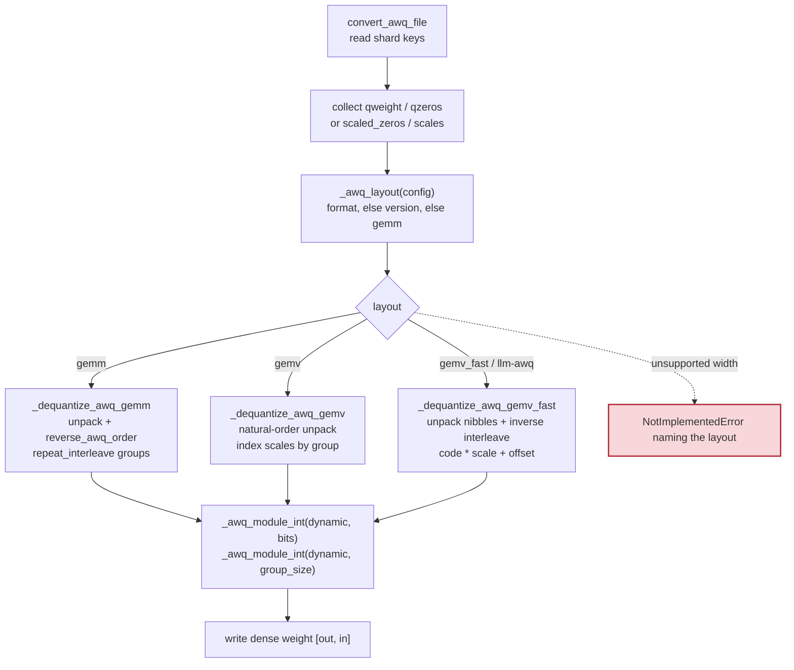

# AWQ dequantization layouts

`dequantize_model` converts a packed AWQ checkpoint back into dense weights.
AWQ has four packed layouts and they are not interchangeable: the same
`qweight`/`qzeros`/`scales` key names describe different tensor shapes, axis
orders, and zero-point encodings. The saved `format` (mirrored into `version`
by `AWQConfig`) is the authoritative selector; `bits` alone is not enough,
because a single run may pack different modules at different widths through
`dynamic`.

Introduced by the fix for issue #4002 item 5.

## Layouts

| `format` | Writer | `qweight` | zero points | `scales` |
| --- | --- | --- | --- | --- |
| `gemm` | `AwqGEMMLinear` (4-bit), `AwqTorchLinear` (2/3/8-bit) | `[in, out / (32/bits)]`, 4-bit `[0,2,4,6,1,3,5,7]` interleave or a contiguous stream | `[groups, out / (32/bits)]` integer codes | `[groups, out]` |
| `gemv` | `AwqGEMVLinear` (4-bit) | `[out, in / 8]`, natural order | `[out, padded_groups / 8]` integer codes | `[out, padded_groups]` |
| `gemv_fast` | `AwqGEMVFastLinear` (4-bit) | `[out / 4, in]` INT16, `pack_intweight` row interleave | `[padded_groups, out]` FP16 scaled offset | `[padded_groups, out]` FP16 |
| `llm-awq` | `LLMAwqLinear` (4-bit) | same as `gemv_fast` | `scaled_zeros`, `[padded_groups, out]` FP16 | same as `gemv_fast` |

`padded_groups` is `calculate_zeros_width(in_features, group_size) * (32 / bits)`,
i.e. the group axis padded to a whole packed word. The last group may cover a
short tail.

`pack_intweight` interleaves four output rows per INT16 word and then reshapes
the `(64 columns x 4 lanes)` tile as if transposed, so the lane index mixes with
the low six column bits. Decoding scatters each nibble back with the inverse of
that mapping (`_awq_gemv_fast_k_order` + a scatter in
`gptqmodel/utils/model_dequant.py:1673`).

## Flow

Per-module `bits` and `group_size` are resolved with `dynamic_get`, so a rule
such as `{"model.layers.0.mlp.down_proj": {"bits": 8}}` decodes that module at
eight bits while its siblings stay at four. An excluded module (`bits: false`)
falls back to the checkpoint default instead of becoming width zero.

## Before and after

| Mechanism | Before | After |
| --- | --- | --- |
| Layout selection | GEMM decode for every AWQ checkpoint, `gptqmodel/utils/model_dequant.py:1589` (origin/main) | `_awq_layout` dispatch, `gptqmodel/utils/model_dequant.py:1545` |
| Per-module width | global `config["bits"]`, `gptqmodel/utils/model_dequant.py:1583` (origin/main) | `dynamic_get(dynamic, prefix, "bits", default)`, `gptqmodel/utils/model_dequant.py:1561` |
| Per-module group size | inferred from the GEMM tensor shapes | `dynamic_get(dynamic, prefix, "group_size", default)` |
| GEMV checkpoint | `IndexError: index ... is out of bounds` | natural-order decode, `gptqmodel/utils/model_dequant.py:1613` |
| GEMV_FAST / LLM_AWQ checkpoint | `NotImplementedError: "rshift_cpu" not implemented for 'Half'` | nibble unpack + inverse interleave + FP16 offset, `gptqmodel/utils/model_dequant.py:1632` |
| Mixed 4-bit / 8-bit run | size-mismatch `RuntimeError` | each module decoded at its own width |

## Failure contract

| Situation | Behaviour |
| --- | --- |
| `format` and `version` absent | assume `gemm` (the historical default) |
| `gemv` / `gemv_fast` / `llm-awq` with `bits != 4` | `NotImplementedError` naming the layout and suggesting a GEMM export |
| `gemv_fast` with `in_features % 64 != 0` | `ValueError` naming the width |
| missing `qweight` / `scales` / zero-point buffer | `KeyError` naming the module and the missing keys |

## Validation

`tests/test_awq_dequant_layouts.py` builds exactly representable weights (codes,
integer zero points, power-of-two scales), packs them with each backend's own
checkpoint writer, and decodes through `convert_awq_file` and `dequantize_model`.
The comparison target is an independent fp64 `(code - zero) * scale` oracle, so
the decode path is never its own reference. All four layouts, the
`scaled_zeros` name, and a per-module `dynamic` width are covered exactly
(`rtol=0`, `atol=0`).

## Not in scope

- vLLM `awq_marlin` reads a `[0,2,1,3]` byte interleave; a natural-order 8-bit
  AWQ checkpoint is not guaranteed to load there. This change only makes
  `dequantize_model` read what GPTQModel writes.
- `swordfish.py` still contains an 8-bit `[0,2,1,3]` undo path that is dead
  while `SUPPORTS_BITS=[4]`.
