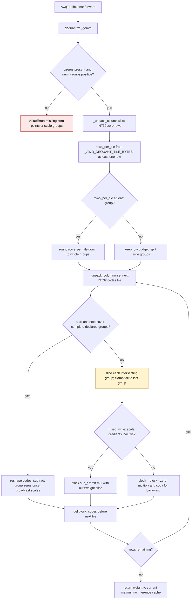
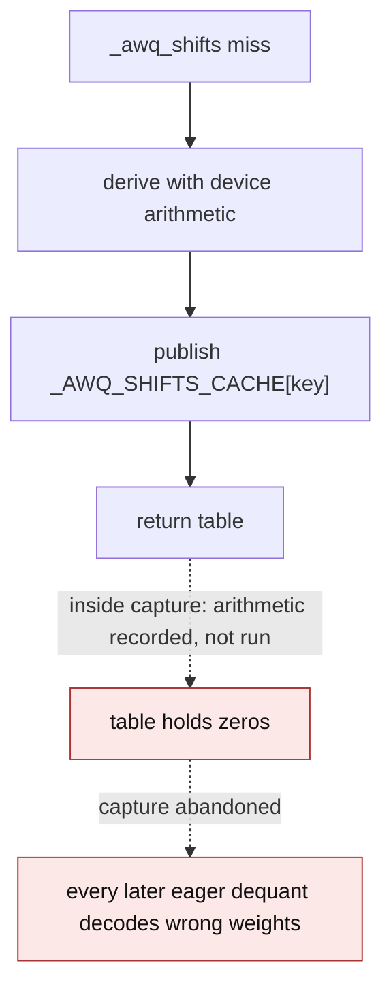
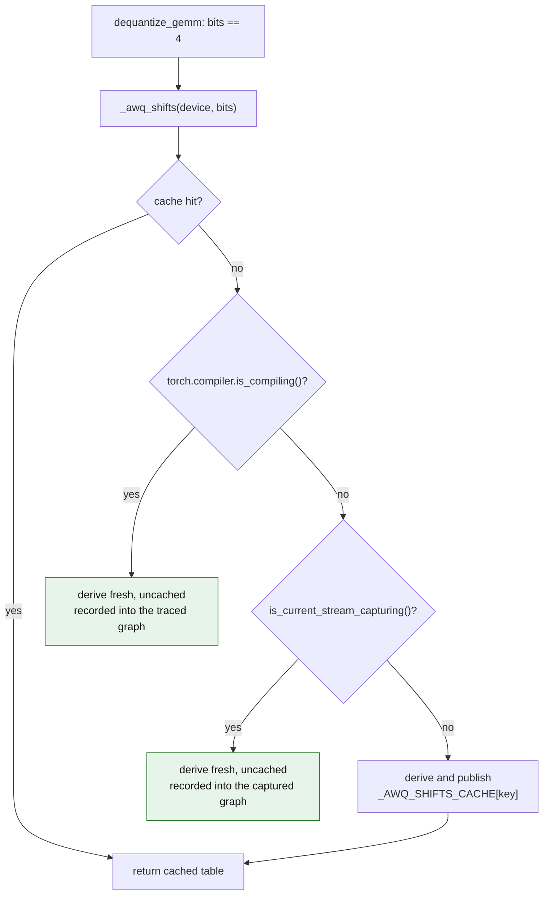
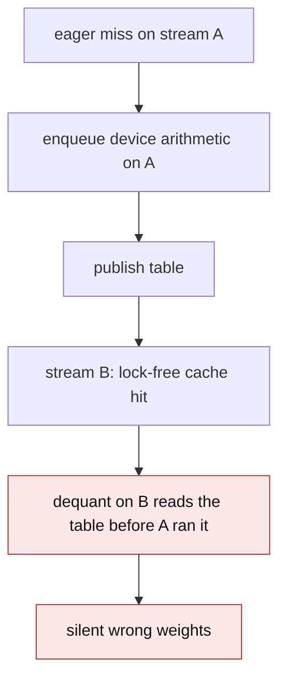
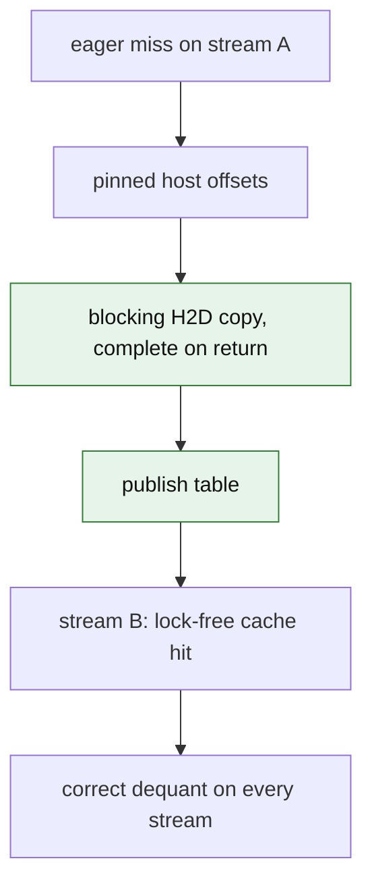

<!-- SPDX-FileCopyrightText: 2026 ModelCloud.ai
SPDX-License-Identifier: Apache-2.0 -->

# AWQ GEMM dequantization tiling

`AwqTorchLinear` reconstructs a dense weight for the current matrix multiplication.
`dequantize_gemm` bounds the reconstruction by input-row tiles and broadcasts one
scale/zero row per quantization group. Complete groups share a three-dimensional
broadcast when they fit; larger groups, per-channel weights, and ragged tails use
partial-group slices. The dense result remains local to the consuming forward.

The INT32 code budget is 8 MiB, with a minimum of one row if a row itself exceeds
the budget. Group alignment can reduce a tile, never enlarge it. The budget
excludes the returned dense weight, unpacked zero-point metadata, and the generic
bit-stream unpacker's tile-local INT64 intermediates. Tile references are released
before the next unpack. Training may retain integer differences for backward;
inference retains only the original quantized weights and their metadata.

## Reconstruction flow

`fused_write` is false only when autograd is enabled and `scales.requires_grad`.
Complete-group broadcasts likewise use `torch.mul(..., out=target)` during
inference and `target.copy_(block * scales)` when scale gradients are active.
Partial-group gradients use separate integer differences: mutating another view
of the same `codes` storage would invalidate tensors already saved for backward.

For four-bit weights, extraction offsets derived from `AWQ_REVERSE_ORDER` emit
codes and zero points in natural column order. Other widths use the continuous
little-endian bit stream. `_unpack_columnwise` keeps INT64 as its default so
packing and repacking consumers retain their existing arithmetic.

## Capture-safe extraction offsets

`_awq_shifts` keeps one four-bit extraction table per device in
`_AWQ_SHIFTS_CACHE`, keyed by `(device.type, device.index, bits)`. A CUDA-graph
capture records device work instead of running it, so a table first built
inside `torch.cuda.graph(...)` holds uninitialized memory until the graph is
replayed. Publishing that table made an abandoned capture leave every later
eager dequant decoding with zeros (#5094). The lookup now bypasses the cache
for the duration of a capture: the fresh tensor is recorded into the graph and
is valid on replay, and the first eager call builds and publishes the real
table.

Before #5094, a cold miss inside a capture published the never-computed table:

After #5094, only an eager miss publishes; a capture gets its own recorded
table:

| Situation | Before #5094 | After #5094 |
| --- | --- | --- |
| First four-bit dequant on the device runs inside a capture | cache published with uninitialized (zero) offsets | capture receives an uncached table recorded into the graph |
| Capture is abandoned | every later eager dequant on that device decodes wrong weights for the life of the process | the next eager call derives and publishes the correct table |
| Capture succeeds, eager call before `replay()` | eager call reads the zero table | eager call publishes its own correct table; the captured graph keeps its recorded tensor |
| Eager steady state | one cached table per device/bits | unchanged: one cached table, no per-call allocation or H2D copy |
| `torch.compile` trace | uncached, derived tensor | unchanged |

### Published device constants must be complete on every stream

#5180 made a capture never publish its never-run table, but an eager miss had
the same publication problem on another axis: `torch.arange` and the integer
arithmetic that derives the table are only *enqueued* on the caller's current
stream. Publishing the tensor before that stream runs let a second stream's
lock-free cache hit launch `dequantize_gemm` with uninitialized offsets
(#5191). The decode was silently wrong once per process and device.

The eager miss now builds the eight offsets on the host, copies them from
pinned memory with a blocking copy, and only then publishes the table. A
blocking copy has completed when it returns, so the values are valid on every
stream. That is one 64-byte copy per process and device; the warm path still
returns the cached tensor without a copy or synchronization. The capture and
`torch.compile` paths keep deriving the table with device arithmetic, because
a host-to-device copy is illegal inside a capture, and neither path publishes.

Before #5191:

After #5191:

| Situation | Before #5191 | After #5191 |
| --- | --- | --- |
| First four-bit dequant publishes the table while its stream is still busy | another stream decodes with uninitialized offsets | the table is complete before it is published |
| Eager steady state | cached tensor, no per-call work | unchanged: cached tensor, no per-call work |
| Cold miss cost | device arithmetic enqueued, publication raced | one 64-byte pinned H2D blocking copy |
| Capture or `torch.compile` trace | uncached, derived tensor | unchanged |

The `AwqTorchLinear` and `ParoLinear` dense forwards reach this through the
shared `_dequantize_weight_for_inference`, and the CPU kernels call the same
`dequantize_gemm`; fixing the helper covers all of them. `AwqTorchLinear` now
declares `SUPPORTS_GRAPH_CAPTURE = True`, matching the measured first-call
capture on RTX 4090.

## Before and after

Paths below are relative to `gptqmodel/quantization/awq/utils/`. The original
full-matrix implementation is pinned to `8ea76c395`; the first tiled
implementation is pinned to `c435ffe40` from #3819.

| Mechanism | Previous evidence | Current behavior |
| --- | --- | --- |
| Full-matrix INT64 codes and column gather | `8ea76c395:packing_utils.py:182-187` | natural-order INT32 code tiles |
| Full-matrix scale/zero expansion | `8ea76c395:packing_utils.py:191-193` | group-row broadcasts |
| Tile rounded up to at least one whole group | `c435ffe40:packing_utils.py:252-253` | round down only if the group fits; otherwise split it (`packing_utils.py:252-254`) |
| Previous tile survives while the next unpack allocates | `c435ffe40:packing_utils.py:262-282` | release `block` and `codes` before either loop continuation (`packing_utils.py:283,312`) |
| Partial-group scale gradients share in-place-mutated codes | `c435ffe40:packing_utils.py:300-305` | separate differences for each autograd slice (`packing_utils.py:302-311`) |

## Failure and ambiguity contract

| Situation | Behavior |
| --- | --- |
| `qzeros is None` | explicit `ValueError` |
| no scale groups | explicit `ValueError` |
| per-channel `group_size` (`None` or nonpositive) | one scale/zero group spans all input rows and may occupy multiple tiles |
| tile budget smaller than a group | split the group; use the same scale/zero row for every slice |
| tile budget smaller than one row | process one row |
| ragged tail | return exactly `in_features` rows; clamp rows beyond the declared full groups to the last group |
| trainable scales and a partial-group tile | preserve the independent integer differences needed for backward |
| repeated inference | rebuild the current weight; retain no dense or expanded inference weight |

## Measured storage and latency

The table compares the initial #3819 implementation (`c435ffe40`) with the
boundary/lifetime fixes. Both backends produced the same allocation deltas.
FP16 dense weights occupy 32 MiB for 4096x4096 and 320 MiB for 4096x40960.

| Shape | Group size | Initial tiled peak | Current peak |
| --- | --- | --- | --- |
| 4096x4096 | 128 | 48.501 MiB | 40.501 MiB |
| 4096x4096 | 1024 | 64.063 MiB | 40.063 MiB |
| 4096x4096 | 4096 | 96.017 MiB | 40.017 MiB |
| 4096x4096 | -1 | 96.017 MiB | 40.017 MiB |
| 4096x40960 | 128 | 365.001 MiB | 332.970 MiB |

Peaks are synchronized `torch.cuda.max_memory_allocated` deltas over resident
packed inputs, excluding allocator reservations. Every measured result matched
an independent hand-decoded weight exactly. The pre-tiling implementation used
448 MiB and 4480 MiB respectively for the group-128 shapes, as measured in #3819.

Dequantization latency below uses synchronized device events, three warmups,
and the median of three runs of 30 calls. These measure reconstruction only.

| Shape / group | CUDA initial / current | ROCm initial / current |
| --- | --- | --- |
| 4096x4096 / 128 | 0.262 / 0.258 ms | 0.737 / 0.710 ms |
| 4096x4096 / 1024 | 0.216 / 0.278 ms | 0.591 / 0.665 ms |
| 4096x4096 / 4096 | 0.315 / 0.249 ms | 0.574 / 0.660 ms |
| 4096x4096 / -1 | 0.314 / 0.249 ms | 0.571 / 0.871 ms |
| 4096x40960 / 128 | 2.152 / 2.590 ms | 5.530 / 6.790 ms |

Splitting large groups or very wide layers adds launches and can increase
latency; it enforces the same code-storage budget for those layouts. Ordinary
group-128 layers keep the complete-group broadcast. Checkpoint tensors are
unchanged and no additional persistent inference weight storage is introduced.

## Validation contracts

| Test | Invariant |
| --- | --- |
| `test_matches_previous_repeat_interleave_formulation` | exact agreement for bits 2/3/4/8, groups 16/32/128, FP16/BF16/FP32 scales |
| `test_matches_hand_decoded_oracle` | bits 2 through 8 match independently packed/decoded words and FP64 arithmetic |
| `test_endpoint_codes_zeros_and_scales` | code/zero endpoints and zero, negative, and small scales |
| `test_per_channel_group_spans_all_rows` | `None`, -1, 0, and explicit full-row groups |
| `test_uneven_tail_uses_the_last_group` | exact row count and final-group broadcast |
| `test_tile_size_does_not_change_the_result` | groups split across one-row, non-divisor, and larger tiles |
| `test_trainable_scales_backward_across_group_slices` | exact FP16/BF16/FP32 scale gradients and no-grad output, including multi-group ragged tails |
| `test_narrow_out_features_slices_the_packed_row` | padded packed rows preserve column order |
| `test_missing_zero_points_is_rejected` | explicit failure for missing zero points |
| `test_forward_keeps_weights_quantized_between_calls` | FP16/BF16 forward output matches an independent oracle; checkpoint buffers stay exact and no dense weight persists |
| `test_temporary_storage_is_bounded_by_the_weight_size` | 4096x4096 group 128/1024/4096/-1 stays below 2.5x the FP16 dense weight |
| `test_abandoned_capture_does_not_poison_dequantize_gemm` | abandoned first-call capture publishes no table; the next eager dequant is exactly the CPU reference |
| `test_eager_call_before_replay_uses_a_computed_table` | eager dequant before the first replay is correct; the replayed capture is still correct |
| `test_successful_capture_does_not_publish_shift_table` | a successful capture leaves the cache empty until an eager call |
| `test_awq_torch_linear_after_abandoned_capture` | FP16/BF16 `AwqTorchLinear` matches the FP64 oracle after an abandoned capture |
| `test_awq_torch_linear_first_dequant_capture_replays` | a real first-call `AwqTorchLinear` capture replays to the FP64 oracle |
| `test_two_stream_first_call_uses_a_complete_shift_table` | a second stream never consumes a table whose build has not run (#5191) |
| `test_two_stream_first_awq_torch_linear_call` | FP16/BF16 `AwqTorchLinear` first calls on two streams match the serial output |
| `test_paro_linear_dense_after_abandoned_capture` | FP16/BF16 dense `ParoLinear` matches the FP64 oracle after an abandoned capture |
| `test_cpu_awq_torch_linear_matches_oracle` | the CPU kernel sharing `dequantize_gemm` still matches the oracle |
| `test_eager_shift_table_is_cached_once` | eager calls reuse one published table; repeated dequant does not rebuild it |

Numerical tests run on CPU and the available CUDA or ROCm runtime. The
`AWQ tiled dequantize_gemm` GIL=0 probe checks independent FP64 expected weights
for FP16/BF16/FP32 scales, complete and partial groups, per-channel layouts,
signed packed words, and FP32 scale extremes. It passed three independent
subprocesses per backend, each using 8 threads x 4 iterations and per-thread
streams; see `pytorch_gil_0_compat.md`.

This mechanism was introduced in [#3819](https://github.com/ModelCloud/GPTQModel/pull/3819).
The capture-safe extraction table was added in
[#5094](https://github.com/ModelCloud/GPTQModel/pull/5094).
