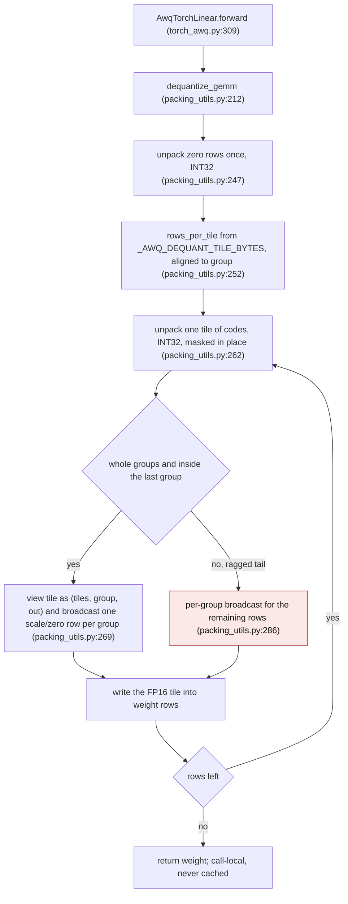

<!-- SPDX-FileCopyrightText: 2026 ModelCloud.ai
SPDX-License-Identifier: Apache-2.0 -->

# AWQ GEMM dequantization tiling

`AwqTorchLinear` is the portable dense AWQ kernel: it dequantizes the packed
weight and multiplies, and it is the arithmetic oracle the other AWQ kernels are
checked against. That shape is deliberate, so the weight is *not* cached between
calls — the dequantized tensor lives for exactly one forward.

The cost of that choice is decided by how the reconstruction is written, not by
the fact that it happens. `dequantize_gemm` used to expand the group scales and
zero points to the full `[in_features, out_features]` shape and keep several
full-size intermediate copies alive at once. For a 4096x4096 four-bit layer that
was 448 MiB of transient memory to produce a 32 MiB FP16 weight, and the
expansion dominated decode latency. The reconstruction is now tiled over input
rows and broadcasts one scale/zero row per group, so the temporary storage is
proportional to one tile instead of a multiple of the whole weight.

## New flow

The only branch that is not a straight tile loop is the ragged tail: rows past
the last whole group, or a tile that does not start on a group boundary, fall
back to one group row at a time. It is highlighted because it is the path that
keeps `in_features` values correct when `in_features` is not a multiple of
`group_size`.

For four-bit weights the AWQ interleave is folded into the extraction offsets
(`AWQ_REVERSE_ORDER`), so codes and zero points come out in natural column order
and the separate `reverse_awq_order` gather is not needed. The four-bit and
generic bit-stream unpackers share `_unpack_columnwise`, which now takes an
integer width: `dequantize_gemm` asks for INT32 because a code is at most eight
bits wide, while the packing paths keep INT64 for their widened arithmetic.

## Before and after

| Mechanism | Before (`origin/main`) | After |
| --- | --- | --- |
| Reconstruction entry | `dequantize_gemm`, `packing_utils.py:180` | `dequantize_gemm`, `packing_utils.py:212` |
| Code width | INT64 from `torch.arange` shifts, `packing_utils.py:90-92` | INT32 per tile, `packing_utils.py:80` |
| Column order | full-size `reverse_awq_order` gather, `packing_utils.py:184` | folded into extraction offsets, `packing_utils.py:240` |
| Scale expansion | `scales.repeat_interleave(group_size)`, `packing_utils.py:191` | contiguous group-row slice broadcast, `packing_utils.py:269` |
| Zero-point expansion | `izeros.repeat_interleave(group_size)`, `packing_utils.py:192` | same slice broadcast, no expansion |
| Arithmetic | full-size `(iweight - izeros) * scales`, `packing_utils.py:193` | in-place `sub_` then `torch.mul(..., out=weight[rows])`, `packing_utils.py:273` |
| Peak scratch | several full-size copies plus the weight | one tile plus the weight |

## Failure and ambiguity contract

| Situation | Before | After |
| --- | --- | --- |
| `in_features` not a multiple of `group_size` | expanded to `groups * group_size` rows, more rows than the weight has | returns exactly `in_features` rows; the tail keeps the last group's scale |
| `group_size <= 0` (per-channel) | `repeat_interleave(-1)` raised | one group spans every row |
| `qzeros is None` | `AttributeError` inside the unpacker | `ValueError: dequantize_gemm requires packed AWQ zero points` |
| tile smaller than one group | not expressible | per-group fallback produces the same values |
| `bits` 2, 3, 8 | full-size INT64 | same arithmetic, tiled, INT32 codes |
| forward repeated | weight rebuilt per call | weight rebuilt per call; nothing retained |

## Measured

4096x4096, four bits, group size 128, FP16 activations, one layer.

| Metric | Before | After |
| --- | --- | --- |
| `dequantize_gemm` peak | 448.0 MiB | 48.5 MiB |
| Forward peak, CUDA path | 448.0 MiB | 48.5 MiB |
| Forward peak, ROCm path | 448.0 MiB | 112.0 MiB (48.5 dequantization + the matmul workspace) |
| M=1, CUDA path | 1.961 ms | 0.326 ms |
| M=1, ROCm path | 3.129 ms | 0.764 ms |
| M=1024, CUDA path | 2.106 ms | 0.497 ms |
| M=1024, ROCm path | 5.865 ms | 3.520 ms |

4096x40960 (the wide-layer case that drives the OOM risk): the dequantization
peak drops from 4480 MiB to 365 MiB, where the reconstructed FP16 weight itself
is 320 MiB.

Tile sizing was measured rather than guessed. On the 4096x4096 shape, an 8 MiB
tile peaks at 48.5 MiB and 0.76 ms, 16 MiB at 64.5 MiB and 0.68 ms, and 32 MiB
at 96.5 MiB and 0.65 ms; the constant keeps the 8 MiB point because the
temporary storage is the property this change is defending.

## Not in scope

`AwqTorchLinear` still materializes the dense weight; it is not a fused kernel.
The fused AWQ Triton GEMM/GEMV kernels (`AwqGEMMTritonLinear`,
`AwqGEMVTritonLinear`) already exist and AUTO selects them for four-bit GPU
loads, so a fused path here would duplicate a kernel that is already dispatched.
The remaining gap between this kernel and a fused decode is therefore expected:
decode is about 9x a dense matmul on the CUDA path and about 20x on the ROCm
path after this change, versus about 45x and 80x before.

## Validation

`tests/kernels/test_awq_dequantize_tiling.py` pins:

| Test | Invariant |
| --- | --- |
| `test_matches_previous_repeat_interleave_formulation` | bitwise equality with the removed formulation for bits 2, 3, 4, 8 and group sizes 16, 32, 128 |
| `test_matches_hand_decoded_oracle` | equality with an oracle that packs and decodes the words itself |
| `test_endpoint_codes_zeros_and_scales` | clamp endpoints, zero and negative scales, group-boundary rows |
| `test_per_channel_group_spans_all_rows` | `group_size` -1 and `in_features` both mean one group |
| `test_uneven_tail_uses_the_last_group` | `in_features % group_size != 0` returns `in_features` rows |
| `test_tile_size_does_not_change_the_result` | a tile bound below one group is clamped to a group and matches |
| `test_narrow_out_features_slices_the_packed_row` | a packed row holding more codes than `out_features` keeps column order |
| `test_missing_zero_points_is_rejected` | a missing zero-point tensor fails closed |
| `test_forward_keeps_weights_quantized_between_calls` | no dequantized weight survives a forward |
| `test_temporary_storage_is_bounded_by_the_weight_size` | peak scratch stays under 2.5x the FP16 weight |

The suite runs on both the CUDA and the ROCm path; the storage test runs on a
GPU and the numerical tests also run on CPU.

This flow was introduced by the fix for the AWQ Torch per-forward dequantization
report.
