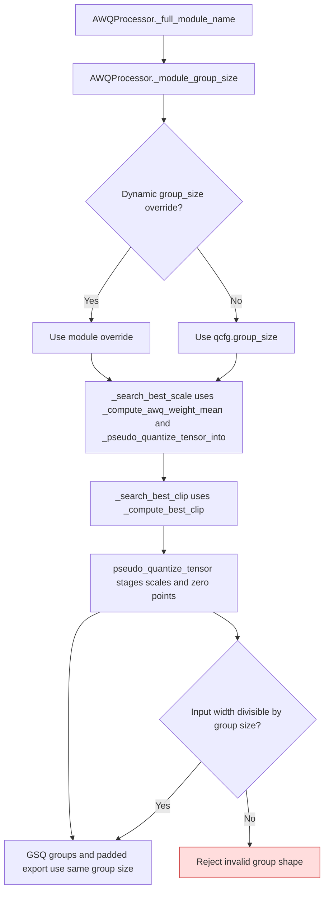

<!-- SPDX-FileCopyrightText: 2026 ModelCloud.ai
SPDX-License-Identifier: Apache-2.0 -->

# AWQ dynamic group-size resolution

The effective AWQ group size is resolved for each module from its full name
and `qcfg.dynamic`. The same value governs scale search, clip search, staged
codes, optional GSQ refinement, and the packed scale/zero shape. This flow was
corrected in PR #3723.

| Mechanism | Before | After |
| --- | --- | --- |
| Scale search | `gptqmodel/looper/awq_processor.py:1668` used global `qcfg.group_size` | `_group_size_for` supplies one size per linear |
| Stage and GSQ | `gptqmodel/looper/awq_processor.py:2602` and `:2610` used the global size | `_module_group_size` supplies the module size to stage, GSQ, and padded export |
| Clip search | `_compute_best_clip` used the global size | `_search_best_clip` passes each module's size |

An invalid positive group size that does not divide the input width fails at
`pseudo_quantize_tensor` instead of silently staging an incompatible shape.
The regression is `tests/test_awq_dynamic_group_size.py`.
