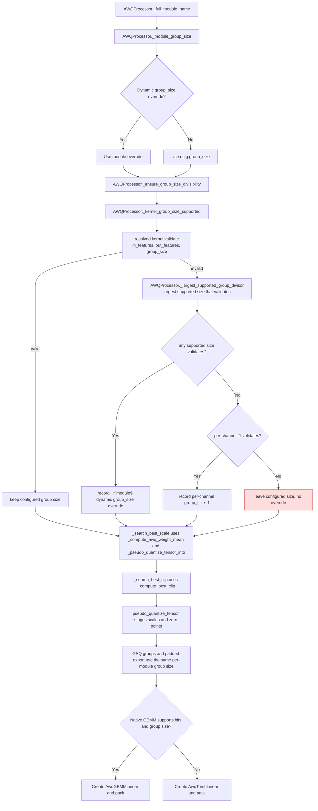

<!-- SPDX-FileCopyrightText: 2026 ModelCloud.ai
SPDX-License-Identifier: Apache-2.0 -->

# AWQ dynamic group-size resolution

The effective AWQ group size is resolved for each module from its full name
and `qcfg.dynamic`. The same value governs scale search, clip search, staged
codes, optional GSQ refinement, and the packed scale/zero shape. This flow was
corrected in PR #3723.

| Mechanism | Before | After |
| --- | --- | --- |
| Scale search | `gptqmodel/looper/awq_processor.py:1668` used global `qcfg.group_size` | `_group_size_for` supplies one size per linear |
| Stage and GSQ | `gptqmodel/looper/awq_processor.py:2602` and `:2610` used the global size | `_module_group_size` supplies the module size to stage, GSQ, and padded export |
| Clip search | `_compute_best_clip` used the global size | `_search_best_clip` passes each module's size |
| Packed kernel | A 4-bit group size of 16 could select `AwqGEMMLinear`, which rejects it during creation | `_resolve_qlinear_kernel` selects `AwqTorchLinear` when native GEMM does not support the module's effective group size |
| Retune predicate | Checked only `in_features % group_size` (PR #4084) | Asks the resolved kernel's `validate(in_features, out_features, group_size)` |
| Expert `gate_proj`/`up_proj` (4096 -> 448) | Kept group size 128 and raised in `create_quant_module` after calibration | Retuned to 64 before calibration |

The retune predicate must not duplicate the kernel's packing contract. PR #4084
checked only the input axis, so Phi-tiny-MoE's expert `gate_proj`/`up_proj`
(`in_features=4096`, `out_features=448`) passed the check with group size 128
and then failed inside `AwqGEMMLinear._validate`, which also requires
`out_features % group_size == 0`. `AWQProcessor._kernel_group_size_supported`
now calls the resolved kernel's own `validate` for every candidate, so the
retune decision and the packing gate cannot drift apart. When no positive
supported size validates, the module falls back to the per-channel `-1`
contract; when even per-channel does not pack the shape, the configured size is
left untouched and no override is recorded (a non-quantized module such as the
PhiMoE router is not rewritten).

The regression is `tests/test_awq_dynamic_group_size.py`. It creates and packs
an AWQ module with a dynamic 16-column group and compares the decoded packed
weight with the staged quantized tensor, and it covers both the 448-wide input
axis and the 448-wide output axis.
