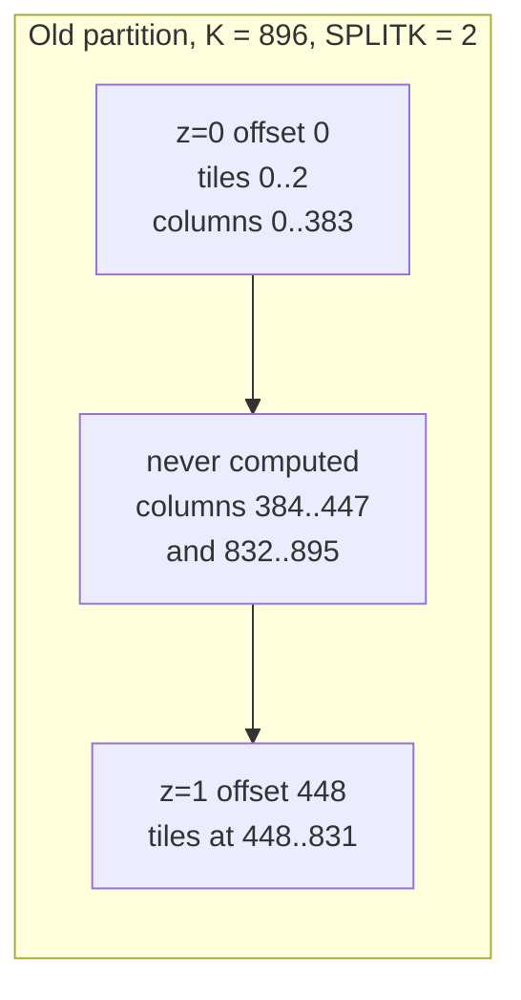
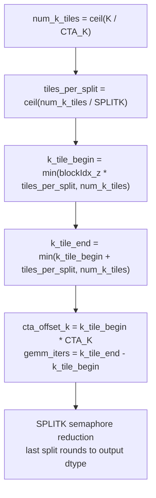
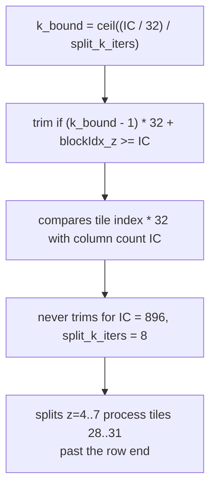
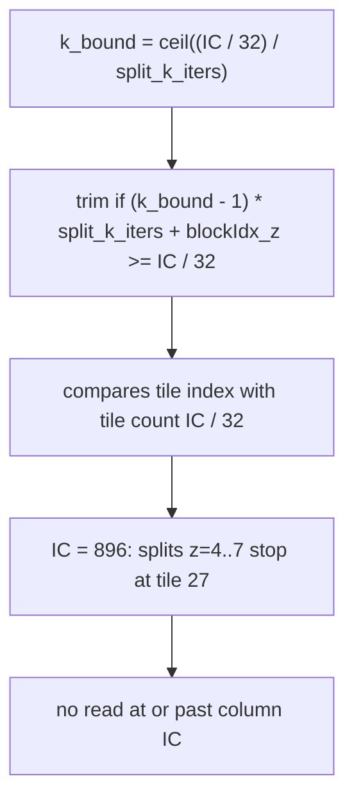

# AWQ split-K kernel boundaries

Two native CUDA AWQ kernels partition the reduction (K) axis across blocks:

- `gemm_forward_cuda_prefill` dispatches `gemm_w4a16_T1` with `SPLITK = 2` and
  `CTA_K = 128` for `M <= 32` (short prefill and batch decode).
- `gemmv2_forward` dispatches `gemmv2_forward_4bit_cuda_m128n64k32` with
  `split_k_iters = 8` and 32-wide k-tiles for `M > 8`.

A split-K partition must cover every K tile exactly once and must never read a
tile whose start is past `K`. This page records that contract, the two places
that broke it (issue #4054 items 1-2), and the fix. Items 3-7 of the same issue
touch CPU dispatch, `torch.compile`, and `device_map`; they are out of scope
here.

Introduced by the fix for issue #4054 items 1-2.

## 1. Prefill split-K tile coverage

`gemm_w4a16_T1` chose a split offset with `blockIdx_z * (K / SPLITK)` and a
per-split tile count with `ceil(K / CTA_K) / SPLITK`. Integer division truncates:
for `K = 896`, `ceil(896 / 128) = 7` tiles and `7 / 2 = 3` iterations, so each
split computed 3 tiles and two K ranges were never touched.

The fix partitions whole tiles and lets the last split take the remainder:

`cta_offset_k` is now always a multiple of `CTA_K`, so the scale group
`(cta_offset_k + iter * CTA_K) / G` stays aligned with the loaded tile. Splits
that receive no tile run zero iterations and contribute a zero partial, which
keeps the existing semaphore order intact.

| Mechanism | Before | After |
| --- | --- | --- |
| Split K offset | `blockIdx_z * (K / SPLITK)` (`gemm_cuda.cu:341`) | `k_tile_begin * CTA_K` (`gemm_cuda.cu:352`) |
| Per-split tiles | `ceil(K / CTA_K) / SPLITK` (`gemm_cuda.cu:351`) | `k_tile_end - k_tile_begin` (`gemm_cuda.cu:362`) |
| Odd `K / 128` | tail tiles dropped | every tile covered once |

### Measured effect (RTX 4090, fp64 dequantize-then-matmul oracle)

Relative output error, `N = 128`, `group_size = 128`, `SPLITK = 2`:

| K | M=1 before | M=7 before | M=32 before | M=33 before | after (all M) |
| --- | --- | --- | --- | --- | --- |
| 896 | 0.797 | 0.615 | 0.569 | 2.8e-4 | 2.8e-4 .. 3.3e-4 |
| 1024 | 2.6e-4 | 2.9e-4 | 2.8e-4 | 2.9e-4 | 2.6e-4 .. 2.9e-4 |
| 1152 | 0.611 | 0.609 | 0.606 | 2.9e-4 | 2.8e-4 .. 3.2e-4 |
| 1408 | 0.486 | 0.578 | 0.551 | 2.8e-4 | 2.8e-4 .. 2.9e-4 |
| 4864 | 3.0e-4 | 3.0e-4 | 2.9e-4 | 2.9e-4 | 2.9e-4 .. 3.0e-4 |

`K = 1024` and `K = 4864` divide evenly into tiles and were already correct;
`M = 33` and larger use a non-split branch, which is why they were correct even
before the fix.

## 2. Decode-batch k-tile bound

`gemmv2` trims the last split so its tile index stays in range. The old check
compared a 32-wide tile index against the column count:

The fix compares tile indices with the tile count `IC / 32`:

The host requires `num_in_channels % group_size == 0` with `group_size` 64 or
128, so `IC / 32` is an exact tile count. The same bound style already existed
in the sibling `m16n128k32`, `m16n64k32`, and MoE kernels; `gemmv2` was the
outlier.

| Mechanism | Before | After |
| --- | --- | --- |
| Last-split trim | `(k_bound - 1) * 32 + blockIdx_z >= IC` (`gemm_cuda_gen.cu:628`) | `(k_bound - 1) * split_k_iters + blockIdx_z >= IC / 32` (`gemm_cuda_gen.cu:632`) |
| `IC = 896`, `split = 8` | tiles 28..31 read past the row | tiles stop at 27 |

### Measured effect (RTX 4090)

NaN sentinel placed in the same storage immediately after the activation
matrix, `M = 9`, `N = 128`:

| K | non-finite outputs before | after |
| --- | --- | --- |
| 896 | 128 / 1152 | 0 / 1152 |
| 1152 | 128 / 1152 | 0 / 1152 |
| 1408 | 128 / 1152 | 0 / 1152 |
| 4864 | 0 / 1152 | 0 / 1152 |

`K = 4864` has `4864 / 32 = 152` tiles, which divides evenly by 8, so it was
never affected. When the memory after the last row is finite the over-read is
usually harmless because the padded scale row is zero, which is why the bug
appeared as an intermittent NaN row (`0 * NaN`) rather than a stable error.

## Contracts

- A split-K launch covers every K tile exactly once.
- No split reads a tile whose first column is `>= K`.
- Split offsets are multiples of the tile width, so group-scale indexing is
  `(offset + iter * tile) / group_size`.
- A split with no tile runs zero iterations and still participates in the
  semaphore reduction.

## Failure paths

- Odd tile count with `SPLITK > 1`: dropped tail tiles produce silently wrong
  numerics for `M <= 32` prefill and batch-decode inputs.
- Tile index compared with a column count: out-of-bounds reads for the final
  activation row, turning a zero-padded scale into `0 * NaN`.

## Tests

`tests/kernels/test_awq_gemv_splitk.py` pins both contracts against an
independent float64 oracle:

- `test_gemv_fast_prefill_computes_every_k_tile`: `K` in 896/1024/1152/1408/4864
  and `M` in 1/7/8/16/32/33/100.
- `test_gemv_fast_prefill_ignores_nonfinite_memory_after_input`: NaN tail after
  the activation storage.
- `test_gemmv2_matches_fp64_oracle_across_k_tiles`: numeric match for `M > 8`.
- `test_gemmv2_never_reads_past_the_activation_row`: NaN tail plus several
  `split_k_iters` values, including ones that do not divide `IC / 32`.
- `test_real_qwen25_awq_gemv_greedy_decode_stays_finite`: real Qwen2.5-0.5B
  (hidden 896 / intermediate 4864) quantized to `FORMAT.GEMV`, then greedy
  decode with finite scores.

## Out of scope

Issue #4054 items 3-7 (CPU AUTO group size, `torch.compile` `addmm`, W4AFP8
compile, `device_map` CPU entries, `max_memory`) are owned by a separate change.
