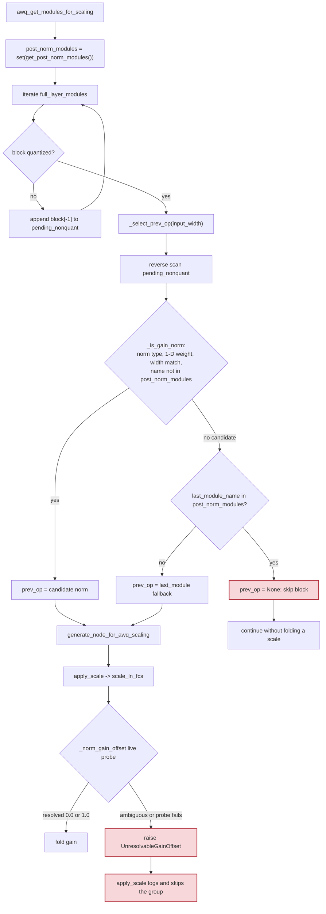

# AWQ normalization selection and gain probing

AWQ folds one smoothing scale into the module that produces a quantized
block's input. Two decisions decide whether that fold is correct:

1. **Which normalization feeds the block.** Module-tree order is not forward
   order. LFM3 lists `operator_norm, post_operator_norm` before `conv` and
   `ffn_norm, post_ffn_norm` before `feed_forward`, but the `post_*` norms run
   on the block output after the residual add. Selecting by position folded
   the scale into the wrong norm and changed the layer output by 0.569 on the
   synthetic LFM3 fixture used by `tests/test_awq_scale_folding.py` (0.688 on
   the real `LFM3QModel` measurement in issue #4002).
2. **Whether the gain parameterization can be measured.** A norm that scales
   before normalizing has no foldable post-gain. Source text that contains
   `1.0 + self.weight` cannot prove that the gain is applied after
   normalization.

Introduced by the fix for issue #4002. The offset-gain detection and float32
fold it builds on came from [PR #3989](https://github.com/ModelCloud/GPTQModel/pull/3989)
and are described in [AWQ scale folding](awq-scale-folding.md).

## Selection flow

`awq_get_modules_for_scaling` reads the definition-level `:postnorm` tag once
per layer, then skips those names while resolving `prev_op`.

The red paths are the fail-closed boundaries: a post-norm is never used as a
source, and an unresolvable gain is never guessed.

## Before and after

| Mechanism | Before (origin/main) | After |
| --- | --- | --- |
| `prev_op` selection | last width-matching gain norm in the run, regardless of data flow, `gptqmodel/models/base.py:4407` | reverse scan skips names tagged `:postnorm`, `gptqmodel/models/base.py:4432` and `:4443` |
| Definition metadata | none; LFM3 post-norms were ordinary `:!` leaves | `POST_NORM_FLAG = ":postnorm"` at `gptqmodel/models/base.py:559`, collected by `get_post_norm_modules` at `:1520` |
| LFM3 / LFM3-VL / LFM3-Omni tree | `post_operator_norm:!`, `post_ffn_norm:!` | `post_operator_norm:!:postnorm`, `post_ffn_norm:!:postnorm` |
| Gain probe failure | grep forward source for `1.0+self.weight` and fold as offset, `gptqmodel/quantization/awq/quantize/scale.py:62` (origin/main) | `_norm_gain_offset` raises `UnresolvableGainOffset`, `gptqmodel/quantization/awq/quantize/scale.py:65` |
| Scale application after probe failure | mutated norm and consumer weights | `apply_scale` logs and skips the group before touching weights or captured features, `gptqmodel/quantization/awq/quantize/scale.py:150` |

### Measured effect

| Case | Before | After |
| --- | --- | --- |
| LFM3 conv `prev_op` | `post_operator_norm` | `operator_norm` |
| LFM3 FFN `prev_op` | `post_ffn_norm` | `ffn_norm` |
| LFM3 layer-output relative L2 after fold | 0.569 (fixture) / 0.688 (real model, issue #4002) | 1.57e-07 |
| `MuseSparkTextInputScaledRMSNorm` probe | source text resolved offset 1.0 | `UnresolvableGainOffset` |
| MuseSpark fold relative L2 | 0.113 (fp32) / 0.093 (bf16, issue #4002) | scale skipped; weights and output unchanged |

## Contracts

- `:postnorm` is definition-level metadata. Apply it only to a norm whose
  output is consumed by the residual add, never to a norm that feeds a
  quantized projection.
- Width equality is necessary but not sufficient for a fold source; the name
  must also not be a declared post-norm.
- If a non-quantized run has no usable source, AWQ skips that block instead of
  falling back to an unrelated module.
- A gain probe that cannot distinguish `weight` from `1 + weight` is
  fail-closed: `scale_ln_fcs` raises, and `apply_scale` skips the whole group
  without mutating the norm, the consumer weights, or the captured input
  features.
- Source text is never parsed to infer gain semantics.

The regression coverage is in `tests/test_awq_scale_folding.py`:
`test_lfm3_post_norms_are_declared_non_sources`,
`test_lfm3_sandwich_post_norms_are_not_fold_sources`,
`test_lfm3_sandwich_norm_fold_is_output_neutral`, and
`test_probe_failure_skips_scale_instead_of_guessing_from_source`.
