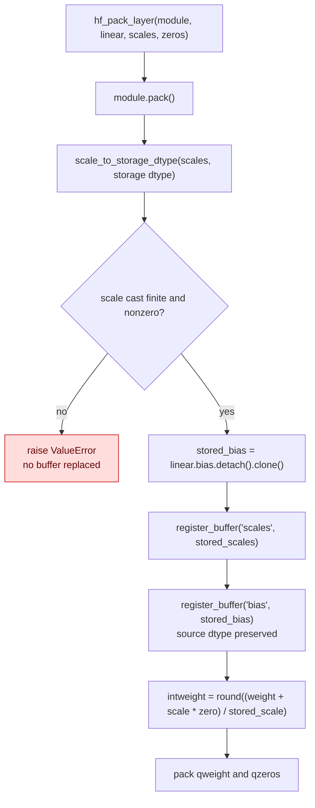
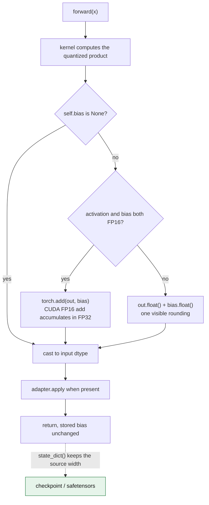

<!-- SPDX-FileCopyrightText: 2026 ModelCloud.ai
SPDX-License-Identifier: Apache-2.0 -->

# AWQ pack-time bias storage

A quantized AWQ layer stores two different kinds of floating tensor. `scales`
is a quantization operand: the kernel multiplies the stored INT4 codes by it,
so it must live in the layout's storage dtype (FP16 for the native GEMM, GEMV
and GEMV_FAST layouts). The non-quantized `bias` is not an operand: every AWQ
forward adds it *after* the reduction, and every AWQ forward already widens
that addition to FP32 for a bias wider than the activation dtype.

The native packers treated the bias like part of the affine state and stored it
in the scale dtype. `AwqGEMMLinear.pack` did that outright
(`gemm_awq.py:384` before this change: an FP32 source became `scale_dtype`),
and `AwqGEMVLinear.pack` (`gemv_awq.py:261`) and `AwqGEMVFastLinear.pack`
(`gemv_fast_awq.py:279`) called `.half()` unconditionally. The public
`hf_pack_layer` AWQ branch (`packing.py:619`) forwards to those packers without
a second representability check, so the corruption reached every supported
entry point.

The result is unrecoverable. An FP32 `-100000` is `-inf` in FP16, and `65520`
rounds to `inf` as well. Once the buffer holds `-inf`, no forward-time
precision fix restores the original value: the checkpoint is already wrong and
every reload reads the same corrupted tensor.

## Storage rule

| Tensor | Storage dtype | Why |
| --- | --- | --- |
| `scales` | layout storage dtype (FP16 / BF16) | multiplied into every code; `scale_to_storage_dtype` rejects a lossy cast |
| `bias` | source layer dtype (FP16 / BF16 / FP32) | added after the reduction; forward widens it to FP32 |

The packers now use `linear.bias.detach().clone()` and register that tensor
unchanged, so the source precision reaches `state_dict()`, the safetensors
payload and a reload. `forward` keeps the same wide epilogue it already had:

* `AwqGEMMLinear` adds `bias.float()` to the FP32 split-K partials or to the
  FP32 dequantize-then-matmul product, then casts once.
* `AwqGEMVLinear` / `AwqGEMVFastLinear` add `bias.float()` to the FP32 result
  unless both the activation and the bias are FP16, where the CUDA FP16 add
  already accumulates in FP32.
* `AwqTorchLinear` and `AwqGEMVTorchLinear` reduce into FP32 and add the stored
  bias there.

`AwqGEMMLinear`, `AwqGEMVLinear`, `AwqGEMVFastLinear`, `LLMAwqLinear` and
`AwqGEMMTritonLinear` therefore declare `MODEL_DTYPE_BUFFERS = ()`. That keeps
the loader from narrowing a wide checkpoint bias to the requested model dtype
before the first forward.

## Pack flow

The bias decision needs no range test because it never leaves its source dtype.
A value the source dtype holds is copied exactly; a value it cannot hold was
never representable in the first place and is not the packer's to change.

## Forward flow

## Before and after

| Location (before this change) | Previous mechanism | Current mechanism |
| --- | --- | --- |
| `gemm_awq.py:384-385` | `bias_dtype = ... else scale_dtype`; `linear.bias.clone().to(bias_dtype)` | `linear.bias.detach().clone()`, registered at the source dtype |
| `gemv_awq.py:261` | `linear.bias.clone().half()` | source dtype preserved |
| `gemv_fast_awq.py:279` | `linear.bias.clone().half()` | source dtype preserved |
| `gemv_fast_awq.py:246-249` | `_ensure_runtime_buffers` rewrote `bias` to the activation dtype | moves the bias only; never rewrites its values or width |
| `gemm_awq.py:309-310` | `_bias_for_compute` converted to the activation dtype | returns the stored tensor; the epilogue already computes in FP32 |
| `AwqGEMMLinear` / `AwqGEMVLinear` / `AwqGEMVFastLinear` / `AwqGEMMTritonLinear` | inherited `MODEL_DTYPE_BUFFERS = ("bias",)`, so the loader narrowed a wide bias | `MODEL_DTYPE_BUFFERS = ()` |

## Failure and ambiguity contract

| Situation | Before | After |
| --- | --- | --- |
| FP32 bias `-100000`, GEMM/GEMV/GEMV_FAST pack | `-inf` in every element | FP32 `-100000` preserved |
| FP32 bias `65520` (FP16 overflow midpoint) | `inf` | FP32 `65520` preserved |
| FP32 bias `-1e-45` (FP16 underflow) | `0` (bias deleted) | FP32 `-1e-45` preserved |
| FP32 bias `65504` (largest finite FP16) | FP16 `65504` | FP32 `65504` preserved |
| BF16 bias `100000` | FP16 `inf` | BF16 `100000` preserved |
| Bias already FP16 | FP16, unchanged | FP16, unchanged |
| Pack -> save -> reload at FP16 | reloaded from the corrupted `-inf` tensor | FP32 value restored by `load_checkpoint_in_model_then_tie_weights` |
| Layer without a bias | no `bias` buffer | no `bias` buffer |

## Measured

Fixture: `in_features = out_features = 128`, all-ones weight, 4-bit,
`group_size = 128`, scale 1, zero point 0, FP32 bias `-100000`; the original
pack method runs on CPU.

| Kernel | Before | After |
| --- | --- | --- |
| `AwqGEMMLinear.pack` | 128/128 values `-inf` | 128/128 values `-100000`, dtype FP32 |
| `AwqGEMVLinear.pack` | 128/128 values `-inf` | 128/128 values `-100000`, dtype FP32 |
| `AwqGEMVFastLinear.pack` | 128/128 values `-inf` | 128/128 values `-100000`, dtype FP32 |

Forward cancellation, `x = 1000`, `sum(x * w) = 128000`, bias `-100000`:
`AwqTorchLinear`, `AwqGEMVTorchLinear`, the Triton GEMM reader and the native
CUDA `AwqGEMMLinear` all return `28000` in FP16, matching an FP64 oracle. The
native GEMV kernels round their own partial result to FP16 before the Python
epilogue, so their cancellation test keeps the product inside the FP16 range
(`x = 100`, bias `-10000`, result `2800`). The Triton GEMV reader passes that
shape on CUDA and on ROCm.

`AwqGEMMTritonLinear` allocates its bias placeholder at the kernel's default
FP16 width because it has no packer of its own; a checkpoint rebuild records
the real value through `bias_dtype` and recreates the buffer at that width
before the copy. This is the same path `restore_packed_module` uses.

## Validation

`tests/test_awq_pack_bias_representability.py` covers, for
`AwqGEMMLinear`, `AwqGEMVLinear`, `AwqGEMVFastLinear` and `LLMAwqLinear`:

* the bias value set `-100000`, `100000`, `±65520`, `65504`, the two
  `nextafter` neighbours of `±65520`, `-1e-45` and `0`, for FP32 and BF16
  sources, through the real `pack()` method;
* the same values through the public `hf_pack_layer` AWQ branch;
* absence of a `bias` buffer when the source layer has no bias;
* `pack -> safetensors -> load_checkpoint_in_model_then_tie_weights`, asserting
  the reloaded buffer is FP32 `-65520` rather than the FP16 placeholder;
* forward cancellation against an independent FP64 oracle for the portable
  Torch GEMV reader, `AwqTorchLinear`, and - where available - the native CUDA
  GEMM/GEMV/GEMV_FAST kernels and the Triton GEMV reader.

`tests/test_awq_gemv_bias_pack.py` pins the packed-bias dtype, and
`tests/test_awq_pack_scale_representability.py` keeps the adjacent scale
contract unchanged.

## Not in scope

`AwqMarlinLinear` is a load-time repack target, not a packer, and its native
kernel reads `b_bias` as `at::Half`/`at::BFloat16` (it also narrows the buffer
in `forward`). A wide checkpoint bias therefore still has to be narrowed before
the Marlin launch, which the Python epilogue cannot undo. That is a separate
kernel-ABI change and is not part of this pack-time fix.
