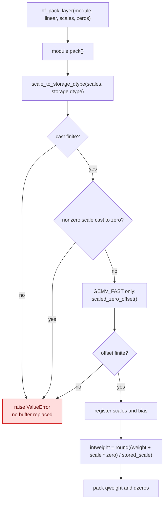

<!-- SPDX-FileCopyrightText: 2026 ModelCloud.ai
SPDX-License-Identifier: Apache-2.0 -->

# AWQ pack-time scale representability

The native AWQ GEMM, GEMV, and GEMV_FAST layouts store their group scales as
FP16. The AllSpark AWQ layout stores them at the module's FP16 or BF16 compute
dtype. The packers used to cast the source scales to that storage dtype after
registering them, then divide by the stored value to compute the weight codes.
A source scale that overflowed to infinity or underflowed to zero therefore
changed every code derived from it. The later code clamp could not recover the
lost scale; it only hid the corruption as a different valid-looking code.

`scale_to_storage_dtype` checks the actual cast result before any module buffer
is replaced. A non-finite result, or a nonzero source scale that becomes zero,
fails closed with `ValueError`. The check applies to the real storage dtype of
each layout, so a BF16 source scale is validated against BF16 while the native
FP16 layouts are validated against FP16.

## Pack flow

The check is made on the cast result, not on the source value: `65520` is finite
in FP32 but rounds to FP16 infinity, and `2**-26` is finite in FP32 but rounds
to FP16 zero. The smallest positive FP16 subnormal is `2**-24`; `2**-25` is the
round-to-nearest-even tie and also becomes zero.

## Before and after

| Kernel | Previous pack path | Current pack path |
| --- | --- | --- |
| `AwqGEMMLinear.pack` (`gemm_awq.py:333-334` before this change) | registered `scales.to(fp16)`, then divided by the stored buffer | validates the cast before `register_buffer` |
| `AwqGEMVLinear.pack` (`gemv_awq.py:256-257` before this change) | wrote `scales` into an FP16 `qscales`, then divided by it | validates the cast before writing `qscales` |
| `AwqGEMVFastLinear.pack` (`gemv_fast_awq.py:272-276` before this change) | checked the FP16 offset with `scaled_zero_offset` but not the scale underflow | validates the scale first, then the offset |
| `AllSparkAwqLinear.pack` (`allspark_awq.py:201-202` before this change) | registered `scales.to(compute_dtype)`, then divided by the stored buffer | validates the cast before `register_buffer` |

## Failure and ambiguity contract

| Situation | Before | After |
| --- | --- | --- |
| `scale=2**-26`, `weight=2**-24`, `zero=8` | stored scale is `0`; code becomes `15` instead of `12` | `ValueError` |
| `scale=65520`, `weight=0`, `zero=8` | stored scale is `inf`; GEMM/GEMV code becomes `0` instead of `8` | `ValueError` |
| Same overflow case on GEMV_FAST | offset check raises, but only after the scale was already lost | scale check raises first |
| Failure after a module already holds packed buffers | scale buffer replaced before the error | buffers unchanged |

The measured codes come from the real `hf_pack_layer` path with FP16 weights
and FP32 scales:

| Case | Expected code | Before GEMM/GEMV | Before GEMV_FAST | After |
| --- | ---: | ---: | ---: | --- |
| `scale=2**-26`, `weight=2**-24`, `zero=8` | 12 | 15 | 15 | `ValueError` |
| `scale=65520`, `weight=0`, `zero=8` | 8 | 0 | `ValueError` (offset) | `ValueError` (scale) |
| `scale=2**-26`, `weight=2**-24`, `zero=128`, AllSpark 8-bit | 132 | 255 | — | `ValueError` |
| `scale=65520`, `weight=0`, `zero=128`, AllSpark 8-bit | 128 | 0 | — | `ValueError` |

## FP16 boundaries

| Source scale | FP16 cast | Result |
| --- | --- | --- |
| `65504` | `65504` | accepted |
| `nextafter(65520, 0)` | `65504` | accepted |
| `65520` | `inf` | rejected |
| `65536` | `inf` | rejected |
| `2**-24` | `2**-24` | accepted |
| `nextafter(2**-25, inf)` | `2**-24` | accepted |
| `2**-25` | `0` (ties to even) | rejected |
| `2**-26` | `0` | rejected |

## Validation

- `tests/test_awq_pack_scale_representability.py::test_rejects_scale_that_underflows_fp16`
- `tests/test_awq_pack_scale_representability.py::test_rejects_scale_that_overflows_fp16`
- `tests/test_awq_pack_scale_representability.py::test_representable_scale_boundaries_keep_their_codes`
- `tests/test_awq_pack_scale_representability.py::test_failed_pack_leaves_module_state_intact`

The tests build each native kernel with only the shape attributes needed for
CPU packing, call the public `hf_pack_layer` entry point, and decode the packed
`qweight` to compare the resulting code.
