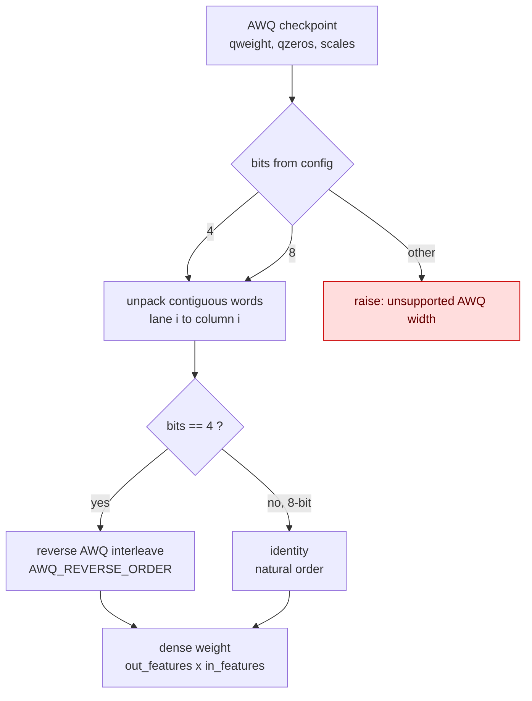
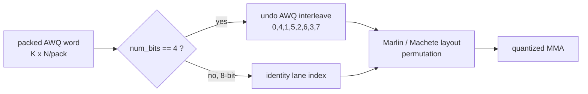

<!-- SPDX-FileCopyrightText: 2026 ModelCloud.ai
SPDX-License-Identifier: Apache-2.0 -->

# AWQ packed layout

AWQ checkpoints store `qweight` and `qzeros` packed along the **output**
dimension: one 32-bit word holds `32 / bits` consecutive output columns. The
bit order inside a word is not the same for every width. The classic INT4
layout interleaves the eight lanes as `[0, 2, 4, 6, 1, 3, 5, 7]` so that a
4-bit kernel can load a column pair with one shift. Every other width — 8-bit
in particular — is a plain little-endian stream, where lane `i` is output
column `i`.

Readers that consume the checkpoint must therefore know two things:

1. which width the checkpoint uses, and
2. whether that width carries the INT4 interleave.

Marlin and Machete then apply their own kernel-layout permutation on top of the
natural columns. An extra "undo" of the INT4 interleave for 8-bit input swaps
columns 1 and 2 inside every word and silently corrupts both weights and zero
points.

## Reader flow

The dequantizer and the Marlin/Machete repack share the same rule. Only the
4-bit path undoes the AWQ interleave; 8-bit input is already in natural order.
Widths outside 4 and 8 fail closed.

## Marlin and Machete repack

`awq_marlin_repack` and `awq_to_marlin_zero_points` read a packed AWQ word and
write the Marlin tile layout. `AwqMacheteLinear` does the equivalent
un-interleave in `_undo_awq_interleave` before `machete_prepack_B`. In all
three places the lane index must stay natural for 8-bit.

The Marlin zero-point path is the same decision, then `marlin_zero_points`
applies the Marlin permutation. Skipping the 8-bit undo leaves the natural
column order that `marlin_zero_points` expects.

## Before and after

| Reader | Old behaviour | New behaviour |
| --- | --- | --- |
| `awq_to_marlin_zero_points` (`gptqmodel/utils/marlin.py:1124-1133` on main) | applied `argsort([0,2,1,3])` for 8-bit | undoes only the 4-bit interleave |
| `awq_marlin_repack_kernel` (`gptqmodel_ext/marlin/awq_marlin_repack.cu:99-105` on main) | `undo_pack[4] = {0,2,1,3}` for every non-4-bit width | lane index stays natural for 8-bit |
| `_undo_awq_interleave` (`gptqmodel/nn_modules/qlinear/machete_awq.py:35-45` on main) | permuted 8-bit with `[0,2,1,3]` | returns 8-bit input unchanged |
| `convert_awq_file` (`gptqmodel/utils/model_dequant.py:1569-1572` on main) | `bits = 4` and generic `unpack_cols`, no `AWQ_REVERSE_ORDER` | reads `bits` from the quantization config and uses `unpack_awq` + `reverse_awq_order` |

## Contracts

- `bits` is read from `quantization_config["bits"]`; a missing key keeps the
  historical 4-bit default.
- 4-bit checkpoints keep their existing interleave and numeric behaviour.
- 8-bit `qweight`/`qzeros` are decoded in natural column order.
- An unsupported width raises instead of guessing a layout.
- `dequantize_model` passes the checkpoint's quantization config into
  `convert_awq_file`, so the width is never hardcoded.

## Validation

- `tests/kernels/test_awq_machete_marlin.py::test_awq_marlin_zero_points_8bit_keeps_natural_column_order`
- `tests/kernels/test_awq_machete_marlin.py::test_machete_undo_awq_interleave_8bit_is_identity`
- `tests/kernels/test_awq_machete_marlin.py::test_awq_marlin_cuda_8bit_matches_dense_reference`
- `tests/test_model_dequant_fp8.py::test_convert_awq_file_4bit_restores_natural_column_order`
- `tests/test_model_dequant_fp8.py::test_convert_awq_file_reads_8bit_from_config`
- `tests/test_model_dequant_fp8.py::test_dequantize_model_awq_8bit_uses_config_bits`

Measured on RTX 4090 (SM 8.9): an 8-bit Marlin layer with `K=512`, `N=256`,
`group_size=128` moved from max error `3.306` to `4.88e-4` against a dense
Torch oracle. On CPU, a 64x16 AWQ GEMM shard moved from max error `0.2748` to
exact equality for 4-bit, and 8-bit dequantization no longer crashes on the
hardcoded width.
