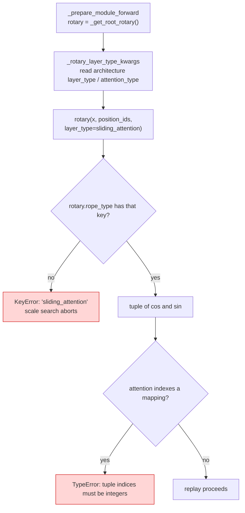
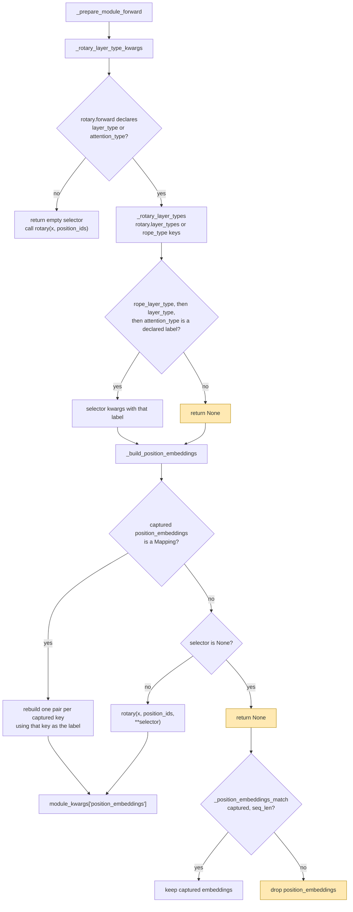

<!-- SPDX-FileCopyrightText: 2026 ModelCloud.ai
SPDX-License-Identifier: Apache-2.0 -->

# AWQ rotary replay selection

AWQ scale search replays a module group through the captured calibration
activations. When the replay target is an attention block that takes
`position_embeddings`, `AWQProcessor._prepare_module_forward` rebuilds the
cos/sin pair from the model's rotary embedding so the replay uses the retained
rows' real positions instead of another sample's sequence length.

Some rotaries keep one pair of buffers per layer type. Those rotaries require a
label that selects the buffer. Gemma 3/4 and OLMo 3 label the buffers with their
architecture types. DeepSeek V4 decouples the two: its architecture types are
`sliding_attention` / `compressed_sparse_attention` /
`heavily_compressed_attention`, while its rotary indexes `main` / `compress`.
The attention exposes the rotary label as `rope_layer_type`, and its
`position_embeddings` is a mapping from that label to the cos/sin pair.

Introduced by the fix for
[issue #4695](https://github.com/ModelCloud/GPTQModel/issues/4695).

## Old flow

Before the fix, `_rotary_layer_type_kwargs` only read the architecture attribute
(`layer_type` or `attention_type`) and passed it to the rotary unchanged. It
also always returned a tuple, even when the attention expected a mapping.



The removed mechanisms and their `main` locations at `19c40b201`:

| Mechanism | Location | Effect |
| --- | --- | --- |
| Architecture-only selector | `gptqmodel/looper/awq_processor.py:4167-4181` | `sliding_attention` passed to a `main`/`compress` rotary |
| No label validation | `gptqmodel/looper/awq_processor.py:4173-4181` | The rotary raised `KeyError` instead of the caller falling back |
| Tuple-only rebuild | `gptqmodel/looper/awq_processor.py:4087-4092` | Mapping-shaped `position_embeddings` became a tuple |
| Tuple/list-only length check | `gptqmodel/looper/awq_processor.py:4122-4140` | A mapping was treated as an unknown layout |
| Tensor/list/tuple-only chunk slicing | `gptqmodel/looper/awq_processor.py:4255-4264` | A mapping kept its full batch while `x` was split |

## New flow



`_rotary_layer_types` reads `rotary.layer_types` first and falls back to the
keys of `rotary.rope_type`. A rotary without either attribute keeps the old
behaviour: the first string architecture selector is passed without validation.

## Failure and ambiguity contract

| Situation | Before | After |
| --- | --- | --- |
| Rotary declares labels, attention exposes `rope_layer_type` | Architecture label passed; `KeyError` | The decoupled rope label is used |
| Rotary declares labels, attention has no valid selector, captured value is a tuple | Architecture label passed; `KeyError` | Captured pair kept when its length matches; otherwise dropped |
| Captured `position_embeddings` is a mapping | Tuple returned; `TypeError` at the attention | Mapping rebuilt per captured key |
| Captured mapping keys are not labels the rotary declares | Not reachable; the rotary raised first | Keep the captured mapping when its length matches; otherwise drop it |
| Rotary has no layer-type parameter | Empty selector | Empty selector (unchanged) |

The fallback is deliberately conservative: when the caller cannot prove a valid
label, it must not invent one. Replaying a same-length captured pair is safe;
replaying a foreign-length pair is not, so the stale value is removed and the
attention uses the replay context it was given.

## Tests

| Test node | Invariant |
| --- | --- |
| `test_selector_prefers_decoupled_rope_layer_type` | `rope_layer_type` wins over the architecture label for both rope labels |
| `test_architecture_layer_type_is_not_passed_when_rotary_cannot_resolve_it` | An undeclared architecture label produces `None`, not a rotary call |
| `test_mapping_position_embeddings_are_rebuilt_per_rope_type` | A stale mapping is rebuilt with one pair per captured key and the new sequence length |
| `test_unresolvable_selector_keeps_matching_captured_embeddings` | A same-length captured pair survives when no selector can be resolved |
| `test_chunked_replay_slices_mapping_position_embeddings` | A mapping is sliced with the same batch split as `x` |
| `test_awq_quantizes_tiny_deepseek_v4_with_decoupled_rope_types` | Public AWQ quantization, packed modules, and a finite forward on a mixed-layer-type V4 model |

## Validation

```bash
python -m pytest tests/test_awq_deepseek_v4_rotary_4695.py -q
# 7 passed

python -m pytest tests/test_awq_position_kwargs.py \
  tests/test_awq_vl_rotary_resolution.py tests/test_awq_rotary_device.py \
  tests/test_awq_scaling_groups.py tests/test_deepseek_v4_support.py \
  tests/test_awq_scale_search_safety.py tests/test_awq_moe_router_scaling.py -q
# 273 passed, 2 skipped
```

Against unmodified `main` (`19c40b201`), the same regression file fails all
seven tests; six fail with `KeyError: 'sliding_attention'` and the chunk-slicing
case fails because the mapping keeps its full batch.
