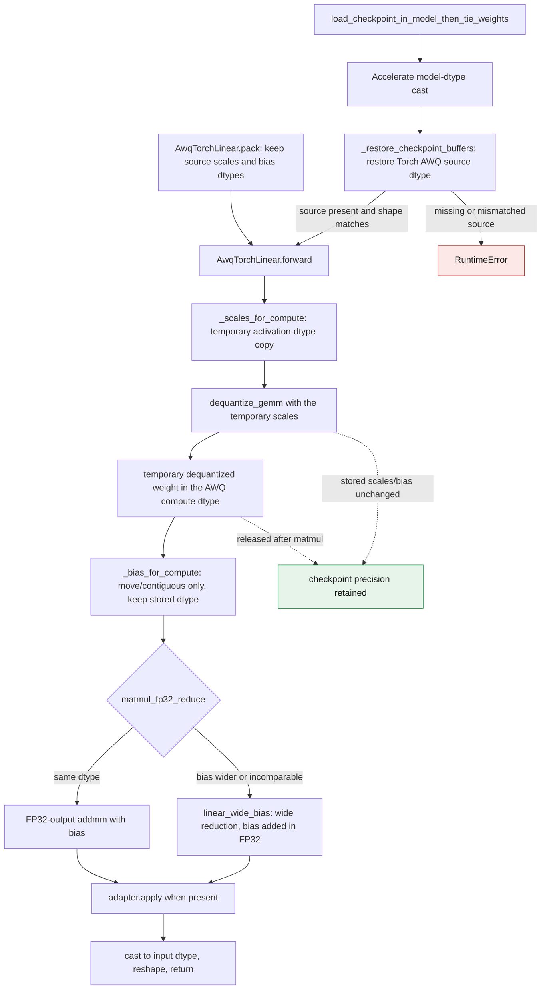

# AWQ runtime dtype precision

`AwqTorchLinear` stores `scales` and `bias` at the precision they were loaded
with. The activation dtype is a *compute* dtype: `forward` converts temporary
operands for the current call and never writes the converted values back into
the module buffers. This keeps repeated forwards with different activation
dtypes, and a re-saved checkpoint, at the original precision.

The model loader restores Torch AWQ scales and bias from the checkpoint after
Accelerate's model-dtype cast. When packing a dense layer, `pack()` keeps the
source scales and bias dtypes. The native AWQ GEMM and GEMV backends have
separate operand contracts.

The previous flow rewrote the buffers in place in `post_init` and
`_ensure_runtime_dtype` (`torch_awq.py:89` and `torch_awq.py:145` before this
change). That permanently rounded the stored value. Two failures followed:

* A BF16 scale below the FP16 subnormal range became zero on an FP16 forward,
  and the zero survived a later BF16 forward.
* A wide checkpoint bias was narrowed before the reduction, so a finite
  cancellation result became `-inf`, `NaN`, or a rounded `0`.

## Inference flow

`_scales_for_compute` returns the stored tensor unchanged when it already matches
the activation device and dtype, so the common FP16/BF16 path allocates
nothing extra. `_bias_for_compute` only moves the bias to the input device; it
never casts it. `matmul_fp32_reduce` selects `linear_wide_bias` whenever the
bias cannot be represented exactly in the activation dtype, adds it to the
FP32 reduction, and rounds once.

`AwqTorchLinear.forward` uses an FP16 or BF16 compute dtype. The shared
`_dequantize_weight_for_inference` helper also serves `ParoLinear._forward_dense`,
which can receive FP32 activations. That path dequantizes in FP32 so an FP32
checkpoint scale does not underflow or overflow in a half-precision
intermediate. The dequantized weight is temporary in both paths.

## Before and after

| Path | Previous mechanism | Current mechanism |
| --- | --- | --- |
| `post_init` | Cast non-half `scales`/`bias` to FP16 at `torch_awq.py:89-94` | Keep the loaded dtype; `post_init` only clears derived caches and initializes the adapter |
| Checkpoint load | Accelerate cast AWQ floating buffers to the requested model dtype in `utils/model.py:2805` | `load_checkpoint_in_model_then_tie_weights` restores source scales and bias dtypes |
| Dense pack | `torch_awq.py:122-126` cast FP32 scales and bias to a half dtype | `pack` retains both source dtypes |
| Runtime dtype | `_ensure_runtime_dtype` replaced `scales`/`bias` in place at `torch_awq.py:145-150` | `_scales_for_compute`/`_bias_for_compute` return temporary operands |
| Dequantize | `dequantize_gemm` read the mutated `self.scales` | Reads temporary compute-dtype scales; `self.scales` is unchanged |
| Bias | `matmul_fp32_reduce(..., bias=self.bias)` received the already-narrowed bias | Receives the stored bias, so the wide-bias path can select |

## Failure and ambiguity contract

| Situation | Before | After |
| --- | --- | --- |
| BF16 scale `1e-40`, FP16 forward, then BF16 forward | Scale and weight become `0`; the BF16 output is `0` | Scale stays `9.1835e-41`; the BF16 output matches the oracle |
| FP32 bias `-65535` cancelling a `65536` reduction, FP16 | Bias becomes `-inf`; output `-inf` or `NaN` | Bias stays FP32; output `1` |
| Same case, BF16 after `post_init` | `post_init` already narrowed the bias to FP16 `-inf`; output `-inf` | Output `1` |
| Same case, BF16 without `post_init` (runtime cast only) | Bias rounds to `-65536`; output `0` | Output `1` |
| FP32 checkpoint scales after `post_init` | Narrowed to FP16 permanently | Kept as FP32 |
| FP32 checkpoint bias loaded with FP16 model dtype | Accelerate changed `-65535` to `-inf` before `forward` | Loader restores the FP32 source value |
| FP32 source bias passed to `pack` | Stored as FP16 `-inf` | Stored as FP32 `-65535` |
| FP32 source scale near `1e-40` passed to `pack` | Stored as FP16 `0` | Stored at its original FP32 value |

The native `AwqGEMMLinear` CUDA kernel has its own activation-dtype operand
contract and is not covered by this page.

## Validation

`tests/kernels/test_awq_torch.py` builds a packed layer whose dequantized
weight equals the scale, then compares against an independent FP64 Torch
oracle that decodes the packed INT4 words itself. On the pre-fix revision
`e17a1a29b`, the cancellation case returned
`-inf` for both FP16 and BF16 after `post_init` narrowed the bias to FP16
(`0` for BF16 without `post_init`), where the oracle is `1`, and the
BF16-to-FP16-to-BF16 case left the scale at `0`. The fixed revision returns
`1` for both dtypes and preserves the `9.1835e-41` scale. The same values were
observed on NVIDIA CUDA and AMD ROCm devices; the original twelve test cases
pass on both.
The checkpoint-load and dense-pack regression cases cover the two earlier
precision-loss boundaries for both scales and bias. They pass on NVIDIA CUDA
and AMD ROCm.
The FP32 dense-fallback regression checks scales of `1`, `1e-40`, and `65536`;
the latter two became zero and infinity, respectively, when narrowed to FP16.
The new FP32 cases pass on NVIDIA CUDA and CPU; they have not been rerun on
AMD ROCm.

This flow was introduced by the fix for the AWQ forward precision report in
PR #3800.
