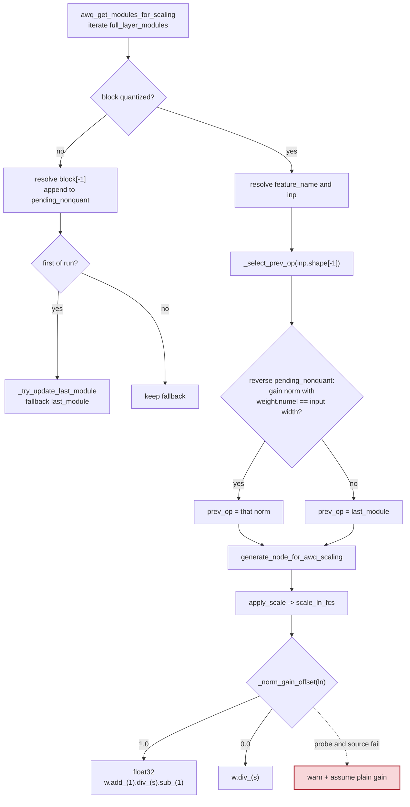

# AWQ scale folding into normalization modules

AWQ computes one smoothing scale per input channel and folds it into the
module that produces the quantized block's input. Correct folding requires two
facts that the model tree alone does not encode:

1. **Which module feeds the block.** In a run of consecutive non-quantized
   blocks, the consumer's input comes from the *last gain norm whose width
   matches the consumer's input*. Earlier entries in the run belong to sibling
   branches (a MoE router) or to the residual stream (Gemma's
   `post_attention_layernorm`).
2. **How the norm applies its gain.** Plain norms multiply by `weight`;
   Gemma-style norms multiply by `1 + weight`. The parameterization is a
   property of the module's forward, not of its class hierarchy.

Both decisions were previously made from the wrong signal: a fixed class list
for the gain offset and the first block of a non-quantized run for `prev_op`.

Introduced by the fix for issue #3973 in
[PR #3989](https://github.com/ModelCloud/GPTQModel/pull/3989).

## Folding flow

`_norm_gain_offset` first calls `resolve_gain_offset` (the live gain probe in
`gptqmodel/quantization/norm_tuning.py`). The probe evaluates `weight` and
`1 + weight` on a private copy at two small gains. If the module's forward
cannot be probed, `_source_gain_offset` inspects the forward source for an
additive offset; if that is inconclusive the fold warns and falls back to a
plain gain (the pre-fix behavior).

## Before and after

| Mechanism | Before | After |
| --- | --- | --- |
| Offset-gain detection | `isinstance(ln, GemmaRMSNorm) or isinstance(ln, Gemma2RMSNorm)` at `gptqmodel/quantization/awq/quantize/scale.py:145` (origin/main) | `_norm_gain_offset` -> `resolve_gain_offset` at `gptqmodel/quantization/awq/quantize/scale.py:87` |
| Offset fold precision | `ln.weight += 1; ln.weight.div_(scales); ln.weight -= 1` in the stored dtype | float32 `folded.add_(1).div_(s).sub_(1)` then cast back, `gptqmodel/quantization/awq/quantize/scale.py:202` |
| `prev_op` for a run of non-quantized blocks | first block of the run; subsequent blocks skipped at `gptqmodel/models/base.py:4415` (origin/main) | all blocks collected in `pending_nonquant`; consumer picks the matching gain norm via `_select_prev_op` at `gptqmodel/models/base.py:4407` |
| Empty block inside a run | skipped only because the first-of-run rule skipped every later block | explicitly skipped without breaking the run, `gptqmodel/models/base.py:4442` |

### Measured effect

| Case | Before | After |
| --- | --- | --- |
| `Gemma3RMSNorm` fold, relative L2 | 0.266 CPU / 0.290 CUDA | 1.2e-7 / 1.0e-7 |
| `Qwen3NextRMSNorm` fold, relative L2 | 0.263 | 1.0e-7 |
| synthetic `Qwen3_5MoeRMSNorm` fold, relative L2 | 0.269 | 1.2e-7 |
| `LlamaRMSNorm` / `Gemma2RMSNorm` fold, relative L2 | ~1e-7 | ~1e-7 |
| Gemma2 MLP `prev_op` | `post_attention_layernorm` | `pre_feedforward_layernorm` |
| Gemma2 MLP fold, layer-output relative L2 | 0.561 | < 1e-5 |

The tests are in `tests/test_awq_scale_folding.py`; the pre-fold
`norm -> linear` output and the closed-form folded weights are the two
independent oracles.

## Contracts

- The gain offset is resolved per module instance, so the same class can be
  configured as a plain or an offset gain.
- `prev_op` must be a gain norm whose parameter width equals the consumer's
  input width. If no candidate matches, the historical `last_module` fallback
  is retained rather than guessing.
- The selected norm must be a module that `apply_scale` can fold into
  (`scale_ln_fcs`). A non-norm candidate is never selected.
- Low-precision checkpoints keep their stored dtype; only the intermediate
  `1 + weight` and division are widened to float32.
