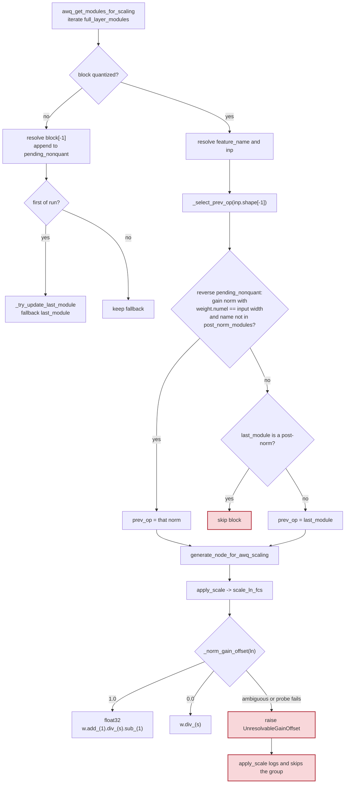
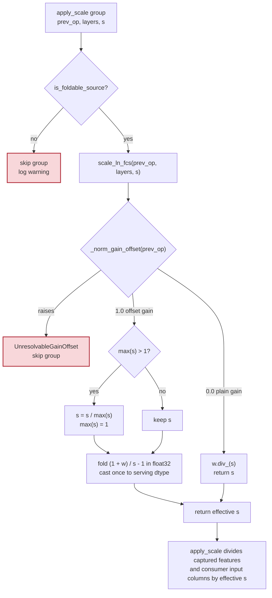

# AWQ scale folding into normalization modules

AWQ computes one smoothing scale per input channel and folds it into the
module that produces the quantized block's input. Correct folding requires two
facts that the model tree alone does not encode:

1. **Which module feeds the block.** In a run of consecutive non-quantized
   blocks, the consumer's input comes from the *last gain norm whose width
   matches the consumer's input and which is not declared `:postnorm`*.
   Earlier entries in the run belong to sibling branches (a MoE router) or to
   the residual stream (Gemma's `post_attention_layernorm`, LFM3's
   `post_operator_norm` / `post_ffn_norm`). See
   [AWQ normalization selection](awq-norm-selection.md).
2. **How the norm applies its gain.** Plain norms multiply by `weight`;
   Gemma-style norms multiply by `1 + weight`. The parameterization is a
   property of the module's forward, not of its class hierarchy. If the live
   probe cannot decide, the scale is skipped rather than inferred from source
   text.

Both decisions were previously made from the wrong signal: a fixed class list
for the gain offset and the first block of a non-quantized run for `prev_op`.

Introduced by the fix for issue #3973 in
[PR #3989](https://github.com/ModelCloud/GPTQModel/pull/3989).

## Folding flow

`_norm_gain_offset` calls `resolve_gain_offset` (the live gain probe in
`gptqmodel/quantization/norm_tuning.py`). The probe evaluates `weight` and
`1 + weight` on a private copy at two small gains. If the module's forward
cannot be probed or both hypotheses fit, `_norm_gain_offset` raises
`UnresolvableGainOffset`; `apply_scale` logs and skips that group without
mutating weights or captured features. Source text is never parsed.

## Offset-gain scale gauge

AWQ's per-channel scale has a uniform gauge: dividing every channel by the same
constant `c` and multiplying every consumer's input columns by `c` leaves the
block output unchanged. For symmetric per-group quantisation the gauge is exact
because scaling all columns of a group by `1/c` scales that group's absmax by
`1/c`, so the packed codes are unchanged and only the group scale moves.

That gauge is what makes an offset-gain fold safe. The fold stores
`(1 + w) / s - 1`; as `s` grows, the stored value approaches `-1` and
`1 + w'` loses its significand to cancellation. Gemma-3
`pre_feedforward_layernorm` channels with `x_mean == 0` push the MLP-group
scale to `s ≈ 1e3`, where `1 + w'` is no longer representable in bf16. The
fold then stops being neutral even though the arithmetic was done in float32.

`scale_ln_fcs` therefore renormalises an offset-gain scale by its peak
(`max(s) <= 1`) before folding. Plain-gain norms store `w / s`, which keeps its
relative precision at any `s`, so they keep their scale unchanged. The function
returns the effective scale and `apply_scale` uses it for the captured input
features and the non-quantized consumers, so the fold, the quantization input,
and the router/gate share one scale.

Before this change `apply_scale` ignored the returned scale (the function
returned nothing) and divided the captured features by the original `s`, so
renormalising inside the fold alone would have desynchronised the quantization
input from the folded weights.

| Mechanism | Before | After |
| --- | --- | --- |
| Offset-gain fold scale | `s` used as-is, `gptqmodel/quantization/awq/quantize/scale.py:316-320` | `s / max(s)` when `max(s) > 1` |
| Effective scale ownership | `scale_ln_fcs` returned `None`; `apply_scale` reused the input `s` | `scale_ln_fcs` returns the effective `s`; `apply_scale` uses it for features and consumers |
| Plain-gain fold | `w / s` | unchanged |

Measured on the shipped code (`bf16`, relative L2 of the block output before and
after folding a neutral scale):

| Case | Before | After |
| --- | --- | --- |
| `Gemma3RMSNorm`, `max(s) ≈ 148` | 0.111 | 0.0036 |
| `Gemma3RMSNorm`, `max(s) ≈ 1485` | 0.993 | 0.0036 |
| `LlamaRMSNorm`, `max(s) ≈ 1499` | 0.0041 | 0.0041 |

## Before and after

| Mechanism | Before | After |
| --- | --- | --- |
| Offset-gain detection | `isinstance(ln, GemmaRMSNorm) or isinstance(ln, Gemma2RMSNorm)` at `gptqmodel/quantization/awq/quantize/scale.py:145` (origin/main) | `_norm_gain_offset` -> `resolve_gain_offset` at `gptqmodel/quantization/awq/quantize/scale.py:75` |
| Offset fold precision | `ln.weight += 1; ln.weight.div_(scales); ln.weight -= 1` in the stored dtype | float32 `folded.add_(1).div_(s).sub_(1)` then cast back, `gptqmodel/quantization/awq/quantize/scale.py:189` |
| `prev_op` for a run of non-quantized blocks | first block of the run; subsequent blocks skipped at `gptqmodel/models/base.py:4415` (origin/main) | all blocks collected in `pending_nonquant`; consumer picks the matching gain norm via `_select_prev_op` at `gptqmodel/models/base.py:4443` |
| Sandwich post-norms | not distinguishable from a source norm; LFM3 selected `post_operator_norm` / `post_ffn_norm` | `:postnorm` excludes them from `_select_prev_op`, `gptqmodel/models/base.py:420` and `:1202` |
| Gain probe failure | grep the forward source for `1.0+self.weight` and fold as offset, `gptqmodel/quantization/awq/quantize/scale.py:62` (origin/main) | raise `UnresolvableGainOffset`; `apply_scale` skips the group, `gptqmodel/quantization/awq/quantize/scale.py:65` and `:150` |
| Empty block inside a run | skipped only because the first-of-run rule skipped every later block | explicitly skipped without breaking the run, `gptqmodel/models/base.py:4442` |

### Measured effect

| Case | Before | After |
| --- | --- | --- |
| `Gemma3RMSNorm` fold, relative L2 | 0.266 CPU / 0.290 CUDA | 1.2e-7 / 1.0e-7 |
| `Qwen3NextRMSNorm` fold, relative L2 | 0.263 | 1.0e-7 |
| synthetic `Qwen3_5MoeRMSNorm` fold, relative L2 | 0.269 | 1.2e-7 |
| `LlamaRMSNorm` / `Gemma2RMSNorm` fold, relative L2 | ~1e-7 | ~1e-7 |
| Gemma2 MLP `prev_op` | `post_attention_layernorm` | `pre_feedforward_layernorm` |
| Gemma2 MLP fold, layer-output relative L2 | 0.561 | < 1e-5 |
| LFM3 conv/FFN `prev_op` | `post_operator_norm` / `post_ffn_norm` | `operator_norm` / `ffn_norm` |
| LFM3 layer-output relative L2 | 0.569 (fixture) / 0.688 (real model, issue #4002) | 1.57e-07 |
| `MuseSparkTextInputScaledRMSNorm` fold relative L2 | 0.113 (fp32) | scale skipped; output unchanged |
| Gemma-3-1B AWQ4 wikitext-2 PPL, `max(s) ≈ 1.4e3` | 848.5 | 67.8 |
| Gemma-3-1B RTN4 / base PPL (same harness) | 72.6 / 59.6 | 72.6 / 59.6 |

The PPL row uses 128 C4 calibration documents, 80 × 512 wikitext-2 test tokens,
bf16, `sym=False`, `FORMAT.GEMM`. Before the gauge, AWQ was 12.5× worse than
RTN; after it, AWQ is slightly better than RTN and within 14% of the
unquantized model, matching the relative result reported in issue #4074.

The offset-gain scale gauge was introduced by the fix for issue #4074.

The tests are in `tests/test_awq_scale_folding.py`; the pre-fold
`norm -> linear` output and the closed-form folded weights are the two
independent oracles.

## Contracts

- The gain offset is resolved per module instance, so the same class can be
  configured as a plain or an offset gain.
- `prev_op` must be a gain norm whose parameter width equals the consumer's
  input width and which is not tagged `:postnorm`. If no candidate matches,
  the historical `last_module` fallback is retained unless that module is a
  post-norm, in which case the block is skipped.
- The selected norm must be a module that `apply_scale` can fold into
  (`scale_ln_fcs`). A non-norm candidate is never selected. A `:!`/`:?`
  Linear is not a norm and has no compensation step, so it is never a fold
  source either (rule 6 in [AWQ scaling groups](awq-scaling-groups.md)).
- An unresolvable gain is fail-closed: the group is skipped, not folded with
  an assumed offset.
- Low-precision checkpoints keep their stored dtype; only the intermediate
  `1 + weight` and division are widened to float32.
