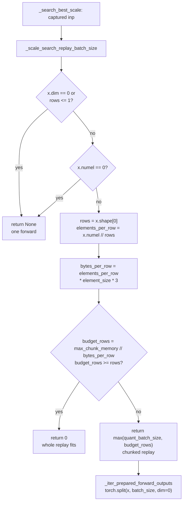
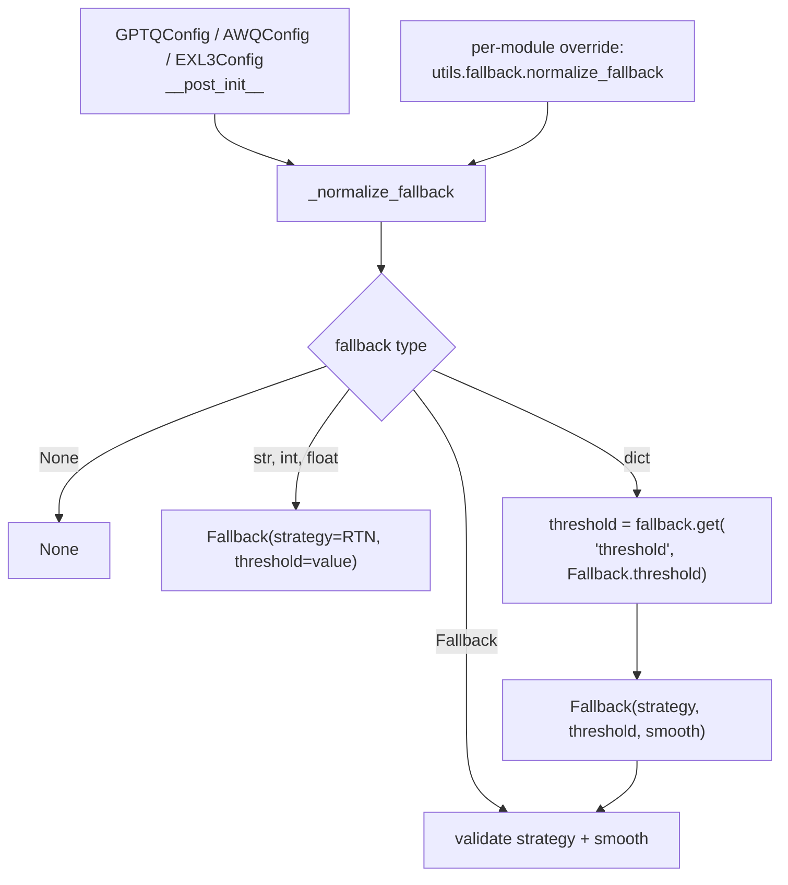

<!-- SPDX-FileCopyrightText: 2026 ModelCloud.ai
SPDX-License-Identifier: Apache-2.0 -->

# AWQ scale-search replay sizing and fallback thresholds

AWQ scores every candidate scale by replaying the captured calibration
activations through the module group. The replay is chunked by a memory budget
derived from `AWQProcessor.max_chunk_memory` (1 GiB by default). This page
documents the two contracts that decide how that replay is bounded and how a
`fallback=` dictionary resolves its threshold. It was introduced by the fix for
[issue #4087](https://github.com/ModelCloud/GPTQModel/issues/4087).

## 1. Replay row sizing

`AWQProcessor._search_best_scale` captures the module input `inp` and calls
`_scale_search_replay_batch_size(inp)`. The returned value is the number of
leading-dimension rows per replay forward:

* `None` or `0` means one forward over the whole capture.
* A positive value means `_iter_prepared_forward_outputs` splits `x` along
  `dim=0` into chunks of that many rows.

`_build_chunked_reference_outputs` materializes one FP reference chunk per
replay, and `_compute_best_scale` compares each candidate-scale replay against
those chunks. Equal-length calibration windows are concatenated by
`_can_concat_batch_tensors` into a 3-D `[batches, seq, hidden]` capture, so one
leading-dimension row is a full `seq * hidden` slice, not a single hidden
vector.

The `* 3` covers the input chunk, the forward output chunk, and the CPU
reference copy that are resident together. `_build_chunked_reference_outputs`
keeps the reference chunks on the replay device, so the reference total is
bounded by the capture size, not by the chunk size.

### Before / after

| Mechanism | Before | After |
| --- | --- | --- |
| Per-row element count | `x.shape[-1]` (hidden only) | `x.numel() // x.shape[0]` |
| `[128, 2048, 4096]` fp16 | `0` (one 6.44 GiB chunk) | `21` (1.06 GiB chunk) |
| `[128, 2048, 14336]` fp16 | `0` (one 22.5 GiB chunk) | `6` (1.06 GiB chunk) |
| `[262144, 4096]` fp16 | `43690` | `43690` (unchanged) |
| `[4, 0, 8]` (empty) | `0` | `None` |
| 1-D `[N]` | `0` | `0` (one element per row) |

The old estimate undercounted a 3-D capture by its sequence length. For
Llama-3.1-8B (`hidden=4096`, `intermediate=14336`) the MLP replay then ran a
single forward over 262,144 tokens, which is a 2 GiB input and a 7 GiB
`LlamaMLP` output.

### Contract

* `rows = x.shape[0]`. A row is a leading-dimension slice.
* `elements_per_row = x.numel() // rows`; for a 1-D input this is one element.
* A zero-element capture (`x.numel() == 0`) returns `None` instead of dividing
  by an empty row.
* `rows <= 1` returns `None`: one row is the minimum possible chunk.
* The returned chunk is at least `_quant_batch_size`, the capture batch size.
  A single capture batch is never split below its own batch size.

## 2. Fallback threshold defaults

`Fallback.threshold` is the single source of truth for the low-sample fallback
threshold. Its dataclass default is `"0.5%"`. A `fallback=` dictionary that
omits `threshold` (for example `fallback={"strategy": "rtn"}` or
`fallback={"smooth": "mad"}`) must inherit that value, not a second hard-coded
default.

`utils/fallback.normalize_fallback` merges a per-module override onto the
config default and then delegates dict construction to `_normalize_fallback`,
so the two entry points cannot drift.

### Before / after

| Entry point | Before | After |
| --- | --- | --- |
| `GPTQConfig(...).fallback.threshold` (plain) | `0.5%` | `0.5%` |
| `GPTQConfig(..., fallback={"strategy": "rtn"})` | `1.0%` | `0.5%` |
| `GPTQConfig(..., fallback={"smooth": "mad"})` | `1.0%` | `0.5%` |
| `AWQConfig(..., fallback={"strategy": "rtn"})` | `1.0%` | `0.5%` |
| `EXL3Config(..., fallback={"strategy": "rtn"})` | `1.0%` | `0.5%` |
| Explicit `fallback={"threshold": "2.0%"}` | `2.0%` | `2.0%` |

A doubled threshold is silent: the fallback decision in
`AWQProcessor._should_fallback_group` and `GPTQ` compares observed calibration
tokens against this percentage. Doubling it moves modules from GPTQ to RTN
without changing the checkpoint layout or reporting an error.

### Contract

* `Fallback.threshold` is the only default. No dict path may hard-code another
  value.
* An explicit `threshold` in the dict (or a standalone string/number) still
  wins.
* An invalid strategy raises from `_normalize_fallback` instead of being
  silently treated as RTN.

## Validation

Regression tests:

* `tests/test_awq_scale_search_memory.py` —
  `test_scale_search_replay_batch_size_accounts_for_the_sequence_dimension`,
  `test_scale_search_replay_batch_size_keeps_the_2d_row_size`,
  `test_scale_search_replay_batch_size_handles_empty_and_1d_inputs`.
* `tests/test_fallback.py` — `test_dict_fallback_keeps_the_dataclass_threshold_default`.

Measured on an RTX 4090 (48 GiB) with 128 x 2048 C4 windows, AWQ 4-bit group
size 128, and the 3-D batch capture pinned through
`awq_input_feature_aggregation`:

| Model | Budget | Before | After |
| --- | --- | --- | --- |
| Llama-3.1-8B-Instruct | 32 GiB | OOM: tried to allocate 7.00 GiB; `inp=(128, 2048, 4096)`, `replay_batch_size=0`; peak 27.87 GiB | `replay_batch_size=21` for hidden 4096, `6` for hidden 14336; no OOM |
| Llama-3.2-1B-Instruct | 12 GiB | OOM: tried to allocate 4.00 GiB; `inp=(128, 2048, 2048)`, `replay_batch_size=0`; peak 10.82 GiB | `replay_batch_size=42` for hidden 2048, `10` for hidden 8192; no OOM |

On current `main` the default AWQ token-row aggregation caps a dense capture at
one largest-batch equivalent, so the 3-D `[batches, seq, hidden]` path is
reached when a model selects `mode=batch`; the harness pins that mode to
exercise the sizing helper with the issue's capture shape.
