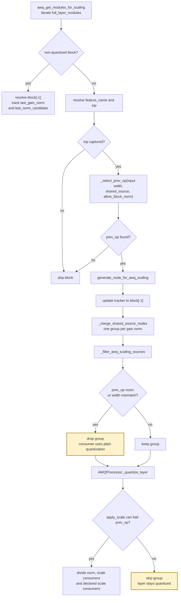
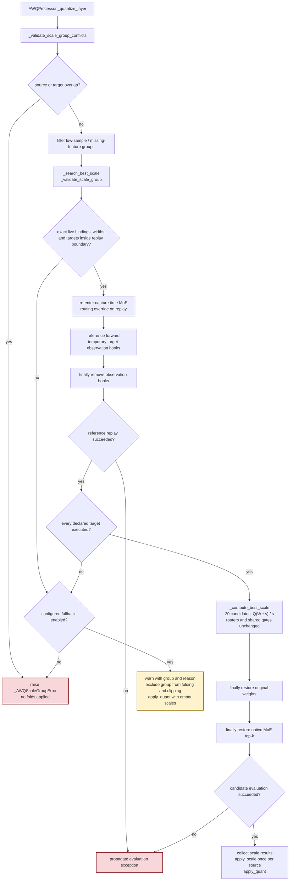
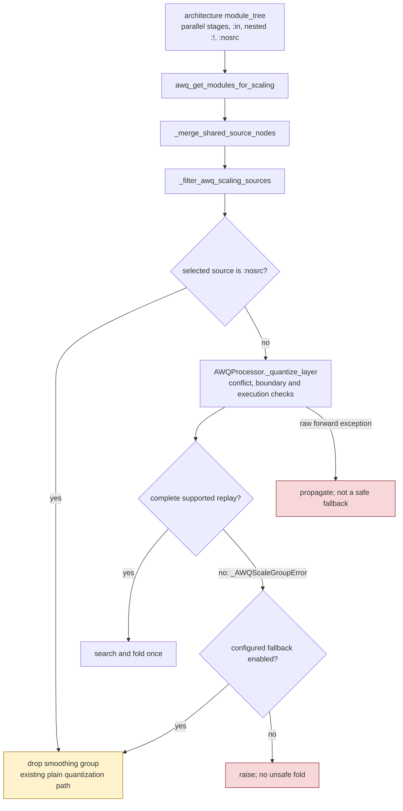
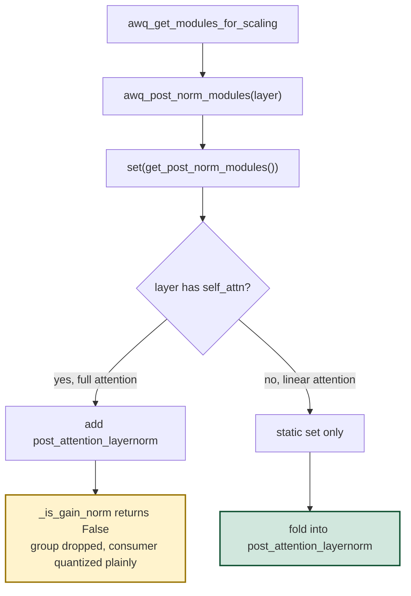
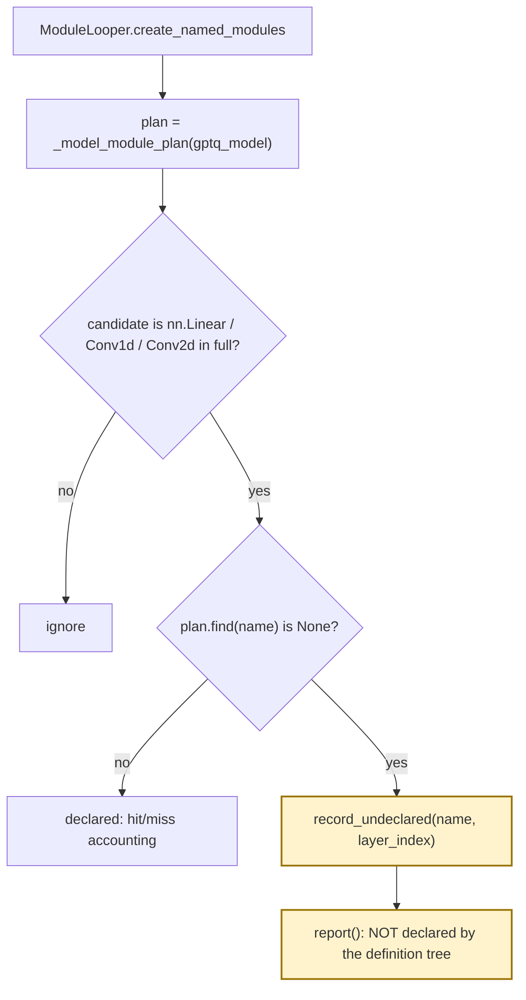
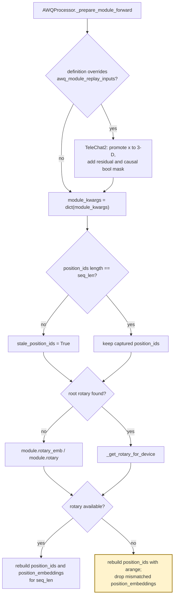
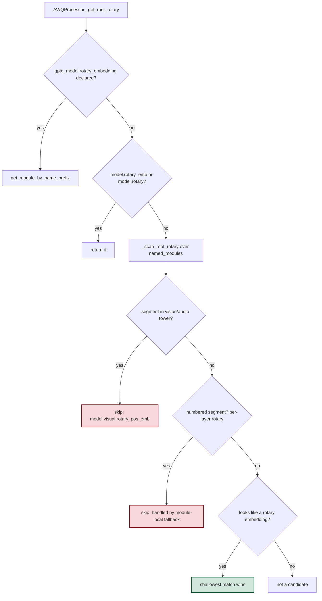
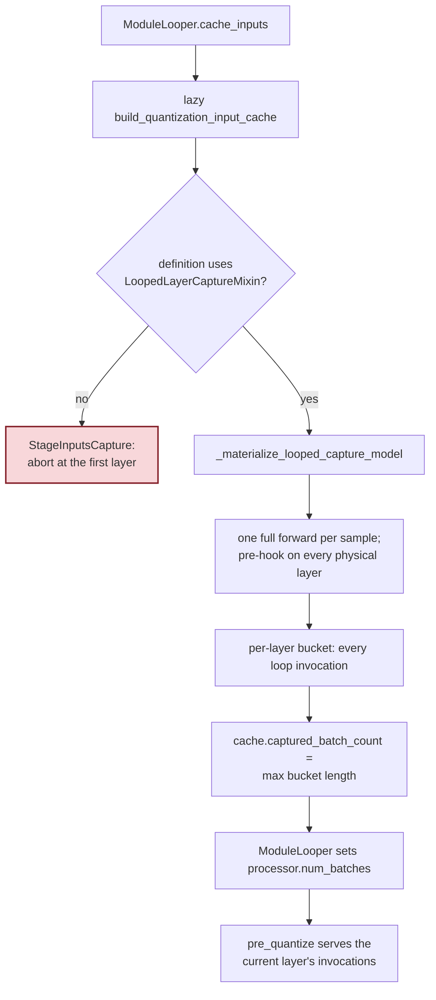
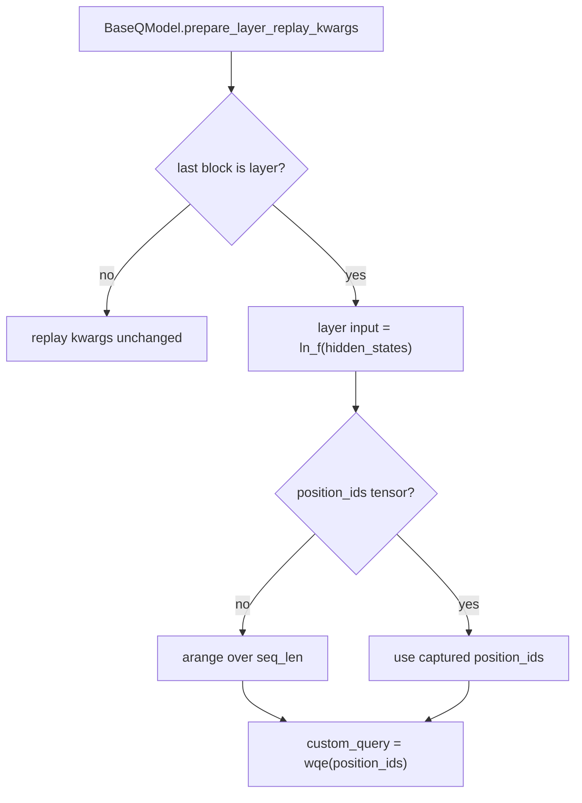

# AWQ scaling groups

AWQ folds one smoothing scale per input channel into the module that produces a
quantized block's input. That is only output-preserving when the producer's
output really *is* the consumer's input and is not consumed by anything else.
The model tree encodes module order, not the residual graph, so tree order alone
cannot decide this.

This page documents the contracts consumed by
`BaseQModel.awq_get_modules_for_scaling` and
`gptqmodel.quantization.awq.quantize.scale.apply_scale`:

1. A layer with no usable scaling group is **quantized plainly**, never
   finalized unquantized (which previously failed later in packing with
   `KeyError: 'q_zeros'`).
2. A definition marks leaves whose output is not a direct scaling source with
   the `nosrc` tree flag. Groups whose `prev_op` carries it are dropped, so the
   consumer falls back to plain quantization instead of silently changing the
   decoder layer output.
3. **One gain norm has exactly one scaling group.** Routed and shared experts
   (and parallel attention/MLP branches) read the same normed tensor; folding
   them as two groups divides the norm twice and leaves one branch unscaled.
4. **Parallel branches share a source.** Sibling projections that read the same
   norm declare it with the same `:in=<tag>` flag, so the second branch folds
   into that norm rather than into the previous branch's output projection.
5. **A norm-like module that cannot absorb a fold is skipped.** A weightless
   norm, a norm with an input-dependent gate, a `Conv1D`, or a
   `HyperConnection` has no plain gain to divide; the group is dropped and the
   layer stays quantized plainly.

Introduced by the fixes for issues #4005, #4017, #4039, #4093 (items 1-6) and
#4121 (items 6-10).

## Flow



The tracker update runs for every block, including blocks skipped because
`prev_op is None`. That keeps the "previous linear in tree order" fallback
available for the next block instead of leaving `last_module` unset.

## Scale-search safety

The search-safety checks were introduced in [#4144](https://github.com/ModelCloud/GPTQModel/pull/4144).

The existing group dictionaries and tag syntax are unchanged. Search uses
the original captured activation `x` and candidate weights `Q(W * s) / s`.
Non-quantized routers and shared gates therefore keep their original weights
during search. Only final `apply_scale`, which changes the source to emit
`x / s`, multiplies those consumers by `s`. Scaling them during search would
change routing even with identity quantization.



| Before (baseline `c9efdbacf`) | Now |
| --- | --- |
| Candidate search multiplies non-quantized consumer weights (`awq_processor.py:3099-3119`). | Search leaves them unchanged; final folding still compensates them. |
| Shared-source merge retains the first inspection module for cross-root groups (`models/base.py:5540-5546`). | Group construction remains unchanged, but search rejects boundaries missing any member rather than scoring only one branch. |
| A contained target need not execute during replay (`awq_processor.py:2551-2572`). | Reference-forward observation rejects unexecuted targets before candidate mutation; observation hooks are always removed. |
| Replay always routes with the model's native top-k, even when calibration captured features under `ExpertsRoutingOverride` (`awq_processor.py:2358-2661`). | Reference and candidate replays re-enter the capture-time override; a target that still cannot execute rejects the group. |
| Weight restoration occurs only after successful grid evaluation (`awq_processor.py:3267-3278`). | Restoration is in `finally`, covering quantizer, replay, and loss exceptions. |
| Search results are collected without a group-validation fallback (`awq_processor.py:2352-2359`). | Unsafe replay groups use the existing configured fallback with a warning, or raise with fallback disabled. Conflicting folds always raise. |

All paths above are layer-owned: `process` holds `_AWQLayerState.lock` while
calling `_quantize_layer`. Observation state, hooks and master weights are local
to a search; no process-global trace or persistent weight cache is installed.
The hook APIs are already used for calibration. This change does not qualify
new concurrent mutation of the same module or claim free-threaded validation.

Validation checks **both** containment and execution. An MoE expert not reached
by the retained reference samples makes the group unsupported for that replay;
fallback is conservative even if earlier calibration batches reached it. Code
that bypasses module calls and reads weights functionally also requires a
compatible existing Python group/replay override, or fallback. The checks do
not prove an entire dynamic graph or discover undeclared functional consumers.

Replay routing must match capture. Calibration forwards run under the configured
`MoEConfig(routing=ExpertsRoutingOverride(...))`, which can execute experts that
native top-k never selects. `_search_best_scale` therefore re-enters the same
override around both the reference and candidate replays before enforcing
coverage (#4151). Without that, an all-expert calibration was judged against a
native-top-k replay and a complete group fell back. The guard still rejects a
genuinely partial replay: a declared target that the block does not execute even
under the configured routing raises `_AWQScaleGroupError`. The separate
pre-existing fallback for experts that captured no features at all (for example
native routing that never reached them) is unchanged.

Cross-root groups are not split: independently folding their shared norm would
divide it repeatedly. Nor is inspection automatically widened to the decoder
layer: its input can differ from the captured norm output. A Python override
may supply an existing-format group with a compatible input, kwargs and full
objective. Until then, the complete shared-source group falls back together.
Default `AWQConfig.fallback` behavior is preserved; set `fallback=None` to make
these unsafe replay groups raise instead. Existing no-group/missing-feature
paths are not redesigned here.

Conflicts are checked **before** low-sample, width or missing-feature filtering.
Dropping one conflicting group first would let another group divide the shared
norm (or modify tied target weights) without compensating the filtered branch.

CPU regressions cover eager and chunked search, FP32/FP16/BF16 router neutrality,
an independent Torch folded-model quantization oracle, failure rollback,
complete/incomplete parallel objectives, capture-time routing overrides with a
genuinely unexecuted target, and real Qwen2/Qwen3 MoE and Cohere/Cohere2
topologies. Inference kernels, persistent quantized weight storage, architecture
declaration syntax, and replay mask/position reconstruction are unchanged. A
declarative graph/DSL and automatic cross-root replay are out of scope.

## Architecture relationship qualification

The source audit covered all 206 registered model types (182 definitions) at
`388f82f01`, without downloading checkpoint weights. It recorded 14 unsafe
model-type entries across 13 definition families. Those are counterexamples to
the inference rule, not a claim that every released checkpoint reaches the
same invalid fold. Matching channel widths and executing every **declared**
target cannot prove producer identity or discover an undeclared consumer.

The immediate repairs use existing declarations, not a graph compiler or DSL:

| Definition | Incorrect relationship before | Existing-format repair |
| --- | --- | --- |
| `cohere_compass` | The input norm also feeds the parallel MLP; `o_proj` is not its producer. | Shared `:in=normalized` on Q/K/V and gate/up, `o_proj:nosrc`; incomplete cross-root replay is rejected. |
| `granitemoe_swa` | Routed experts omitted the sibling shared MLP. | Shared input tags include `shared_mlp.input_linear`; incomplete cross-root replay is rejected. |
| `hunyuan_v1_moe` | The weightless gate container hid the actual router weight. | Declare the non-quantized affine consumer `mlp.gate.wg`. |
| `falcon_mamba` | Matching widths allowed a fold across SSM and nonlinear computation. | Mark mixer projections `:nosrc`; explicitly exclude convolution, time-step and state owners. |
| `moss` | Parallel attention/MLP and GELU were treated as sequential linear paths. | Mark the shared norm, attention output and activated MLP source `:nosrc`. |
| `internlm2` | The attention input and output projections shared stage zero. | Stage `wqkv:0`, `wo:1`. |
| `minicpm` | Parallel Q/K/V were sequential; MLP input and output stages were combined. | Group Q/K/V at stage zero and gate/up together; keep output projections in the next stage. |
| `gemma3n`, `gemma3n_text` | Folds omitted Laurel, crossed value normalization, or crossed AltUp/residual/activation boundaries. | Exclude the corresponding sources with `:nosrc`, declare AltUp/Laurel owners, and place per-layer output normalization after its projection. |
| `axk2`, `glm_moe_dsa` | An indexer projection was mistaken for a low-rank query producer; GLM's input fold omitted an indexer consumer. | Conservatively disable internal attention source folds and declare nested norm/indexer owners. FFN folds remain eligible. |
| `longcat_flash` | Indexed norms and dual residual sublayers were treated as one sequential path. | Declare indexed norm owners and nested router weights; disable the ambiguous attention/output sources. |
| `inkling_mm_model` | The norm fed unhandled native 3-D shared experts as well as routed experts. | Disable that norm's fold and explicitly exclude shared-expert, scale, convolution and relative-logit owners. |
| `qwen` | The inferred `w2` source crosses SiLU. | Mark `w2:nosrc`. |



Declaring a source `:nosrc` retains the pre-existing unconditional plain
quantization path for that group; this is different from rejecting a generated
group under `fallback=None`. The safety checks are not expanded to infer an
arbitrary graph. Raw replay exceptions (for example a native Bloom forward
missing its residual argument) remain errors, not configured fallback.

`tests/module_tree/test_awq_relationships.py` uses real tiny CPU model modules,
their `state_dict()` owners, nontrivial synthetic folds and full text outputs.
It covers shared/no-shared Granite, nested Hunyuan routing, a Falcon Mamba width
collision, AXK2/GLM indexers, LongCat residuals, dense/sparse Inkling text layers,
MHA/GQA CohereCompass and Gemma3n's AltUp/Laurel decoder. The legacy remote-code
families also have pinned-source audit probes; their CI declaration checks do
not claim that remote implementations were loaded by the CPU job. The
always-run registry contract covers every registered alias and method case.

## One group per norm

`_merge_shared_source_nodes` merges every node whose `prev_op` is the same gain
norm into a single scaling group. The merged group divides that norm once and
multiplies every quantized consumer (all routed experts plus `shared_experts`,
or both parallel branches) and every declared `_scale_consumers` entry (router,
`shared_expert_gate`, `g_proj`, `output_gate`) by the same scale. The merged
group re-inspects a common parent when every consumer shares one, so the scale
search still scores the combined block. If the retained inspection boundary
cannot cover the complete group, the search-safety checks above reject it.

## Parallel branches

When a parallel block reads one norm from two quantized branches, the second
branch has no intervening norm to fold into. Each consumer carries the same
`:in=<tag>` flag, and `_select_prev_op` reuses the first branch's resolved norm
for the tag. Example (Falcon):

```
"input_layernorm": ("input_layernorm:!",),
"self_attention": ("query_key_value:0:in=x", "dense:1"),
"post_attention_layernorm": ("post_attention_layernorm:!",),
"mlp": ("dense_h_to_4h:0:in=x:nosrc", "dense_4h_to_h:1"),
```

## Declared non-sources

Two flags declare data flow:

- `:postnorm` marks a sandwich post-norm whose output is consumed by a residual
  add. It is checked during `prev_op` selection.
- `:nosrc` marks any other leaf whose output is not the direct input of the
  following scaling consumer. It is checked after selection by
  `_filter_awq_scaling_sources`, so it also covers quantized linears.

A `nosrc` flag on a tree leaf means: *this module's output is not the direct
input of the following scaling consumer*. Folding a scale into it changes the
decoder layer output because of one of:

- a residual add between the producer and the consumer,
- a parallel branch that consumes the same activation,
- a non-homogeneous activation (GELU, SiLU, xIELU, sigmoid gate) between the two
  linears,
- a fused projection whose output does not match the consumer's input width.

Syntax:

```
"input_layernorm": ("input_layernorm:!:nosrc",)
"mlp": ("fc1:0:nosrc", "fc2:1")
```

`nosrc` is metadata only: it does not change quantization, subset grouping, or
the emitted block list (the compiler drops non-`!`/`?` flags from block names).

| Definition | Declared non-sources | Why |
| --- | --- | --- |
| `olmo2`, `olmo3`, `exaone4`, `exaone4_5`, `gemma4_text` | post-attention / post-FFN norms (`:postnorm`) | the norm output is added to the residual |
| `opt` (post-norm) | `self_attn_layer_norm` | the normed value is also the MLP residual |
| `phi`, `gptj`, `codegen` | input norm, attention out, MLP in | parallel branches, residual, GELU |
| `gpt_neox`, `gpt_neo`, `gpt_bigcode`, `bloom`, `rw`, `falcon` | MLP input projection | GELU is not positively homogeneous |
| `starcoder2`, `apertus`, `mpt` | MLP up projection | non-homogeneous activation |
| `gpt_oss` | expert `up_proj` | `(clamp(up) + 1) * glu` is not homogeneous in up |
| `afmoe`, `muse_glimmer`, `hrm_text` | attention `gate_proj` | `o_proj` reads `attn * sigmoid(gate)` |
| `gemma4_text` | `v_proj` | MHA configs pass v through a scale-free `v_norm` |
| `minimax` (original) | both block norms | the normalized value is the residual |

## Before and after

| Mechanism | Before | After |
| --- | --- | --- |
| Routed + shared experts | two groups from one norm; each fold left the other unscaled (0.049 / 0.080 on DeepSeek-V3) | one merged group (`_merge_shared_source_nodes`) |
| Parallel branches (Falcon, Cohere) | second branch folded into the first branch's output projection (0.25) | both branches carry `:in=<tag>`; `_select_prev_op` reuses the shared source |
| Non-homogeneous fc1→fc2 | folded across GELU (0.02-0.05) | `:nosrc` on fc1 |
| Gated attention | `gate_proj` became block 0's last module, folded into `o_proj` (0.28) | `:nosrc` on `gate_proj` |
| Weightless / gated norms | `apply_scale` raised (`NotImplementedError`, `AttributeError`) | `is_foldable_source` drops the group; layer is quantized plainly |
| MoE block with a non-foldable norm | fell back to the last expert linear | `last_norm_candidate` returns the block norm; group is dropped |
| `Cohere2` / `Cohere2-MoE` norms | crash (`not in allowed_norms`) | added to `allowed_norms` |
| `Cohere2-MoE` shared experts | undeclared, unscaled (0.01) | declared and merged into the routed group |
| `olmoe` `q_norm`/`k_norm` | full-width norms picked as `prev_op` (0.29) | group index `0` keeps them inside the q/k/v block |
| `laguna` `g_proj` | omitted consumer (0.006) | declared `:!` sibling; collected as a scale consumer |

## Remote-code family trees

The tree is the only declaration of which module feeds a scaling group. Three
remote-code families shipped a tree that did not describe their forward graph,
and two of them quantized to garbage without raising:

| Definition | Before | After | Effect |
| --- | --- | --- | --- |
| `instella` | inherited `LlamaQModel.module_tree` (`input_layernorm` / `post_attention_layernorm`) | own tree with `pre_attention_layernorm` / `pre_feedforward_layernorm` | q/k/v get a norm source; `mlp.gate/up` no longer fold into `self_attn.o_proj` across the residual (wikitext-2 PPL 27997 -> 27.7 on the 3B checkpoint) |
| `k2_horizon` | `q_proj`, `k_proj`, `v_proj`, `gate_proj`, `o_proj` as separate dict nodes | one flat `""` tuple `q_proj:0`, `k_proj:0`, `v_proj:0`, `gate_proj:0:nosrc`, `o_proj:1` | one group per attention input instead of chained single-module groups (PPL 1100 -> sane) |
| `telechat2` | `{"dense": ("dense",)}` only | `("query:0", "key_value:0", "dense:1")` | `query`/`key_value` are quantized instead of silently staying fp16 |

Issue #4121 added four more definitions whose tree did not match the forward
graph. All of them are now in `FAMILY_MODEL_TYPES`:

| Definition | Before | After | Effect (per-group fold error) |
| --- | --- | --- | --- |
| `gpt_pangu` | `mlp: ("c_fc:0", "c_proj:1")`; the last block's `ln_1` group contained `attn.q_proj` | `c_fc:0:nosrc`; `awq_get_modules_for_scaling` drops the top-query block's `q_proj` | GELU fold 4.5e-2 -> dropped; `ln_1 -> q_proj` 3.4e-3 -> `q_proj` excluded, remaining k/v group 1.2e-8 |
| `olmo_hybrid` | one static tree; `post_attention_layernorm` was a gain source on every layer | `awq_post_norm_modules(layer)` adds it on the full-attention layer only | 3.6e-1 -> group dropped on attention layers; linear-attention fold stays exact (1.6e-8) |
| `gemma4`, `gemma4_unified` | composite/unified trees kept `v_proj:0` and `post_feedforward_layernorm:!` | copied `v_proj:0:in=x:nosrc` and `:postnorm` from the text tree; `post_per_layer_input_norm` is `:postnorm` too | `v_proj -> o_proj` 1.9e-1 -> dropped; `post_feedforward_layernorm -> per_layer_input_gate` 2.4e-1 -> dropped; `post_per_layer_input_norm -> per_layer_projection` 2.2e-1 -> dropped |
| `nemotron_h` | `mixer.up_proj` fed `down_proj` | `up_proj:3:nosrc` | `relu(x)^2` fold 2.2e-2 -> dropped |

Every family listed in `FAMILY_MODEL_TYPES` is covered by the
output-preservation invariant: folding a random scale into each group must
leave the decoder layer's logits unchanged to `1e-5` relative.

## Trees that alternate layer shapes

`ModulePlan` is built from one `module_tree` per model, but OLMo Hybrid's
decoder layers do not share a shape. `OlmoHybridAttentionDecoderLayer`
post-norms the attention output and *adds it to the residual*:

```
residual = h
h = post_attention_layernorm(self_attn(h))
h = residual + h
```

`OlmoHybridLinearAttentionDecoderLayer` feeds the same-named norm straight into
the MLP, where a fold is exact. A static `:postnorm` flag would therefore drop
a valid group on half the layers, and no flag would fold across a residual on
the other half.



`get_post_norm_modules` stays a classmethod for the definitions that declare one
static set; `awq_post_norm_modules` is the per-layer extension point.

## Coverage: declared specs versus undeclared leaves

`LayerModuleCoverageTracker` used to count only *declared* specs. A quantizable
`nn.Linear` that no spec named was invisible: every declared spec matched while
the leaf stayed in the source dtype. TeleChat2's `query`/`key_value` were
exactly this, and the report said "all 4 specs matched".



The LM head is excluded because it is quantized through its own path, not the
layer tree. A leaf that is intentionally not quantized must still be declared
with `:!` or `:?`; "no spec at all" is now reported.

## AWQ replay scaffolding

AWQ scores a multi-module scaling group by replaying its common parent. Two
inputs to that replay are captured per linear, not per parent, so they can be
stale or incomplete.

### Position kwargs

`AWQProcessor._prepare_module_forward` rebuilds position scaffolding whenever
it does not match the sample being replayed. Before, `position_ids` was only
added when the key was *absent*, so a 430-token capture was replayed with a
522-token activation (EXAONE-3.0) or 48 vs 20 (tiny DeciLM/Nanbeige), crashing
in `apply_rotary_pos_emb`.



`exaone` also declares `rotary_embedding = "transformer.rotary"`, so its
model-level rotary is found directly. Nanbeige/DeciLM keep the rotary on the
attention module and take the `module.rotary_emb` path.

### Multimodal rotary resolution

A multimodal wrapper nests the decoder one level deeper than a text model.
Qwen2-VL, Qwen2.5-VL, Gemma 3 and Mistral 3 keep the decoder rotary on
`model.language_model.rotary_emb`, and their definitions do not declare
`rotary_embedding`. `AWQProcessor._get_root_rotary` looked only at
`model.rotary_emb`, returned `None`, and the replay then dropped the captured
`position_embeddings`; the attention unpacked `None`:

```
AWQ Qwen2-VL-2B-Instruct -> TypeError: cannot unpack non-iterable NoneType object
```



Two exclusions keep the scan from picking the wrong module:

- **Vision/audio towers.** `model.visual.rotary_pos_emb` is a rotary embedding
  too, and by name it is the shallowest match on Qwen2-VL. Its frequency width
  is the vision head width, so rebuilding the decoder's cos/sin from it would
  silently produce a wrong-length tensor.
- **Per-layer rotaries.** A rotary under a numbered container
  (`layers.0.self_attn.rotary_emb` on Nanbeige/DeciLM) belongs to one layer and
  is usually an old-style `(x, seq_len)` module. Those families are handled by
  the module-local fallback in `_prepare_module_forward`, and `_get_root_rotary`
  keeps returning `None` for them so the other replay paths behave as before.

The resolved module is cached on the processor, so the scan runs once.

### Module-owned replay inputs

`BaseQModel.awq_module_replay_inputs` lets a definition add arguments the
per-linear capture cannot record. TeleChat2's `TelechatAttention.forward`
requires `(hidden_states, residual, attention_mask, ...)`; the default
implementation returns `(x, module_kwargs)` unchanged, and TeleChat2 promotes
the 2-D capture to 3-D, passes the block input as `residual` (an additive
constant shared by reference and candidate), and builds a causal bool mask.

## Looped decoder calibration

HRM-Text, Ouro (`total_ut_steps=4`) and Nanbeige 4.2 (`num_loops=2`) run the
same physical layers several times per forward. The default capture aborts at
the first layer, so each processor's Hessian only saw loop 0. Ouro's steps 1-3
have cosine -0.03..0.42 against the single captured input.



`_resolve_batch_total` caps the replay at `processor.num_batches`, so publishing
`captured_batch_count` is what keeps loops 1..N-1 from being truncated.

## Top-query layer replay

`GPTPanguModel.forward` applies `ln_f` before the last decoder block and passes
it `custom_query = wqe(position_ids)`, so that block's `q_proj` reads query
embeddings rather than hidden states. `PanguAlphaQModel.prepare_layer_replay_kwargs`
now mirrors that for the last block only; the measured last-layer `q_proj`
relative error on query embeddings dropped from GPTQ 0.130 (worse than RTN
0.101) to GPTQ 0.0558 (better than RTN 0.0933).



## Failure and ambiguity contract

| Situation | Before | After |
| --- | --- | --- |
| No norm in the tree and the first block is quantized | every block skipped, empty map, pack crash | first block skipped, later blocks use the previous linear; invalid ones are filtered |
| `prev_op` is a declared non-source | folded anyway (silent output change) | group dropped; consumer is quantized plainly |
| `prev_op` gain width differs from the consumer input | `apply_scale` shape error | group dropped |
| `prev_op` is a weightless / gated norm / Conv1D / HyperConnection | `NotImplementedError` or `AttributeError` | group skipped by `is_foldable_source` |
| No group survives | layer finalized unquantized; pack crash | layer quantized plainly |

## Validation

`tests/test_awq_scaling_groups.py` builds a tiny model for every family in
`FAMILIES`, folds a random scale in `[0.5, 1.5]` with the library's own
`apply_scale`, and requires the decoder-layer logits to change by less than
`1e-5` relative (Llama measures ~1.5e-7). `tests/test_awq_empty_groups.py` pins
both empty-group paths to `apply_quant(..., scales_list=[])`.

Issue #4093 item coverage:

| Test | Invariant |
| --- | --- |
| `tests/test_awq_scaling_groups.py` (`instella`, `k2_horizon`) | fold preserves the decoder-layer output |
| `tests/test_instella_support.py` | the tree declares the real Instella norm names and resolves on the checkpoint's own layer |
| `tests/test_k2_horizon_support.py` | q/k/v/gate form one flat group; `o_proj` is the separate consumer |
| `tests/test_telechat2_coverage.py` | `query`/`key_value`/`dense` are quantized and no leaf is undeclared; replay supplies `residual` + mask |
| `tests/test_awq_position_kwargs.py` | stale `position_ids` are rebuilt, mismatched `position_embeddings` dropped, module-local rotary rebuilds cos/sin |
| `tests/test_pangu_alpha_replay.py` | last layer replays `ln_f` + `custom_query`; GPTQ beats RTN on the top-query `q_proj` |
| `tests/test_looped_decoder_capture.py` | Ouro captures 4 invocations, Nanbeige 2, per-loop cosine < 0.99 |
| `tests/test_layer_module_coverage.py` | undeclared quantizable leaves are recorded and warned about |

Issue #4121 item coverage:

| Test | Invariant |
| --- | --- |
| `tests/test_awq_scaling_groups.py` (`gpt_pangu`, `olmo_hybrid`, `gemma4`, `gemma4_unified`, `nemotron_h`) | fold preserves the decoder layer's logits to `1e-5` relative |
| `tests/test_awq_vl_rotary_resolution.py` | `_get_root_rotary` finds `model.language_model.rotary_emb`, never the vision tower, ignores per-layer rotaries, and `_prepare_module_forward` rebuilds cos/sin for a nested rotary; tiny Qwen2-VL quantizes with AWQ and GPTQ |

### Real-checkpoint CPU CI

The `AWQ CPU` pull-request workflow runs the offline regressions plus
`tests/test_awq_hf_cpu.py` against revision-pinned, trained SmolLM2-135M and
TinyMoE-100M checkpoints from Hugging Face. The integration tests download real
safetensors, compare held-out logits and next-token loss before/after 4-bit AWQ,
check all expected packed projections and unquantized MoE routers, then save,
reload with the same activation dtype, and check logits and greedy generation.
Network/download failures fail the integration job rather than silently skip it.
The MoE test permits configured fallback when calibration does not execute all
experts and records how many groups used it. These short deterministic checks
guard against catastrophic drift; they are not a corpus-level perplexity or
model-quality qualification.

## Not in scope

- MLA attention groups (`deepseek_v2/v3/v32`, `deepseek_v4`, `axk2`) whose
  `q_b_proj`/`kv_b_proj` read different low-rank tensors are filtered by the
  existing width check; the MoE routed+shared merge is covered by the structural
  test.
- `nosrc` is a static declaration. A new family whose forward graph has a
  residual, parallel branch, or non-homogeneous activation between a producer
  and its consumer must declare it; the invariant test catches regressions for
  the families listed above.
