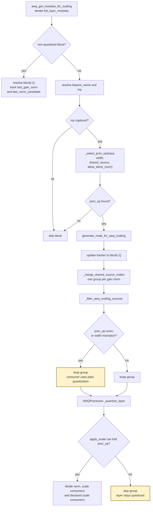
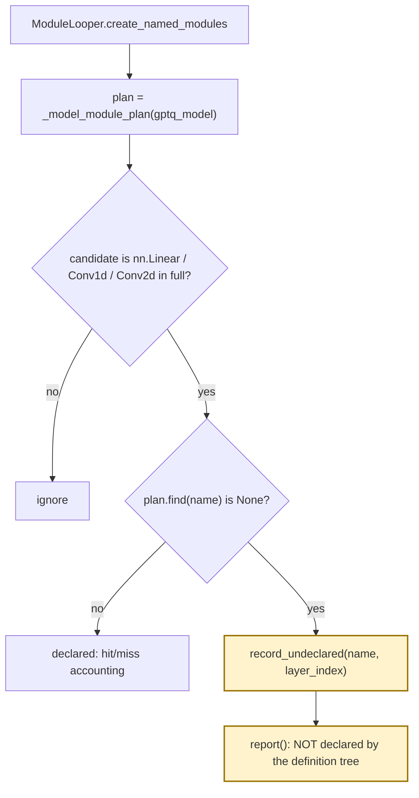
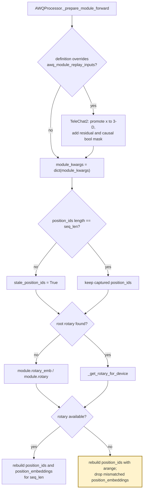
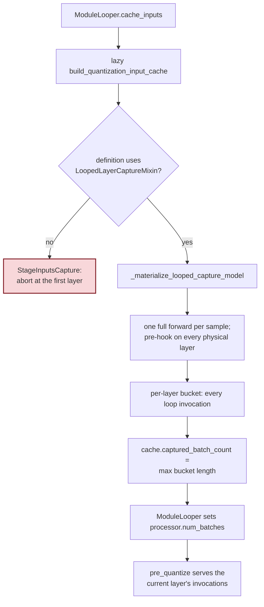
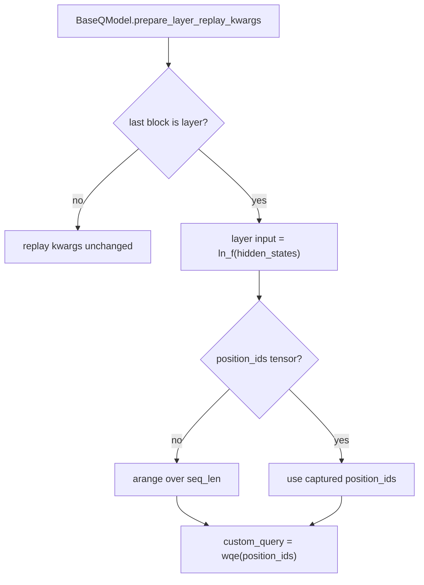

# AWQ scaling groups

AWQ folds one smoothing scale per input channel into the module that produces a
quantized block's input. That is only output-preserving when the producer's
output really *is* the consumer's input and is not consumed by anything else.
The model tree encodes module order, not the residual graph, so tree order alone
cannot decide this.

This page documents the contracts consumed by
`BaseQModel.awq_get_modules_for_scaling` and
`gptqmodel.quantization.awq.quantize.scale.apply_scale`:

1. A layer with no usable scaling group is **quantized plainly**, never
   finalized unquantized (which previously failed later in packing with
   `KeyError: 'q_zeros'`).
2. A definition marks leaves whose output is not a direct scaling source with
   the `nosrc` tree flag. Groups whose `prev_op` carries it are dropped, so the
   consumer falls back to plain quantization instead of silently changing the
   decoder layer output.
3. **One gain norm has exactly one scaling group.** Routed and shared experts
   (and parallel attention/MLP branches) read the same normed tensor; folding
   them as two groups divides the norm twice and leaves one branch unscaled.
4. **Parallel branches share a source.** Sibling projections that read the same
   norm declare it with the same `:in=<tag>` flag, so the second branch folds
   into that norm rather than into the previous branch's output projection.
5. **A norm-like module that cannot absorb a fold is skipped.** A weightless
   norm, a norm with an input-dependent gate, a `Conv1D`, or a
   `HyperConnection` has no plain gain to divide; the group is dropped and the
   layer stays quantized plainly.

Introduced by the fixes for issues #4005, #4017, #4039, and #4093 (items 1-6).

## Flow



The tracker update runs for every block, including blocks skipped because
`prev_op is None`. That keeps the "previous linear in tree order" fallback
available for the next block instead of leaving `last_module` unset.

## One group per norm

`_merge_shared_source_nodes` merges every node whose `prev_op` is the same gain
norm into a single scaling group. The merged group divides that norm once and
multiplies every quantized consumer (all routed experts plus `shared_experts`,
or both parallel branches) and every declared `_scale_consumers` entry (router,
`shared_expert_gate`, `g_proj`, `output_gate`) by the same scale. The merged
group re-inspects a common parent when every consumer shares one, so the scale
search still scores the combined block.

## Parallel branches

When a parallel block reads one norm from two quantized branches, the second
branch has no intervening norm to fold into. Each consumer carries the same
`:in=<tag>` flag, and `_select_prev_op` reuses the first branch's resolved norm
for the tag. Example (Falcon):

```
"input_layernorm": ("input_layernorm:!",),
"self_attention": ("query_key_value:0:in=x", "dense:1"),
"post_attention_layernorm": ("post_attention_layernorm:!",),
"mlp": ("dense_h_to_4h:0:in=x:nosrc", "dense_4h_to_h:1"),
```

## Declared non-sources

Two flags declare data flow:

- `:postnorm` marks a sandwich post-norm whose output is consumed by a residual
  add. It is checked during `prev_op` selection.
- `:nosrc` marks any other leaf whose output is not the direct input of the
  following scaling consumer. It is checked after selection by
  `_filter_awq_scaling_sources`, so it also covers quantized linears.

A `nosrc` flag on a tree leaf means: *this module's output is not the direct
input of the following scaling consumer*. Folding a scale into it changes the
decoder layer output because of one of:

- a residual add between the producer and the consumer,
- a parallel branch that consumes the same activation,
- a non-homogeneous activation (GELU, SiLU, xIELU, sigmoid gate) between the two
  linears,
- a fused projection whose output does not match the consumer's input width.

Syntax:

```
"input_layernorm": ("input_layernorm:!:nosrc",)
"mlp": ("fc1:0:nosrc", "fc2:1")
```

`nosrc` is metadata only: it does not change quantization, subset grouping, or
the emitted block list (the compiler drops non-`!`/`?` flags from block names).

| Definition | Declared non-sources | Why |
| --- | --- | --- |
| `olmo2`, `olmo3`, `exaone4`, `exaone4_5`, `gemma4_text` | post-attention / post-FFN norms (`:postnorm`) | the norm output is added to the residual |
| `opt` (post-norm) | `self_attn_layer_norm` | the normed value is also the MLP residual |
| `phi`, `gptj`, `codegen` | input norm, attention out, MLP in | parallel branches, residual, GELU |
| `gpt_neox`, `gpt_neo`, `gpt_bigcode`, `bloom`, `rw`, `falcon` | MLP input projection | GELU is not positively homogeneous |
| `starcoder2`, `apertus`, `mpt` | MLP up projection | non-homogeneous activation |
| `gpt_oss` | expert `up_proj` | `(clamp(up) + 1) * glu` is not homogeneous in up |
| `afmoe`, `muse_glimmer`, `hrm_text` | attention `gate_proj` | `o_proj` reads `attn * sigmoid(gate)` |
| `gemma4_text` | `v_proj` | MHA configs pass v through a scale-free `v_norm` |
| `minimax` (original) | both block norms | the normalized value is the residual |

## Before and after

| Mechanism | Before | After |
| --- | --- | --- |
| Routed + shared experts | two groups from one norm; each fold left the other unscaled (0.049 / 0.080 on DeepSeek-V3) | one merged group (`_merge_shared_source_nodes`) |
| Parallel branches (Falcon, Cohere) | second branch folded into the first branch's output projection (0.25) | both branches carry `:in=<tag>`; `_select_prev_op` reuses the shared source |
| Non-homogeneous fc1→fc2 | folded across GELU (0.02-0.05) | `:nosrc` on fc1 |
| Gated attention | `gate_proj` became block 0's last module, folded into `o_proj` (0.28) | `:nosrc` on `gate_proj` |
| Weightless / gated norms | `apply_scale` raised (`NotImplementedError`, `AttributeError`) | `is_foldable_source` drops the group; layer is quantized plainly |
| MoE block with a non-foldable norm | fell back to the last expert linear | `last_norm_candidate` returns the block norm; group is dropped |
| `Cohere2` / `Cohere2-MoE` norms | crash (`not in allowed_norms`) | added to `allowed_norms` |
| `Cohere2-MoE` shared experts | undeclared, unscaled (0.01) | declared and merged into the routed group |
| `olmoe` `q_norm`/`k_norm` | full-width norms picked as `prev_op` (0.29) | group index `0` keeps them inside the q/k/v block |
| `laguna` `g_proj` | omitted consumer (0.006) | declared `:!` sibling; collected as a scale consumer |

## Remote-code family trees

The tree is the only declaration of which module feeds a scaling group. Three
remote-code families shipped a tree that did not describe their forward graph,
and two of them quantized to garbage without raising:

| Definition | Before | After | Effect |
| --- | --- | --- | --- |
| `instella` | inherited `LlamaQModel.module_tree` (`input_layernorm` / `post_attention_layernorm`) | own tree with `pre_attention_layernorm` / `pre_feedforward_layernorm` | q/k/v get a norm source; `mlp.gate/up` no longer fold into `self_attn.o_proj` across the residual (wikitext-2 PPL 27997 -> 27.7 on the 3B checkpoint) |
| `k2_horizon` | `q_proj`, `k_proj`, `v_proj`, `gate_proj`, `o_proj` as separate dict nodes | one flat `""` tuple `q_proj:0`, `k_proj:0`, `v_proj:0`, `gate_proj:0:nosrc`, `o_proj:1` | one group per attention input instead of chained single-module groups (PPL 1100 -> sane) |
| `telechat2` | `{"dense": ("dense",)}` only | `("query:0", "key_value:0", "dense:1")` | `query`/`key_value` are quantized instead of silently staying fp16 |

`instella` and `k2_horizon` are in `FAMILY_MODEL_TYPES` in
`tests/test_awq_scaling_groups.py`, so the output-preservation invariant covers
them: folding a random scale into each group must leave the decoder layer's
logits unchanged to `1e-5` relative.

## Coverage: declared specs versus undeclared leaves

`LayerModuleCoverageTracker` used to count only *declared* specs. A quantizable
`nn.Linear` that no spec named was invisible: every declared spec matched while
the leaf stayed in the source dtype. TeleChat2's `query`/`key_value` were
exactly this, and the report said "all 4 specs matched".



The LM head is excluded because it is quantized through its own path, not the
layer tree. A leaf that is intentionally not quantized must still be declared
with `:!` or `:?`; "no spec at all" is now reported.

## AWQ replay scaffolding

AWQ scores a multi-module scaling group by replaying its common parent. Two
inputs to that replay are captured per linear, not per parent, so they can be
stale or incomplete.

### Position kwargs

`AWQProcessor._prepare_module_forward` rebuilds position scaffolding whenever
it does not match the sample being replayed. Before, `position_ids` was only
added when the key was *absent*, so a 430-token capture was replayed with a
522-token activation (EXAONE-3.0) or 48 vs 20 (tiny DeciLM/Nanbeige), crashing
in `apply_rotary_pos_emb`.



`exaone` also declares `rotary_embedding = "transformer.rotary"`, so its
model-level rotary is found directly. Nanbeige/DeciLM keep the rotary on the
attention module and take the `module.rotary_emb` path.

### Module-owned replay inputs

`BaseQModel.awq_module_replay_inputs` lets a definition add arguments the
per-linear capture cannot record. TeleChat2's `TelechatAttention.forward`
requires `(hidden_states, residual, attention_mask, ...)`; the default
implementation returns `(x, module_kwargs)` unchanged, and TeleChat2 promotes
the 2-D capture to 3-D, passes the block input as `residual` (an additive
constant shared by reference and candidate), and builds a causal bool mask.

## Looped decoder calibration

HRM-Text, Ouro (`total_ut_steps=4`) and Nanbeige 4.2 (`num_loops=2`) run the
same physical layers several times per forward. The default capture aborts at
the first layer, so each processor's Hessian only saw loop 0. Ouro's steps 1-3
have cosine -0.03..0.42 against the single captured input.



`_resolve_batch_total` caps the replay at `processor.num_batches`, so publishing
`captured_batch_count` is what keeps loops 1..N-1 from being truncated.

## Top-query layer replay

`GPTPanguModel.forward` applies `ln_f` before the last decoder block and passes
it `custom_query = wqe(position_ids)`, so that block's `q_proj` reads query
embeddings rather than hidden states. `PanguAlphaQModel.prepare_layer_replay_kwargs`
now mirrors that for the last block only; the measured last-layer `q_proj`
relative error on query embeddings dropped from GPTQ 0.130 (worse than RTN
0.101) to GPTQ 0.0558 (better than RTN 0.0933).



## Failure and ambiguity contract

| Situation | Before | After |
| --- | --- | --- |
| No norm in the tree and the first block is quantized | every block skipped, empty map, pack crash | first block skipped, later blocks use the previous linear; invalid ones are filtered |
| `prev_op` is a declared non-source | folded anyway (silent output change) | group dropped; consumer is quantized plainly |
| `prev_op` gain width differs from the consumer input | `apply_scale` shape error | group dropped |
| `prev_op` is a weightless / gated norm / Conv1D / HyperConnection | `NotImplementedError` or `AttributeError` | group skipped by `is_foldable_source` |
| No group survives | layer finalized unquantized; pack crash | layer quantized plainly |

## Validation

`tests/test_awq_scaling_groups.py` builds a tiny model for every family in
`FAMILIES`, folds a random scale in `[0.5, 1.5]` with the library's own
`apply_scale`, and requires the decoder-layer logits to change by less than
`1e-5` relative (Llama measures ~1.5e-7). `tests/test_awq_empty_groups.py` pins
both empty-group paths to `apply_quant(..., scales_list=[])`.

Issue #4093 item coverage:

| Test | Invariant |
| --- | --- |
| `tests/test_awq_scaling_groups.py` (`instella`, `k2_horizon`) | fold preserves the decoder-layer output |
| `tests/test_instella_support.py` | the tree declares the real Instella norm names and resolves on the checkpoint's own layer |
| `tests/test_k2_horizon_support.py` | q/k/v/gate form one flat group; `o_proj` is the separate consumer |
| `tests/test_telechat2_coverage.py` | `query`/`key_value`/`dense` are quantized and no leaf is undeclared; replay supplies `residual` + mask |
| `tests/test_awq_position_kwargs.py` | stale `position_ids` are rebuilt, mismatched `position_embeddings` dropped, module-local rotary rebuilds cos/sin |
| `tests/test_pangu_alpha_replay.py` | last layer replays `ln_f` + `custom_query`; GPTQ beats RTN on the top-query `q_proj` |
| `tests/test_looped_decoder_capture.py` | Ouro captures 4 invocations, Nanbeige 2, per-loop cosine < 0.99 |
| `tests/test_layer_module_coverage.py` | undeclared quantizable leaves are recorded and warned about |

## Not in scope

- MLA attention groups (`deepseek_v2/v3/v32`, `deepseek_v4`, `axk2`) whose
  `q_b_proj`/`kv_b_proj` read different low-rank tensors are filtered by the
  existing width check; the MoE routed+shared merge is covered by the structural
  test.
- `nosrc` is a static declaration. A new family whose forward graph has a
  residual, parallel branch, or non-homogeneous activation between a producer
  and its consumer must declare it; the invariant test catches regressions for
  the families listed above.
