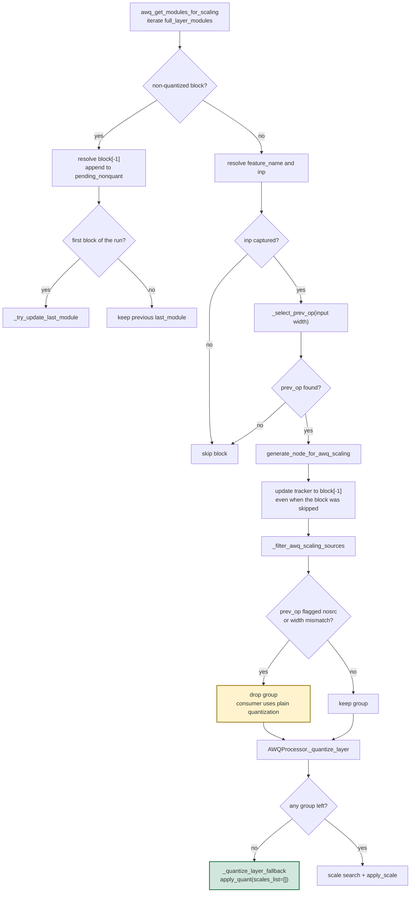

# AWQ scaling groups

AWQ folds one smoothing scale per input channel into the module that produces a
quantized block's input. That is only output-preserving when the producer's
output really *is* the consumer's input and is not consumed by anything else.
The model tree encodes module order, not the residual graph, so tree order alone
cannot decide this.

This page documents the two contracts introduced for issue #4005:

1. A layer with no usable scaling group is **quantized plainly**, never
   finalized unquantized (which previously failed later in packing with
   `KeyError: 'q_zeros'`).
2. A definition marks leaves whose output is not a direct scaling source with
   the `nosrc` tree flag. `awq_get_modules_for_scaling` drops any group whose
   `prev_op` carries it, so the consumer falls back to plain quantization
   instead of silently changing the decoder layer output.

Introduced by the fix for issue #4005.

## Flow



The tracker update at `gptqmodel/models/base.py:4599` runs for every block,
including blocks skipped because `prev_op is None`. That keeps the "previous
linear in tree order" fallback available for the next block instead of leaving
`last_module` unset for the whole layer.

## Declared non-sources

A `nosrc` flag on a tree leaf means: *this module's output is not the direct
input of the following scaling consumer*. Folding a scale into it changes the
decoder layer output because of one of:

- a residual add between the producer and the consumer,
- a parallel branch that consumes the same activation,
- a non-homogeneous activation (GELU, SiLU, xIELU) between the two linears,
- a fused projection whose output does not match the consumer's input width.

Syntax:

```
"input_layernorm": ("input_layernorm:!:nosrc",)
"mlp": ("fc1:0:nosrc", "fc2:1")
```

`nosrc` is metadata only: it does not change quantization, subset grouping, or
the emitted block list (the compiler drops non-`!`/`?` flags from block names).

| Definition | Declared non-sources | Why |
| --- | --- | --- |
| `olmo2`, `olmo3`, `exaone4` | `post_attention_layernorm` | the norm output is added to the residual; the MLP consumes the sum |
| `opt` (post-norm, `do_layer_norm_before=False`) | `self_attn_layer_norm` | the normed value is also the MLP residual |
| `phi` | `input_layernorm`, `self_attn.dense`, `mlp.fc1` | attention and the MLP are parallel branches; `dense` crosses the residual; `fc1` crosses the GELU |
| `gptj` | `ln_1`, `attn.out_proj`, `mlp.fc_in` | parallel branches, residual crossing, GELU |
| `starcoder2` | `mlp.c_fc` | the MLP output projection follows the GELU |
| `apertus` | `mlp.up_proj` | the xIELU activation is not positively homogeneous |
| `codegen` | `ln_1`, `attn.out_proj`, `mlp.fc_in` | parallel branches, residual crossing, GELU |
| `mpt` | `ffn.up_proj` | the FFN output projection follows the GELU |

A gain norm whose width does not match the consumer's input is also dropped
(`gptqmodel/models/base.py:4677`); this covers a stale tracker entry left by a
block that was skipped because a projection is fused or unlisted.

## Before and after

| Mechanism | Before | After |
| --- | --- | --- |
| Tracker after a skipped block | `continue` at `gptqmodel/models/base.py:4558` (origin/main), so `last_module` stayed `None` | tracker updated for every block, `gptqmodel/models/base.py:4599` |
| Empty scaling map | `_finalize_quantized_layer` without quantizing, `gptqmodel/looper/awq_processor.py:1544` (origin/main) | `_quantize_layer_fallback`, `gptqmodel/looper/awq_processor.py:1544` |
| Empty map after filtering | same unquantized finalize, `gptqmodel/looper/awq_processor.py:1631` (origin/main) | `_quantize_layer_fallback`, `gptqmodel/looper/awq_processor.py:1635` |
| Packing without zero points | debug `print("modddd", ...)` then `KeyError: 'q_zeros'` | explicit `RuntimeError` naming the module, `gptqmodel/looper/awq_processor.py:3123` |
| Invalid `prev_op` | tree order only | `nosrc` flag + width check in `_filter_awq_scaling_sources`, `gptqmodel/models/base.py:4624` |
| Phi3 / Apertus / CodeGen / MPT trees | no norm entries (Phi3, CodeGen, MPT) or string values instead of 1-tuples (Apertus) | norms declared; Apertus uses 1-tuples |

## Failure and ambiguity contract

| Situation | Before | After |
| --- | --- | --- |
| No norm in the tree and the first block is quantized | every block skipped, empty map, pack crash | first block skipped, later blocks use the previous linear; invalid ones are filtered |
| `prev_op` is a declared non-source | folded anyway (silent layer-output change) | group dropped; consumer is quantized plainly |
| `prev_op` gain width differs from the consumer input | `apply_scale` shape error | group dropped |
| No group survives | layer finalized unquantized; pack crash | layer quantized plainly |

## Validation

`tests/test_awq_scaling_groups.py` builds a tiny model for every family in the
table, folds a random scale in `[0.5, 2]` with the library's own `apply_scale`,
and requires the decoder-layer logits to change by less than `1e-5` relative
(Llama measures ~1.5e-7). `tests/test_awq_empty_groups.py` pins both empty-group
paths to `apply_quant(..., scales_list=[])`.

## Not in scope

- The LFM3 sandwich post-norms are handled by the `_select_prev_op` data-flow
  work tracked in issue #4002 item 1; this page covers the `nosrc` contract
  consumed after selection.
- `nosrc` is a static declaration. A new family whose forward graph has a
  residual, parallel branch, or non-homogeneous activation between a producer
  and its consumer must declare it; the invariant test catches regressions for
  the families listed above.
