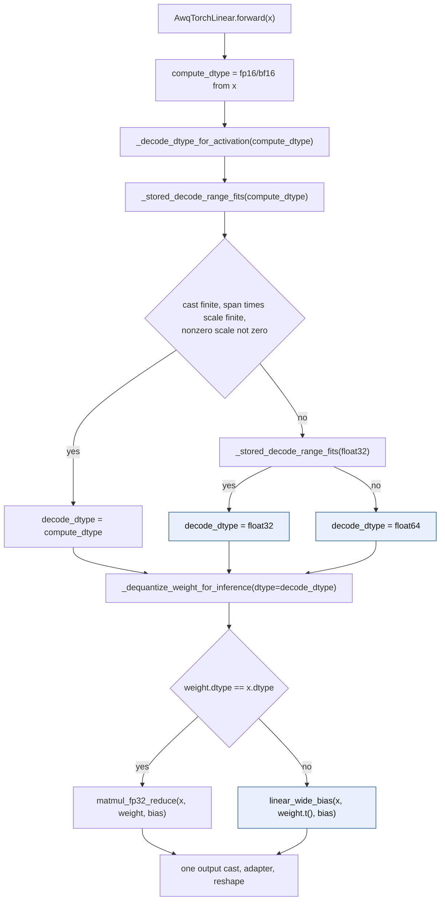

<!-- SPDX-FileCopyrightText: 2026 ModelCloud.ai
SPDX-License-Identifier: Apache-2.0 -->

# AWQ Torch forward decode range

`AwqTorchLinear` is the portable AWQ reference kernel. Its forward decodes the
packed INT4 codes of the current call, multiplies, and rounds once. The decode
dtype therefore decides the representable set of the reconstructed weight, and
the reference kernel must not narrow a checkpoint scale into a range that the
checkpoint itself does not have.

## What the checkpoint actually stores

`pack()` stores the source `scales` (one row per group) without narrowing them,
and the codes are integers in `[0, 2**bits - 1]`. The decoder reconstructs

```text
weight[row, column] = (code - zero) * scale[group(row), column]
```

`dequantize_gemm` materializes that product in the dtype of the scale operand it
receives. The previous forward passed `_scales_for_compute(..., dtype=compute_dtype)`,
so an FP16/BF16 activation decoded every weight into the half dtype *before* the
product and before any wide reduction.

## The failure

| Stored scale | Code | Input | Previous output | FP64 oracle |
| --- | --- | --- | --- | --- |
| FP32 `10000` | 7 | `0.001` | `inf` | `8963.623046875` |
| FP32 `1e-8` | 1 | `60000` | `0` | `0.07680000000000024` |

Both cases are 128/128 wrong with the packed codes intact, so the corruption is
the scale-to-weight product, not the packing. `7 * 10000 = 70000` exceeds the
FP16 maximum, and `1e-8` is below the smallest FP16 subnormal (`2**-24`), so the
half decode produces `inf` and `0` for every element. `matmul_fp32_reduce` widens
the operands it is given; it cannot restore a value that the decoder already
destroyed.

The AWQ search bounds its own scale range, so an internally produced checkpoint
does not normally reach these values. A portable checkpoint that stores FP32 or
BF16 scales, or one written by another tool, can.

## Flow



The range predicate evaluates the cast the decoder performs: the scale must stay
finite, `span * scale` (`span = 2**bits - 1`) must stay finite, and a nonzero
scale must not round to zero. It is conservative — it does not decode the packed
codes — so a layer whose codes happen to stay in range may still take the wide
decode. The cost is a wider temporary, never a wrong value.

## Before and after

| Mechanism | Before (`ce1329bfe`) | After |
| --- | --- | --- |
| Decode dtype in `forward` | `compute_dtype` (activation dtype) at `torch_awq.py:312` | `_decode_dtype_for_activation(compute_dtype)`, range-derived |
| Decode operand | `_scales_for_compute(..., dtype=compute_dtype)` at `torch_awq.py:191` | decode dtype from the same helper |
| Half-dtype decode of a wide scale | materialized `inf` / `0` weights | decode stays finite in FP32/FP64 |
| Wide decode epilogue | not reachable | `linear_wide_bias`: promote for the call, accumulate in FP32, round once |
| Stored buffers | kept checkpoint dtype | unchanged |
| Persistent weights | packed only | packed only; the wide decode is call-local |

`AwqTorchLinear.SUPPORTS_DTYPES` still lists FP16 and BF16, and the returned
tensor keeps the activation dtype. Only the intermediate weight and product are
wider.

## Failure and ambiguity contract

| Situation | Before | After |
| --- | --- | --- |
| FP32 scale `10000`, FP16 activation | all outputs `inf` | `8960` (FP16 rounding of `8963.62`) |
| FP32 scale `1e-8`, FP16 activation | all outputs `0` | `0.0767822265625` |
| FP16 scale at `finfo(fp16).max / 15` | decode `inf` | wide decode, finite output |
| FP16 scale below the smallest subnormal | decode `0` | wide decode, nonzero output |
| Zero scale stored in the checkpoint | decode `0` | stays `0` (checkpoint value, not a cast) |
| BF16 scale `1e38`, four bits | FP32 decode also `inf` | FP64 decode; BF16 output finite |
| `torch.compile` / inductor | eager decode | forces the wide decode; no host-side value read |
| CUDA graph capture | eager decode | forces the wide decode; no host sync |
| Scale replaced or mutated | decode followed the buffer | cache key uses identity/version/device/dtype/shape; `clear_weight_cache()` also resets |
| Meta / empty scales | `True` (narrow decode) | unchanged; nothing to decode |

## Scope

This contract governs `AwqTorchLinear`. `ParoLinear` reaches the same helper
through `_forward_dense`, which already requests an FP32 decode. `AwqGEMMLinear`
and the native GEMV/GEMV-fast kernels keep their own operand contracts and were
not measured here. The decode branches were exercised on CPU and on an
accelerator in both the CUDA and the HIP runtime.

## Validation

`tests/kernels/test_awq_torch.py` builds each layer from known codes and packed
bytes and compares against an FP64 oracle that decodes the words itself from the
source scale value (never `module.scales`):

- `test_awq_torch_decode_range_matches_fp64_oracle` — the two reported cases,
  CPU and CUDA.
- `test_awq_torch_decode_range_keeps_checkpoint_scale_precision` — FP16, BF16,
  and FP32 checkpoint scales; `state_dict()` bytes unchanged after the forward.
- `test_awq_torch_decode_range_threshold_neighbors` — one representable FP16 step
  either side of the upper (`finfo(fp16).max / 15`) and lower (`2**-24`)
  boundaries.
- `test_awq_torch_decode_range_both_activation_dtypes` — FP16 and BF16.
- `test_awq_torch_decode_range_is_call_local` — repeated forwards, no retained
  dense weight, decision follows a replaced or mutated scale buffer.
- `test_awq_torch_decode_range_bound_is_conservative` — an in-range code grid may
  still take the wide decode.
- `test_awq_torch_decode_range_widens_past_fp32` — a BF16 scale beyond the FP32
  weight range decodes in FP64.

On the pre-fix revision these tests report 24 failures (the 4 that pass assert
unchanged checkpoint buffers and the zero-scale case); with the change they
pass. The AWQ CPU regression baseline from the AWQ safety skill and the Torch
oracle suites (`test_awq_dequantize_tiling.py`,
`test_awq_runtime_dtype_storage.py`, `test_paro.py`) also pass.
