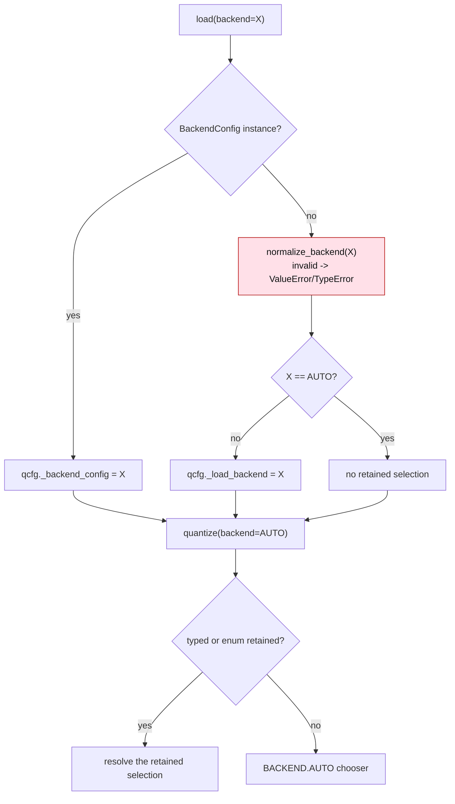
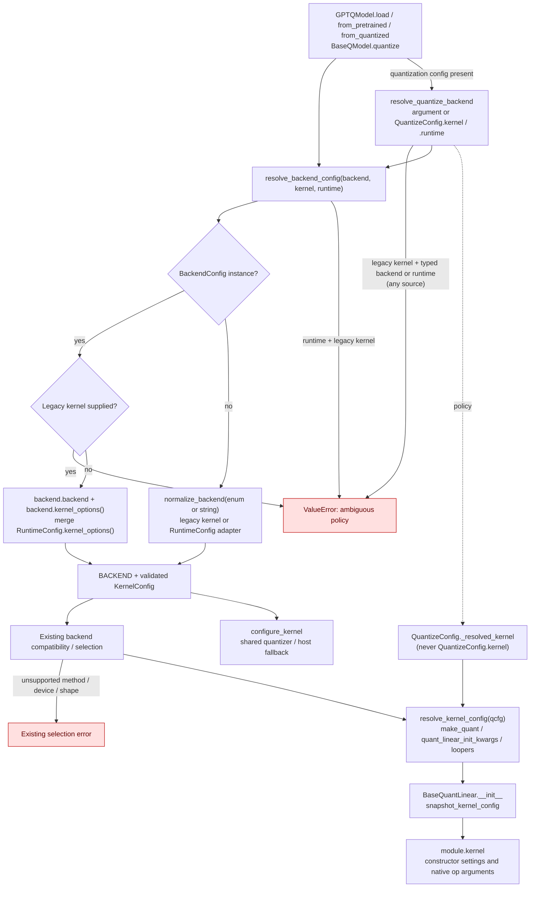
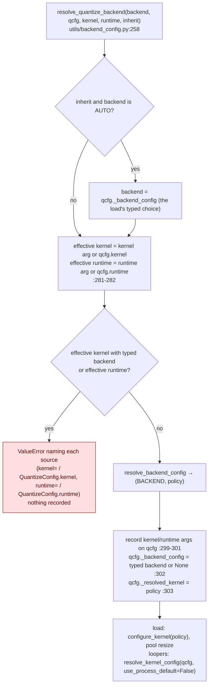
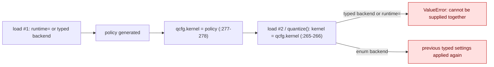
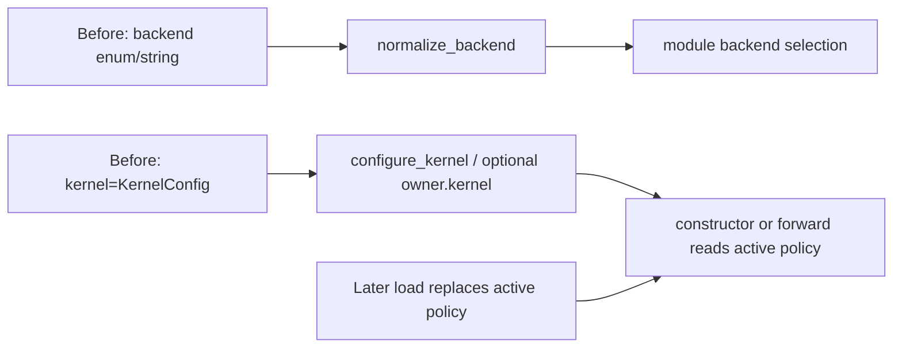
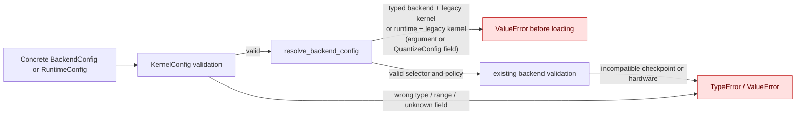

<!-- SPDX-FileCopyrightText: 2026 ModelCloud.ai
SPDX-License-Identifier: Apache-2.0 -->

# Backend selection and configuration

GPT-QModel accepts one execution argument: `backend=BACKEND.MARLIN` selects
Marlin with defaults; `backend=MarlinConfig(fp32=False)` selects Marlin with
custom settings. Existing enum members, strings and legacy aliases retain
their selection semantics. Backend compatibility checks still apply to the
checkpoint's method, format, device, dtype and shape.

```python
from gptqmodel import GPTQModel
from gptqmodel.backend import BACKEND, MarlinConfig, RuntimeConfig
from gptqmodel.quantization import QuantizeConfig

model = GPTQModel.load("org/model", backend=BACKEND.MARLIN)
model = GPTQModel.load("org/model", backend=MarlinConfig(fp32=False))

# Shared run controls live separately from backend-specific execution options.
qcfg = QuantizeConfig(bits=4, runtime=RuntimeConfig(max_packers=2))
model = GPTQModel.load("org/unquantized-model", quantize_config=qcfg,
                      backend=MarlinConfig(fp32=False))
# model.quantize(calibration_dataset) retains that typed backend selection.
```

`GPTQModel.from_pretrained`, `GPTQModel.from_quantized`, and `model.quantize`
also accept typed backend configurations. A quantization-time `backend=`
overrides the selection retained by the loader. Use `backend=BACKEND.AUTO`
without a retained selection to run the existing automatic chooser.

A dense load's explicit selection is retained for a later
`quantize(backend=AUTO)` whether it was written as a typed configuration or as
the equivalent enum/string:

| dense load | `quantize(backend=AUTO)` |
| --- | --- |
| `backend=AwqTorchConfig()` | `AWQ_TORCH` with that configuration |
| `backend=BACKEND.AWQ_TORCH` | `AWQ_TORCH` with defaults |
| `backend=BACKEND.AUTO` | the automatic chooser |

An invalid backend value raises at the load boundary; it is never replaced by
`AUTO`.



## Types and options

`BackendConfig` is abstract. Concrete configurations inherit it, declare a
fixed `BACKEND` identity, and validate their options at construction. They are
frozen dataclasses; their backend cannot be supplied as a constructor option.
`MarlinConfig()` has the same execution defaults as `BACKEND.MARLIN`.

Import configurations from `gptqmodel.backend` or `gptqmodel`.

| Configuration | Selects | Options (unprefixed within the configuration) |
| --- | --- | --- |
| `MarlinConfig` | `MARLIN` | `fp32` (GPTQ and AWQ Marlin reductions) |
| `TorchConfig` | `GPTQ_TORCH` | `streaming`, `stream_tile`, `triton_dequant`, `rocm_gemv`, `rocm_gemm` |
| `AwqTorchConfig` | `AWQ_TORCH` | Default selection |
| `AwqGemmConfig` | `AWQ_GEMM` | `fp32_accum`, `fused_splitk_reduce` |
| `AwqTritonConfig` | `AWQ_GEMM_TRITON` | `fp32_accum`, `schedule` |
| `SwordfishConfig` | `SWORDFISH` | `dense_m`, `deterministic` |
| `GGUFTorchConfig` | `GGUF_TORCH` | Fused CPU/CUDA row and matrix-size gates, chunk sizes and autotuning settings |
| `GGUFCPPConfig` | `GGUF_CPP_CPU` | GGUF options plus `native_matmul`, `threads` |
| `GGUFCUDAConfig` | `GGUF_CPP_CUDA` | Default selection; ggml-cuda runs every matmul, so the Torch fused-forward gates do not apply |
| `ParoQuantConfig` | `PAROQUANT_CUDA` | `fp32_accum`, `fused_splitk_reduce`, runtime/rotation dtype caching, `cpu_avx512` |
| `ParoQuantTritonConfig` | `PAROQUANT_TRITON` | ParoQuant options plus autotuning and `decode_max_rows` |
| `BitsAndBytesConfig` | `BITSANDBYTES` | `cpu_packed`, `cpu_int8_dense`, `triton` |
| `TTBlockFloatConfig` | `TT_BLOCKFLOAT` | `cublas` |

Backends without typed tuning options continue to use `BACKEND` selectors.
Shared quantizer, worker and host controls use `RuntimeConfig`, accepted by
the loaders as `runtime=` or attached to `QuantizeConfig.runtime`. The
[legacy field reference](kernel-config.md#fields) gives the defaults and
units; typed execution options omit the backend prefix (for example
`TorchConfig(stream_tile=256)` maps to `KernelConfig.torch_stream_tile`).
Shared quantizer options keep their names, such as `gptq_fused_block_update`.
`RuntimeConfig` also carries the device-pool controls `cpu_workers`,
`cuda_workers` and `pool_intraop_threads`; a later load that changes any of
them rebuilds the process pool. `BitsAndBytesConfig(triton=True)` forces the
Triton 4-bit GEMM where a measured tile exists; like the legacy field, it is
read from the process policy that the load installs. The legacy
`torch_cache_weights` and `torch_lookahead` fields are not exposed: dense
weight caches are refused, and those fields only warn.

## Resolution and ownership



`resolve_kernel_config` accepts a `KernelConfig` directly, then prefers the
policy an API boundary resolved for the owner (`_resolved_kernel`), then the
owner's caller-supplied `kernel`, then its `runtime`, then the process fallback. Each quantized
linear owns a fresh copy. Loading another model or mutating the legacy policy
after construction does not retune existing modules. Native AWQ, Swordfish,
block-float and GGUF CPU calls receive the relevant module settings explicitly.
GGUF's shared native CPU backend sets the selected module's thread count under
its existing execution lock.

Shared quantization/host utilities still use a process-wide fallback guarded
by an `RLock`. Concurrent model quantization with different shared runtime
settings is not isolated by this API. `configure_kernel(None)` resets that
fallback to defaults; it does not modify constructed modules.
Both loopers resolve an unset run policy with `use_process_default=False` to
reset to defaults before quantization instead of inheriting a previous run.

## Reusing a quantization config

`QuantizeConfig.kernel` and `QuantizeConfig.runtime` hold only settings a
caller supplied: on the config itself, or as the loader's `kernel=` / `runtime=`
argument, which replaces the field of the same kind. The policy derived from
them and a typed backend is kept in the private `_resolved_kernel`, so loading
the same config again, or calling `quantize(backend=...)` on its model, never
mistakes the previous result for a caller's legacy `kernel=`.



Before this change (`gptqmodel/utils/backend_config.py:265-278` at `489aed6`),
the resolver read `qcfg.kernel` as the caller's legacy policy and then wrote its
own generated policy into that field:



Only the typed-backend path had an identity escape (`_backend_kernel`), so a
`runtime=`-only config failed on its second load, and `QuantizeConfig.runtime`
plus `kernel=` silently dropped the runtime settings instead of raising.

| Second call on the same config | Before | Now |
| --- | --- | --- |
| `QuantizeConfig(runtime=R)`, then `backend=TorchConfig(...)` (load or `quantize`) | `ValueError` | Torch settings merged with `R` |
| `runtime=R1`, then `runtime=R2` | `ValueError` | `R2` replaces `R1` |
| `backend=TorchConfig(streaming=True)`, then `backend=BACKEND.TORCH` | streaming stays on | Torch defaults |
| `QuantizeConfig(runtime=R)` plus `kernel=K` | `R` silently dropped | `ValueError` |
| `QuantizeConfig(kernel=K)` plus `runtime=R` or a typed backend | `ValueError` | `ValueError` |

`GPTQModel.load` and `GPTQModel.from_pretrained` forward the caller's own
`backend`, `kernel` and `runtime` to the model definition, which resolves them
again against the same config; the redirect to `from_quantized` receives the
resolved `(BACKEND, policy)` pair because it does not receive the config.
`from_quantized` stores its policy in the checkpoint config's
`_resolved_kernel`, not in `kernel`.

## Before and after

Locations in the second column refer to the code before this API change.

| Mechanism | Before (`gptqmodel/` location) | Current behavior |
| --- | --- | --- |
| Execution choice | `models/auto.py:872,1005,1129`: normalize enum/string | `resolve_backend_config` additionally accepts a `BackendConfig` and extracts its fixed identity |
| Execution tuning | `models/auto.py:839`: `kernel=` installs a mixed policy | A typed `backend=` selects and tunes; `runtime=` carries shared controls; legacy `kernel=` remains accepted |
| Module policy | `nn_modules/qlinear/__init__.py:288`: stores only the selector; `utils/model.py:623`: forwards qcfg kwargs | `BaseQuantLinear` snapshots an explicit policy, also forwarded by `make_quant` |
| Runtime fallback | `utils/kernel.py:404-414`: owner policy or current global | Direct policy objects are honored; modules keep snapshots; shared utilities retain the global fallback |



## Failure and compatibility contract



Existing `kernel=KernelConfig(...)` and `kernel={...}` remain supported with
enum/string selectors. A typed backend cannot be combined with legacy
`kernel=`, including one on `QuantizeConfig`; use `runtime=` for shared controls.
Configurations and effective policies are runtime-only and are not written to
checkpoint metadata. Checkpoints continue to describe their numerical format;
callers choose execution settings on reload.
