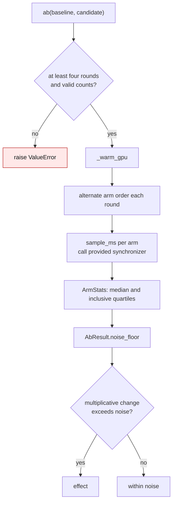

# Benchmark methodology

Performance claims in this repository come from `scripts/benchmark_*.py`. This page
records the protocol those numbers are expected to follow, why it exists, and
how to calibrate a machine before trusting a comparison. `scripts/bench_ab.py`
implements the timing side.

## The problem with one timed run

The common shape of a benchmark is a warmup followed by a single timed loop:

```python
for _ in range(warmup):
    fn()
torch.cuda.synchronize()
start = time.perf_counter()
for _ in range(iters):
    fn()
torch.cuda.synchronize()
return (time.perf_counter() - start) * 1e3 / iters
```

The returned number has no uncertainty attached, and the usual follow-up - run
arm A now, run arm B in a second process - compares two GPU clock states rather
than two kernels. Measured on one laptop (RTX 5090 Laptop, marlin W4A16, the
same build in both runs):

| shape | run 1 | run 2 | delta |
| --- | --- | --- | --- |
| expert_down 2304x5120 | 382.4 GB/s | 417.0 GB/s | +9.0% |
| o_proj 32768x5120 | 615.8 GB/s | 758.5 GB/s | +23.2% |
| shared_down 5120x2304 | 439.9 GB/s | 417.0 GB/s | -5.2% |
| kv_a_proj 5120x576 | 122.9 GB/s | 123.2 GB/s | +0.3% |

Mean absolute deviation 6.4%, worst case 23.2%, with nothing changed. A change
smaller than that cannot be distinguished from the clock.

## The protocol

1. **Both arms in one process.** Two processes cannot share a clock state.
2. **Alternate the order every round.** A fixed order lets a slow heat cycle
   attach to one arm. With a fixed order, an A/A control on this laptop reported
   0.91x - a 9% "effect" between two arms running identical code.
3. **One sample per arm per round, many rounds.** The minimum of a round's
   iterations is used as the round's sample; rounds supply the spread.
4. **Report the noise floor next to the speedup.** It uses inclusive 25th and
   75th percentiles from at least four rounds, takes the larger relative spread
   of the two arms, and floors it at 3%:
   `noise = max(iqr_baseline, iqr_candidate, 0.03)`.
5. **A change counts only if it exceeds the noise floor.** Speedups and
   slowdowns use the same multiplicative threshold:
   `max(speedup, 1 / speedup) - 1 > noise`. Otherwise the result is
   `within noise`.
6. **Warm the GPU before the first sample.** An idle card starts at its lowest
   clock, and the first arm measured pays for the ramp.

| Existing single-arm timing | A/B harness |
| --- | --- |
| `scripts/benchmark_gptq_block.py:20-25` times one call and reports its duration. Separate runs can see different clock states. | `scripts/bench_ab.py` warms once, alternates arm order each round, and compares medians against measured spread. |



```python
from scripts.bench_ab import ab, format_result

result = ab(lambda: forward(baseline), lambda: forward(candidate), rounds=10)
print(format_result("fused vs unfused", result))
# fused vs unfused: baseline   142.0us  candidate   131.5us   1.08x  noise  6.1%  -> effect
```

By default the sampler synchronizes PyTorch's current CUDA device. For work on
another device, pass its synchronizer so the measurement includes the kernel:

```python
import torch

device = torch.device("cuda:1")
result = ab(baseline, candidate, warm_gpu_device=device,
            sync=lambda: torch.cuda.synchronize(device))
```

For CPU work on a machine with a GPU, pass `sync=lambda: None` and
`warm_gpu_seconds=0`. `self_check()` accepts the same options.

## Calibrate the machine first

`--self-check` times identical work in both arms. Whatever it reports is the
protocol's bias on that machine; a comparison narrower than it is not evidence.

```bash
python scripts/bench_ab.py --self-check
# A/A control: baseline     316.8us  candidate     314.5us    1.01x  noise  18.2%  -> within noise
```

The example above is a laptop: 18% spread on a 300us operation. On that machine
only a change larger than ~18% is worth reporting, and a 10% claim is not.

## When a faster kernel does not show up end to end

Kernel-level and model-level numbers answer different questions. On the same
laptop, a marlin change that made a 5120x128 GEMM 2.9x faster moved the model
forward by 0.2%: the GEMMs were 10% of the step and the rest was Python
dispatch. Report both, and state which one the claim is about.

    kernel:  43.1us -> 14.8us   2.91x   (isolated, 10 rounds)
    forward: 13.83ms -> 13.80ms 1.002x  (same model, same process)

## What to write in a PR

- the exact command and the shape list;
- per-round samples, or at least median and the spread;
- the noise floor from `--self-check` on the machine that produced them;
- whether the number is kernel-level or end-to-end;
- what could not be measured (hardware you do not have).

A negative result recorded this way is worth more than an unqualified win: it
stops the next person from repeating it.
