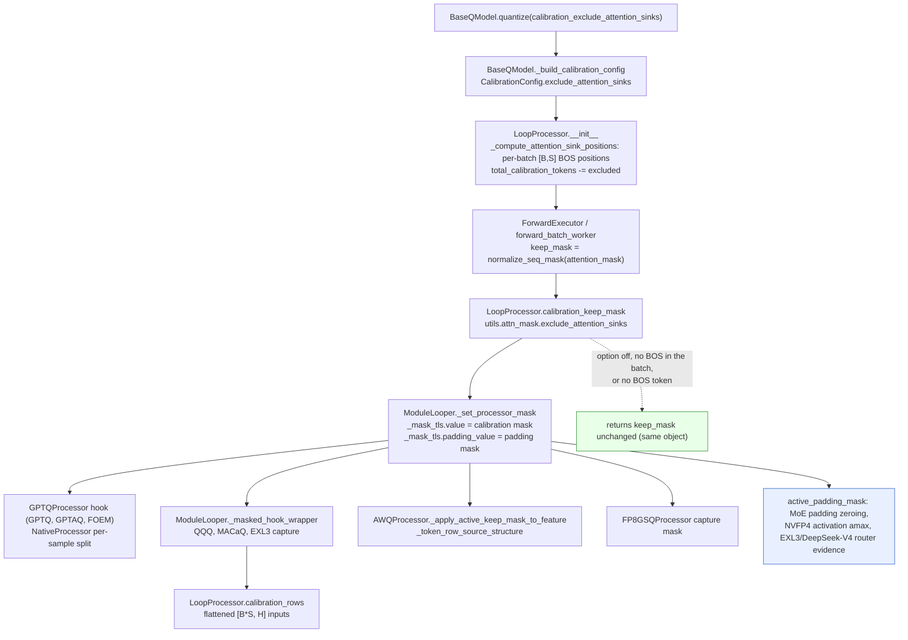
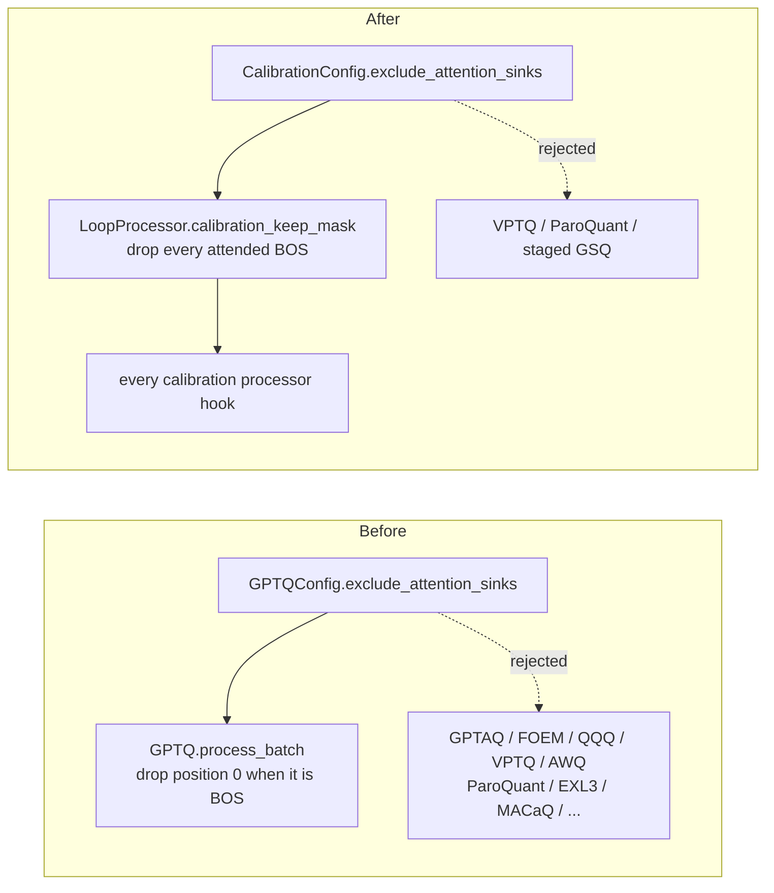

# Calibration attention-sink exclusion

`quantize(..., calibration_exclude_attention_sinks=True)` removes the BOS
attention-sink tokens from every calibration statistic: Hessians (GPTQ,
GPTAQ/FOEM `H` and `dXXT`, QQQ, MACaQ, the EXL3 capture), AWQ activation
features (token-row sample, `x_mean`, scale-search loss), calibrated FP8 GSQ,
and the token totals used for averaging and the zero-sample fallback threshold.
The tokens still run through every forward, so later tokens keep attending to
them. The default is `False`, and with it every method writes the same
checkpoint as before.

## Which tokens are sinks

Measured at the input of `layers.1.mlp.down_proj` (fp32, 8 C4 documents,
`tests/test_calibration_attention_sinks.py` pins the rule, not these numbers):

| model | leading BOS | leading text token | BOS inside a row | median token |
| --- | --- | --- | --- | --- |
| Llama-3.2-1B-Instruct | 1161 | 445 | 755 | 1.7 |
| Llama-3.2-1B | 624 | 1124 | 515 | 1.9 |
| Qwen2.5-0.5B-Instruct (no BOS token) | - | 10.5 | - | 5.9 |

A BOS token is a sink wherever it appears. Concatenated calibration
(`calibration_concat_size`) tokenizes every document with its own BOS: on 32 C4
documents packed into 2048-token windows with the Llama tokenizer, 1 of 8
windows starts with BOS and the windows hold 31 more BOS tokens at document
boundaries. The excluded set is therefore every attended position whose token
is `tokenizer.bos_token_id`: the leading BOS of a row (the first non-pad token
of a left-padded row) and every BOS inside a row.

Nothing else is excluded. A tokenizer without a BOS token (Qwen2/2.5/3) has no
sink to drop: the run logs a warning and its checkpoint is bitwise identical to
the default one. An earlier rule also dropped the first token of every row
whatever its id; on Qwen2.5-0.5B-Instruct that removed a real text token and
raised GPTQ wikitext-2 perplexity from 21.17 to 23.26 (issue #4459).

## Flow

## Before and after

Before, the option was `GPTQConfig.exclude_attention_sinks` (#4440) and only the
plain GPTQ Hessian honoured it (`GPTQ._attention_sink_row_keep`, called from
`GPTQ.process_batch`): it dropped position 0 of a 3-D batch when the
calibration `input_ids` showed BOS there (#4459). That lookup read
`processor.calibration_dataset` from the forward hook, after `ModuleLooper` had
already released it, so in a real `quantize()` run nothing was ever excluded
(#4568); #4610 then cached that per-batch decision inside `GPTQProcessor`.
Every other method rejected the field (#4447), so GPTAQ, FOEM, QQQ,
AWQ, MACaQ and EXL3 had no remedy, and a document-boundary BOS inside a
concatenated window was never excluded. The BOS positions are now resolved
from the prepared `input_ids` and `tokenizer.bos_token_id` when the processor
is built, before the dataset is released, and the run logs how many tokens it
drops.

`GPTQConfig(exclude_attention_sinks=...)` is no longer accepted (`TypeError`),
and neither is a `dynamic` override of it: the option describes the calibration
rows, not a module. When the option is on, the saved `quantize_config.json`
records `meta.calibration_exclude_attention_sinks: true`; a default run writes
nothing.

## Failure and ambiguity paths

* **Rejected methods.** VPTQ raises a `ValueError`: dropping the sink rows from
  its Hessian made perplexity 4.5-4.7x worse (table below). ParoQuant optimizes
  whole replayed layer outputs, not per-token rows, and raises too. Staged GSQ
  rejects it with its other unsupported `quantize()` arguments. EoRA builds its
  own calibration config and is unaffected; weight-only methods warn that it has
  no effect.
* **Natively routed MoE experts** see `[routed_rows, H]` inputs whose rows
  cannot be mapped back to a sequence position, so their statistics keep the
  sink rows. The all-expert bypass path (`[B*S, H]`) is row-aligned and drops
  them. MoE padding zeroing (`GPTQProcessor.register_moe_root_capture_hook`)
  uses the padding-only mask so the sink token's forward is never altered.
* **Inputs the mask wrapper cannot place** (`LoopProcessor.calibration_rows`,
  used by QQQ, MACaQ and the EXL3 capture) lose only their BOS rows; their
  padding rows stay, as with the option off.
* **VLMs that expand placeholders inside the forward** produce a layer sequence
  longer than `input_ids`. The BOS positions cannot be placed, so that batch
  keeps its default mask (`exclude_attention_sinks` shape check).
* **NVFP4 activation ranges** keep the sink rows: inference sees them.

## Measured effect

Wikitext-2 perplexity (80 windows of BOS + 511 tokens), 128 C4 calibration
documents, `batch_size=1`, no concatenation, fp16, quantize -> save -> reload,
CUDA RTX 4090 unless marked ROCm. Every CUDA "off" value equals the pre-change
main result bit for bit. Without concatenation each Llama row is one document
that starts with BOS, so the BOS is the only token excluded.

| method | Llama-3.2-1B-Instruct off → on (Δ%) | Llama-3.2-1B off → on (Δ%) | Qwen2.5-0.5B-Instruct |
|---|---|---|---|
| gptq4 | 25.06 → 22.21 (-11.4%) | 15.22 → 17.12 (+12.5%) | 21.17, identical |
| gptq4_asym | 26.07 → 21.54 (-17.4%) | 14.68 → 16.29 (+11.0%) ROCm | no BOS: unchanged |
| awq4 | 21.88 → 21.76 (-0.6%) | 15.82 → 16.22 (+2.5%) | 24.50, identical |
| awq4_asym | 20.98 → 20.90 (-0.4%) | 15.52 → 15.36 (-1.0%) ROCm | no BOS: unchanged |
| gptaq4 | 22.17 → 21.66 (-2.3%) | 15.17 → 16.73 (+10.3%) ROCm | no BOS: unchanged |
| foem4 | 24.10 → 22.57 (-6.4%) | 15.29 → 16.38 (+7.1%) ROCm | no BOS: unchanged |
| qqq4 | 30.30 → 22.70 (-25.1%) | 15.51 → 16.55 (+6.7%) ROCm | no BOS: unchanged |
| exl3_4 | 19.40 → 19.19 (-1.1%) | 14.14 → 15.05 (+6.5%) ROCm | no BOS: unchanged |
| macaq | 22.34 → 22.59 (+1.1%) | 16.39 → 18.34 (+11.9%) ROCm | no BOS: unchanged |
| vptq (now rejected) | 59.79 → 282.18 (+372.0%) | 47.96 → 217.62 (+353.8%) ROCm | - |

"identical" means the saved tensors are bitwise identical to the option-off
checkpoint. The non-GPTQ Llama cells were measured with the earlier rule, which
excludes exactly the same tokens on these unconcatenated rows; the GPTQ cells
were re-measured with the shipped code (Llama-3.2-1B-Instruct reproduced to
every digit).

Concatenated calibration (`calibration_concat_size=2048`, GPTQ 4-bit, CUDA):

| model | off | on (every BOS) |
| --- | --- | --- |
| Llama-3.2-1B-Instruct | 26.54 | 26.27 (-1.0%) |
| Llama-3.2-1B | 15.27 | 15.34 (+0.5%) |

Most concatenated windows start mid-document, so their leading token is text
and is kept; only the document-boundary BOS tokens are excluded, and the effect
is small. The earlier rule that also dropped each window's leading text token
moved Llama-3.2-1B-Instruct much further (26.29 → 22.69 on ROCm) but cost
Qwen2.5-0.5B-Instruct 10% (#4459), so it is not used.

Peak quantization memory (`torch.cuda.max_memory_allocated`) is unchanged
within 0.03 GiB for every method except MACaQ, which drops 0.04-0.35 GiB. AWQ
quantization takes about 5-40% longer with the option on; other methods are
within the run-to-run noise of a shared host.

The option helps where the sink-dominated Hessian made the quantizer worse
than RTN (Llama-3.2-1B-Instruct GPTQ: 25.06 off vs 24.49 RTN) and hurts
models whose sink rows carry information the quantizer should preserve (base
Llama-3.2-1B). Keep it off by default and validate per model.
