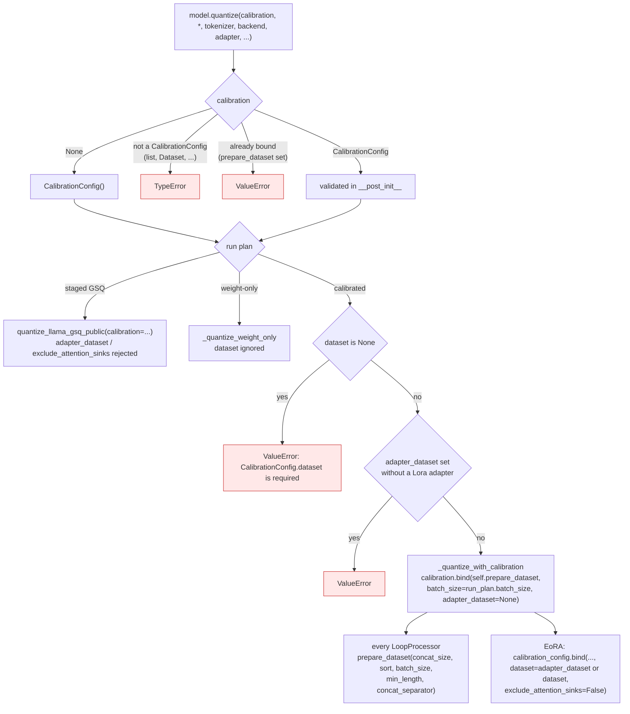

# Calibration config

`quantize()` takes every calibration choice of a run in one frozen dataclass,
`CalibrationConfig` (`gptqmodel/quantization/config.py`, exported as
`gptqmodel.CalibrationConfig` and `gptqmodel.quantization.CalibrationConfig`).
The looper processors consume the same class; there is no second definition.

```python
from gptqmodel import CalibrationConfig, GPTQConfig, GPTQModel

model = GPTQModel.load("Qwen/Qwen3-0.6B", GPTQConfig(bits=4, group_size=128))
model.quantize(
    CalibrationConfig(
        dataset=calibration_texts,  # strings, token ids, input_ids rows, HF datasets, ...
        concat_size=2048,           # optional fixed-length packing
        sort="desc",                # "asc", "desc", "shuffle", or None (input order)
        batch_size=1,
        min_length=10,              # drop rows with <= 10 non-padding tokens
        concat_separator=None,
        exclude_attention_sinks=False,
    ),
    backend=BACKEND.AUTO,
)
```

| field | default | validation (`__post_init__`) |
| --- | --- | --- |
| `dataset` | `None` | not a `str`/`bytes`/`CalibrationConfig`; required unless the quantize config is weight-only |
| `concat_size` | `None` | `None` or a positive `int` (not `bool`); `0` is rejected, `None` disables packing |
| `sort` | `"desc"` | `None`, `"asc"`, `"desc"` or `"shuffle"` |
| `batch_size` | `1` | positive `int` (not `bool`) |
| `min_length` | `10` | non-negative `int` (not `bool`) |
| `concat_separator` | `None` | `None` or `str` |
| `exclude_attention_sinks` | `False` | `bool` ([attention-sink exclusion](calibration-attention-sinks.md)) |
| `adapter_dataset` | `None` | as `dataset`; requires a `Lora` adapter |

The defaults are the previous `quantize()` keyword defaults, so a default
`CalibrationConfig(dataset=data)` run writes the same checkpoint as the
previous `quantize(data)` call. Measured on Qwen2.5-0.5B-Instruct (fp16, 64
`nm-calibration` rows, `batch_size=1`, CUDA): GPTQ 4-bit `g128` (794 tensors)
and AWQ 4-bit `g128` (626 tensors) are bitwise identical to `main` at
`2ed6a6e4f` calling `quantize(texts, batch_size=1)`, `quantize_config.json` included.

`requantize(calibration, *, ...)` and
`GPTQModel.adapter.generate(adapter, model, quantized_model, calibration, *, ...)`
take the same object. `quantize()` keeps `tokenizer=`, `backend=`, `adapter=`,
`embed_quant_config=`, `embed_quant_mode=`, `checkpoint=` and `fuse=` as
keyword-only arguments: none of them describes calibration data.

* `tokenizer=` is not a calibration field. It replaces the model's tokenizer
  (`self.tokenizer`), which tokenizes the calibration text but is also what
  `save()` writes next to the checkpoint and what `generate()` uses.
* `adapter_dataset` holds the EoRA samples. The EoRA pass has always reused the
  main pass's concatenation, sort, separator, minimum length and batch size,
  and falls back to `dataset` when no adapter samples are given, so the adapter
  samples are one more field of the same policy rather than a second config.

## Flow



`prepare_dataset` is a non-constructor field (`init=False`): only
`CalibrationConfig.bind()` sets it, and `bind()` re-validates the copy.
`LoopProcessor.__init__` passes `calibration_data_min_length=calibration.min_length`
to the bound preparer itself, so the minimum length no longer travels through a
`functools.partial`.

## Before and after

| before (`main` at `2ed6a6e4f`) | after |
| --- | --- |
| `quantize(calibration=None, calibration_concat_size=None, calibration_sort="desc", batch_size=1, tokenizer=None, backend=..., adapter=None, adapter_calibration_dataset=None, calibration_data_min_length=10, calibration_concat_separator=None, ..., calibration_exclude_attention_sinks=False)` (`gptqmodel/models/base.py:2095`), every argument positional-or-keyword | `quantize(calibration: Optional[CalibrationConfig] = None, *, tokenizer, backend, adapter, embed_quant_config, embed_quant_mode, checkpoint, fuse)` (`gptqmodel/models/base.py:2095`) |
| internal `CalibrationConfig(dataset, prepare_dataset, concat_size, sort=None, concat_separator, batch_size, exclude_attention_sinks)` (`gptqmodel/looper/loop_processor.py:334`) | one public `CalibrationConfig` (`gptqmodel/quantization/config.py:261`) with `min_length` and `adapter_dataset`; `prepare_dataset` set by `bind()` (`config.py:335`) |
| `BaseQModel._build_calibration_config(...)` (`base.py:2835`) assembled it from seven arguments | removed; `calibration.bind(...)` (`base.py:2851`) |
| `partial(self.prepare_dataset, calibration_data_min_length=...)` (`base.py:2897`) | `LoopProcessor` forwards `calibration.min_length` (`gptqmodel/looper/loop_processor.py:569`) |
| EoRA config rebuilt from `adapter_calibration_dataset` (`base.py:2945`) | `calibration_config.bind(dataset=adapter_dataset or dataset, exclude_attention_sinks=False)` (`base.py:2895`) |
| `requantize(calibration, embed_quant_config, calibration_concat_size, ...)` (`base.py:2629`) | `requantize(calibration: CalibrationConfig, *, ...)` (`base.py:2630`) |
| `GPTQModel.adapter.generate(..., calibration_dataset, calibration_dataset_concat_size, calibration_dataset_sort=None, batch_size, tokenizer, calibration_concat_separator)` (`gptqmodel/models/auto.py:1338`) | `generate(adapter, model_id_or_path, quantized_model_id_or_path, calibration: CalibrationConfig, *, tokenizer, ...)` (`auto.py:1344`) |
| `quantize_llama_gsq_public(..., calibration_concat_size, calibration_sort, calibration_data_min_length, calibration_concat_separator, ...)` (`gptqmodel/looper/gsq_training_model.py:661`) | `quantize_llama_gsq_public(wrapper, *, calibration, tokenizer, backend, unsupported)` |
| a bare list, an old keyword, or an old positional (`quantize(data, 2048)`) was accepted | `TypeError` (no alias, shim or deprecation path) |

`GPTQModel.adapter.generate()` previously defaulted to unsorted calibration
(`calibration_dataset_sort=None`); it now uses the `CalibrationConfig` default
`sort="desc"`. Pass `CalibrationConfig(sort=None)` for the input order.

## Failure paths

* `quantize(["text"])`, `quantize(calibration=dataset)`, `requantize(["text"], ...)`
  and `adapter.generate(..., ["text"])` raise `TypeError` naming
  `CalibrationConfig`.
* Any removed keyword (`calibration_concat_size`, `calibration_sort`,
  `batch_size`, `calibration_data_min_length`, `calibration_concat_separator`,
  `calibration_exclude_attention_sinks`, `adapter_calibration_dataset`,
  `calibration_dataset*`) raises Python's `TypeError: unexpected keyword
  argument`. Every parameter after `calibration` is keyword-only, so an old
  positional call raises `TypeError` too.
* A pre-bound config passed to `quantize()` raises `ValueError`: the model owns
  dataset preparation.
* `adapter_dataset` without a `Lora` adapter raises `ValueError` before any
  layer is quantized (previously the samples were silently ignored).
* Norm tuning (`requantize(norm=...)`) and post-quantization EoRA generation
  reject `exclude_attention_sinks` and `adapter_dataset`, which they cannot
  apply.

Tests: `tests/test_calibration_config.py` (validation, the signatures,
`TypeError` for every removed keyword and for a bare dataset, a tiny-Llama
`quantize()` that records the exact `prepare_dataset` arguments, sink
provenance through save/reload, and the EoRA adapter samples).
