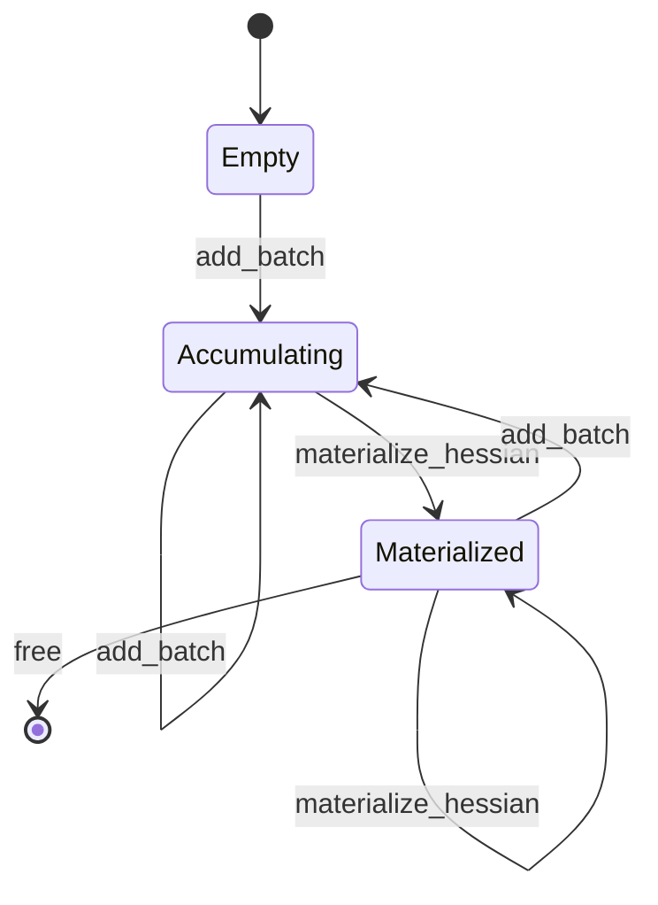
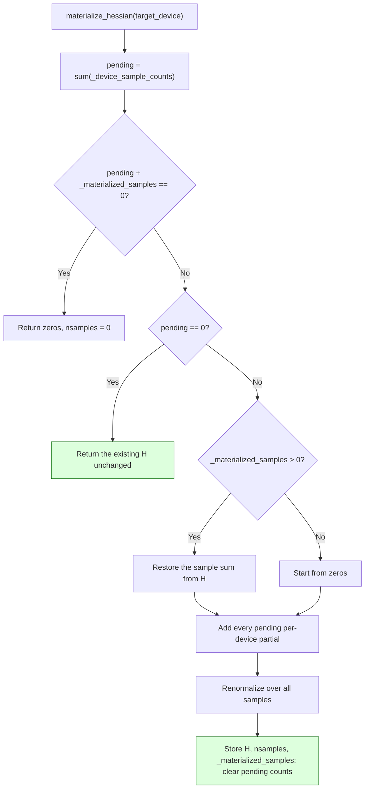
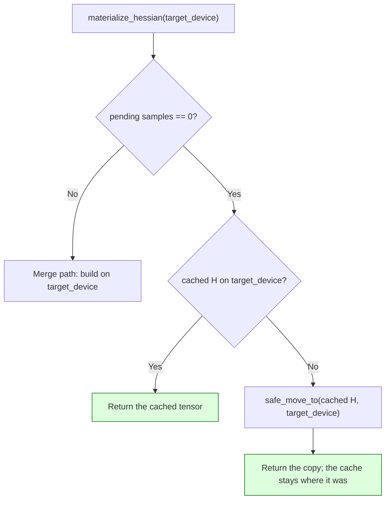

<!-- SPDX-FileCopyrightText: 2026 ModelCloud.ai -->
<!-- SPDX-License-Identifier: Apache-2.0 -->

# Calibration Hessian materialization

VPTQ and QQQ accumulate calibration statistics as per-device partials and only
fold them into a normalized Hessian when `materialize_hessian()` is called.
That method is also the read path for inspection and checkpointing, so calling
it must not be destructive. This page describes the contract for the two
quantizers. GPTQ's separate `finalize_hessian` / `snapshot_hessian` pair is
covered in [GPTQ Hessian accumulation](gptq-hessian-accumulation.md).

## Capture model

`H` (QQQ) and `H2` (VPTQ) hold the normalized mean over every sample seen so
far. `_materialized_samples` records how many samples that mean represents;
`_device_sample_counts` holds only the samples captured since the last merge.

## Merge arithmetic

The restore step is exact because the stored value is a mean:

- VPTQ stores `H2 = sum(x^T x) / N`, so the merge starts from
  `H2 * _materialized_samples`.
- QQQ stores `H = 2 * sum(x^T x) / N`, so the merge starts from
  `H * (_materialized_samples / 2)`.

Both then add the pending partials and divide by the new total, so the result is
the mean over all samples, not just the newest batch.

## Target device

`target_device` names where the caller wants the Hessian. The cached result is a
read-only view of the statistics, so a request for a different device returns a
moved copy instead of relocating the cache.

| Situation | Result |
| --- | --- |
| Repeat call, same device | The cached tensor itself |
| Repeat call, different device | A copy on the requested device; the cache is unchanged |
| Repeat call, different dtype | A cast copy on the requested device |
| New batches pending | Merge path, built directly on `target_device` |

Moving the cache instead of copying would make a read path mutate the capture,
which is the failure mode the repeat-materialization fix removed. A caller that
inspects on CPU and then quantizes on GPU therefore receives GPU data without
disturbing the statistics.

## Previous behavior

| Mechanism | Previous behavior | New behavior |
| --- | --- | --- |
| Second `materialize_hessian()` call | Popped the partials, then hit the zero-partials branch and overwrote `H2`/`H` with zeros, resetting `nsamples` to 0 | Returns the existing Hessian with `nsamples` intact |
| `add_batch` after a materialization | Replaced the earlier statistics: the next merge saw only the new batch | Merges with the previously materialized samples |
| `_materialized_samples` | Did not exist; the mean had no sample-count provenance | Tracks the samples folded into the stored mean |

The removed code path was the `total_samples == 0` branch in
`gptqmodel/quantization/vptq.py` and `gptqmodel/quantization/qqq.py`, which was
reachable only after the first call had already consumed the partials.

## Failure and ambiguity contract

| Situation | Result |
| --- | --- |
| No batches were ever captured | Zeros with `nsamples = 0` |
| Repeat call with no new batches | The stored Hessian, unchanged, with the stored sample count |
| New batches after a materialization | Mean over old and new samples |
| `free()` | Releases the Hessian and resets the provenance, so the next capture starts fresh |
| QQQ `quantize()` consumes the Hessian | Clears the provenance with the stored tensor, because the quantizer mutates it in place |

## Validation

| Test | Invariant |
| --- | --- |
| `tests/test_vptq.py::test_vptq_materialize_hessian_is_idempotent_and_accumulates_later_batches` | Repeat call is identical; a later batch merges; `nsamples` is the total |
| `tests/test_qqq.py::TestQQQHessian::test_repeat_materialization_is_idempotent` | Repeat call returns the same `2/N * X^T X` |
| `tests/test_qqq.py::TestQQQHessian::test_batch_after_materialization_accumulates` | Merged Hessian equals the closed-form reference over both batches |
| `tests/test_vptq.py::test_vptq_repeat_materialization_honours_a_changed_target_device` | A CPU-inspected capture returns GPU data on request and keeps its cache |
| `tests/test_qqq.py::TestQQQHessian::test_repeat_materialization_honours_a_changed_target_device` | Same contract for QQQ |

Measured on an R9700 (gfx1201, torch 2.16.0.dev+rocm10.1):
`tests/test_qqq.py -k TestQQQHessian` reports 7 passed, and the two lifecycle
tests fail when the merge change is reverted. On an RTX 4090 with torch
2.16.0.dev+cu130, `tests/test_vptq.py` reports 297 passed, and the
changed-target-device test fails when the cached-result change is reverted.
