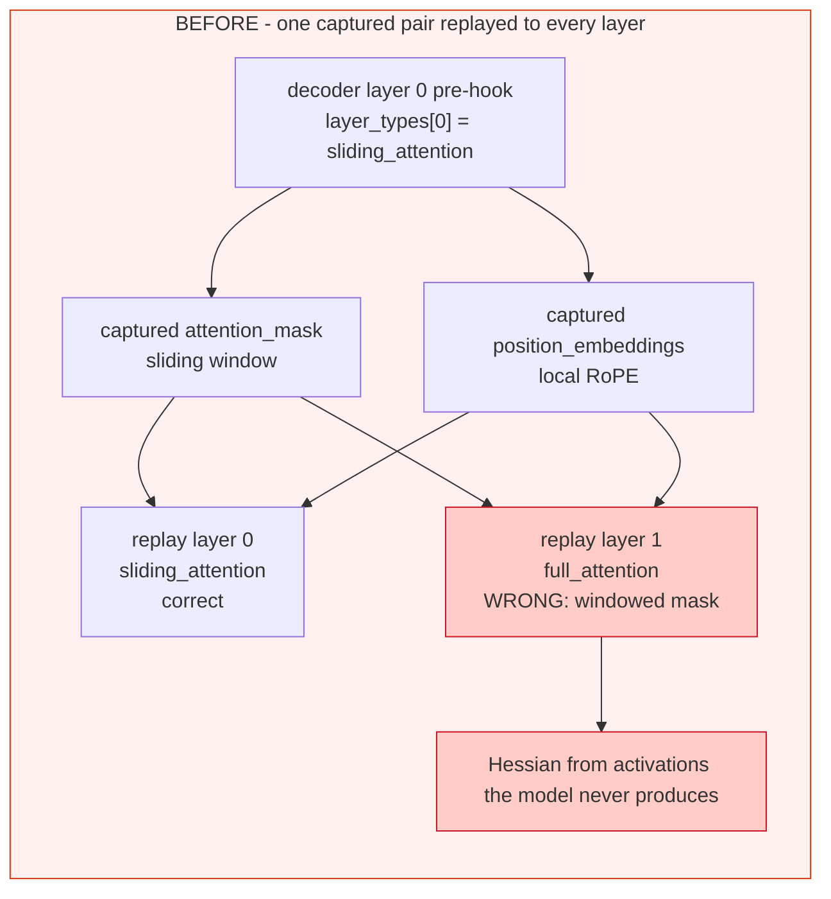
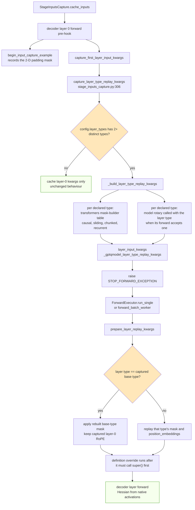

# Calibration layer replay

Quantization calibrates one decoder layer at a time. `StageInputsCapture` runs a
single calibration forward, stops at the first decoder layer, and caches that
layer's input; the looper then replays the cached input through each decoder layer
in isolation to build that layer's Hessian. The replay contract is therefore
narrow but strict: **each replayed layer must receive the kwargs the model's own
forward would have handed it at that depth.**

Introduced by the fix for issue #4004.

The base-type mask, the definition-override `super()` contract, and the AWQ
typed-rotary call are covered in [layer-type replay masks](layer-type-replay-masks.md).

## Why the layer-0 capture was not enough

`transformers` 5 builds the attention mask *per layer type*, not once for the
whole stack:

```python
# transformers/models/gemma3/modeling_gemma3.py (5.22.2)
causal_mask_mapping = {
    "full_attention": create_causal_mask(**mask_kwargs),
    "sliding_attention": create_sliding_window_causal_mask(**sliding_mask_kwargs),
}
position_embeddings = {}
for layer_type in set(self.config.layer_types):
    position_embeddings[layer_type] = self.rotary_emb(hidden_states, position_ids, layer_type)

for i, decoder_layer in enumerate(self.layers[: self.config.num_hidden_layers]):
    hidden_states = decoder_layer(
        hidden_states,
        attention_mask=causal_mask_mapping[self.config.layer_types[i]],
        position_embeddings=position_embeddings[self.config.layer_types[i]],
        ...
    )
```

The capture hook fires on layer 0 only, so it can only observe
`causal_mask_mapping[layer_types[0]]` and `position_embeddings[layer_types[0]]`.
Before this change those two objects were replayed to every layer.



The failure is silent: the layer still runs, the Hessian still looks plausible,
and the wrong outputs are propagated to every later layer. `Gemma3` compounds it
by also handing full-attention layers the local RoPE base.

## The replay flow after the fix

Capture rebuilds the missing layer types from the same inputs the model used, and
replay selects by the layer's own declared type.



The capture bookkeeping key is popped by
`BaseQModel.prepare_layer_replay_kwargs`, so it never reaches a decoder layer's
`forward`.

## Before / after

Before-lines are from `origin/main`; after-lines are this change.

| Mechanism | Before | After |
| --- | --- | --- |
| Captured mask | layer 0's mask only; `capture_first_layer_input_kwargs` returned the caller's kwargs unchanged (`gptqmodel/models/base.py:3284`) | one mask per declared layer type in `capture_layer_type_replay_kwargs` (`gptqmodel/models/base.py:4022`), built by `_build_layer_type_attention_mask` (`:3409`) |
| Captured RoPE | layer 0's tuple only | one tuple per declared type when the rotary takes a layer type (`_build_layer_type_position_embeddings`, `gptqmodel/models/base.py:4005`) |
| Replay selection | none; `prepare_layer_replay_kwargs` was a no-op (`gptqmodel/models/base.py:3334`) | layer's declared type or `self_attn.layer_idx` (`_apply_layer_type_replay_kwargs`, `gptqmodel/models/base.py:4274`, called from `prepare_layer_replay_kwargs` at `:3623`) |
| Raw 2-D padding mask | discarded (`gptqmodel/models/base.py:3272`) | retained for one example (`gptqmodel/models/base.py:3285`) |
| Capture stage | `gptqmodel/looper/stage_inputs_capture.py:296` | same call, plus the optional `capture_layer_type_replay_kwargs` hook at `gptqmodel/looper/stage_inputs_capture.py:306` |
| Replay stage | `gptqmodel/looper/forward_executor.py:394` | same call; selection happens inside the default `prepare_layer_replay_kwargs` |
| Base-type mask | not rebuilt; `support_batch_quantize=False` replayed `None` | rebuilt for `layer_types[0]` and applied when non-`None` (`gptqmodel/models/base.py:3689`) |
| Definition overrides | authoritative; five skipped `super()` | still authoritative, but they call `super()` first so the private key is consumed |

## Contracts

| Situation | Behaviour |
| --- | --- |
| `config.layer_types` missing, empty, or a single distinct value | no per-type capture; layer-0 replay, unchanged |
| `layer_types` length differs from `num_hidden_layers` | no per-type capture |
| no `attention_mask` in the calibration example, or its width differs from the captured hidden states | no per-type capture |
| rotary forward has no `layer_type`/`attention_type` parameter | masks are rebuilt, the captured `position_embeddings` is kept |
| `use_bidirectional_attention` set and the overlay helper is unavailable | no per-type capture |
| layer's declared type has no captured entry | layer-0 kwargs, unchanged |
| layer's declared type maps to no single builder (`hybrid`, unknown) | that type keeps the layer-0 kwargs |
| layer-0 mask is `None` (causal skip) but a later type needs a materialized mask | the later type's mask is injected |
| base-type rebuilt mask is a tensor | applied even when `support_batch_quantize=False` supplied `None` |
| base-type rebuilt mask is `None` (causal skip) | the incoming mask is kept, never cleared |

`prepare_layer_replay_keep_mask` needs no change: the processor keep-mask is
padding-equivalent for a causal and for a sliding-window causal mask, because
`normalize_seq_mask` collapses the query axis with `any`.

Memory cost is one extra mask per additional layer type per calibration batch
(two types is the common case: one sliding mask plus one causal mask).

## Measured effect

Tiny random `gemma3_text` and `gpt_oss`, 2 decoder layers,
`layer_types=["sliding_attention", "full_attention"]`, `sliding_window=2`, sequence
length 6. `cos[-1,1]` is the last row of the rotary cosine table; `mask` reports
whether the last row can see token 0.

Before the fix (`origin/main`):

```text
== gemma3_text / no padding ==
0     sliding_attention   sees_tok0=False     sees_tok0=False             0.8776    0.8776  mask=True  rope=True
1     full_attention      None                sees_tok0=False             0.9875    0.8776  mask=False rope=False
== gpt_oss / no padding ==
1     full_attention      sees_tok0=True      sees_tok0=False             1.3033    1.3033  mask=False rope=True
MISMATCHED_LAYERS = 4
```

After the fix:

```text
== gemma3_text / no padding ==
0     sliding_attention   sees_tok0=False     sees_tok0=False             0.8776    0.8776  mask=True rope=True
1     full_attention      None                None                        0.9875    0.9875  mask=True rope=True
== gpt_oss / no padding ==
1     full_attention      sees_tok0=True      sees_tok0=True              1.3033    1.3033  mask=True rope=True
MISMATCHED_LAYERS = 0
```

`tests/test_layer_type_replay.py` pins the same invariant for every layer: replay
kwargs equal the native forward's kwargs (`torch.equal` on the mask and on the
rotary tuple) and replaying the stack reproduces the native last hidden state.
It covers `gemma3_text`, `gpt_oss`, and a `llama4_text` configuration whose
layer 0 is `full_attention` and layer 1 is `chunked_attention`; the chunked case
also pins that a materialized mask is injected after a causal-skip layer 0.

## Extension points

`prepare_layer_replay_kwargs` remains the per-definition hook. Definitions whose
model builds masks outside the standard `transformers` mask-builder table
(`cohere_compass`, `inkling`, `lfm3`, `mimo_v2`, `muse_glimmer`) rebuild them
there and win over the generic selection.

## Not in scope

- Models that pass no `attention_mask` to their decoder layers
  (`support_batch_quantize = False`) still receive a per-type mask when a later
  declared type needs a materialized one; a `None` layer-0 mask no longer hides
  it.
- Rebuilding masks for models whose per-type mask depends on model-specific
  overlays other than `use_bidirectional_attention`.
- End-to-end GPTQ-vs-RTN quality sweeps for the affected families.
