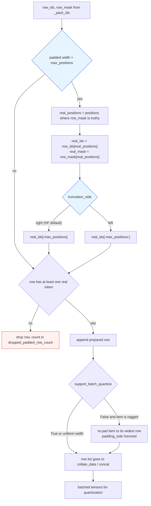
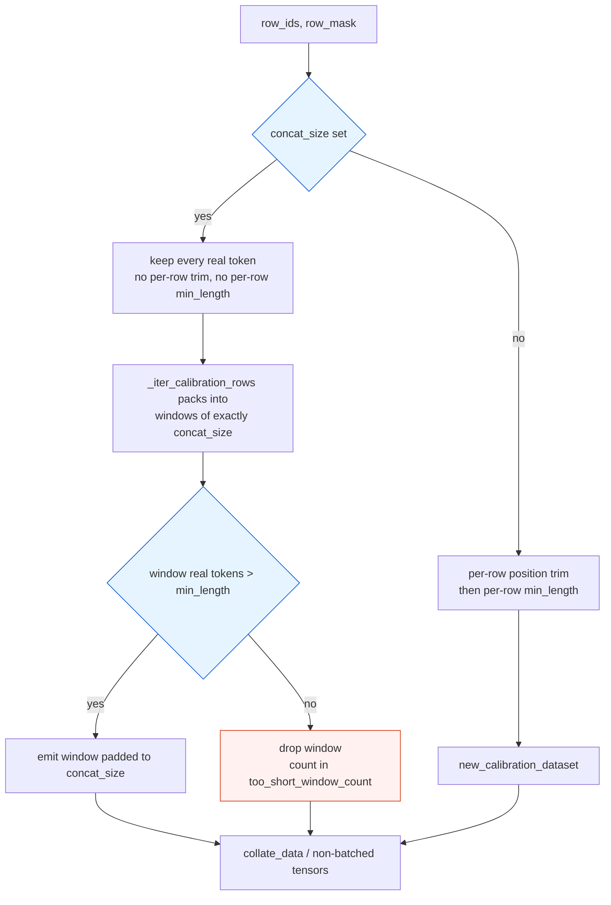
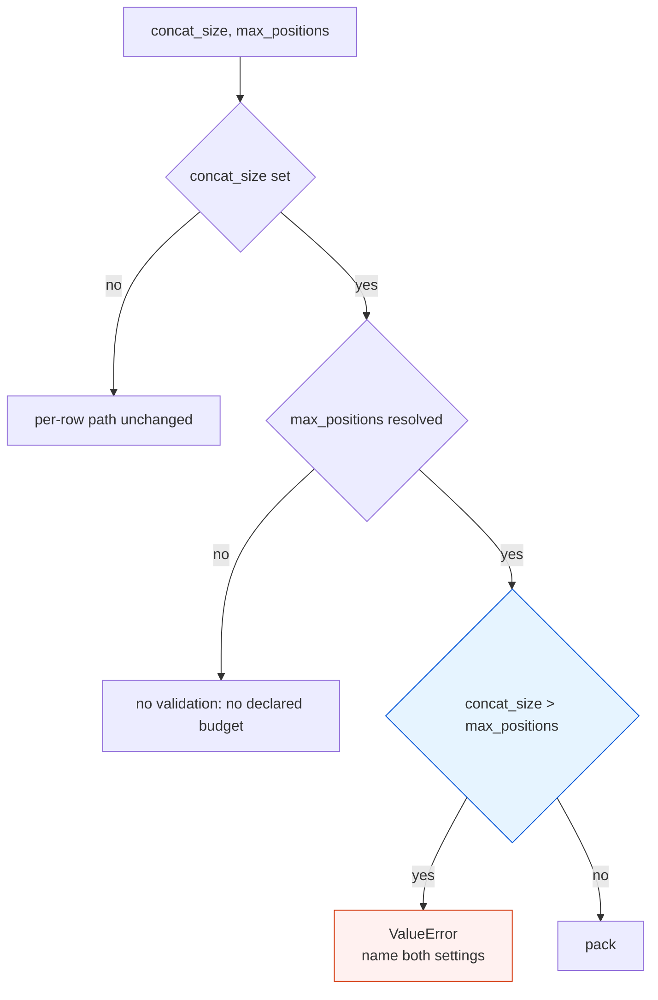
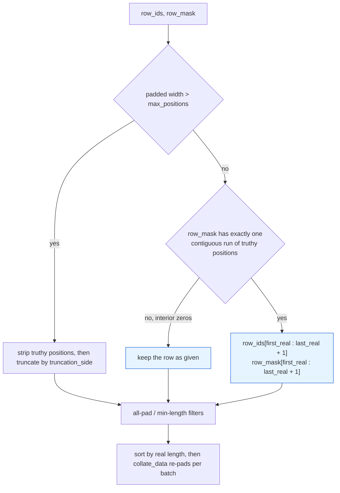

# Calibration row trimming

`prepare_calibration_dataset` normalizes every calibration row, then trims it to
the model's position budget (`max_position_embeddings`, or the shortest declared
fallback) before the rows are batched. This page documents that trimming step:
what counts against the budget, which direction truncates, and what happens to a
row that has no real token left.

Trimming is a **per-row** policy. When `concat_size` is set the same policies
are applied to the packed windows instead, because packing exists to combine the
short rows the per-row policies would have discarded — see
[`concat_size` reverses the order](#concat_size-reverses-the-order-pack-then-filter)
below.

Introduced by the fix for issue #4238, which extended the truncation-side fix
from #4008.

## What the budget applies to

A row's **padded width** is not its length. Padding is a batch artifact: the same
document tokenized alone has no pads. Counting pads against the position budget
therefore silently discards real tokens, and if the padding alone fills the
budget the row survives as pure padding with an all-zero attention mask. Such a
row passes the minimum-length check (which measures width on the batched path)
and contributes nothing but zeros to the Hessian.

The trimmed length is measured on the retained tokens instead. The diagram below
is the per-row path, taken when `concat_size` is not set:



`padding_side` and `truncation_side` are independent tokenizer settings and are
read as such: padding decides where a short row is padded, truncation decides
which end of an over-long row is kept.

## Before / after

| Mechanism | Before (`utils/calibration.py:472-490`) | After |
| --- | --- | --- |
| Budget measured on | Padded width, `row_ids[:max_positions]` / `row_ids[-max_positions:]` | Real tokens only, after stripping positions where the mask is falsy |
| Left-padded over-long row | Leading pads consumed the budget, tail tokens dropped | Pads stripped first, then real tokens truncated by `truncation_side` |
| Row whose padding fills the budget | Emitted as all-pad with an all-zero mask | No real token remains: the row is dropped and counted |
| Row that is all padding below the budget | Emitted as all-pad with an all-zero mask | Dropped as well: the rule is "no all-pad row", not "no all-pad row after trimming" |
| Item left ragged by stripping | Not possible (width slicing keeps width uniform) | `support_batch_quantize=False` re-pads the item on `padding_side`; batched and concat paths consume rows individually |

## Failure and ambiguity contract

| Situation | Before | After |
| --- | --- | --- |
| Row has no real token, trimmed or not | Kept, all-zero mask reaches the Hessian | Dropped; `dropped_padded_row_count` drives a WARN, and an item with no surviving row also increments `too_short_calibration_data_count` |
| Every row of the dataset dropped this way | n/a | `prepare_calibration_dataset` returns an empty batch list; the quantizer's existing zero-sample path handles it |
| Item where only some rows are all padding | n/a | Remaining rows are kept in order; the dropped row never reaches the Hessian |
| Item already ragged before trimming | Row lists of unequal width would fail the non-batched stack | Only rows that were actually trimmed are re-laid-out; untrimmed items are untouched |
| `max_positions` unresolved | No trimming at all | No budget is applied; pre-padded rows are still stripped (see below) |
| User row that keeps interior padding | Untouched below the budget | Unchanged below the budget; over-long rows now keep every truthy position, so an interior pad is removed rather than surviving as a hole |

## `concat_size` reverses the order: pack, then filter

Introduced by the fix for issue #4892. The two per-row policies above protect
*unpacked* rows. Running them before packing threw away the data packing exists
to use, so `concat_size` now moves both policies after the packer and adds one
up-front validation.



`concat_mode` is `bool(calibration_dataset_concat_size)`. Both per-row guards
read it directly:

```python
if not concat_mode and max_positions is not None and row_len > max_positions:
    ...
if not concat_mode and sum(1 for keep in row_mask if keep) <= calibration_data_min_length:
    ...
```

The window filter lives in `flush_buffer()`: every exit path — a full window,
an early flush, and the final tail — goes through it. It measures
`sum(attention_mask_buff)` — pad positions are already stripped by the packer,
so that sum is the window's real token count — and pads every partial window to
`concat_size` on `tokenizer.padding_side` with a zero attention mask. Early
flushes used to emit short windows while only the tail was padded, so consumers
saw ragged rows.

A `concat_separator` is inserted only between two documents in the same window,
and only when the separator plus at least one token of the next document fit in
the remaining positions. A separator that would fill the window by itself is
not appended; the window is flushed and the next document starts a fresh one.

### Up-front validation

A packed window is exactly `concat_size` wide, so a window can only fit the
model's budget when the width does. The width is validated before any row is
touched rather than trimming rows to a budget the window will then exceed:



### Before / after

| Mechanism | Before | After |
| --- | --- | --- |
| Per-row `min_length` with `concat_size` | Ran first; on a corpus of short utterances 397 of 400 rows were dropped before packing | Skipped per row; applied to each packed window, where only a near-empty tail window can fall below it |
| Per-row position trim with `concat_size` | Cut a document to `max_position_embeddings` before windowing, losing everything past the budget even though every window was far below it | Skipped; a 40000-token document packs into 20 windows of 2048 with no token lost |
| `concat_size > max_positions` | Accepted; produced windows over the budget | `ValueError` naming `concat_size` and the budget |
| Tail window with a few real tokens | Kept unconditionally | Kept only when it exceeds `min_length`; otherwise dropped and counted |
| Every window dropped | Returned an empty batch list | `ValueError` explaining that `concat_size` must exceed `min_length` |
| Non-concat path | Per-row trim and filter | Unchanged |

### Measured effect

Qwen2.5-0.5B-Instruct tokenizer, `max_position_embeddings=32768`, 400 sentences
of 3-9 words (2423 tokens total, longest row 11 tokens):

| Configuration | Before | After |
| --- | --- | --- |
| `concat_size=256`, default `min_length=10` | 0 windows, 0 real tokens | 10 windows, 2423 real tokens |
| `concat_size=256`, `min_length=0` | 10 windows, 2423 real tokens | 10 windows, 2423 real tokens |
| one 40000-token document, `concat_size=2048` | 16 windows, 32768 tokens (7232 lost) | 20 windows, 40000 tokens (0 lost) |
| `concat_size=32769` | accepted | `ValueError` |

### Verification

`tests/test_calibration_concat_policies_4892.py` pins the contract: short
documents survive, a long document is not trimmed before packing, a tail window
at or below `min_length` is dropped while one above it is kept, `concat_size`
above the budget is refused and one equal to it is accepted, and the non-concat
path still trims and filters per row. Five of those cases fail on the
pre-#4892 code.

## Pre-padded rows below the budget

The trim step above only saw rows that were wider than the position budget.
A row that was merely *padded* — `tokenizer(texts, padding=True)` or
`padding="max_length"` — kept its padding, because the strip lived inside the
over-long branch. Every capture and per-layer replay forward then ran at the
padded width, and `sort="desc"` (the default) sorted by that padded width, so on
pre-padded input the sort was a no-op and `batch_size > 1` batches were no longer
length-grouped. The attention mask kept the pads out of the Hessian, so the
checkpoint was correct and the cost was pure waste (issue #4889).

Padding is stripped for every row, trimmed or not:



`first_real` / `last_real` are the first and last truthy mask positions. A row
whose truthy positions form one contiguous run has its edge pads removed; the
sort and `collate_data` then see real lengths and re-pad per batch. A row with
interior mask zeros (a caller-built mask, not tokenizer padding) is left
untouched, so its mask keeps its original holes.

The strip is unconditional: it runs for a row below the budget whether or not
`concat_size` is set. With `concat_size` the packer stripped these pads anyway,
so the packed windows are unchanged; rows simply arrive already stripped.

| Input | Before | After |
| --- | --- | --- |
| `tokenizer(texts, padding=True)`, 128 wikitext docs, `max_length=2048` | 59,648 tokens forwarded for 20,882 real tokens (2.86x) | 20,882 forwarded (1.00x) |
| `sort="desc"` on pre-padded rows | Sorted by padded width, i.e. a no-op | Sorted by real length |
| `batch_size > 1` collation | Every batch padded to the dataset-wide width | Every batch padded to its own widest row |
| Row with interior mask zeros | Kept as given | Kept as given |
| Unpadded row | Unchanged | Unchanged |
| Pre-padded row with `concat_size` | Packer strips it | Stripped earlier; same windows |

## Verification

`tests/test_calibration_truncation.py` pins the contract: left and right padding
trim identically, padding longer than the budget keeps the real tokens, an
all-padding row is dropped whether or not it was over the budget,
`truncation_side="left"` keeps the real tail, and a ragged item is re-padded only
on the non-batched path. The issue's reproduction
now returns `[[11, 12, 13, 14]]` and `[[11, 12]]` instead of a pad-only row.

`tests/test_calibration_strip_padding_4889.py` pins the pre-padded-row contract:
the same text set tokenized with `padding=True` and with `padding="max_length"`
produces the same batch widths, sort order, real-token content, sample count and
mask-filtered Hessian as the unpadded form, while interior mask zeros survive.
