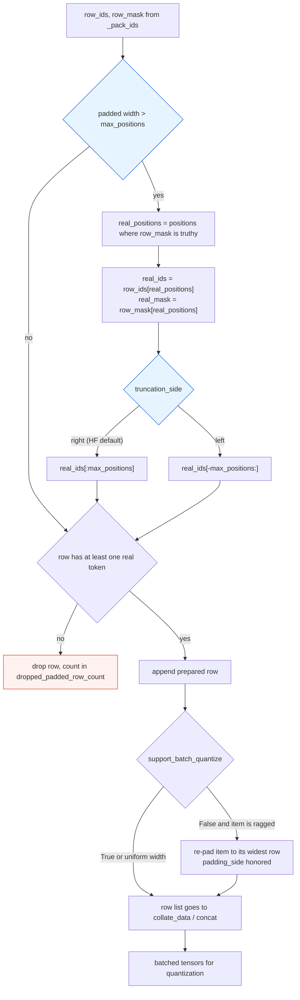

# Calibration row trimming

`prepare_calibration_dataset` normalizes every calibration row, then trims it to
the model's position budget (`max_position_embeddings`, or the shortest declared
fallback) before the rows are batched. This page documents that trimming step:
what counts against the budget, which direction truncates, and what happens to a
row that has no real token left.

Introduced by the fix for issue #4238, which extended the truncation-side fix
from #4008.

## What the budget applies to

A row's **padded width** is not its length. Padding is a batch artifact: the same
document tokenized alone has no pads. Counting pads against the position budget
therefore silently discards real tokens, and if the padding alone fills the
budget the row survives as pure padding with an all-zero attention mask. Such a
row passes the minimum-length check (which measures width on the batched path)
and contributes nothing but zeros to the Hessian.

The trimmed length is measured on the retained tokens instead:

`padding_side` and `truncation_side` are independent tokenizer settings and are
read as such: padding decides where a short row is padded, truncation decides
which end of an over-long row is kept.

## Before / after

| Mechanism | Before (`utils/calibration.py:472-490`) | After |
| --- | --- | --- |
| Budget measured on | Padded width, `row_ids[:max_positions]` / `row_ids[-max_positions:]` | Real tokens only, after stripping positions where the mask is falsy |
| Left-padded over-long row | Leading pads consumed the budget, tail tokens dropped | Pads stripped first, then real tokens truncated by `truncation_side` |
| Row whose padding fills the budget | Emitted as all-pad with an all-zero mask | No real token remains: the row is dropped and counted |
| Row that is all padding below the budget | Emitted as all-pad with an all-zero mask | Dropped as well: the rule is "no all-pad row", not "no all-pad row after trimming" |
| Item left ragged by stripping | Not possible (width slicing keeps width uniform) | `support_batch_quantize=False` re-pads the item on `padding_side`; batched and concat paths consume rows individually |

## Failure and ambiguity contract

| Situation | Before | After |
| --- | --- | --- |
| Row has no real token, trimmed or not | Kept, all-zero mask reaches the Hessian | Dropped; `dropped_padded_row_count` drives a WARN, and an item with no surviving row also increments `too_short_calibration_data_count` |
| Every row of the dataset dropped this way | n/a | `prepare_calibration_dataset` returns an empty batch list; the quantizer's existing zero-sample path handles it |
| Item where only some rows are all padding | n/a | Remaining rows are kept in order; the dropped row never reaches the Hessian |
| Item already ragged before trimming | Row lists of unequal width would fail the non-batched stack | Only rows that were actually trimmed are re-laid-out; untrimmed items are untouched |
| `max_positions` unresolved | No trimming at all | Unchanged: no stripping when the model declares no position limit |
| User row that keeps interior padding | Untouched below the budget | Unchanged below the budget; over-long rows now keep every truthy position, so an interior pad is removed rather than surviving as a hole |

## Verification

`tests/test_calibration_truncation.py` pins the contract: left and right padding
trim identically, padding longer than the budget keeps the real tokens, an
all-padding row is dropped whether or not it was over the budget,
`truncation_side="left"` keeps the real tail, and a ragged item is re-padded only
on the non-batched path. The issue's reproduction
now returns `[[11, 12, 13, 14]]` and `[[11, 12]]` instead of a pad-only row.
