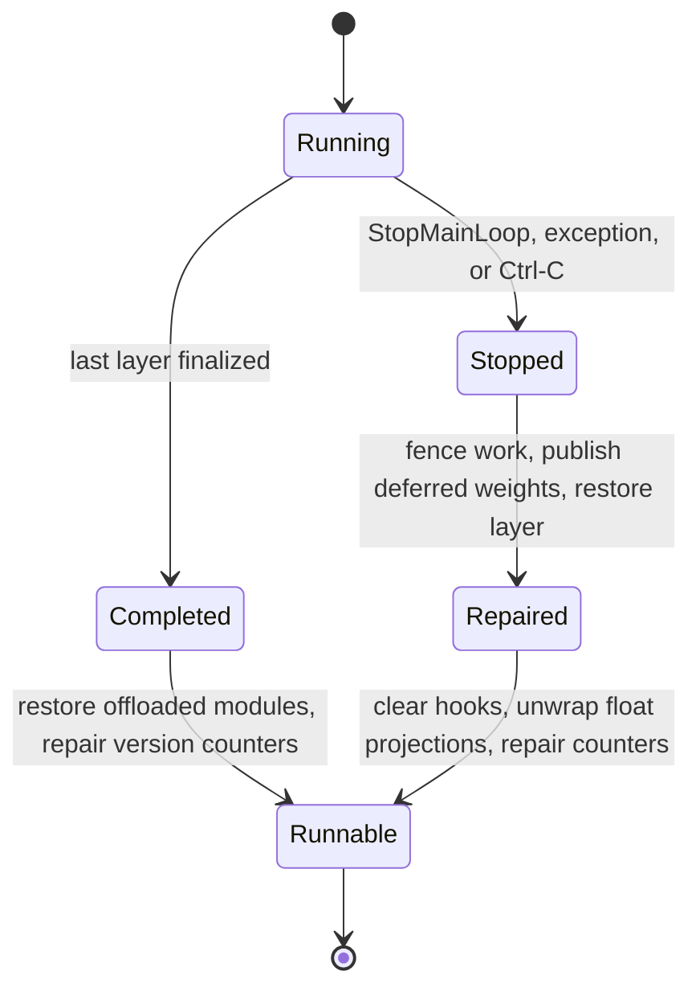
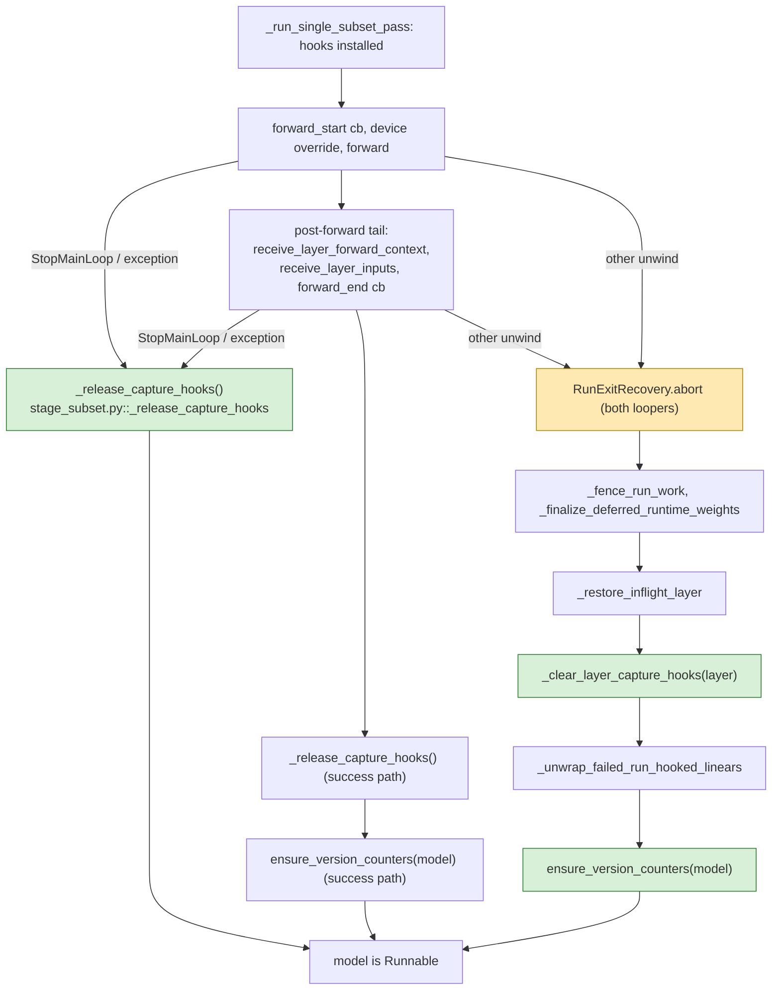
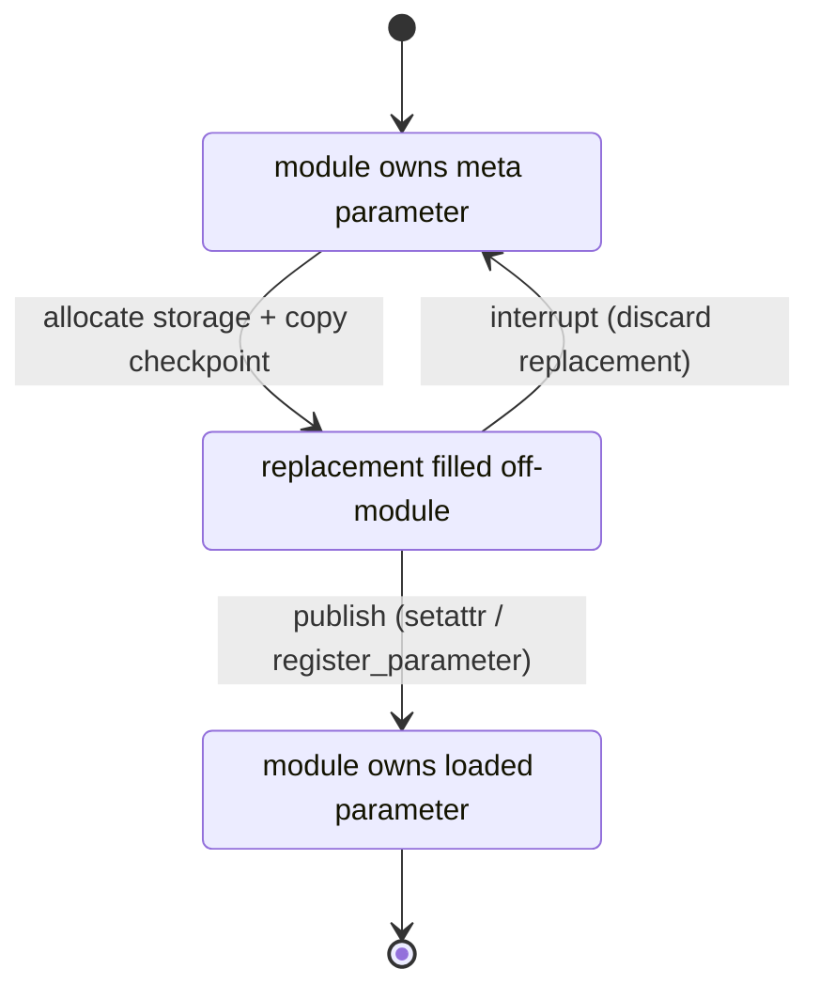
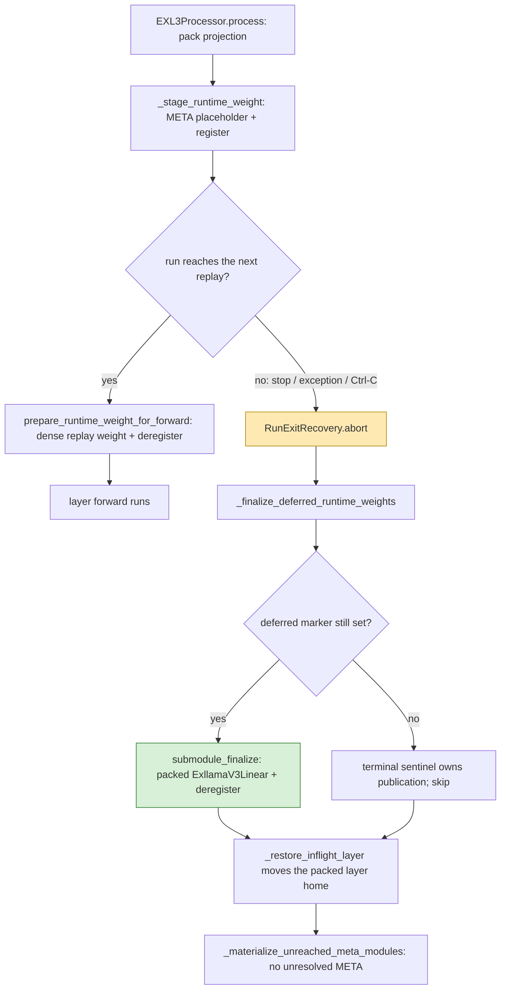
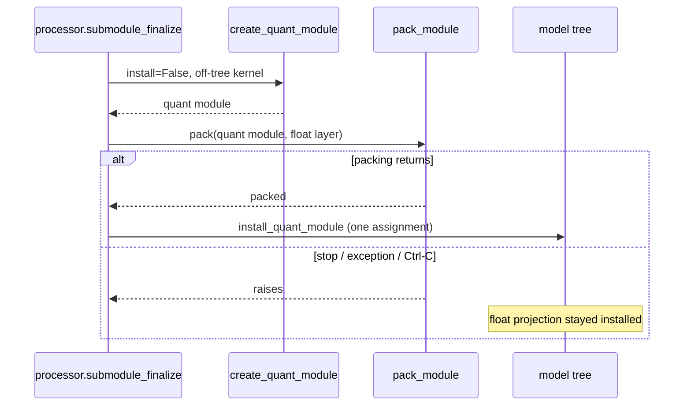

# Cancelled and failed `quantize()` runs: in-session model state

A run can end without quantizing the model: a `subset_callback` returns
`StopMainLoop` (the documented stop point), the caller raises from a callback,
Ctrl-C arrives, or a stage fails. `quantize()` then re-raises and the
in-session model stays alive, so it must be left in the same state a completed
run leaves it in: no capture hooks installed, and only ordinary tensors.

Two exit windows did not honour that. Both are fixed at the source, and the
looper keeps a safety net for the windows the stage cannot see.

## Outcome of one `quantize()` call

`Runnable` means: every `HookedLinear` in the model has `forward_hook is None`
and `forward_hook_last is False`, and no parameter or buffer is an inference
tensor, so a plain forward in default grad mode works.

## Where each guarantee comes from

## Materialization publishes one tensor atomically

A lazy shell owns meta parameters. `LazyTurtle._copy_checkpoint_tensors_into_submodule`
used to allocate replacement storage, install it on the module with `setattr`,
and copy the checkpoint values in a second step. A Ctrl-C between the two left
`torch.empty` weights that are no longer meta, so run-exit recovery (whose only
"not loaded" test is `is_meta`) treated the module as materialized and the
in-session model forwarded with uninitialized weights (#5088).

`_publish_checkpoint_param_` now fills the replacement before publishing it.
An interrupt during the copy leaves the old meta parameter in place, which
`RunExitRecovery` already re-materializes; recovery can no longer observe an
installed but unfilled tensor. Buffer materialization already copied into a
local tensor before `register_buffer` and is unchanged.

## Before and after

Pre-fix locations are from revision `bfbb7a2b4`; the symbols are unchanged.

| Exit window | Before | After |
| --- | --- | --- |
| Lazy parameter fill (`gptqmodel/utils/structure.py::_copy_checkpoint_tensors_into_submodule`, both the concatenated and the grouped-shard branch) | `torch.empty_like` was installed on the module with `setattr` and only then filled by `copy_`. A Ctrl-C between them left `torch.empty` weights that are not meta; recovery's `is_meta` test skipped the module and the forward silently returned NaN or wrong logits (#5088). | `gptqmodel/utils/structure.py::_publish_checkpoint_param_` allocates and fills the replacement, then publishes it. An interrupt leaves the old meta parameter, which the recovery re-materializes. |
| `subset_event_cb(stage="forward_end")` returns `StopMainLoop` (`stage_subset.py:1470` at `bfbb7a2b4`) | Unwound past the success-path release at `:1488`. The in-flight layer kept `HookedLinear.forward_hook` and `forward_hook_last=True`, so **every** later forward raised `StopForward("Forwarding stopped")` (#5009). | The post-forward tail is wrapped in `try/except BaseException` and calls `gptqmodel/looper/stage_subset.py::_release_capture_hooks` before re-raising, so both the inline hook attributes and the registered handles are removed. |
| A `receive_layer_*` call or a `KeyboardInterrupt` in the same window | Same leak. | Same guard. |
| Zero-route-recovery callbacks (`zero_route_recovery_start` / `_end`) or any other unwind the stage guard cannot reach | `ModuleLooper.loop()`'s failure branch restored devices, materialized layers and rehomed kernels but never cleared `forward_hook` (#5009). | `gptqmodel/looper/module_looper.py::ModuleLooper._restore_inflight_layer` calls `_clear_layer_capture_hooks` on the in-flight layer before rehoming it. |
| Any cancelled or failed run (`ModuleLooper`, `weight_only_looper`) | `ensure_version_counters` ran only on the success path (`module_looper.py:2154`, `weight_only_looper.py:1033` at `bfbb7a2b4`), so norms, biases and buffers materialized under `inference_mode()` stayed inference tensors. A plain grad-mode forward raised `RuntimeError: Inference tensors cannot be saved for backward` (#5012). | Both failure branches call `gptqmodel/utils/offload.py::ensure_version_counters` after materialization. The repair is best-effort and never replaces the exception that failed the run. |
| Ctrl-C or exception inside `pack_module` of a finished layer (#5089) | Finalization called `create_quant_module(..., register_buffers=False)`, which replaced the float projection in the tree, and only then packed it. An interrupt in `pack_module` left a `TorchLinear` without `qweight`/`qzeros`/`scales`/`g_idx`, so every later forward raised `AttributeError: 'TorchLinear' object has no attribute 'qzeros'` (or `'g_idx'`). The in-flight restore rehomed the layer but could not finish the pack or put the float projection back. | Every processor now builds and packs the kernel off-tree (`create_quant_module(..., install=False)`) and publishes it with one `install_quant_module` assignment after packing returns, so the tree only ever holds a complete module or the untouched float one. Recovery also unwraps the run's remaining float `HookedLinear` projections, because their forward runs under `inference_mode()` and a partially quantized layer otherwise mixed inference outputs with packed siblings. |
| EXL3 `quant_complete` stop, exception or Ctrl-C with `offload_to_disk=False` (#5083) | `EXL3Processor._stage_runtime_weight` replaced each just-packed projection's dense weight with a META placeholder and rebuilt it only for the next replay. `RunExitRecovery.abort` did not know about that state, so the in-flight layer kept 1-3 META parameters and the next forward raised `RuntimeError: Tensor on device cpu is not on the expected device meta!`. `offload_to_disk=True` escaped because its layer shells are restored from the checkpoint. | `ModuleLooper._finalize_deferred_runtime_weights` runs `EXL3Processor.finalize_deferred_runtime_weights` before `_restore_inflight_layer`. It installs the packed `ExllamaV3Linear` for every registered deferred projection, exactly as `submodule_finalize` does on the success path, so no dense copy is retained. The processor registers a projection in `_stage_runtime_weight` and deregisters it when the replay weight or the packed module is published. |

## Deferred runtime weights (#5083)

EXL3 defers the dense replay weight of every packed projection until the layer's
next forward. That is a run-scoped obligation, like the in-flight-layer device,
so it is published by the exit sequence above and not by a special case in the
layer stage.

The terminal layer is out of scope for this hook: `prepare_layer_post_quantize`
retires its placeholders to zero-sized sentinels and the pending
`submodule_finalize` owns them, so recovery must not publish them a second time.

## Atomic kernel publication (#5089)

Finalization is the widest window of a run: packing dominates RTN/GPTQ wall
time. Installing the kernel first meant a stop anywhere in that window
published a module that owned no packed buffers.

`RunExitRecovery.abort` still runs: it fences submitted finalizers, restores the
in-flight layer, and unwraps the float projections so a partially quantized
layer runs in ordinary grad mode.

## What is not covered

- A run that fails **before** `pre_quantize` has nothing to repair; the model is
  untouched.
- A second `quantize()` on a model whose first run was stopped is not part of
  this contract. The documented recovery is to reload the checkpoint.
- Disk-offloaded layers keep their meta shells and the per-run offload root
  (#4807); materializing them would defeat the memory bound
  `offload_to_disk=True` exists for.

## Tests

`tests/test_run_exit_recovery_contract_5060.py` — the shared conformance
fixture for both loopers: a next-layer fault and a final-restore fault with
disk offload on and off, the calibrated post-forward stop, a secondary repair
failure that must not replace the primary error, and a successful-run control.
Two nodes interrupt the first checkpoint copy inside materialization: the
weight-only post-loop tail and the GPTQ first-capture layer. Both assert every
floating parameter is finite and the affected weights still match the
checkpoint (#5088).

`tests/test_exl3_cancelled_run_5083.py` — the EXL3 deferred-weight matrix: a
`quant_complete` stop in the in-flight layer and in the last layer, raised and
returned stops, disk offload on and off, and the completed-run control.

`tests/test_run_exit_recovery_contract_5060.py::test_pack_fault_leaves_no_half_built_kernel`
— a `KeyboardInterrupt` injected inside `pack_module` for both loopers with
disk offload on and off. It asserts no kernel is installed without its packed
buffers and that an ordinary grad-mode forward still runs (#5089).
`tests/test_finalize_module_lookup.py` pins that the tree still holds the float
projection while packing runs.

`tests/test_failed_run_model_state_5009.py`:

- `test_forward_end_stop_releases_capture_hooks[return_stop|raise]` — stops a
  real GPTQ run at `forward_end` both ways, then asserts no module keeps a
  capture hook and a later forward runs.
- `test_failed_run_repairs_inference_tensors[gptq|awq × offload]` — stops at
  `quant_complete`, asserts no inference tensor remains and a plain grad-mode
  forward succeeds.
- `test_failed_weight_only_run_repairs_inference_tensors[offload]` — the
  same for the weight-only looper (RTN), driven through an injected module
  failure.

`tests/test_cancelled_quantize_layer_cleanup_4546.py`,
`tests/test_cancelled_quantize_default_offload_4860.py`,
`tests/test_cancelled_quantize_disk_offload_4807.py` and
`tests/test_cancelled_quantize_kernel_rehome_4947.py` cover the earlier
cancelled-run contracts that this page extends.

## Related pages

- [Quantization lifecycle contracts](quantization-lifecycle-contracts.md) - the
  shared processor and run-plan contracts the subset stage executes.
- [Input capture cleanup lifecycle](input-capture-cleanup-lifecycle.md) - the
  same "cleanup is a `finally` obligation" rule for the pre-layer input-capture
  stage.
