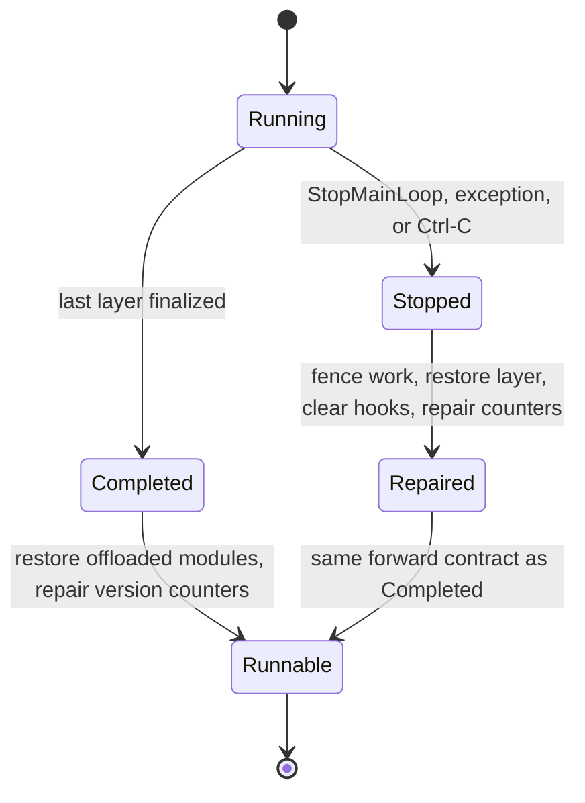
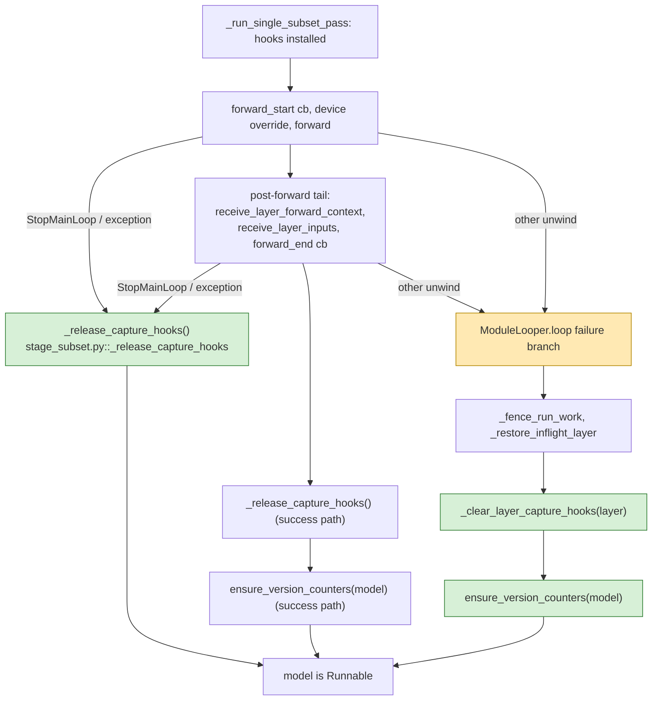

# Cancelled and failed `quantize()` runs: in-session model state

A run can end without quantizing the model: a `subset_callback` returns
`StopMainLoop` (the documented stop point), the caller raises from a callback,
Ctrl-C arrives, or a stage fails. `quantize()` then re-raises and the
in-session model stays alive, so it must be left in the same state a completed
run leaves it in: no capture hooks installed, and only ordinary tensors.

Two exit windows did not honour that. Both are fixed at the source, and the
looper keeps a safety net for the windows the stage cannot see.

## Outcome of one `quantize()` call

`Runnable` means: every `HookedLinear` in the model has `forward_hook is None`
and `forward_hook_last is False`, and no parameter or buffer is an inference
tensor, so a plain forward in default grad mode works.

## Where each guarantee comes from

## Before and after

Pre-fix locations are from revision `bfbb7a2b4`; the symbols are unchanged.

| Exit window | Before | After |
| --- | --- | --- |
| `subset_event_cb(stage="forward_end")` returns `StopMainLoop` (`stage_subset.py:1470` at `bfbb7a2b4`) | Unwound past the success-path release at `:1488`. The in-flight layer kept `HookedLinear.forward_hook` and `forward_hook_last=True`, so **every** later forward raised `StopForward("Forwarding stopped")` (#5009). | The post-forward tail is wrapped in `try/except BaseException` and calls `gptqmodel/looper/stage_subset.py::_release_capture_hooks` before re-raising, so both the inline hook attributes and the registered handles are removed. |
| A `receive_layer_*` call or a `KeyboardInterrupt` in the same window | Same leak. | Same guard. |
| Zero-route-recovery callbacks (`zero_route_recovery_start` / `_end`) or any other unwind the stage guard cannot reach | `ModuleLooper.loop()`'s failure branch restored devices, materialized layers and rehomed kernels but never cleared `forward_hook` (#5009). | `gptqmodel/looper/module_looper.py::ModuleLooper._restore_inflight_layer` calls `_clear_layer_capture_hooks` on the in-flight layer before rehoming it. |
| Any cancelled or failed run (`ModuleLooper`, `weight_only_looper`) | `ensure_version_counters` ran only on the success path (`module_looper.py:2154`, `weight_only_looper.py:1033` at `bfbb7a2b4`), so norms, biases and buffers materialized under `inference_mode()` stayed inference tensors. A plain grad-mode forward raised `RuntimeError: Inference tensors cannot be saved for backward` (#5012). | Both failure branches call `gptqmodel/utils/offload.py::ensure_version_counters` after materialization. The repair is best-effort and never replaces the exception that failed the run. |

## What is not covered

- A run that fails **before** `pre_quantize` has nothing to repair; the model is
  untouched.
- A second `quantize()` on a model whose first run was stopped is not part of
  this contract. The documented recovery is to reload the checkpoint.
- Disk-offloaded layers keep their meta shells and the per-run offload root
  (#4807); materializing them would defeat the memory bound
  `offload_to_disk=True` exists for.

## Tests

`tests/test_failed_run_model_state_5009.py`:

- `test_forward_end_stop_releases_capture_hooks[return_stop|raise]` — stops a
  real GPTQ run at `forward_end` both ways, then asserts no module keeps a
  capture hook and a later forward runs.
- `test_failed_run_repairs_inference_tensors[gptq|awq × offload]` — stops at
  `quant_complete`, asserts no inference tensor remains and a plain grad-mode
  forward succeeds.
- `test_failed_weight_only_run_repairs_inference_tensors[offload]` — the
  same for the weight-only looper (RTN), driven through an injected module
  failure.

`tests/test_cancelled_quantize_layer_cleanup_4546.py`,
`tests/test_cancelled_quantize_default_offload_4860.py`,
`tests/test_cancelled_quantize_disk_offload_4807.py` and
`tests/test_cancelled_quantize_kernel_rehome_4947.py` cover the earlier
cancelled-run contracts that this page extends.

## Related pages

- [Quantization lifecycle contracts](quantization-lifecycle-contracts.md) - the
  shared processor and run-plan contracts the subset stage executes.
- [Input capture cleanup lifecycle](input-capture-cleanup-lifecycle.md) - the
  same "cleanup is a `finally` obligation" rule for the pre-layer input-capture
  stage.
