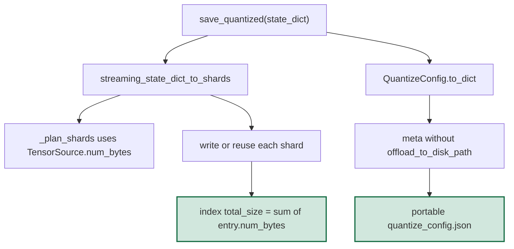
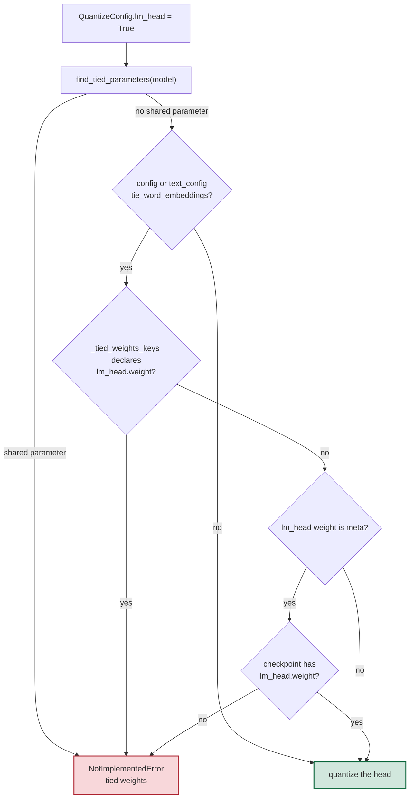
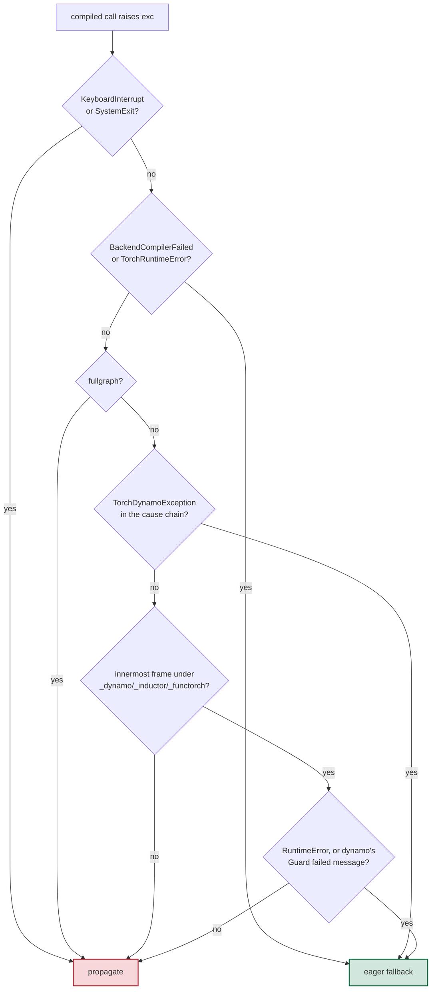
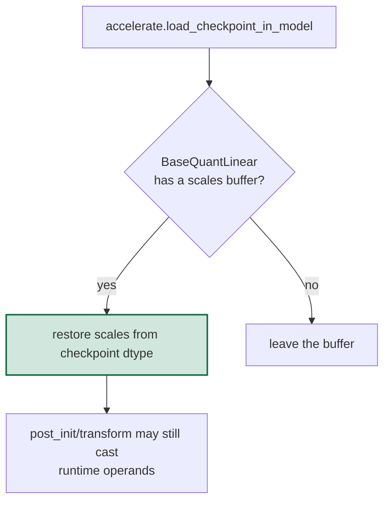
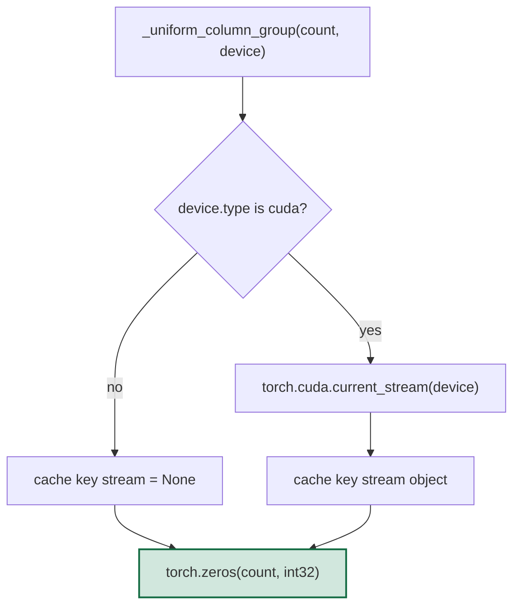
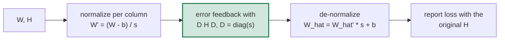

# Checkpoint metadata and runtime decision contracts

This page records the contracts that decide whether a checkpoint is portable,
whether a tied `lm_head` may be quantized, when a failed `torch.compile` call
may fall back to eager, how a quantizer's scale dtype survives loading, and
which stream owns a cached quantization scratch tensor.

These are the hardening items from the 7.11 review. The CPU int4pack dispatch
contracts are documented separately in
[CPU and offload kernel dispatch](kernel-dispatch-cpu.md).

## 1. Checkpoint metadata

A saved checkpoint describes tensors, not the machine that produced them.

| Mechanism | Before | After |
| --- | --- | --- |
| `offload_to_disk_path` in `meta` | published the quantizer's local `/tmp/gptqmodel_*` directory (`config.py:5396` before the change) | omitted; a loader chooses its own scratch directory |
| index `metadata.total_size` | summed on-disk safetensors file sizes, including headers and padding | sums `TensorSource.num_bytes` (`utils/model.py:3567`) |
| `max_shard_size` units | every `KB`/`MB`/`GB` suffix meant 1024^n | `KB`/`MB`/`GB` are decimal, `KiB`/`MiB`/`GiB` are binary, bare `K`/`M`/`G` keep the historical binary meaning (`models/writer.py:142`) |

`max_shard_size="4GB"` therefore means `4_000_000_000` bytes, matching
Transformers, while `"4GiB"` means `4 * 1024^3`. A legacy checkpoint that
still contains `meta.offload_to_disk_path` keeps loading; the field is only
dropped on the next save.

## 2. Tied `lm_head`

A checkpoint may redundantly store `lm_head.weight` even though the model ties
the head to the input embedding (Qwen3 does this). The stored tensor is not
evidence of an independent head: the loader ties the parameters after
materialization.

The config check walks `text_config` / `get_text_config()` so a composite model
whose root config leaves `tie_word_embeddings` unset is still detected. The
checkpoint-tensor fallback remains for configs that do not declare tying.

## 3. `torch.compile` eager fallback

A deferred compiler failure may retry eagerly, but only when the failure is
demonstrably compiler-owned. A compiler-package frame is not enough: user code
can raise from a module whose file lives under `torch/_dynamo`.

This keeps the #4094 guard-assertion fallback and inductor's closed-pool
`RuntimeError` while letting a `ValueError` or an unrelated `AssertionError`
raised from a compiler frame reach the caller.

## 4. Checkpoint scale dtype

Accelerate casts floating buffers to the requested model dtype. That is wrong
for `scales`: narrowing an FP16 scale to BF16 changes the dequantized weight
and a later `save_pretrained()` republishes the narrowed value.

Torch AWQ additionally restores `bias` because its forward makes temporary
activation-dtype copies. Other kernels keep the checkpoint scale dtype and
cast only their per-forward operands.

## 5. Stream-scoped quantization scratch

`_uniform_column_group` caches a zero group index. `torch.zeros` queues its
fill on the creating stream, so a tensor created by one worker must not be
reused by a worker on another stream.

The stream object is part of the cache key, which also keeps it alive while an
entry exists. Steady-state callers on one stream still hit the cache.

## 6. VPTQ per-channel normalization

With `enable_norm=True, norm_dim=0`, VPTQ divides each input channel by its own
scale: `W' = (W - b) / s`. The reconstruction error in the original space is
`e = D e'` with `D = diag(s)`, so error feedback must minimize
`e'^T (D H D) e'`.

Measured on a 16x32 Gaussian weight and a well-conditioned Hessian (seed 0,
`vector_lens=[-1, 4]`, 16 centroids, block size 8):

| Error-feedback Hessian | True Hessian-weighted loss |
| --- | --- |
| raw `H` (before) | 0.2602 |
| `D^-1 H D^-1` (wrong direction) | 0.3535 |
| `D H D` (this change) | 0.2200 |

The independent oracle in `tests/test_vptq.py` performs its own arithmetic and
matches the quantizer's codes exactly for the `norm` and `all` variants.

## Not in scope

Auto-detected module trees still require calibration data that exercises every
discovered branch. A text-only calibration of a multimodal model must pass an
explicit text-only `module_tree`; silently leaving a vision tower unquantized
would publish a partially quantized checkpoint.
