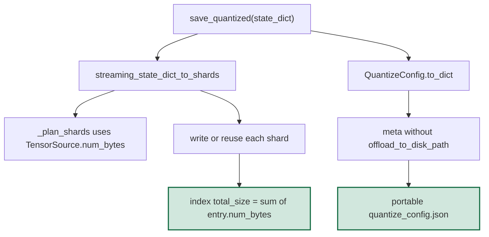
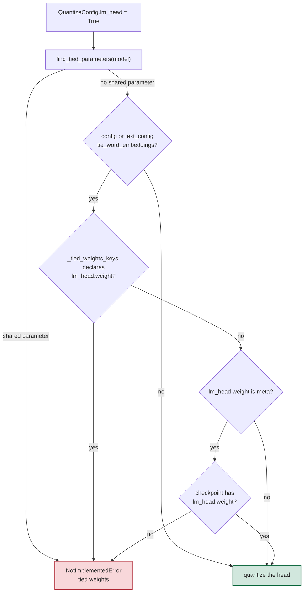
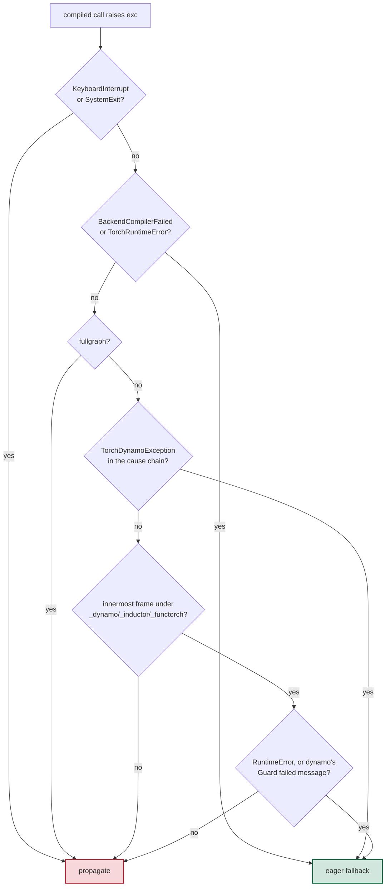
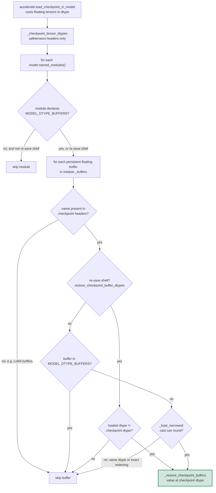
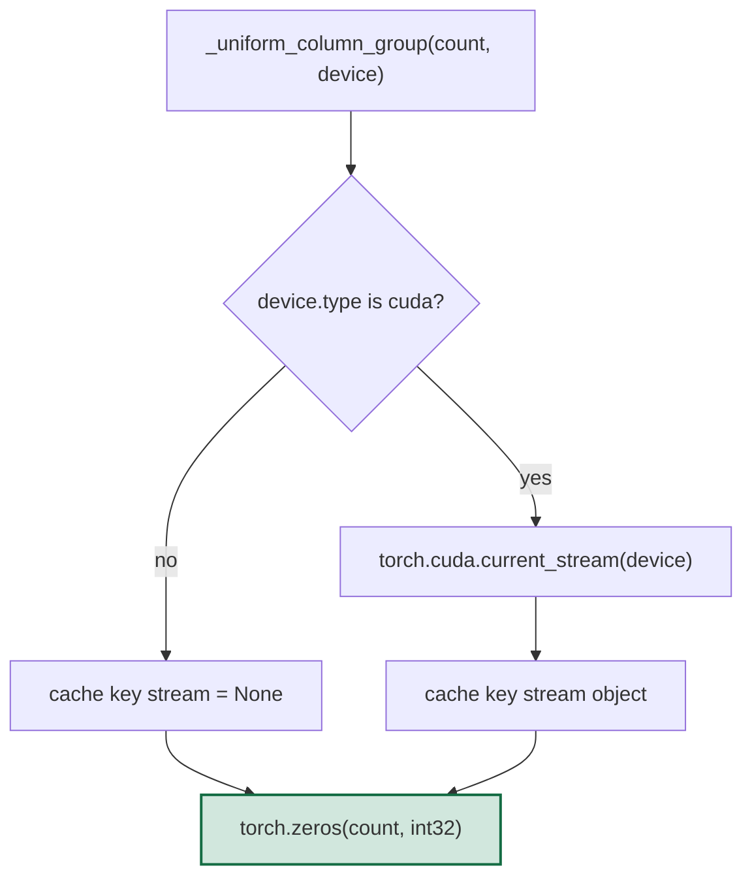
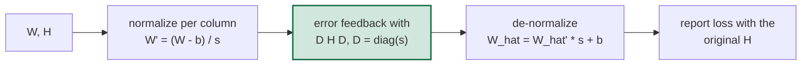

# Checkpoint metadata and runtime decision contracts

This page records the contracts that decide whether a checkpoint is portable,
whether a tied `lm_head` may be quantized, when a failed `torch.compile` call
may fall back to eager, how a quantized module's buffer dtypes survive loading, and
which stream owns a cached quantization scratch tensor.

These are the hardening items from the 7.11 review. The CPU int4pack dispatch
contracts are documented separately in
[CPU and offload kernel dispatch](kernel-dispatch-cpu.md).

## 1. Checkpoint metadata

A saved checkpoint describes tensors, not the machine that produced them.

| Mechanism | Before | After |
| --- | --- | --- |
| `offload_to_disk_path` in `meta` | published the quantizer's local `/tmp/gptqmodel_*` directory (`config.py:5396` before the change) | omitted; a loader chooses its own scratch directory |
| index `metadata.total_size` | summed on-disk safetensors file sizes, including headers and padding | sums `TensorSource.num_bytes` (`utils/model.py:4077`) |
| `max_shard_size` units | every `KB`/`MB`/`GB` suffix meant 1024^n | `KB`/`MB`/`GB` are decimal, `KiB`/`MiB`/`GiB` are binary, bare `K`/`M`/`G` keep the historical binary meaning (`models/writer.py:226`) |

`max_shard_size="4GB"` therefore means `4_000_000_000` bytes, matching
Transformers, while `"4GiB"` means `4 * 1024^3`. A legacy checkpoint that
still contains `meta.offload_to_disk_path` keeps loading; the field is only
dropped on the next save.

## 2. Tied `lm_head`

A checkpoint may redundantly store `lm_head.weight` even though the model ties
the head to the input embedding (Qwen3 does this). The stored tensor is not
evidence of an independent head: the loader ties the parameters after
materialization.

The config check walks `text_config` / `get_text_config()` so a composite model
whose root config leaves `tie_word_embeddings` unset is still detected. The
checkpoint-tensor fallback remains for configs that do not declare tying.

## 3. `torch.compile` eager fallback

A deferred compiler failure may retry eagerly, but only when the failure is
demonstrably compiler-owned. A compiler-package frame is not enough: user code
can raise from a module whose file lives under `torch/_dynamo`.

This keeps the #4094 guard-assertion fallback and inductor's closed-pool
`RuntimeError` while letting a `ValueError` or an unrelated `AssertionError`
raised from a compiler frame reach the caller.

## 4. Checkpoint buffer dtype

`accelerate.load_checkpoint_in_model(dtype=...)` casts every floating buffer to
the model dtype. A quantized module's buffers are quantization state, not
activation operands: rounding QQQ's FP16 `s_group` / FP32 `s_channel` to BF16
changes the effective int8 weights, and rounding any scale changes the
dequantized weight. `load_checkpoint_in_model_then_tie_weights`
(`gptqmodel/utils/model.py`) therefore restores, from the checkpoint, every
persistent floating buffer a quantized module owns, except the ones the module
declares as activation-side operands. Introduced for #4458; the re-save shell
path also covers #4379 and #4452.

### Declaration

A module opts in by declaring `MODEL_DTYPE_BUFFERS`. `BaseQuantLinear` declares
`("bias",)`, so every kernel participates by default and new quantization
buffers load exactly without further code.

| Module | `MODEL_DTYPE_BUFFERS` | Why |
| --- | --- | --- |
| `BaseQuantLinear` (default) | `("bias",)` | the bias is added at the activation dtype |
| `AwqTorchLinear` | `()` | the bias is added after an FP32 reduction |
| `ParoLinear` | `("bias",)` | restores the default its `AwqTorchLinear` base drops; forward adds an activation-dtype runtime bias |
| `MacaqLinear` | `("bias", "BH", "pre_scale")` | Hadamard block and pre-scale are built in `compute_dtype` and multiply activations |
| `ExllamaV3Linear`, `ExllamaV3TorchLinear` | `()` | `suh`/`svh` must stay FP16 for the Hadamard kernels |

Format-specific overrides stay where they were: the loader still forces FP8,
GGUF, VPTQ and AllSpark biases plus the FP8 `weight_scale_inv` to FP32
(`fp32_bf16_buffer_names`), checks packed FP8 weights byte-exactly
(`packed_fp8_buffer_dtypes`), and restores the BitsAndBytes 4-bit state.
Names already chosen by those paths are not re-decided.

### Flow

`_load_narrowed` treats a cast as lossless only when
`torch.promote_types(checkpoint, loaded) == loaded` (for example a BF16 tensor
placed in an FP32 `keep_in_fp32_modules` slot). Float8 types do not promote, so
any float8 cast is treated as lossy and restored.

Iterating the model's own buffers, rather than the checkpoint's keys, is what
makes checkpoint tensors without a module harmless. Legacy Llama-2 GPTQ
checkpoints carry a per-layer `self_attn.rotary_emb.inv_freq` that current
Transformers no longer owns; the earlier key-driven loop called
`model.get_submodule()` on it and crashed `save()` (#4452).

### Before and after

| Mechanism (before, at `4bc0413`) | After |
| --- | --- |
| restore `scales` of any `BaseQuantLinear` unconditionally (`utils/model.py:3269-3276`) | every non-declared persistent floating quant buffer the load narrowed |
| restore Torch AWQ `scales`/`bias` by `QUANT_TYPE == "awq_torch"` (`utils/model.py:3277-3280`) | `AwqTorchLinear.MODEL_DTYPE_BUFFERS = ()` |
| restore every differing buffer for EXL3 loads only (`models/loader.py:3365`) | `ExllamaV3*Linear.MODEL_DTYPE_BUFFERS = ()`; loader flag removed |
| re-save shell: loop over checkpoint keys, `model.get_submodule(key)` (`utils/model.py:3305-3326`) | loop over model buffers; orphan keys are skipped |

### Coverage

Persistent floating buffers per format and what a BF16 load did with them when
the checkpoint stores them at another dtype.
`tests/test_checkpoint_quant_buffer_dtypes_4458.py` saves each module, loads it
at BF16 and checks every buffer against the safetensors bytes.

| Format / module | Floating buffers | Before | After |
| --- | --- | --- | --- |
| GPTQ `TorchLinear` | `scales` | restored | restored |
| AWQ `AwqTorchLinear` | `scales`, `bias` | restored | restored |
| QQQ `QQQTorchLinear` | `s_group` FP16, `s_channel` FP32 | **rounded to BF16** | restored |
| FP8 `TorchFP8Linear` | `weight` float8, `weight_scale_inv` FP32 | restored by loader lists | unchanged |
| GGUF `GGUFTorchLinear` | none besides `bias` | n/a | n/a |
| EXL3 `ExllamaV3TorchLinear` | `suh`, `svh`, `bias` | restored (EXL3 flag) | restored (declaration) |
| Paro `ParoLinear` | `scales`, `theta`, `channel_scales` | `theta`/`channel_scales` **rounded** | restored |
| MACaQ `MacaqLinear` | `BH`, `pre_scale` | model dtype | model dtype (declared) |
| VPTQ `VPTQLinear` | `weight_scale`, `weight_bias` | **rounded** | restored |
| BitsAndBytes 8-bit | `weight_scb` FP32 | **rounded to BF16** | restored |
| BitsAndBytes 4-bit | absmax / quant maps | restored | restored |

Parameters are outside this contract. Machete and Swordfish keep their scales
as parameters and the forward converts them to the activation dtype. Marlin
does too; its `bias` is a buffer and declares
`MODEL_DTYPE_BUFFERS = ()` because the kernel adds it to its FP32 accumulator.
VPTQ codebooks are `nn.Embedding` parameters allocated in the model dtype.

### Measured

Llama-3.2-1B-Instruct, 4-bit g128, BF16, wikitext-2 PPL over 80 windows of
BOS + 511 tokens, RTX 4090. The same checkpoint is reloaded before and after
the change.

| Checkpoint (kernel) | In-session PPL | Reload before | Reload after |
| --- | --- | --- | --- |
| QQQ (`QQQTorchLinear`) | 35.0052 | 35.5230 (224/224 scale tensors differ from the file) | 35.0052 |
| GPTQ (`TorchLinear`) | 34.6350 | 34.6350 | 34.6350, logits bit-identical |
| AWQ (`AwqTorchLinear`) | 21.6461 | 21.6461 | 21.6461, logits bit-identical |
| GPTQ / AWQ (Marlin, AUTO) | n/a | 34.3546 / 21.6463 | identical, logits bit-identical |

Re-saving `TheBloke/Llama-2-7B-GPTQ` raised
`AttributeError: LlamaAttention has no attribute rotary_emb` before; it now
writes 963 tensors, and the re-saved checkpoint's logits are bit-identical to
the original's.

## 5. Stream-scoped quantization scratch

`_uniform_column_group` caches a zero group index. `torch.zeros` queues its
fill on the creating stream, so a tensor created by one worker must not be
reused by a worker on another stream.

The stream object is part of the cache key, which also keeps it alive while an
entry exists. Steady-state callers on one stream still hit the cache.

## 6. VPTQ per-channel normalization

With `enable_norm=True, norm_dim=0`, VPTQ divides each input channel by its own
scale: `W' = (W - b) / s`. The reconstruction error in the original space is
`e = D e'` with `D = diag(s)`, so error feedback must minimize
`e'^T (D H D) e'`.

Measured on a 16x32 Gaussian weight and a well-conditioned Hessian (seed 0,
`vector_lens=[-1, 4]`, 16 centroids, block size 8):

| Error-feedback Hessian | True Hessian-weighted loss |
| --- | --- |
| raw `H` (before) | 0.2602 |
| `D^-1 H D^-1` (wrong direction) | 0.3535 |
| `D H D` (this change) | 0.2200 |

The independent oracle in `tests/test_vptq.py` performs its own arithmetic and
matches the quantizer's codes exactly for the `norm` and `all` variants.

## Not in scope

Auto-detected module trees still require calibration data that exercises every
discovered branch. A text-only calibration of a multimodal model must pass an
explicit text-only `module_tree`; silently leaving a vision tower unquantized
would publish a partially quantized checkpoint.
